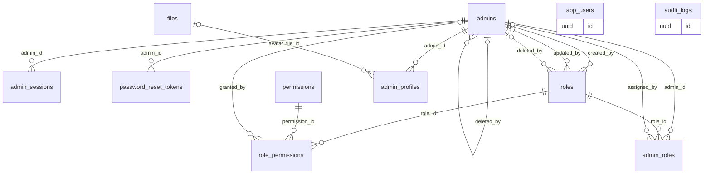
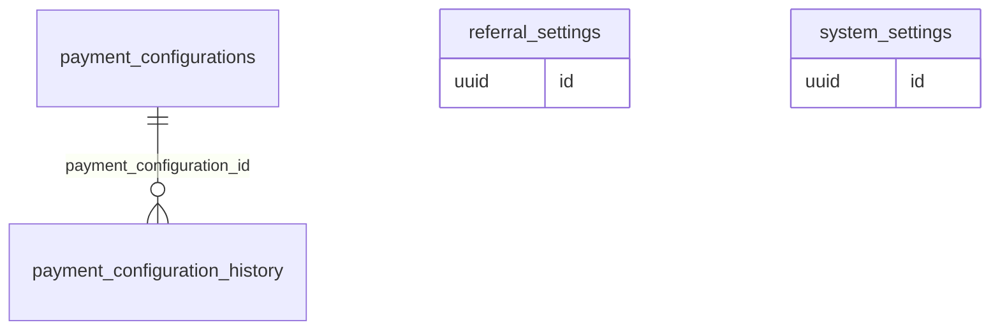
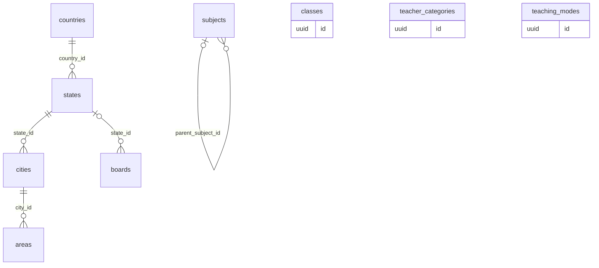
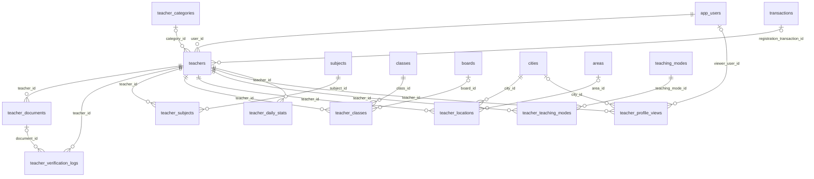
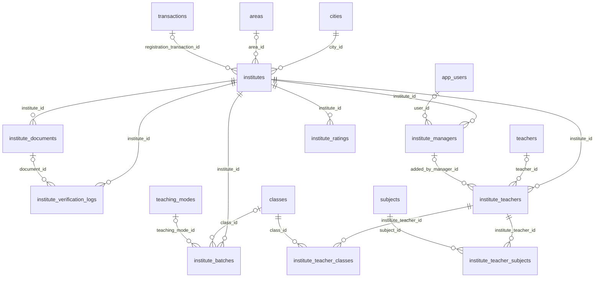
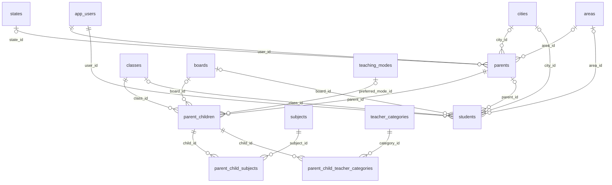
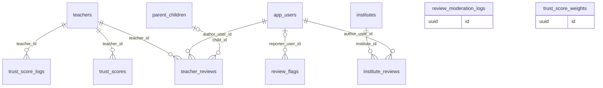
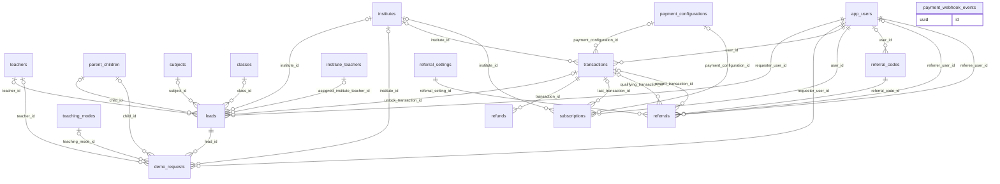
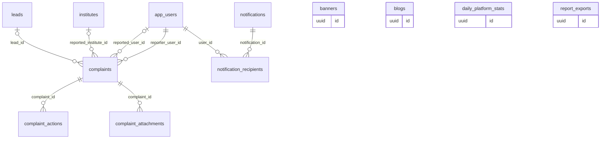

# 01 · Data Model

71 tables in PostgreSQL 16. Every entity table uses a `uuid` primary key (`gen_random_uuid()`); join tables use composite keys (e.g. `role_permissions (role_id, permission_id)`), one-to-one extensions use the parent id (`admin_profiles`, `trust_scores`) and daily rollups use the date (`daily_platform_stats`, `teacher_daily_stats`). All tables use `timestamptz` timestamps and snake_case names. Soft-deletable tables carry `deleted_at` / `deleted_by` with partial unique indexes `WHERE deleted_at IS NULL`. Full column definitions are in each module file (sections 9–10) and in `sql/schema.sql`.

## Relationship diagrams by domain

Each diagram shows the tables owned by that domain and the tables they reference. References to `admins` (created_by, decided_by, …) and `files` are left out of the diagrams to keep them readable; they are listed in the foreign-key table below.

### Foundation and access

Tables: `audit_logs`, `files`, `app_users`, `admins`, `admin_sessions`, `password_reset_tokens`, `roles`, `permissions`, `role_permissions`, `admin_roles`, `admin_profiles`

### Configuration

Tables: `system_settings`, `payment_configurations`, `payment_configuration_history`, `referral_settings`

### Locations and education masters

Tables: `countries`, `states`, `cities`, `areas`, `classes`, `subjects`, `boards`, `teaching_modes`, `teacher_categories`

### Teachers

Tables: `teachers`, `teacher_documents`, `teacher_verification_logs`, `teacher_subjects`, `teacher_classes`, `teacher_locations`, `teacher_teaching_modes`, `teacher_profile_views`, `teacher_daily_stats`

### Institutes

Tables: `institutes`, `institute_documents`, `institute_verification_logs`, `institute_batches`, `institute_managers`, `institute_teachers`, `institute_teacher_subjects`, `institute_teacher_classes`, `institute_ratings`

### Parents and students

Tables: `parents`, `parent_children`, `parent_child_subjects`, `parent_child_teacher_categories`, `students`

### Reviews and trust

Tables: `teacher_reviews`, `institute_reviews`, `review_flags`, `review_moderation_logs`, `trust_score_weights`, `trust_scores`, `trust_score_logs`

### Leads, payments and referrals

Tables: `leads`, `demo_requests`, `transactions`, `refunds`, `payment_webhook_events`, `subscriptions`, `referral_codes`, `referrals`

### Complaints, CMS and reporting

Tables: `complaints`, `complaint_actions`, `complaint_attachments`, `banners`, `blogs`, `notifications`, `notification_recipients`, `daily_platform_stats`, `report_exports`

## All tables

| Table | Module | Purpose | Columns |
| --- | --- | --- | --- |
| `audit_logs` | [M00](modules/M00-platform-foundation-audit-logs-files-app-users.md) | Append-only record of every admin action and security event. Never updated or deleted by the application. | 15 |
| `files` | [M00](modules/M00-platform-foundation-audit-logs-files-app-users.md) | Metadata for every uploaded object stored in S3 / Cloudflare R2. Binary content never touches PostgreSQL. | 16 |
| `app_users` | [M00](modules/M00-platform-foundation-audit-logs-files-app-users.md) | Login identity for every mobile app account (parent, student, teacher, institute staff). Role profiles hang off this table. | 15 |
| `admins` | [M01](modules/M01-authentication-system.md) | Admin web portal accounts. Every admin action is attributed to a row here. | 18 |
| `admin_sessions` | [M01](modules/M01-authentication-system.md) | One row per signed-in device. Holds the hashed refresh token used to mint new access tokens. | 13 |
| `password_reset_tokens` | [M01](modules/M01-authentication-system.md) | Single-use, 30-minute tokens for the forgot-password and invite flows. | 8 |
| `roles` | [M02](modules/M02-roles-permissions.md) | Named bundles of permissions. System roles are seeded and cannot be deleted. | 11 |
| `permissions` | [M02](modules/M02-roles-permissions.md) | Catalogue of permission keys. Seeded from code; admins cannot create permissions. | 6 |
| `role_permissions` | [M02](modules/M02-roles-permissions.md) | Which permissions each role grants. | 4 |
| `admin_roles` | [M02](modules/M02-roles-permissions.md) | Which roles each admin holds. An admin may hold several roles; effective permissions are the union. | 4 |
| `admin_profiles` | [M03](modules/M03-admin-profile-management.md) | Personal details for an admin, one-to-one with admins. | 10 |
| `system_settings` | [M04](modules/M04-global-settings.md) | Typed key–value settings that change platform behaviour without a deploy. | 12 |
| `payment_configurations` | [M05](modules/M05-dynamic-payment-configuration.md) | One row per version of each fee. The app charges whichever version is active at payment time. | 23 |
| `payment_configuration_history` | [M05](modules/M05-dynamic-payment-configuration.md) | Immutable change log for payment configurations (create, edit, publish, cancel, activate, supersede). | 9 |
| `referral_settings` | [M06](modules/M06-referral-configuration.md) | Versioned rules for each referral program. One active version per program. | 23 |
| `countries` | [M07](modules/M07-country-management.md) | Countries the platform can operate in. India is seeded; others stay inactive until launch. | 14 |
| `states` | [M08](modules/M08-state-management.md) | States and union territories within a country. | 13 |
| `cities` | [M09](modules/M09-city-management.md) | Cities where teachers and institutes can be listed. | 16 |
| `areas` | [M10](modules/M10-area-management.md) | Localities within a city, used for "nearby" search and teacher coverage. | 15 |
| `classes` | [M11](modules/M11-class-management.md) | Grades and levels learners study at, from Class 1 to competitive exam preparation. | 12 |
| `subjects` | [M12](modules/M12-subject-management.md) | Subjects, exams and skills teachers can teach. | 18 |
| `boards` | [M13](modules/M13-board-management.md) | Education boards and curricula, e.g. CBSE, ICSE, state boards, IB. | 13 |
| `teaching_modes` | [M14](modules/M14-teaching-mode-management.md) | How classes are delivered, e.g. Online, Offline at teacher's place, Home tuition, Hybrid. | 13 |
| `teacher_categories` | [M15](modules/M15-teacher-category-management.md) | Types of teacher shown as categories and used in parent preferences, e.g. Home Tutor, Coaching Faculty. | 13 |
| `teachers` | [M16](modules/M16-teacher-registration-queue.md) | Teacher profile and verification state. One row per teacher app account. | 44 |
| `teacher_documents` | [M16](modules/M16-teacher-registration-queue.md) | Every uploaded verification document version. Only one current version per teacher and type. | 15 |
| `teacher_verification_logs` | [M16](modules/M16-teacher-registration-queue.md) | Timeline of every verification event for a teacher, shown in the review screen. | 11 |
| `teacher_subjects` | [M18](modules/M18-teacher-subject-mapping.md) | Subjects a teacher teaches. | 7 |
| `teacher_classes` | [M19](modules/M19-teacher-class-mapping.md) | Classes (and optionally boards) a teacher covers. | 6 |
| `teacher_locations` | [M20](modules/M20-teacher-location-mapping.md) | Cities and areas a teacher serves, with travel radius for home tuition. | 11 |
| `teacher_teaching_modes` | [M20](modules/M20-teacher-location-mapping.md) | Teaching modes a teacher offers (Online, Home tuition, …). | 3 |
| `teacher_profile_views` | [M21](modules/M21-teacher-analytics.md) | Raw profile-view events from the app. High volume; partition by month when it exceeds ~50M rows. | 6 |
| `teacher_daily_stats` | [M21](modules/M21-teacher-analytics.md) | Daily roll-up per teacher, written by a nightly job. All analytics screens read from here. | 10 |
| `institutes` | [M22](modules/M22-institute-registration-queue.md) | Coaching centres, tuition centres, schools and academies. Rated by GuruConnect after verification. | 49 |
| `institute_documents` | [M22](modules/M22-institute-registration-queue.md) | Institute verification documents and campus photos, versioned like teacher documents. | 14 |
| `institute_verification_logs` | [M23](modules/M23-institute-verification.md) | Timeline of institute verification events. | 11 |
| `institute_batches` | [M24](modules/M24-institute-profile-management.md) | Courses and batches an institute runs, shown on its public profile. | 16 |
| `institute_managers` | [M25](modules/M25-institute-manager-accounts.md) | App accounts that act for an institute. Exactly one active primary manager; counsellors can only handle leads. | 17 |
| `institute_teachers` | [M26](modules/M26-institute-teacher-management.md) | Teachers listed under an institute. Added, edited and removed only by an institute manager (or an admin). | 17 |
| `institute_teacher_subjects` | [M26](modules/M26-institute-teacher-management.md) | Subjects assigned to an institute teacher. | 2 |
| `institute_teacher_classes` | [M26](modules/M26-institute-teacher-management.md) | Classes assigned to an institute teacher. | 2 |
| `institute_ratings` | [M27](modules/M27-institute-rating-system.md) | Evaluations by GuruConnect admins. The latest submitted version is current and drives the public rating. | 22 |
| `parents` | [M28](modules/M28-parent-management.md) | Parent profile, one per parent app account. | 18 |
| `parent_children` | [M29](modules/M29-parent-children-management.md) | Children a parent is finding teachers for. Drives per-child recommendations. | 11 |
| `parent_child_subjects` | [M29](modules/M29-parent-children-management.md) | Subjects needed for a child. | 2 |
| `parent_child_teacher_categories` | [M29](modules/M29-parent-children-management.md) | Types of teacher the parent wants for a child (Home Tutor, Competitive Exam Faculty, …). | 2 |
| `students` | [M31](modules/M31-student-management.md) | Student profile, one per student app account. | 26 |
| `teacher_reviews` | [M33](modules/M33-teacher-reviews.md) | Reviews of teachers by parents and students. Only published reviews count toward ratings and trust. | 22 |
| `institute_reviews` | [M34](modules/M34-institute-reviews.md) | Reviews of institutes by parents and students. | 22 |
| `review_flags` | [M35](modules/M35-review-moderation.md) | Reports raised against a review by users or teachers. | 10 |
| `review_moderation_logs` | [M35](modules/M35-review-moderation.md) | Every moderation decision on reviews and replies. | 11 |
| `trust_score_weights` | [M36](modules/M36-teacher-trust-score.md) | Versioned factor weights. Exactly one active version; weights must add up to 100. | 8 |
| `trust_scores` | [M36](modules/M36-teacher-trust-score.md) | Current trust score per teacher with its factor breakdown. | 19 |
| `trust_score_logs` | [M37](modules/M37-trust-score-history.md) | Every change to a teacher's trust score and what caused it. | 11 |
| `leads` | [M38](modules/M38-lead-management.md) | Enquiries and call-back requests from parents/students to a teacher or institute. | 25 |
| `demo_requests` | [M39](modules/M39-demo-class-requests.md) | Free demo class bookings and their outcome. | 19 |
| `transactions` | [M40](modules/M40-transactions.md) | Every payment attempt through Razorpay, plus refunds and reward payouts. Amounts in paise. | 27 |
| `refunds` | [M40](modules/M40-transactions.md) | Refund requests and their gateway processing. | 15 |
| `payment_webhook_events` | [M40](modules/M40-transactions.md) | Raw Razorpay webhooks, stored before processing so every event is processed exactly once. | 10 |
| `subscriptions` | [M41](modules/M41-subscription-payments.md) | Paid access periods for parents, students, teachers and institutes, including trials. | 21 |
| `referral_codes` | [M42](modules/M42-referral-management.md) | One personal referral code per app user. | 10 |
| `referrals` | [M42](modules/M42-referral-management.md) | One row per referred user, tracking qualification, fraud checks and reward payout. | 19 |
| `complaints` | [M43](modules/M43-complaint-management.md) | Two-way safety reports: learners about teachers/institutes, teachers about parents/students. | 21 |
| `complaint_actions` | [M43](modules/M43-complaint-management.md) | Case timeline: assignments, notes, warnings, suspensions, escalations. | 8 |
| `complaint_attachments` | [M43](modules/M43-complaint-management.md) | Evidence files attached to a complaint. | 5 |
| `banners` | [M44](modules/M44-banner-management.md) | Promotional banners in the mobile app. | 20 |
| `blogs` | [M45](modules/M45-blog-management.md) | Articles and guides shown in the app and on the website. | 24 |
| `notifications` | [M46](modules/M46-notification-management.md) | Push / in-app notification campaigns created by admins (transactional pushes are sent by services and not stored here). | 21 |
| `notification_recipients` | [M46](modules/M46-notification-management.md) | Per-user delivery record for a campaign. Partition by month at scale. | 6 |
| `daily_platform_stats` | [M47](modules/M47-dashboard-analytics.md) | One row per day with platform totals, written by the nightly analytics job and refreshed hourly for today. | 21 |
| `report_exports` | [M48](modules/M48-revenue-reports.md) | Asynchronous CSV/XLSX exports for all report modules. Files expire after 7 days. | 13 |

## All foreign keys

| Table | Column | References | Required |
| --- | --- | --- | --- |
| `admin_profiles` | `admin_id` | `admins` | yes |
| `admin_profiles` | `avatar_file_id` | `files` | no |
| `admin_roles` | `admin_id` | `admins` | yes |
| `admin_roles` | `assigned_by` | `admins` | no |
| `admin_roles` | `role_id` | `roles` | yes |
| `admin_sessions` | `admin_id` | `admins` | yes |
| `admins` | `created_by` | `admins` | no |
| `admins` | `deleted_by` | `admins` | no |
| `admins` | `updated_by` | `admins` | no |
| `areas` | `city_id` | `cities` | yes |
| `areas` | `created_by` | `admins` | no |
| `areas` | `deleted_by` | `admins` | no |
| `areas` | `updated_by` | `admins` | no |
| `banners` | `created_by` | `admins` | no |
| `banners` | `deleted_by` | `admins` | no |
| `banners` | `image_file_id` | `files` | yes |
| `banners` | `updated_by` | `admins` | no |
| `blogs` | `author_admin_id` | `admins` | no |
| `blogs` | `cover_file_id` | `files` | no |
| `blogs` | `created_by` | `admins` | no |
| `blogs` | `deleted_by` | `admins` | no |
| `blogs` | `updated_by` | `admins` | no |
| `boards` | `created_by` | `admins` | no |
| `boards` | `deleted_by` | `admins` | no |
| `boards` | `state_id` | `states` | no |
| `boards` | `updated_by` | `admins` | no |
| `cities` | `created_by` | `admins` | no |
| `cities` | `deleted_by` | `admins` | no |
| `cities` | `state_id` | `states` | yes |
| `cities` | `updated_by` | `admins` | no |
| `classes` | `created_by` | `admins` | no |
| `classes` | `deleted_by` | `admins` | no |
| `classes` | `updated_by` | `admins` | no |
| `complaint_actions` | `admin_id` | `admins` | no |
| `complaint_actions` | `complaint_id` | `complaints` | yes |
| `complaint_attachments` | `complaint_id` | `complaints` | yes |
| `complaint_attachments` | `file_id` | `files` | yes |
| `complaints` | `assigned_admin_id` | `admins` | no |
| `complaints` | `lead_id` | `leads` | no |
| `complaints` | `reported_institute_id` | `institutes` | no |
| `complaints` | `reported_user_id` | `app_users` | no |
| `complaints` | `reporter_user_id` | `app_users` | yes |
| `countries` | `created_by` | `admins` | no |
| `countries` | `deleted_by` | `admins` | no |
| `countries` | `updated_by` | `admins` | no |
| `demo_requests` | `child_id` | `parent_children` | no |
| `demo_requests` | `institute_id` | `institutes` | no |
| `demo_requests` | `lead_id` | `leads` | yes |
| `demo_requests` | `requester_user_id` | `app_users` | yes |
| `demo_requests` | `teacher_id` | `teachers` | no |
| `demo_requests` | `teaching_mode_id` | `teaching_modes` | no |
| `institute_batches` | `class_id` | `classes` | no |
| `institute_batches` | `institute_id` | `institutes` | yes |
| `institute_batches` | `teaching_mode_id` | `teaching_modes` | no |
| `institute_documents` | `file_id` | `files` | yes |
| `institute_documents` | `institute_id` | `institutes` | yes |
| `institute_documents` | `reviewed_by` | `admins` | no |
| `institute_managers` | `created_by` | `admins` | no |
| `institute_managers` | `institute_id` | `institutes` | yes |
| `institute_managers` | `user_id` | `app_users` | no |
| `institute_ratings` | `institute_id` | `institutes` | yes |
| `institute_ratings` | `rated_by` | `admins` | yes |
| `institute_reviews` | `author_user_id` | `app_users` | yes |
| `institute_reviews` | `institute_id` | `institutes` | yes |
| `institute_reviews` | `moderated_by` | `admins` | no |
| `institute_teacher_classes` | `class_id` | `classes` | yes |
| `institute_teacher_classes` | `institute_teacher_id` | `institute_teachers` | yes |
| `institute_teacher_subjects` | `institute_teacher_id` | `institute_teachers` | yes |
| `institute_teacher_subjects` | `subject_id` | `subjects` | yes |
| `institute_teachers` | `added_by_admin_id` | `admins` | no |
| `institute_teachers` | `added_by_manager_id` | `institute_managers` | no |
| `institute_teachers` | `institute_id` | `institutes` | yes |
| `institute_teachers` | `photo_file_id` | `files` | no |
| `institute_teachers` | `teacher_id` | `teachers` | no |
| `institute_verification_logs` | `admin_id` | `admins` | no |
| `institute_verification_logs` | `document_id` | `institute_documents` | no |
| `institute_verification_logs` | `institute_id` | `institutes` | yes |
| `institutes` | `approved_by` | `admins` | no |
| `institutes` | `area_id` | `areas` | no |
| `institutes` | `city_id` | `cities` | yes |
| `institutes` | `cover_file_id` | `files` | no |
| `institutes` | `created_by` | `admins` | no |
| `institutes` | `deleted_by` | `admins` | no |
| `institutes` | `logo_file_id` | `files` | no |
| `institutes` | `registration_transaction_id` | `transactions` | no |
| `institutes` | `updated_by` | `admins` | no |
| `leads` | `assigned_institute_teacher_id` | `institute_teachers` | no |
| `leads` | `child_id` | `parent_children` | no |
| `leads` | `class_id` | `classes` | no |
| `leads` | `institute_id` | `institutes` | no |
| `leads` | `requester_user_id` | `app_users` | yes |
| `leads` | `subject_id` | `subjects` | no |
| `leads` | `teacher_id` | `teachers` | no |
| `leads` | `unlock_transaction_id` | `transactions` | no |
| `notification_recipients` | `notification_id` | `notifications` | yes |
| `notification_recipients` | `user_id` | `app_users` | yes |
| `notifications` | `approved_by` | `admins` | no |
| `notifications` | `created_by` | `admins` | no |
| `notifications` | `image_file_id` | `files` | no |
| `parent_child_subjects` | `child_id` | `parent_children` | yes |
| `parent_child_subjects` | `subject_id` | `subjects` | yes |
| `parent_child_teacher_categories` | `category_id` | `teacher_categories` | yes |
| `parent_child_teacher_categories` | `child_id` | `parent_children` | yes |
| `parent_children` | `board_id` | `boards` | no |
| `parent_children` | `class_id` | `classes` | yes |
| `parent_children` | `parent_id` | `parents` | yes |
| `parent_children` | `preferred_mode_id` | `teaching_modes` | no |
| `parents` | `area_id` | `areas` | no |
| `parents` | `city_id` | `cities` | no |
| `parents` | `deleted_by` | `admins` | no |
| `parents` | `state_id` | `states` | no |
| `parents` | `suspended_by` | `admins` | no |
| `parents` | `user_id` | `app_users` | yes |
| `password_reset_tokens` | `admin_id` | `admins` | yes |
| `payment_configuration_history` | `changed_by` | `admins` | no |
| `payment_configuration_history` | `payment_configuration_id` | `payment_configurations` | yes |
| `payment_configurations` | `created_by` | `admins` | no |
| `payment_configurations` | `published_by` | `admins` | no |
| `payment_configurations` | `updated_by` | `admins` | no |
| `referral_codes` | `created_by` | `admins` | no |
| `referral_codes` | `user_id` | `app_users` | no |
| `referral_settings` | `created_by` | `admins` | no |
| `referral_settings` | `updated_by` | `admins` | no |
| `referrals` | `qualifying_transaction_id` | `transactions` | no |
| `referrals` | `referee_user_id` | `app_users` | yes |
| `referrals` | `referral_code_id` | `referral_codes` | yes |
| `referrals` | `referral_setting_id` | `referral_settings` | yes |
| `referrals` | `referrer_user_id` | `app_users` | no |
| `referrals` | `reviewed_by` | `admins` | no |
| `referrals` | `reward_transaction_id` | `transactions` | no |
| `refunds` | `decided_by` | `admins` | no |
| `refunds` | `transaction_id` | `transactions` | yes |
| `report_exports` | `file_id` | `files` | no |
| `report_exports` | `requested_by` | `admins` | yes |
| `review_flags` | `reporter_user_id` | `app_users` | no |
| `review_flags` | `resolved_by` | `admins` | no |
| `review_moderation_logs` | `admin_id` | `admins` | no |
| `role_permissions` | `granted_by` | `admins` | no |
| `role_permissions` | `permission_id` | `permissions` | yes |
| `role_permissions` | `role_id` | `roles` | yes |
| `roles` | `created_by` | `admins` | no |
| `roles` | `deleted_by` | `admins` | no |
| `roles` | `updated_by` | `admins` | no |
| `states` | `country_id` | `countries` | yes |
| `states` | `created_by` | `admins` | no |
| `states` | `deleted_by` | `admins` | no |
| `states` | `updated_by` | `admins` | no |
| `students` | `area_id` | `areas` | no |
| `students` | `board_id` | `boards` | no |
| `students` | `city_id` | `cities` | no |
| `students` | `class_id` | `classes` | no |
| `students` | `deleted_by` | `admins` | no |
| `students` | `parent_id` | `parents` | no |
| `students` | `suspended_by` | `admins` | no |
| `students` | `user_id` | `app_users` | yes |
| `subjects` | `created_by` | `admins` | no |
| `subjects` | `deleted_by` | `admins` | no |
| `subjects` | `icon_file_id` | `files` | no |
| `subjects` | `parent_subject_id` | `subjects` | no |
| `subjects` | `updated_by` | `admins` | no |
| `subscriptions` | `granted_by` | `admins` | no |
| `subscriptions` | `institute_id` | `institutes` | no |
| `subscriptions` | `last_transaction_id` | `transactions` | no |
| `subscriptions` | `payment_configuration_id` | `payment_configurations` | no |
| `subscriptions` | `user_id` | `app_users` | yes |
| `system_settings` | `updated_by` | `admins` | no |
| `teacher_categories` | `created_by` | `admins` | no |
| `teacher_categories` | `deleted_by` | `admins` | no |
| `teacher_categories` | `icon_file_id` | `files` | no |
| `teacher_categories` | `updated_by` | `admins` | no |
| `teacher_classes` | `board_id` | `boards` | no |
| `teacher_classes` | `class_id` | `classes` | yes |
| `teacher_classes` | `created_by` | `admins` | no |
| `teacher_classes` | `teacher_id` | `teachers` | yes |
| `teacher_daily_stats` | `teacher_id` | `teachers` | yes |
| `teacher_documents` | `file_id` | `files` | yes |
| `teacher_documents` | `reviewed_by` | `admins` | no |
| `teacher_documents` | `teacher_id` | `teachers` | yes |
| `teacher_locations` | `area_id` | `areas` | no |
| `teacher_locations` | `city_id` | `cities` | yes |
| `teacher_locations` | `created_by` | `admins` | no |
| `teacher_locations` | `teacher_id` | `teachers` | yes |
| `teacher_profile_views` | `city_id` | `cities` | no |
| `teacher_profile_views` | `teacher_id` | `teachers` | yes |
| `teacher_profile_views` | `viewer_user_id` | `app_users` | no |
| `teacher_reviews` | `author_user_id` | `app_users` | yes |
| `teacher_reviews` | `child_id` | `parent_children` | no |
| `teacher_reviews` | `moderated_by` | `admins` | no |
| `teacher_reviews` | `teacher_id` | `teachers` | yes |
| `teacher_subjects` | `created_by` | `admins` | no |
| `teacher_subjects` | `subject_id` | `subjects` | yes |
| `teacher_subjects` | `teacher_id` | `teachers` | yes |
| `teacher_teaching_modes` | `teacher_id` | `teachers` | yes |
| `teacher_teaching_modes` | `teaching_mode_id` | `teaching_modes` | yes |
| `teacher_verification_logs` | `admin_id` | `admins` | no |
| `teacher_verification_logs` | `document_id` | `teacher_documents` | no |
| `teacher_verification_logs` | `teacher_id` | `teachers` | yes |
| `teachers` | `badge_granted_by` | `admins` | no |
| `teachers` | `category_id` | `teacher_categories` | no |
| `teachers` | `created_by` | `admins` | no |
| `teachers` | `deleted_by` | `admins` | no |
| `teachers` | `profile_photo_file_id` | `files` | no |
| `teachers` | `registration_transaction_id` | `transactions` | no |
| `teachers` | `reviewed_by` | `admins` | no |
| `teachers` | `updated_by` | `admins` | no |
| `teachers` | `user_id` | `app_users` | yes |
| `teaching_modes` | `created_by` | `admins` | no |
| `teaching_modes` | `deleted_by` | `admins` | no |
| `teaching_modes` | `updated_by` | `admins` | no |
| `transactions` | `institute_id` | `institutes` | no |
| `transactions` | `payment_configuration_id` | `payment_configurations` | no |
| `transactions` | `user_id` | `app_users` | yes |
| `trust_score_logs` | `admin_id` | `admins` | no |
| `trust_score_logs` | `teacher_id` | `teachers` | yes |
| `trust_score_weights` | `created_by` | `admins` | no |
| `trust_scores` | `overridden_by` | `admins` | no |
| `trust_scores` | `teacher_id` | `teachers` | yes |

## Conventions recap

- **Money:** `bigint` paise, never `numeric` floats in JS. **Ratings:** `numeric(2,1)` / `numeric(3,2)`; **scores:** `numeric(5,2)`.
- **Enums:** `text` + `CHECK (… IN (…))` rather than PostgreSQL enum types, so values can be added in a migration without `ALTER TYPE` locks.
- **Versioned config** (payment configurations, referral settings, trust weights, institute ratings): rows are never edited after activation; a partial unique index guarantees one active and one draft per key.
- **Append-only logs** (`audit_logs`, `*_logs`, `*_history`, `complaint_actions`): no `updated_at`, never updated or deleted by the app; revoke `UPDATE, DELETE` from the app role on them.
- **`updated_at`** is maintained by the `set_updated_at()` trigger and doubles as the optimistic-locking version sent in `If-Match`.
