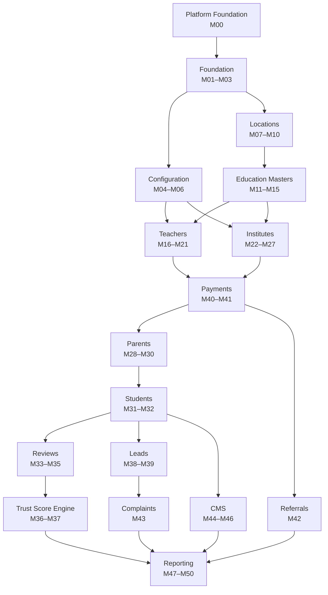

# GuruConnect Admin Web Portal — Software Requirements Specification

Implementation-ready SRS for the GuruConnect admin portal, split into **51 modules** (M0 platform foundation + the 50 requested modules) in the order they should be built. Stack: **React 18 + Vite + TypeScript**, **Node.js 20 + Express 4 + TypeScript**, **PostgreSQL 16**.

| | |
| --- | --- |
| Modules | 51 |
| PostgreSQL tables | 71 |
| Columns (each documented) | 1024 |
| Admin API endpoints | 436 |
| Permission keys | 86 across 5 system roles |
| Estimated build effort | 132–145 developer-days (one full-stack developer, backend + admin UI + tests) |

**Stack in full:** Node.js 20 LTS + Express 4 + TypeScript (strict) on the API, `pg` + Kysely for typed queries, Zod for validation (schemas shared with the frontend), Redis 7 + BullMQ for cache/jobs, PostgreSQL 16 (`pgcrypto`, `citext`, `pg_trgm`); React 18 + Vite + TypeScript on the admin web, React Router 6, TanStack Query 5, React Hook Form + Zod, TanStack Table 8, Tailwind CSS; Vitest/Supertest for tests on both sides. Full detail in `00-conventions.md`.

## Current build status

<!-- build-status:start (generated by scripts/syncRoadmap.mjs from ROADMAP-STATUS.md; edit that file, not this block) -->
**Progress: 11 of 51 admin modules are complete** (25 of 106 counting the mobile app, about 24%). The per-module tracker, with the API and the screens ticked separately for the admin portal and the mobile app, is in [ROADMAP-STATUS.md](ROADMAP-STATUS.md). The *Status* column of the table below is kept in step with it.

✅ done (API and screens, tests passing) · 🟡 partly done · ➖ not started

| | Complete | API only | Partly done | Not started |
| --- | --- | --- | --- | --- |
| **Admin web** (51) | **11** | 2 | 0 | 38 |
| **Mobile app** (55) | **14** | 6 | 4 | 31 |

- **Admin modules complete:** M01, M02, M07, M08, M09, M10, M11, M12, M13, M14, M15
- **Admin modules with an API but no screens yet:** M00, M16
<!-- build-status:end -->

What is running today, beyond the specs:

- **`GuruBackend/`** — Express + TypeScript API. Admin API at `/api/v1/admin`: Authentication, Roles & Permissions, the Teacher Registration Queue and all the location and education masters (countries, states, cities, areas, classes, subjects, boards, teaching modes, teacher categories). Mobile-app API at `/api/v1/app`. Tests run against a real database. `CLAUDE.md` lists exactly what is real and what is simplified for this dev environment (bcrypt instead of Argon2id, no SMS gateway, a fake payment gateway, local-disk file storage).
- **`GureFronend/`** — Vite + React + TypeScript admin web: sign-in and password flows, Roles and Admins screens, and one config-driven list/form/import/merge page that every master module reuses. Vitest + Testing Library tests.
- **Database** — two local PostgreSQL databases are provisioned and loaded with `sql/schema.sql` + all `sql/seed/*.sql`, plus the extension migration `sql/migrations/049_admin_mobile_otp.sql` (`admin_otp_codes`): `guruconnect` (development) and `guruconnect_test` (automated tests). See `GuruBackend/.env.example` for the connection shape.
- **Demo admin** — seeded into both databases via `npm run seed:admin` (`GuruBackend/`): sign in at `/login` with email `sameer@gmail.com` / password `demo@123`, or the "Mobile OTP" tab with `+919999999999`.

To tick a module off: change its row in `ROADMAP-STATUS.md`, then run `node scripts/syncRoadmap.mjs`. See `CLAUDE.md` for architecture notes and the mandatory testing rule before starting a module.

## What's in this pack

```
guruconnect-admin-srs/
  index.html                  Searchable viewer for everything below (open in any browser)
  README.md                   This file: build order, dependencies, how to run the SQL and the apps
  CLAUDE.md                   Guidance for Claude Code working in this repo: commands, architecture, testing rule
  00-conventions.md           Read first: stack, repo layout, API envelope, errors, pagination, RBAC, audit, security
  01-data-model.md            All tables, relationships diagrams by domain, full foreign-key list
  02-api-index.md             Every endpoint with its permission, grouped by module
  03-rbac-matrix.md           Permission keys × default roles
  04-react-app-structure.md   Route map, sidebar, folder layout, shared components
  05-roadmap-and-enhancements.md  Delivery plan by phase and future enhancements per module
  modules/MNN-*.md            One file per module, 22 sections each
  sql/schema.sql              Whole schema in one file (all migrations in order)
  sql/migrations/NNN_*.sql    One migration per module that owns tables
  sql/seed/001_rbac.sql       Roles, permissions, default role matrix
  sql/seed/002_reference_data.sql  India, states, cities, areas, classes, subjects, boards, modes, categories
  sql/seed/003_config.sql     Global settings, launch pricing (placeholders), referral rules, trust weights
  GuruBackend/                Node.js + Express + TypeScript API (scaffolded; implemented module by module)
  GureFronend/                React + Vite + TypeScript admin web (scaffolded; implemented module by module)
```

## How each module file is organised

1 Overview · 2 Business purpose · 3 User stories · 4 Functional requirements & business logic · 5 Validation rules · 6 API endpoints · 7 Request payloads · 8 Response payloads · 9 PostgreSQL tables · 10 Column definitions · 11 Relationships (with ER diagram) · 12 Indexing strategy · 13 Permissions · 14 UI screens & React page structure · 15 UI components · 16 Filters · 17 Search · 18 Pagination · 19 Audit logs · 20 Error scenarios · 21 Future scalability & enhancements · 22 Security considerations.

Sections 9–10 and the ER diagram are generated from the SQL, so the docs and the database cannot drift apart.

## Implementation order

Build top to bottom. A module can start once everything in *Depends on* is merged. Modules marked with the same phase can be built in parallel by different developers.

| # | Module | Status | Phase | Depends on | Owns tables | Endpoints | Estimate |
| --- | --- | --- | --- | --- | --- | --- | --- |
| [M00](modules/M00-platform-foundation-audit-logs-files-app-users.md) | Platform Foundation (Audit Logs, Files, App Users) | 🟡 | Platform Foundation | — | `audit_logs`, `files`, `app_users` | 10 | 3–4 days |
| [M01](modules/M01-authentication-system.md) | Authentication System | ✅ | Foundation | M00 | `admins`, `admin_sessions`, `password_reset_tokens` | 11 | 4–5 days |
| [M02](modules/M02-roles-permissions.md) | Roles & Permissions | ✅ | Foundation | M00, M01 | `roles`, `permissions`, `role_permissions`, `admin_roles` | 16 | 4 days |
| [M03](modules/M03-admin-profile-management.md) | Admin Profile Management | ➖ | Foundation | M00, M01 | `admin_profiles` | 5 | 1–2 days |
| [M04](modules/M04-global-settings.md) | Global Settings | ➖ | Configuration | M00, M01, M02 | `system_settings` | 4 | 2 days |
| [M05](modules/M05-dynamic-payment-configuration.md) | Dynamic Payment Configuration | ➖ | Configuration | M00, M01, M02 | `payment_configurations`, `payment_configuration_history` | 11 | 5 days |
| [M06](modules/M06-referral-configuration.md) | Referral Configuration | ➖ | Configuration | M00, M01, M02, M05 | `referral_settings` | 7 | 2–3 days |
| [M07](modules/M07-country-management.md) | Country Management | ✅ | Locations | M00, M01, M02 | `countries` | 8 | 1 day |
| [M08](modules/M08-state-management.md) | State Management | ✅ | Locations | M07 | `states` | 9 | 1 day |
| [M09](modules/M09-city-management.md) | City Management | ✅ | Locations | M08 | `cities` | 9 | 1–2 days |
| [M10](modules/M10-area-management.md) | Area Management | ✅ | Locations | M09 | `areas` | 11 | 1–2 days |
| [M11](modules/M11-class-management.md) | Class Management | ✅ | Education Masters | M00, M01, M02 | `classes` | 9 | 1 day |
| [M12](modules/M12-subject-management.md) | Subject Management | ✅ | Education Masters | M00, M01, M02, M11 | `subjects` | 9 | 2 days |
| [M13](modules/M13-board-management.md) | Board Management | ✅ | Education Masters | M08, M11 | `boards` | 8 | 1 day |
| [M14](modules/M14-teaching-mode-management.md) | Teaching Mode Management | ✅ | Education Masters | M00, M01, M02 | `teaching_modes` | 8 | 0.5–1 day |
| [M15](modules/M15-teacher-category-management.md) | Teacher Category Management | ✅ | Education Masters | M00, M01, M02 | `teacher_categories` | 9 | 1 day |
| [M16](modules/M16-teacher-registration-queue.md) | Teacher Registration Queue | 🟡 | Teachers | M00, M01, M02, M05 | `teachers`, `teacher_documents`, `teacher_verification_logs` | 14 | 6–7 days |
| [M17](modules/M17-teacher-profile-management.md) | Teacher Profile Management | ➖ | Teachers | M16 | — (reads other modules) | 10 | 4 days |
| [M18](modules/M18-teacher-subject-mapping.md) | Teacher Subject Mapping | ➖ | Teachers | M12, M16 | `teacher_subjects` | 2 | 1 day |
| [M19](modules/M19-teacher-class-mapping.md) | Teacher Class Mapping | ➖ | Teachers | M11, M13, M16 | `teacher_classes` | 2 | 1 day |
| [M20](modules/M20-teacher-location-mapping.md) | Teacher Location Mapping | ➖ | Teachers | M09, M10, M14, M16 | `teacher_locations`, `teacher_teaching_modes` | 3 | 2 days |
| [M21](modules/M21-teacher-analytics.md) | Teacher Analytics | ➖ | Teachers | M16, M17 | `teacher_profile_views`, `teacher_daily_stats` | 4 | 3 days |
| [M22](modules/M22-institute-registration-queue.md) | Institute Registration Queue | ➖ | Institutes | M00, M01, M02, M05, M09, M10 | `institutes`, `institute_documents` | 9 | 4 days |
| [M23](modules/M23-institute-verification.md) | Institute Verification | ➖ | Institutes | M22, M25, M27 | `institute_verification_logs` | 7 | 3 days |
| [M24](modules/M24-institute-profile-management.md) | Institute Profile Management | ➖ | Institutes | M22, M23 | `institute_batches` | 12 | 3 days |
| [M25](modules/M25-institute-manager-accounts.md) | Institute Manager Accounts | ➖ | Institutes | M22 | `institute_managers` | 7 | 2 days |
| [M26](modules/M26-institute-teacher-management.md) | Institute Teacher Management | ➖ | Institutes | M11, M12, M22, M25 | `institute_teachers`, `institute_teacher_subjects`, `institute_teacher_classes` | 8 | 3 days |
| [M27](modules/M27-institute-rating-system.md) | Institute Rating System | ➖ | Institutes | M22, M23, M26 | `institute_ratings` | 7 | 3–4 days |
| [M28](modules/M28-parent-management.md) | Parent Management | ➖ | Parents | M00, M01, M02, M09, M10 | `parents` | 9 | 3 days |
| [M29](modules/M29-parent-children-management.md) | Parent Children Management | ➖ | Parents | M11, M12, M13, M14, M15, M28 | `parent_children`, `parent_child_subjects`, `parent_child_teacher_categories` | 6 | 2–3 days |
| [M30](modules/M30-parent-subscription-management.md) | Parent Subscription Management | ➖ | Parents | M05, M28, M40, M41 | — (reads other modules) | 7 | 2 days |
| [M31](modules/M31-student-management.md) | Student Management | ➖ | Students | M00, M01, M02, M09, M10, M11, M12, M13, M28 | `students` | 10 | 2–3 days |
| [M32](modules/M32-student-subscription-management.md) | Student Subscription Management | ➖ | Students | M05, M31, M40, M41 | — (reads other modules) | 7 | 1–2 days |
| [M33](modules/M33-teacher-reviews.md) | Teacher Reviews | ➖ | Reviews | M16, M28, M31 | `teacher_reviews` | 5 | 3 days |
| [M34](modules/M34-institute-reviews.md) | Institute Reviews | ➖ | Reviews | M22, M28, M31 | `institute_reviews` | 4 | 2 days |
| [M35](modules/M35-review-moderation.md) | Review Moderation | ➖ | Reviews | M33, M34 | `review_flags`, `review_moderation_logs` | 12 | 4 days |
| [M36](modules/M36-teacher-trust-score.md) | Teacher Trust Score | ➖ | Trust Score Engine | M16, M17, M33, M35 | `trust_score_weights`, `trust_scores` | 13 | 4–5 days |
| [M37](modules/M37-trust-score-history.md) | Trust Score History | ➖ | Trust Score Engine | M36 | `trust_score_logs` | 3 | 1–2 days |
| [M38](modules/M38-lead-management.md) | Lead Management | ➖ | Leads | M16, M22, M26, M28, M29, M31 | `leads` | 10 | 3 days |
| [M39](modules/M39-demo-class-requests.md) | Demo Class Requests | ➖ | Leads | M38 | `demo_requests` | 8 | 2 days |
| [M40](modules/M40-transactions.md) | Transactions | ➖ | Payments | M05, M16, M22 | `transactions`, `refunds`, `payment_webhook_events` | 15 | 5 days |
| [M41](modules/M41-subscription-payments.md) | Subscription Payments | ➖ | Payments | M05, M40 | `subscriptions` | 8 | 3 days |
| [M42](modules/M42-referral-management.md) | Referral Management | ➖ | Referrals | M06, M40 | `referral_codes`, `referrals` | 12 | 3 days |
| [M43](modules/M43-complaint-management.md) | Complaint Management | ➖ | Complaints | M00, M16, M22, M28, M31, M38 | `complaints`, `complaint_actions`, `complaint_attachments` | 16 | 5 days |
| [M44](modules/M44-banner-management.md) | Banner Management | ➖ | CMS | M00, M09 | `banners` | 10 | 2 days |
| [M45](modules/M45-blog-management.md) | Blog Management | ➖ | CMS | M00, M11 | `blogs` | 12 | 3 days |
| [M46](modules/M46-notification-management.md) | Notification Management | ➖ | CMS | M00, M28, M31 | `notifications`, `notification_recipients` | 11 | 4 days |
| [M47](modules/M47-dashboard-analytics.md) | Dashboard Analytics | ➖ | Reporting | M16, M17, M18, M19, M20, M21, M22, M23, M24, M25, M26, M27, M28, M29, M30, M31, M32, M33, M34, M35, M36, M37, M38, M39, M40, M41, M42, M43, M44, M45, M46 | `daily_platform_stats` | 7 | 4 days |
| [M48](modules/M48-revenue-reports.md) | Revenue Reports | ➖ | Reporting | M40, M41 | `report_exports` | 10 | 3 days |
| [M49](modules/M49-teacher-reports.md) | Teacher Reports | ➖ | Reporting | M16, M17, M18, M19, M20, M21, M33, M36, M38, M39, M41, M48 | — (reads other modules) | 6 | 3 days |
| [M50](modules/M50-institute-reports.md) | Institute Reports | ➖ | Reporting | M22, M23, M24, M25, M26, M27, M34, M38, M41, M48 | — (reads other modules) | 6 | 2 days |

## Phase dependency graph



**Ordering notes.** The requested phase order is followed, with three places where a module reads data owned by a later one:

- **M30 Parent Subscription and M32 Student Subscription** read and act on `subscriptions` (owned by M41) and `transactions` (M40). That is why the graph shows Payments before Parents. Either build the M40–M41 backend (tables, services, jobs) right after Phase 6 and the admin screens in order, or build M30/M32 after M41. All migrations can still run up front in numeric order — only the code depends on it.
- **M36 Trust Score** uses complaints (M43) for one factor; until M43 ships, that factor scores 100 for everyone.
- **M21 Teacher Analytics** and **M47 Dashboard** show lead and demo numbers that stay at zero until M38–M39 ship.

## Running the database

Requires PostgreSQL 16+ (tested on 16.13 and locally on 18) with the `pgcrypto`, `citext` and `pg_trgm` extensions (created by migration 000; the database user needs permission to create extensions, or a DBA creates them once).

Two databases are used: **`guruconnect`** for local development and **`guruconnect_test`** for the automated test suite (backend tests run against a real database, never a mock). Both are created and owned by the same application role.

**Option A — one file (local development, CI):**

```bash
createdb guruconnect
createdb guruconnect_test
psql -v ON_ERROR_STOP=1 -d guruconnect -f sql/schema.sql
psql -v ON_ERROR_STOP=1 -d guruconnect_test -f sql/schema.sql
for f in sql/seed/*.sql; do psql -v ON_ERROR_STOP=1 -d guruconnect -f "$f"; done
for f in sql/seed/*.sql; do psql -v ON_ERROR_STOP=1 -d guruconnect_test -f "$f"; done
```

**Option B — migrations (recommended for the real project):** copy `sql/migrations/*.sql` into your migration tool (node-pg-migrate in SQL mode, dbmate or Knex raw migrations). They are numbered by module (`016_m16_…`); numbers are not contiguous because some modules own no tables. Each file is plain SQL and wrapped by the tool in a transaction.

```bash
for f in sql/migrations/*.sql; do psql -v ON_ERROR_STOP=1 -d guruconnect -f "$f"; done
```

Seeds are idempotent: running them twice changes nothing. The whole schema, all migrations in order and all seeds (twice) were executed on a clean PostgreSQL 16 database while building this pack, and key constraints (one live subscription per user, refund ≤ amount, case-insensitive referral codes, generated case numbers) were smoke-tested.

## Running the apps

The two apps live in `GuruBackend/` (API) and `GureFronend/` (admin web). Both are already scaffolded — install dependencies and run:

**Redis** — the API uses Redis 7+ for rate limiting, the session deny-list and BullMQ jobs (it degrades to in-process fallbacks if Redis is down, but the auth tests need it). On Windows install Memurai Developer (`winget install Memurai.MemuraiDeveloper`; if the MSI fails with 1603, extract it with `msiexec /a Memurai.msi /qn TARGETDIR=<dir>` and run `memurai.exe`); on macOS/Linux use `redis-server` or `docker run -p 6379:6379 redis:7`. Set `REDIS_URL` (see `.env.example`).

**Backend** — copy `GuruBackend/.env.example` to `.env` and fill in your database credentials (host, port, database, username, password), then:

```bash
cd GuruBackend
npm install
npm run dev          # http://localhost:4000, GET /health checks DB connectivity
npm run seed:admin   # creates sameer@gmail.com / demo@123 (phone +919999999999) if not already there
npm run admin:create -- --email you@example.com --name "You" --super   # bootstrap admin + one-time invite link
npm run test         # runs against guruconnect_test (loads .env.test)
```

**Frontend** — copy `GureFronend/.env.example` to `.env` if you need to point at an API other than `http://localhost:4000`, then:

```bash
cd GureFronend
npm install
npm run dev       # http://localhost:5173
npm run test
```

See `CLAUDE.md` for the full repository layout, architecture notes and the testing rule both apps follow (tests are written immediately after each module's implementation, not deferred).

## Testing

Tests are not a separate pass done at the end — **every module's tests are written immediately after that module's code is functionally complete**, in the same piece of work, before moving on:

- **Backend**: Vitest + Supertest, run against a real database (`guruconnect_test`), never a mocked one. A module is only done once its API tests cover every row of that module's *Error Scenarios* table (section 20 of its spec file in `modules/`), not just the happy path.
- **Frontend**: Vitest + Testing Library. A page or component is only done once it has tests for its loading, empty and error states where those apply, alongside the happy path.
- Definition of done for a module (`00-conventions.md` §13) explicitly includes "API tests covering every row of the module's Error Scenarios table" — treat that as a hard gate, not a nice-to-have.

```bash
cd GuruBackend  && npm run test   # or: npx vitest run <path/to/file>.test.ts
cd GureFronend && npm run test   # or: npx vitest run <path/to/file>.test.tsx
```

## Confirm before go-live

- **Prices** in `003_config.sql` are placeholders (Teacher registration ₹499, Institute ₹2,999, Parent ₹299/month or ₹1,999/year, Student ₹199/month or ₹1,499/year, Premium ₹999, Featured ₹1,499, Contact unlock ₹49 — off). Change them in the portal (Module 5) or in the seed.
- **Grievance officer** name (IT Rules 2021) — `contact.grievance_officer` is `[TO CONFIRM]`.
- **GSTIN, legal entity name and address** for invoices (Module 40) — not in the seed; add as settings.
- **Safety keywords** for complaint triage (`complaints.safety_keywords`) — starter list only; review with your trust & safety lead, including regional-language terms.
- **Support phone and email**, app store versions, allowed banner domains.
- **Referral rewards** (₹100/₹100 learner, ₹200 teacher, institute program off) and **trust score weights** (20/10/20/25/15/10).

## Glossary

| Term | Meaning |
| --- | --- |
| Learner | A parent (on behalf of children) or a student using the app |
| Lead | An enquiry, call-back or demo request from a learner to a teacher or institute |
| Trust score | 0–100 score per teacher from verification, reviews, complaints and profile completeness (Module 36) |
| Fee code | A priced product, e.g. `TEACHER_REGISTRATION`, versioned in Module 5 |
| Paise | All money is stored as integer paise (₹1 = 100 paise) |
| Maker–checker | One admin requests, a different admin approves (refunds, manual payments, large notifications) |
| IST | All dates shown and grouped in Asia/Kolkata |
