# Module 0 · Platform Foundation (Audit Logs, Files, App Users)

> **Phase 0 · Platform Foundation** · **Depends on:** none — build first · **Owns tables:** `audit_logs`, `files`, `app_users` · **Build estimate:** 3–4 days

## 1. Module Overview

Shared plumbing every other module uses: the append-only audit log and its viewer, the file-upload service (presigned S3/R2 uploads), and the `app_users` identity table that parents, students, teachers and institute staff hang off. It also delivers the Express skeleton (middleware chain, error handler, pagination helpers) and the React shell (layout, router, `DataTable`, `FilterBar`, `PageHeader`, `ConfirmDialog`, `Can`).

## 2. Business Purpose

- Sameer Bhaiya must be able to answer "who changed this, when and why" for any record. The audit log is the single source for that and for security investigations.
- Teachers and institutes upload identity documents. These must be stored privately, served only through short-lived signed links, and every view of an original document must be traceable.
- Admins need one consistent way to look up any mobile user (parent, student, teacher, institute staff) regardless of role.

## 3. User Stories

- As **Super Admin**, I want to filter the audit log by admin, module, action and date so that I can investigate a disputed change.
- As **Super Admin**, I want to open any record's history from its detail page so that I see every change in context.
- As **any admin**, I want to upload an image or document once and reuse its id in forms so that uploads are fast and never pass through our API server.
- As a **Verification Admin**, I want document links to expire quickly so that leaked URLs are useless.
- As a **developer**, I want a standard error, pagination and audit helper so that every module behaves the same.

## 4. Functional Requirements & Business Logic

**FR-0.1 Audit helper.** `audit(tx, { action, module, entityType, entityId, oldValues, newValues, reason })` inserts into `audit_logs` inside the caller's transaction. Actor, IP, user agent and request id are taken from the request context (AsyncLocalStorage). Sensitive keys are stripped (see Conventions §7). The helper computes a diff so only changed keys are stored.

**FR-0.2 Audit viewer.** List with filters, cursor pagination and a detail drawer that shows a side-by-side old/new JSON diff. Export to CSV through Module 48's export service (`report_type = 'audit_logs'`).

**FR-0.3 Entity history.** `GET /audit-logs/entity/:entityType/:entityId` powers the reusable `AuditTrail` panel on every detail page (latest 50, "Load more").

**FR-0.4 File presign.** `POST /files/presign` validates `purpose`, MIME type and size against the purpose rules table below, creates a `files` row (`pending`) and returns a presigned PUT URL valid for 5 minutes. Object key pattern: `{purpose}/{yyyy}/{mm}/{fileId}.{ext}`.

| Purpose | Bucket | Allowed types | Max size |
| --- | --- | --- | --- |
| `teacher_document`, `institute_document`, `complaint_evidence` | private | application/pdf, image/jpeg, image/png | 10 MB |
| `admin_avatar`, `banner_image`, `blog_image`, `category_icon`, `subject_icon`, `notification_image` | public | image/jpeg, image/png, image/webp | 5 MB |
| `report_export` | private | text/csv, application/vnd.openxmlformats-officedocument.spreadsheetml.sheet | 200 MB (system only) |

**FR-0.5 File confirm.** `POST /files/:id/confirm` issues `HeadObject`, verifies size and SHA-256 (from S3 checksum), sets `status = 'uploaded'` and enqueues a ClamAV scan job; infected files become `quarantined` and are never served.

**FR-0.6 Signed URL.** `GET /files/:id/url` returns a 60-second signed GET URL for private files (public files return the CDN URL). For purposes `teacher_document` and `institute_document` the caller needs `teacher_documents.unmask` / `institute_documents.unmask`, and an audit row `file.viewed` is written.

**FR-0.7 App user lookup.** `GET /app-users` and `GET /app-users/:id` give a role-agnostic view (type, status, created, last active) used by global search and by support. Contact fields are masked unless the admin holds `users.pii`.

**FR-0.8 Global search.** `GET /search?q=` searches teachers, institutes, parents, students, leads (by code), transactions (by code or gateway id) and complaints (by case number) in parallel, returning at most 5 hits per type. Each hit carries `type`, `id`, `title`, `subtitle`, `route`. Results are filtered by the admin's read permissions.

**FR-0.9 Cleanup job.** Nightly: files `pending` for more than 24 h are deleted from storage and marked `deleted`; soft-deleted files older than 30 days are purged from storage.

## 5. Validation Rules

- `purpose` must be one of the table above; `mimeType` must match the purpose; `sizeBytes` 1 … max; `fileName` 1–255 chars, sanitised to `[A-Za-z0-9._-]`.
- `checksumSha256` optional, 64 hex chars when present.
- Audit filters: `from`/`to` ISO dates, `to` ≥ `from`, range ≤ 366 days; `action` and `module` max 80 chars; `actorId` UUID.
- Global search `q`: 2–100 chars after trim.

## 6. API Endpoints

| Method | Path | Permission | Description |
| --- | --- | --- | --- |
| GET | /audit-logs | audit_logs.read | List audit entries (cursor pagination) |
| GET | /audit-logs/:id | audit_logs.read | One entry with full old/new values |
| GET | /audit-logs/entity/:entityType/:entityId | read permission of that entity's module | History of one record |
| POST | /files/presign | any authenticated admin | Create a pending file and return an upload URL |
| POST | /files/:id/confirm | uploader or super admin | Confirm the upload finished |
| GET | /files/:id/url | depends on purpose (see FR-0.6) | Short-lived download URL |
| DELETE | /files/:id | uploader or super admin | Soft-delete an unused file (409 if referenced) |
| GET | /app-users | any of parents.read, students.read, teachers.read, institutes.read | Role-agnostic user list |
| GET | /app-users/:id | same as above | One user with linked profile ids |
| GET | /search | any authenticated admin | Global search across entities |

## 7. Request Payloads

```json
// POST /files/presign
{ "purpose": "banner_image", "fileName": "diwali-offer.webp", "mimeType": "image/webp", "sizeBytes": 284311, "checksumSha256": "9f2c…e1" }

// GET /audit-logs?module=payment_config&action=payment_config.published&actorId=…&from=2026-09-01&to=2026-09-30&limit=50&cursor=…
```

## 8. Response Payloads

```json
// 201 POST /files/presign
{ "data": { "fileId": "0b7c1a52-…", "uploadUrl": "https://gc-public.s3.ap-south-1.amazonaws.com/banner_image/2026/09/0b7c1a52-….webp?X-Amz-…", "expiresAt": "2026-09-26T11:35:00Z", "headers": { "Content-Type": "image/webp" } } }

// 200 GET /files/:id/url
{ "data": { "url": "https://…signed…", "expiresAt": "2026-09-26T11:31:00Z" } }

// 200 GET /audit-logs
{ "data": [ { "id": "…", "actorType": "admin", "actorId": "…", "actorEmail": "sameer@guruconnect.in", "action": "payment_config.published", "module": "payment_config", "entityType": "payment_configurations", "entityId": "…", "reason": "Festive pricing", "ipAddress": "103.21.x.x", "createdAt": "2026-09-24T12:40:10Z" } ],
  "meta": { "limit": 50, "nextCursor": "eyJjIjoiMjAyNi0wOS0yNFQxMjo0MDoxMFoiLCJpIjoi…" } }

// 200 GET /search?q=ananya
{ "data": [ { "type": "teacher", "id": "…", "title": "Dr. Ananya Iyer", "subtitle": "GC-T10241 · Physics · Bengaluru", "route": "/teachers/…" } ] }
```

## 9. PostgreSQL Tables

### `audit_logs`

Append-only record of every admin action and security event. Never updated or deleted by the application.

```sql
CREATE TABLE audit_logs (
  id uuid PRIMARY KEY DEFAULT gen_random_uuid(), -- Primary key
  actor_type text NOT NULL CHECK (actor_type IN ('admin','system','app_user')), -- Who performed the action
  actor_id uuid, -- admins.id / app_users.id; NULL for system jobs (no FK so logs survive deletions)
  actor_email citext, -- Snapshot of the actor's email at the time of the action
  action text NOT NULL, -- Dotted event name, e.g. teacher.approved, payment_config.published
  module text NOT NULL, -- Module slug, e.g. teachers, payment_config
  entity_type text, -- Table or aggregate name, e.g. teachers
  entity_id uuid, -- Primary key of the affected row
  old_values jsonb, -- Changed fields before the action (sensitive fields removed)
  new_values jsonb, -- Changed fields after the action (sensitive fields removed)
  reason text, -- Free-text reason entered by the admin, when the action requires one
  ip_address inet, -- Client IP from X-Forwarded-For (first trusted hop)
  user_agent text, -- Client user agent, truncated to 512 chars
  request_id uuid, -- Correlation id from the X-Request-Id header
  created_at timestamptz NOT NULL DEFAULT now() -- When the action happened
);
CREATE INDEX idx_audit_logs_created_at ON audit_logs (created_at DESC);
CREATE INDEX idx_audit_logs_entity ON audit_logs (entity_type, entity_id, created_at DESC);
CREATE INDEX idx_audit_logs_actor ON audit_logs (actor_id, created_at DESC);
CREATE INDEX idx_audit_logs_module_action ON audit_logs (module, action, created_at DESC);
```

### `files`

Metadata for every uploaded object stored in S3 / Cloudflare R2. Binary content never touches PostgreSQL.

```sql
CREATE TABLE files (
  id uuid PRIMARY KEY DEFAULT gen_random_uuid(), -- Primary key
  storage_provider text NOT NULL DEFAULT 's3' CHECK (storage_provider IN ('s3','r2')), -- Object store in use
  bucket text NOT NULL, -- Bucket name
  object_key text NOT NULL, -- Full object key, e.g. teachers/<uuid>/aadhaar/<uuid>.pdf
  original_name text NOT NULL, -- File name as uploaded (sanitised, max 255)
  mime_type text NOT NULL, -- Validated MIME type
  size_bytes bigint NOT NULL CHECK (size_bytes > 0), -- File size in bytes
  checksum_sha256 text, -- Hex SHA-256 reported by the client and verified after upload
  visibility text NOT NULL DEFAULT 'private' CHECK (visibility IN ('private','public')), -- private = signed URLs only (documents); public = CDN (banners, blog images)
  purpose text NOT NULL, -- Why it was uploaded, e.g. teacher_document, banner_image, admin_avatar
  uploaded_by_type text NOT NULL CHECK (uploaded_by_type IN ('admin','app_user','system')), -- Uploader kind
  uploaded_by_id uuid, -- Uploader id (polymorphic, no FK)
  status text NOT NULL DEFAULT 'pending' CHECK (status IN ('pending','uploaded','quarantined','deleted')), -- pending until the upload is confirmed and virus-scanned
  created_at timestamptz NOT NULL DEFAULT now(), -- Created
  updated_at timestamptz NOT NULL DEFAULT now(), -- Last updated
  deleted_at timestamptz -- Soft delete; object is removed from storage by a cleanup job after 30 days
);
CREATE UNIQUE INDEX uq_files_object ON files (bucket, object_key);
CREATE INDEX idx_files_purpose ON files (purpose, created_at DESC);
CREATE TRIGGER trg_files_updated BEFORE UPDATE ON files FOR EACH ROW EXECUTE FUNCTION set_updated_at();
```

### `app_users`

Login identity for every mobile app account (parent, student, teacher, institute staff). Role profiles hang off this table.

```sql
CREATE TABLE app_users (
  id uuid PRIMARY KEY DEFAULT gen_random_uuid(), -- Primary key
  user_type text NOT NULL CHECK (user_type IN ('parent','student','teacher','institute_staff')), -- Primary role chosen at sign-up
  phone text, -- E.164 mobile number, e.g. +919845014210
  phone_verified_at timestamptz, -- Set after OTP verification
  email citext, -- Email address
  email_verified_at timestamptz, -- Set after email verification
  full_name text NOT NULL, -- Display name
  auth_provider text NOT NULL DEFAULT 'otp' CHECK (auth_provider IN ('otp','password','google','apple')), -- First sign-in method
  account_status text NOT NULL DEFAULT 'active' CHECK (account_status IN ('active','suspended','banned','deactivated')), -- Suspended and banned users cannot sign in
  suspended_reason text, -- Shown to support staff, not to the user
  suspended_at timestamptz, -- When suspended
  last_active_at timestamptz, -- Last authenticated request (updated at most every 5 minutes)
  created_at timestamptz NOT NULL DEFAULT now(), -- Created
  updated_at timestamptz NOT NULL DEFAULT now(), -- Last updated
  deleted_at timestamptz -- Soft delete (account deletion request); PII is anonymised by a job after 30 days
);
CREATE UNIQUE INDEX uq_app_users_phone ON app_users (phone) WHERE deleted_at IS NULL AND phone IS NOT NULL;
CREATE UNIQUE INDEX uq_app_users_email ON app_users (email) WHERE deleted_at IS NULL AND email IS NOT NULL;
CREATE INDEX idx_app_users_type_status ON app_users (user_type, account_status) WHERE deleted_at IS NULL;
CREATE INDEX idx_app_users_name_trgm ON app_users USING gin (full_name gin_trgm_ops);
CREATE TRIGGER trg_app_users_updated BEFORE UPDATE ON app_users FOR EACH ROW EXECUTE FUNCTION set_updated_at();
```

Migration file: `sql/migrations/000_m00_platform_foundation_extensions_helpers_audit_logs_files_app_users.sql`

## 10. Column Definitions

### `audit_logs`

| Column | Type | Null | Default | Constraints / References | Description |
| --- | --- | --- | --- | --- | --- |
| `id` | uuid | no | gen_random_uuid() | PK | Primary key |
| `actor_type` | text | no | — | CHECK actor_type IN ('admin','system','app_user') | Who performed the action |
| `actor_id` | uuid | yes | — | — | admins.id / app_users.id; NULL for system jobs (no FK so logs survive deletions) |
| `actor_email` | citext | yes | — | — | Snapshot of the actor's email at the time of the action |
| `action` | text | no | — | — | Dotted event name, e.g. teacher.approved, payment_config.published |
| `module` | text | no | — | — | Module slug, e.g. teachers, payment_config |
| `entity_type` | text | yes | — | — | Table or aggregate name, e.g. teachers |
| `entity_id` | uuid | yes | — | — | Primary key of the affected row |
| `old_values` | jsonb | yes | — | — | Changed fields before the action (sensitive fields removed) |
| `new_values` | jsonb | yes | — | — | Changed fields after the action (sensitive fields removed) |
| `reason` | text | yes | — | — | Free-text reason entered by the admin, when the action requires one |
| `ip_address` | inet | yes | — | — | Client IP from X-Forwarded-For (first trusted hop) |
| `user_agent` | text | yes | — | — | Client user agent, truncated to 512 chars |
| `request_id` | uuid | yes | — | — | Correlation id from the X-Request-Id header |
| `created_at` | timestamptz | no | now() | — | When the action happened |

### `files`

| Column | Type | Null | Default | Constraints / References | Description |
| --- | --- | --- | --- | --- | --- |
| `id` | uuid | no | gen_random_uuid() | PK | Primary key |
| `storage_provider` | text | no | 's3' | CHECK storage_provider IN ('s3','r2') | Object store in use |
| `bucket` | text | no | — | — | Bucket name |
| `object_key` | text | no | — | — | Full object key, e.g. teachers/<uuid>/aadhaar/<uuid>.pdf |
| `original_name` | text | no | — | — | File name as uploaded (sanitised, max 255) |
| `mime_type` | text | no | — | — | Validated MIME type |
| `size_bytes` | bigint | no | — | CHECK size_bytes > 0 | File size in bytes |
| `checksum_sha256` | text | yes | — | — | Hex SHA-256 reported by the client and verified after upload |
| `visibility` | text | no | 'private' | CHECK visibility IN ('private','public') | private = signed URLs only (documents); public = CDN (banners, blog images) |
| `purpose` | text | no | — | — | Why it was uploaded, e.g. teacher_document, banner_image, admin_avatar |
| `uploaded_by_type` | text | no | — | CHECK uploaded_by_type IN ('admin','app_user','system') | Uploader kind |
| `uploaded_by_id` | uuid | yes | — | — | Uploader id (polymorphic, no FK) |
| `status` | text | no | 'pending' | CHECK status IN ('pending','uploaded','quarantined','deleted') | pending until the upload is confirmed and virus-scanned |
| `created_at` | timestamptz | no | now() | — | Created |
| `updated_at` | timestamptz | no | now() | — | Last updated |
| `deleted_at` | timestamptz | yes | — | — | Soft delete; object is removed from storage by a cleanup job after 30 days |

### `app_users`

| Column | Type | Null | Default | Constraints / References | Description |
| --- | --- | --- | --- | --- | --- |
| `id` | uuid | no | gen_random_uuid() | PK | Primary key |
| `user_type` | text | no | — | CHECK user_type IN ('parent','student','teacher','institute_staff') | Primary role chosen at sign-up |
| `phone` | text | yes | — | — | E.164 mobile number, e.g. +919845014210 |
| `phone_verified_at` | timestamptz | yes | — | — | Set after OTP verification |
| `email` | citext | yes | — | — | Email address |
| `email_verified_at` | timestamptz | yes | — | — | Set after email verification |
| `full_name` | text | no | — | — | Display name |
| `auth_provider` | text | no | 'otp' | CHECK auth_provider IN ('otp','password','google','apple') | First sign-in method |
| `account_status` | text | no | 'active' | CHECK account_status IN ('active','suspended','banned','deactivated') | Suspended and banned users cannot sign in |
| `suspended_reason` | text | yes | — | — | Shown to support staff, not to the user |
| `suspended_at` | timestamptz | yes | — | — | When suspended |
| `last_active_at` | timestamptz | yes | — | — | Last authenticated request (updated at most every 5 minutes) |
| `created_at` | timestamptz | no | now() | — | Created |
| `updated_at` | timestamptz | no | now() | — | Last updated |
| `deleted_at` | timestamptz | yes | — | — | Soft delete (account deletion request); PII is anonymised by a job after 30 days |

## 11. Relationships


**Referenced by**

- `admin_profiles.avatar_file_id` → `files` (module 3) — on delete **no action**
- `subjects.icon_file_id` → `files` (module 12) — on delete **no action**
- `teacher_categories.icon_file_id` → `files` (module 15) — on delete **no action**
- `teachers.user_id` → `app_users` (module 16) — on delete **restrict**
- `teachers.profile_photo_file_id` → `files` (module 16) — on delete **no action**
- `teacher_documents.file_id` → `files` (module 16) — on delete **restrict**
- `teacher_profile_views.viewer_user_id` → `app_users` (module 21) — on delete **set null**
- `institutes.logo_file_id` → `files` (module 22) — on delete **no action**
- `institutes.cover_file_id` → `files` (module 22) — on delete **no action**
- `institute_documents.file_id` → `files` (module 22) — on delete **restrict**
- `institute_managers.user_id` → `app_users` (module 25) — on delete **restrict**
- `institute_teachers.photo_file_id` → `files` (module 26) — on delete **no action**
- `parents.user_id` → `app_users` (module 28) — on delete **restrict**
- `students.user_id` → `app_users` (module 31) — on delete **restrict**
- `teacher_reviews.author_user_id` → `app_users` (module 33) — on delete **restrict**
- `institute_reviews.author_user_id` → `app_users` (module 34) — on delete **restrict**
- `review_flags.reporter_user_id` → `app_users` (module 35) — on delete **set null**
- `leads.requester_user_id` → `app_users` (module 38) — on delete **restrict**
- `demo_requests.requester_user_id` → `app_users` (module 39) — on delete **restrict**
- `transactions.user_id` → `app_users` (module 40) — on delete **restrict**
- `subscriptions.user_id` → `app_users` (module 41) — on delete **restrict**
- `referral_codes.user_id` → `app_users` (module 42) — on delete **cascade**
- `referrals.referrer_user_id` → `app_users` (module 42) — on delete **set null**
- `referrals.referee_user_id` → `app_users` (module 42) — on delete **restrict**
- `complaints.reporter_user_id` → `app_users` (module 43) — on delete **restrict**
- `complaints.reported_user_id` → `app_users` (module 43) — on delete **restrict**
- `complaint_attachments.file_id` → `files` (module 43) — on delete **restrict**
- `banners.image_file_id` → `files` (module 44) — on delete **restrict**
- `blogs.cover_file_id` → `files` (module 45) — on delete **set null**
- `notifications.image_file_id` → `files` (module 46) — on delete **set null**
- `notification_recipients.user_id` → `app_users` (module 46) — on delete **cascade**
- `report_exports.file_id` → `files` (module 48) — on delete **set null**

**Entity relationship diagram**

```mermaid
erDiagram
  files |o--o{ admin_profiles : "avatar_file_id"
  files |o--o{ subjects : "icon_file_id"
  files |o--o{ teacher_categories : "icon_file_id"
  app_users ||--o{ teachers : "user_id"
  files |o--o{ teachers : "profile_photo_file_id"
  files ||--o{ teacher_documents : "file_id"
  app_users |o--o{ teacher_profile_views : "viewer_user_id"
  files |o--o{ institutes : "logo_file_id"
  files |o--o{ institutes : "cover_file_id"
  files ||--o{ institute_documents : "file_id"
  app_users |o--o{ institute_managers : "user_id"
  files |o--o{ institute_teachers : "photo_file_id"
  app_users ||--o{ parents : "user_id"
  app_users ||--o{ students : "user_id"
  app_users ||--o{ teacher_reviews : "author_user_id"
  app_users ||--o{ institute_reviews : "author_user_id"
  app_users |o--o{ review_flags : "reporter_user_id"
  app_users ||--o{ leads : "requester_user_id"
  app_users ||--o{ demo_requests : "requester_user_id"
  app_users ||--o{ transactions : "user_id"
  app_users ||--o{ subscriptions : "user_id"
  app_users |o--o{ referral_codes : "user_id"
  app_users |o--o{ referrals : "referrer_user_id"
  app_users ||--o{ referrals : "referee_user_id"
  app_users ||--o{ complaints : "reporter_user_id"
  app_users |o--o{ complaints : "reported_user_id"
  files ||--o{ complaint_attachments : "file_id"
  files ||--o{ banners : "image_file_id"
  files |o--o{ blogs : "cover_file_id"
  files |o--o{ notifications : "image_file_id"
  app_users ||--o{ notification_recipients : "user_id"
  files |o--o{ report_exports : "file_id"
  audit_logs {
    uuid id PK
    text actor_type
    uuid actor_id
    citext actor_email
    text action
    text module
    text entity_type
    uuid entity_id
    jsonb old_values
    jsonb new_values
    text reason
    inet ip_address
    text user_agent
    uuid request_id
    timestamptz created_at
  }
  files {
    uuid id PK
    text storage_provider
    text bucket
    text object_key
    text original_name
    text mime_type
    bigint size_bytes
    text checksum_sha256
    text visibility
    text purpose
    text uploaded_by_type
    uuid uploaded_by_id
    text status
    timestamptz created_at
    timestamptz updated_at
    timestamptz deleted_at
  }
  app_users {
    uuid id PK
    text user_type
    text phone
    timestamptz phone_verified_at
    citext email
    timestamptz email_verified_at
    text full_name
    text auth_provider
    text account_status
    text suspended_reason
    timestamptz suspended_at
    timestamptz last_active_at
    timestamptz created_at
    timestamptz updated_at
    timestamptz deleted_at
  }
```



## 12. Indexing Strategy

| Index | Table | Kind | Definition |
| --- | --- | --- | --- |
| `idx_audit_logs_created_at` | `audit_logs` | btree | `(created_at DESC)` |
| `idx_audit_logs_entity` | `audit_logs` | btree | `(entity_type, entity_id, created_at DESC)` |
| `idx_audit_logs_actor` | `audit_logs` | btree | `(actor_id, created_at DESC)` |
| `idx_audit_logs_module_action` | `audit_logs` | btree | `(module, action, created_at DESC)` |
| `uq_files_object` | `files` | unique | `(bucket, object_key)` |
| `idx_files_purpose` | `files` | btree | `(purpose, created_at DESC)` |
| `uq_app_users_phone` | `app_users` | unique | `(phone) WHERE deleted_at IS NULL AND phone IS NOT NULL` |
| `uq_app_users_email` | `app_users` | unique | `(email) WHERE deleted_at IS NULL AND email IS NOT NULL` |
| `idx_app_users_type_status` | `app_users` | btree | `(user_type, account_status) WHERE deleted_at IS NULL` |
| `idx_app_users_name_trgm` | `app_users` | gin | `USING gin (full_name gin_trgm_ops)` |

- `audit_logs` is append-only and grows fastest; indexes serve the four access paths: recent first, by entity, by actor, by module+action. When it passes ~20 M rows convert it to a range-partitioned table by month (`PARTITION BY RANGE (created_at)`) and keep 24 months online, older partitions archived to S3 (Parquet).
- `app_users` phone/email uniques are partial so deleted accounts free their identifiers; the trigram index powers name search.

## 13. Permissions

| Permission key | Allows | Sensitive | Super | Ops | Verif. | Finance | Support |
| --- | --- | --- | --- | --- | --- | --- | --- |
| `audit_logs.read` | View the audit log across all modules | yes | ✓ | — | — | — | — |

- Audit log viewing is restricted to `audit_logs.read` (Super Admin by default) because it exposes every admin's activity.
- Entity history panels inherit the read permission of the module that owns the entity.

## 14. UI Screens & React Page Structure

| Route | Page | Purpose |
| --- | --- | --- |
| `/audit-logs` | AuditLogListPage | Filterable log with drawer |
| (panel) | AuditTrail | Embedded on every detail page |
| (global) | TopBarSearch | Ctrl/⌘ K global search overlay |

React structure:
```
src/app/AppLayout.tsx          sidebar + topbar + <Outlet/>
src/app/router.tsx             lazy routes per module, <RequirePermission> wrapper
src/features/audit/
  pages/AuditLogListPage.tsx
  components/AuditDiffDrawer.tsx, AuditTrail.tsx
  api.ts                       useAuditLogs(), useEntityHistory()
src/features/files/useUpload.ts  presign → PUT → confirm, with progress
src/components/common/*        DataTable, FilterBar, SearchInput, …
```

## 15. UI Components

- `DataTable` — server-side pagination/sort, selectable rows, column chooser, sticky header, skeleton rows.
- `FilterBar` — renders filter controls from a config array; syncs with URL.
- `AuditDiffDrawer` — two-column JSON diff with changed keys highlighted.
- `AuditTrail` — timeline (actor avatar, action label, relative time, reason).
- `FileUploader` — drag-and-drop, type/size pre-checks, progress bar, retry; returns `fileId`.
- `GlobalSearch` — command palette with grouped results and keyboard navigation.

## 16. Filters

Audit logs: actor (admin picker), module (select), action (text/select of known actions), entity type, entity id, date range (default last 7 days), actor type (admin/system/app_user).

## 17. Search Capabilities

- Global search: codes (`GC-T…`, `LD-…`, `TXN-…`, `CS-…`) match exactly (case-insensitive); phone numbers match on the last 10 digits; emails match by prefix; names by trigram similarity ≥ 0.3 ordered by similarity.
- Audit logs: no free text; use filters (free-text search over JSON is intentionally not offered).

## 18. Pagination Requirements

- Audit logs: cursor pagination, `limit` 50 (max 200), ordered `created_at DESC, id DESC`.
- Entity history: latest 50, cursor for more.
- App users: offset, default 20.

## 19. Audit Logs

| Event | When |
| --- | --- |
| `file.uploaded` | Upload confirmed (purpose, size) |
| `file.viewed` | Private document URL issued |
| `file.deleted` | File soft-deleted |
| `audit.exported` | Audit CSV export requested |
| `app_user.pii_viewed` | Full phone/email revealed |
The audit table itself is never updated; a database role `app_rw` has `INSERT, SELECT` only on `audit_logs` (no `UPDATE`/`DELETE`).

## 20. Error Scenarios

| Scenario | HTTP | Code | Message shown |
| --- | --- | --- | --- |
| Unsupported MIME for purpose | 415 | FILE_TYPE_NOT_ALLOWED | "This file type isn't allowed here. Use PDF, JPG or PNG." |
| File larger than limit | 413 | FILE_TOO_LARGE | "Files must be 10 MB or smaller." |
| Confirm before upload finished | 409 | CONFLICT_STATE | "Upload not found in storage yet. Try again." |
| Checksum mismatch | 422 | VALIDATION_FAILED | "The file was corrupted during upload. Upload it again." |
| File quarantined by virus scan | 409 | CONFLICT_STATE | "This file failed a security scan and can't be used." |
| Signed URL for document without unmask permission | 403 | FORBIDDEN | "You don't have access to original documents." |
| Delete a file referenced by another row | 409 | CONFLICT_IN_USE | "This file is in use and can't be deleted." |
| Audit date range > 366 days | 422 | VALIDATION_FAILED | "Pick a range of one year or less." |
| S3/R2 unavailable | 502 | GATEWAY_ERROR | "File storage is not responding. Try again in a minute." |

## 21. Future Scalability Notes & Enhancements

- Partition `audit_logs` monthly; ship to a data lake (S3 + Athena) for long-term queries.
- Move virus scanning to a Lambda triggered by S3 events.
- Add OpenSearch for global search when entity counts pass a few million; keep Postgres as the source of truth.
- Consider WORM storage (S3 Object Lock) for audit archives to satisfy compliance audits.

## 22. Security Considerations

- Audit writes are transactional and immutable at the DB-grant level.
- Presigned URLs are single-object, short-lived, and bound to Content-Type; public bucket objects are immutable (new key per upload).
- Private bucket blocks all public access; S3 server-side encryption on; bucket policy denies non-TLS requests.
- File names are never used as object keys (prevents path tricks); `Content-Disposition: attachment` on private downloads.
