# Module 1 · Authentication System

> **Phase 1 · Foundation** · **Depends on:** M0 · **Owns tables:** `admins`, `admin_sessions`, `password_reset_tokens` · **Build estimate:** 4–5 days

## 1. Module Overview

Email-and-password sign-in for the admin portal with short-lived JWT access tokens, rotating refresh tokens stored in an httpOnly cookie, forgot/reset password by email, account lockout, and a session manager where an admin can see and sign out their devices.

## 2. Business Purpose

The admin portal can approve teachers, change prices and suspend accounts. A compromised admin account is the highest-impact risk on the platform, so authentication must be strict (lockout, rotation with reuse detection, instant revocation) while staying simple for a small team.

## 3. User Stories

- As an **admin**, I want to sign in with my email and password so that I can use the portal.
- As an **admin**, I want to stay signed in for a working week on my own laptop ("Keep me signed in") so that I am not asked to log in all day.
- As an **admin**, I want to reset a forgotten password through an emailed link so that I can regain access without calling Sameer.
- As an **admin**, I want to see where I am signed in and sign out other devices so that I can secure my account.
- As **Super Admin**, I want an account to lock after repeated failed logins so that passwords cannot be brute-forced.
- As **Super Admin**, I want changing a password to sign the admin out everywhere else so that a leaked session dies immediately.

## 4. Functional Requirements & Business Logic

**FR-1.1 Login.** `POST /auth/login` with email and password.
1. Rate limit: 5 attempts per minute per (IP, email) and 20 per hour per IP.
2. Load admin by email (`deleted_at IS NULL`). If not found, run a dummy Argon2 verify (constant time) and return `AUTH_INVALID_CREDENTIALS`.
3. If `status = 'disabled'` → `AUTH_ACCOUNT_DISABLED`. If `locked_until > now()` → `AUTH_ACCOUNT_LOCKED` with `lockedUntil`.
4. Verify Argon2id (`m=19456, t=2, p=1`). On failure increment `failed_login_count`; at 5 set `locked_until = now() + 15 min` and `status = 'locked'`, send a "someone tried to sign in" email; return `AUTH_INVALID_CREDENTIALS`.
5. On success reset the counter, set `status = 'active'` if it was `locked`, update `last_login_at/ip`, create an `admin_sessions` row, return the access token in the body and set the refresh cookie.

**FR-1.2 Tokens.**
- Access token: JWT RS256, 15-minute lifetime, claims `sub` (admin id), `sid` (session id), `sa` (is super admin), `pwd` (password_changed_at epoch), `iat`, `exp`, `iss = guruconnect-admin`, `aud = admin-portal`. Kept in memory in the React app (never localStorage).
- Refresh token: 256-bit random, base64url, stored only as SHA-256 in `admin_sessions.refresh_token_hash`. Cookie `gc_admin_rt`, `HttpOnly; Secure; SameSite=Strict; Path=/api/v1/admin/auth`. Session lifetime 7 days (30 with "Keep me signed in"), sliding by refresh but never past `expires_at`.

**FR-1.3 Refresh with rotation.** `POST /auth/refresh` reads the cookie, hashes it and finds an unrevoked, unexpired session. It issues a new refresh token, stores the new hash and moves the old hash to `previous_token_hash`, and returns a new access token.
- **Reuse detection:** if the presented hash matches a `previous_token_hash` (already rotated), revoke every session in that `token_family` with reason `token_reuse`, audit `auth.token_reuse_detected` and email the admin.
- Parallel requests: a 10-second grace window allows the immediately previous token once (handles two tabs refreshing at the same moment).

**FR-1.4 Authentication middleware.** Verifies JWT signature and claims, then checks Redis `revoked_sid:<sid>` (set when a session is revoked, TTL 15 min) and `pwd` ≥ admin's `password_changed_at`. Disabled admins are rejected even with a valid token.

**FR-1.5 Logout.** `POST /auth/logout` revokes the current session (`revoked_reason = 'logout'`), clears the cookie and writes `revoked_sid`. `POST /auth/logout-all` revokes every session of the admin.

**FR-1.6 Forgot password.** `POST /auth/forgot-password` always returns 202 (no account enumeration). If an active admin exists, create a token (32 random bytes, stored hashed, 30-minute expiry, previous unused tokens for that admin invalidated) and email `https://admin.guruconnect.in/reset-password?token=…`. Limit 3 requests per hour per email.

**FR-1.7 Reset password.** `POST /auth/reset-password` with token and new password. Validates token (exists, unused, unexpired), sets new hash, `password_changed_at = now()`, marks token used, revokes all sessions (`password_changed`), clears lockout, and emails a confirmation. Also used for invite tokens (`purpose = 'invite'`, 72 hours) created by Module 2 — accepting an invite sets `status = 'active'`.

**FR-1.8 Current admin.** `GET /auth/me` returns profile basics, roles and the effective permission keys (Module 2) for the React app.

**FR-1.9 Sessions.** `GET /auth/sessions` lists the admin's active sessions (device label, IP, last used, current flag). `DELETE /auth/sessions/:id` revokes one of the admin's own sessions. With `sessions.revoke_any`, `DELETE /admins/:adminId/sessions` revokes all sessions of another admin.

**FR-1.10 Password policy.** 12–128 chars; at least three of: lower, upper, digit, symbol; not equal to the email or name; not in the top-100k breached list (bundled bloom filter or HIBP k-anonymity API); not one of the last 5 passwords (store last 5 hashes in a `password_history` jsonb on admins — optional, see scalability).

**FR-1.11 Bootstrap.** CLI `npm run admin:create -- --email … --name … --super` creates the first super admin with an invite token printed once. There is no public sign-up.

## 5. Validation Rules

| Field | Rule |
| --- | --- |
| email | required, valid email, ≤ 254, lower-cased |
| password (login) | required, 1–128 chars (policy is not re-checked at login) |
| newPassword | policy in FR-1.10; must differ from current password |
| token | required, 43-char base64url |
| rememberMe | boolean, default false |
| sessionId | UUID, must belong to the caller |

## 6. API Endpoints

| Method | Path | Permission | Description |
| --- | --- | --- | --- |
| POST | /auth/login | public (rate limited) | Sign in, returns access token + sets refresh cookie |
| POST | /auth/refresh | refresh cookie + CSRF header | Rotate refresh token, return new access token |
| POST | /auth/logout | authenticated | Revoke current session |
| POST | /auth/logout-all | authenticated | Revoke all own sessions |
| POST | /auth/forgot-password | public (rate limited) | Email a reset link (always 202) |
| POST | /auth/reset-password | public (token) | Set a new password with a reset or invite token |
| GET | /auth/reset-password/validate | public (token) | Check a token before showing the form |
| GET | /auth/me | authenticated | Current admin, roles, permissions |
| GET | /auth/sessions | authenticated | Own active sessions |
| DELETE | /auth/sessions/:id | authenticated (own session) | Sign out one device |
| DELETE | /admins/:adminId/sessions | sessions.revoke_any | Force sign-out another admin everywhere |

## 7. Request Payloads

```json
// POST /auth/login
{ "email": "sameer@guruconnect.in", "password": "••••••••••••", "rememberMe": true }

// POST /auth/refresh   (cookie gc_admin_rt, header X-CSRF-Token: <value of gc_admin_csrf cookie>)
{}

// POST /auth/forgot-password
{ "email": "priya@guruconnect.in" }

// POST /auth/reset-password
{ "token": "q2Vt3…43chars", "newPassword": "Maple!Lantern-2026" }
```

## 8. Response Payloads

```json
// 200 POST /auth/login
{ "data": {
  "accessToken": "eyJhbGciOiJSUzI1NiIs…",
  "expiresIn": 900,
  "admin": { "id": "5f0e…", "email": "sameer@guruconnect.in", "fullName": "Sameer Bhaiya", "isSuperAdmin": true, "avatarUrl": null }
} }
// Set-Cookie: gc_admin_rt=…; HttpOnly; Secure; SameSite=Strict; Path=/api/v1/admin/auth; Max-Age=2592000
// Set-Cookie: gc_admin_csrf=…; Secure; SameSite=Strict; Path=/

// 200 GET /auth/me
{ "data": { "id": "5f0e…", "email": "sameer@guruconnect.in", "fullName": "Sameer Bhaiya", "isSuperAdmin": true,
  "roles": [ { "code": "super_admin", "name": "Super Admin" } ],
  "permissions": ["teachers.read", "teacher_verification.decide", "payment_config.publish", "…"],
  "profile": { "displayName": "Sameer", "timezone": "Asia/Kolkata", "theme": "system", "avatarUrl": null } } }

// 200 GET /auth/sessions
{ "data": [ { "id": "c1…", "deviceLabel": "Chrome on macOS", "ipAddress": "103.21.x.x", "lastUsedAt": "2026-09-26T10:58:00Z", "createdAt": "2026-09-22T04:10:00Z", "isCurrent": true } ] }

// 423 POST /auth/login (locked)
{ "error": { "code": "AUTH_ACCOUNT_LOCKED", "message": "Too many attempts. Try again after 4:32 PM.", "details": { "lockedUntil": "2026-09-26T11:02:00Z" } } }
```

## 9. PostgreSQL Tables

### `admins`

Admin web portal accounts. Every admin action is attributed to a row here.

```sql
CREATE TABLE admins (
  id uuid PRIMARY KEY DEFAULT gen_random_uuid(), -- Primary key
  email citext NOT NULL, -- Login email, unique among non-deleted admins
  password_hash text NOT NULL, -- Argon2id hash (never returned by any API)
  full_name text NOT NULL, -- Display name, 2–100 chars
  status text NOT NULL DEFAULT 'active' CHECK (status IN ('invited','active','locked','disabled')), -- invited = must set password; locked = too many failed logins; disabled = access removed
  is_super_admin boolean NOT NULL DEFAULT false, -- Bypasses permission checks; at least one active super admin must always exist
  failed_login_count smallint NOT NULL DEFAULT 0, -- Consecutive failed logins; reset on success
  locked_until timestamptz, -- Login blocked until this time after 5 failures
  last_login_at timestamptz, -- Last successful login
  last_login_ip inet, -- IP of the last successful login
  password_changed_at timestamptz NOT NULL DEFAULT now(), -- Used to invalidate tokens issued before a password change
  mfa_enabled boolean NOT NULL DEFAULT false, -- Reserved for TOTP (future)
  created_by uuid REFERENCES admins(id), -- Admin who created this account
  updated_by uuid REFERENCES admins(id), -- Admin who last updated this account
  created_at timestamptz NOT NULL DEFAULT now(), -- Created
  updated_at timestamptz NOT NULL DEFAULT now(), -- Last updated
  deleted_at timestamptz, -- Soft delete
  deleted_by uuid REFERENCES admins(id) -- Admin who deleted this account
);
CREATE UNIQUE INDEX uq_admins_email ON admins (email) WHERE deleted_at IS NULL;
CREATE INDEX idx_admins_status ON admins (status) WHERE deleted_at IS NULL;
CREATE TRIGGER trg_admins_updated BEFORE UPDATE ON admins FOR EACH ROW EXECUTE FUNCTION set_updated_at();
```

### `admin_sessions`

One row per signed-in device. Holds the hashed refresh token used to mint new access tokens.

```sql
CREATE TABLE admin_sessions (
  id uuid PRIMARY KEY DEFAULT gen_random_uuid(), -- Session id; also the "sid" claim in access tokens
  admin_id uuid NOT NULL REFERENCES admins(id) ON DELETE CASCADE, -- Session owner
  refresh_token_hash text NOT NULL, -- SHA-256 of the current refresh token (the raw token is only in the httpOnly cookie)
  token_family uuid NOT NULL DEFAULT gen_random_uuid(), -- Rotation family; reuse of an old token revokes the whole family
  previous_token_hash text, -- Hash of the token that was rotated out, used for reuse detection
  ip_address inet, -- IP at sign-in
  user_agent text, -- Browser user agent at sign-in
  device_label text, -- Parsed label, e.g. "Chrome on Windows"
  last_used_at timestamptz NOT NULL DEFAULT now(), -- Last refresh
  expires_at timestamptz NOT NULL, -- Absolute expiry (7 days, or 30 with "keep me signed in")
  revoked_at timestamptz, -- Set on logout, password change or forced sign-out
  revoked_reason text CHECK (revoked_reason IN ('logout','logout_all','password_changed','token_reuse','admin_forced','expired','account_disabled')), -- Why it was revoked
  created_at timestamptz NOT NULL DEFAULT now() -- Sign-in time
);
CREATE UNIQUE INDEX uq_admin_sessions_token ON admin_sessions (refresh_token_hash);
CREATE INDEX idx_admin_sessions_admin_active ON admin_sessions (admin_id) WHERE revoked_at IS NULL;
CREATE INDEX idx_admin_sessions_prev_token ON admin_sessions (previous_token_hash) WHERE previous_token_hash IS NOT NULL;
```

### `password_reset_tokens`

Single-use, 30-minute tokens for the forgot-password and invite flows.

```sql
CREATE TABLE password_reset_tokens (
  id uuid PRIMARY KEY DEFAULT gen_random_uuid(), -- Primary key
  admin_id uuid NOT NULL REFERENCES admins(id) ON DELETE CASCADE, -- Account being reset
  token_hash text NOT NULL, -- SHA-256 of the emailed token
  purpose text NOT NULL DEFAULT 'reset' CHECK (purpose IN ('reset','invite')), -- invite tokens live 72 hours
  expires_at timestamptz NOT NULL, -- Expiry
  used_at timestamptz, -- Set when consumed; a used token can never be reused
  requested_ip inet, -- IP that requested the reset
  created_at timestamptz NOT NULL DEFAULT now() -- Created
);
CREATE UNIQUE INDEX uq_password_reset_tokens_hash ON password_reset_tokens (token_hash);
CREATE INDEX idx_password_reset_tokens_admin ON password_reset_tokens (admin_id, created_at DESC);
```

Migration file: `sql/migrations/001_m01_authentication_system.sql`

## 10. Column Definitions

### `admins`

| Column | Type | Null | Default | Constraints / References | Description |
| --- | --- | --- | --- | --- | --- |
| `id` | uuid | no | gen_random_uuid() | PK | Primary key |
| `email` | citext | no | — | — | Login email, unique among non-deleted admins |
| `password_hash` | text | no | — | — | Argon2id hash (never returned by any API) |
| `full_name` | text | no | — | — | Display name, 2–100 chars |
| `status` | text | no | 'active' | CHECK status IN ('invited','active','locked','disabled') | invited = must set password; locked = too many failed logins; disabled = access removed |
| `is_super_admin` | boolean | no | false | — | Bypasses permission checks; at least one active super admin must always exist |
| `failed_login_count` | smallint | no | 0 | — | Consecutive failed logins; reset on success |
| `locked_until` | timestamptz | yes | — | — | Login blocked until this time after 5 failures |
| `last_login_at` | timestamptz | yes | — | — | Last successful login |
| `last_login_ip` | inet | yes | — | — | IP of the last successful login |
| `password_changed_at` | timestamptz | no | now() | — | Used to invalidate tokens issued before a password change |
| `mfa_enabled` | boolean | no | false | — | Reserved for TOTP (future) |
| `created_by` | uuid | yes | — | FK → `admins.id` (on delete no action) | Admin who created this account |
| `updated_by` | uuid | yes | — | FK → `admins.id` (on delete no action) | Admin who last updated this account |
| `created_at` | timestamptz | no | now() | — | Created |
| `updated_at` | timestamptz | no | now() | — | Last updated |
| `deleted_at` | timestamptz | yes | — | — | Soft delete |
| `deleted_by` | uuid | yes | — | FK → `admins.id` (on delete no action) | Admin who deleted this account |

### `admin_sessions`

| Column | Type | Null | Default | Constraints / References | Description |
| --- | --- | --- | --- | --- | --- |
| `id` | uuid | no | gen_random_uuid() | PK | Session id; also the "sid" claim in access tokens |
| `admin_id` | uuid | no | — | FK → `admins.id` (on delete cascade) | Session owner |
| `refresh_token_hash` | text | no | — | — | SHA-256 of the current refresh token (the raw token is only in the httpOnly cookie) |
| `token_family` | uuid | no | gen_random_uuid() | — | Rotation family; reuse of an old token revokes the whole family |
| `previous_token_hash` | text | yes | — | — | Hash of the token that was rotated out, used for reuse detection |
| `ip_address` | inet | yes | — | — | IP at sign-in |
| `user_agent` | text | yes | — | — | Browser user agent at sign-in |
| `device_label` | text | yes | — | — | Parsed label, e.g. "Chrome on Windows" |
| `last_used_at` | timestamptz | no | now() | — | Last refresh |
| `expires_at` | timestamptz | no | — | — | Absolute expiry (7 days, or 30 with "keep me signed in") |
| `revoked_at` | timestamptz | yes | — | — | Set on logout, password change or forced sign-out |
| `revoked_reason` | text | yes | — | CHECK revoked_reason IN ('logout','logout_all','password_changed','token_reuse','admin_forced','expired','account_disabled') | Why it was revoked |
| `created_at` | timestamptz | no | now() | — | Sign-in time |

### `password_reset_tokens`

| Column | Type | Null | Default | Constraints / References | Description |
| --- | --- | --- | --- | --- | --- |
| `id` | uuid | no | gen_random_uuid() | PK | Primary key |
| `admin_id` | uuid | no | — | FK → `admins.id` (on delete cascade) | Account being reset |
| `token_hash` | text | no | — | — | SHA-256 of the emailed token |
| `purpose` | text | no | 'reset' | CHECK purpose IN ('reset','invite') | invite tokens live 72 hours |
| `expires_at` | timestamptz | no | — | — | Expiry |
| `used_at` | timestamptz | yes | — | — | Set when consumed; a used token can never be reused |
| `requested_ip` | inet | yes | — | — | IP that requested the reset |
| `created_at` | timestamptz | no | now() | — | Created |

## 11. Relationships

**Outgoing foreign keys**

- `admins.created_by` → `admins.id` — optional, many-to-one, on delete **no action**
- `admins.updated_by` → `admins.id` — optional, many-to-one, on delete **no action**
- `admins.deleted_by` → `admins.id` — optional, many-to-one, on delete **no action**
- `admin_sessions.admin_id` → `admins.id` — required, many-to-one, on delete **cascade**
- `password_reset_tokens.admin_id` → `admins.id` — required, many-to-one, on delete **cascade**

**Referenced by**

- `roles.created_by` → `admins` (module 2) — on delete **no action**
- `roles.updated_by` → `admins` (module 2) — on delete **no action**
- `roles.deleted_by` → `admins` (module 2) — on delete **no action**
- `role_permissions.granted_by` → `admins` (module 2) — on delete **no action**
- `admin_roles.admin_id` → `admins` (module 2) — on delete **cascade**
- `admin_roles.assigned_by` → `admins` (module 2) — on delete **no action**
- `admin_profiles.admin_id` → `admins` (module 3) — on delete **cascade**
- `system_settings.updated_by` → `admins` (module 4) — on delete **no action**
- `payment_configurations.published_by` → `admins` (module 5) — on delete **no action**
- `payment_configurations.created_by` → `admins` (module 5) — on delete **no action**
- `payment_configurations.updated_by` → `admins` (module 5) — on delete **no action**
- `payment_configuration_history.changed_by` → `admins` (module 5) — on delete **no action**
- `referral_settings.created_by` → `admins` (module 6) — on delete **no action**
- `referral_settings.updated_by` → `admins` (module 6) — on delete **no action**
- `countries.created_by` → `admins` (module 7) — on delete **no action**
- `countries.updated_by` → `admins` (module 7) — on delete **no action**
- `countries.deleted_by` → `admins` (module 7) — on delete **no action**
- `states.created_by` → `admins` (module 8) — on delete **no action**
- `states.updated_by` → `admins` (module 8) — on delete **no action**
- `states.deleted_by` → `admins` (module 8) — on delete **no action**
- `cities.created_by` → `admins` (module 9) — on delete **no action**
- `cities.updated_by` → `admins` (module 9) — on delete **no action**
- `cities.deleted_by` → `admins` (module 9) — on delete **no action**
- `areas.created_by` → `admins` (module 10) — on delete **no action**
- `areas.updated_by` → `admins` (module 10) — on delete **no action**
- `areas.deleted_by` → `admins` (module 10) — on delete **no action**
- `classes.created_by` → `admins` (module 11) — on delete **no action**
- `classes.updated_by` → `admins` (module 11) — on delete **no action**
- `classes.deleted_by` → `admins` (module 11) — on delete **no action**
- `subjects.created_by` → `admins` (module 12) — on delete **no action**
- `subjects.updated_by` → `admins` (module 12) — on delete **no action**
- `subjects.deleted_by` → `admins` (module 12) — on delete **no action**
- `boards.created_by` → `admins` (module 13) — on delete **no action**
- `boards.updated_by` → `admins` (module 13) — on delete **no action**
- `boards.deleted_by` → `admins` (module 13) — on delete **no action**
- `teaching_modes.created_by` → `admins` (module 14) — on delete **no action**
- `teaching_modes.updated_by` → `admins` (module 14) — on delete **no action**
- `teaching_modes.deleted_by` → `admins` (module 14) — on delete **no action**
- `teacher_categories.created_by` → `admins` (module 15) — on delete **no action**
- `teacher_categories.updated_by` → `admins` (module 15) — on delete **no action**
- `teacher_categories.deleted_by` → `admins` (module 15) — on delete **no action**
- `teachers.badge_granted_by` → `admins` (module 16) — on delete **no action**
- `teachers.reviewed_by` → `admins` (module 16) — on delete **no action**
- `teachers.created_by` → `admins` (module 16) — on delete **no action**
- `teachers.updated_by` → `admins` (module 16) — on delete **no action**
- `teachers.deleted_by` → `admins` (module 16) — on delete **no action**
- `teacher_documents.reviewed_by` → `admins` (module 16) — on delete **no action**
- `teacher_verification_logs.admin_id` → `admins` (module 16) — on delete **no action**
- `teacher_subjects.created_by` → `admins` (module 18) — on delete **no action**
- `teacher_classes.created_by` → `admins` (module 19) — on delete **no action**
- `teacher_locations.created_by` → `admins` (module 20) — on delete **no action**
- `institutes.approved_by` → `admins` (module 22) — on delete **no action**
- `institutes.created_by` → `admins` (module 22) — on delete **no action**
- `institutes.updated_by` → `admins` (module 22) — on delete **no action**
- `institutes.deleted_by` → `admins` (module 22) — on delete **no action**
- `institute_documents.reviewed_by` → `admins` (module 22) — on delete **no action**
- `institute_verification_logs.admin_id` → `admins` (module 23) — on delete **no action**
- `institute_managers.created_by` → `admins` (module 25) — on delete **no action**
- `institute_teachers.added_by_admin_id` → `admins` (module 26) — on delete **no action**
- `institute_ratings.rated_by` → `admins` (module 27) — on delete **no action**
- `parents.suspended_by` → `admins` (module 28) — on delete **no action**
- `parents.deleted_by` → `admins` (module 28) — on delete **no action**
- `students.suspended_by` → `admins` (module 31) — on delete **no action**
- `students.deleted_by` → `admins` (module 31) — on delete **no action**
- `teacher_reviews.moderated_by` → `admins` (module 33) — on delete **no action**
- `institute_reviews.moderated_by` → `admins` (module 34) — on delete **no action**
- `review_flags.resolved_by` → `admins` (module 35) — on delete **no action**
- `review_moderation_logs.admin_id` → `admins` (module 35) — on delete **no action**
- `trust_score_weights.created_by` → `admins` (module 36) — on delete **no action**
- `trust_scores.overridden_by` → `admins` (module 36) — on delete **no action**
- `trust_score_logs.admin_id` → `admins` (module 37) — on delete **no action**
- `refunds.decided_by` → `admins` (module 40) — on delete **no action**
- `subscriptions.granted_by` → `admins` (module 41) — on delete **no action**
- `referral_codes.created_by` → `admins` (module 42) — on delete **no action**
- `referrals.reviewed_by` → `admins` (module 42) — on delete **no action**
- `complaints.assigned_admin_id` → `admins` (module 43) — on delete **no action**
- `complaint_actions.admin_id` → `admins` (module 43) — on delete **no action**
- `banners.created_by` → `admins` (module 44) — on delete **no action**
- `banners.updated_by` → `admins` (module 44) — on delete **no action**
- `banners.deleted_by` → `admins` (module 44) — on delete **no action**
- `blogs.author_admin_id` → `admins` (module 45) — on delete **no action**
- `blogs.created_by` → `admins` (module 45) — on delete **no action**
- `blogs.updated_by` → `admins` (module 45) — on delete **no action**
- `blogs.deleted_by` → `admins` (module 45) — on delete **no action**
- `notifications.created_by` → `admins` (module 46) — on delete **no action**
- `notifications.approved_by` → `admins` (module 46) — on delete **no action**
- `report_exports.requested_by` → `admins` (module 48) — on delete **no action**

**Entity relationship diagram**

```mermaid
erDiagram
  admins |o--o{ admins : "created_by"
  admins |o--o{ admins : "updated_by"
  admins |o--o{ admins : "deleted_by"
  admins ||--o{ admin_sessions : "admin_id"
  admins ||--o{ password_reset_tokens : "admin_id"
  admins |o--o{ roles : "created_by"
  admins |o--o{ roles : "updated_by"
  admins |o--o{ roles : "deleted_by"
  admins |o--o{ role_permissions : "granted_by"
  admins ||--o{ admin_roles : "admin_id"
  admins |o--o{ admin_roles : "assigned_by"
  admins ||--o{ admin_profiles : "admin_id"
  admins |o--o{ system_settings : "updated_by"
  admins |o--o{ payment_configurations : "published_by"
  admins |o--o{ payment_configurations : "created_by"
  admins |o--o{ payment_configurations : "updated_by"
  admins |o--o{ payment_configuration_history : "changed_by"
  admins |o--o{ referral_settings : "created_by"
  admins |o--o{ referral_settings : "updated_by"
  admins |o--o{ countries : "created_by"
  admins |o--o{ countries : "updated_by"
  admins |o--o{ countries : "deleted_by"
  admins |o--o{ states : "created_by"
  admins |o--o{ states : "updated_by"
  admins |o--o{ states : "deleted_by"
  admins |o--o{ cities : "created_by"
  admins |o--o{ cities : "updated_by"
  admins |o--o{ cities : "deleted_by"
  admins |o--o{ areas : "created_by"
  admins |o--o{ areas : "updated_by"
  admins |o--o{ areas : "deleted_by"
  admins |o--o{ classes : "created_by"
  admins |o--o{ classes : "updated_by"
  admins |o--o{ classes : "deleted_by"
  admins |o--o{ subjects : "created_by"
  admins |o--o{ subjects : "updated_by"
  admins |o--o{ subjects : "deleted_by"
  admins |o--o{ boards : "created_by"
  admins |o--o{ boards : "updated_by"
  admins |o--o{ boards : "deleted_by"
  admins |o--o{ teaching_modes : "created_by"
  admins |o--o{ teaching_modes : "updated_by"
  admins |o--o{ teaching_modes : "deleted_by"
  admins |o--o{ teacher_categories : "created_by"
  admins |o--o{ teacher_categories : "updated_by"
  admins |o--o{ teacher_categories : "deleted_by"
  admins |o--o{ teachers : "badge_granted_by"
  admins |o--o{ teachers : "reviewed_by"
  admins |o--o{ teachers : "created_by"
  admins |o--o{ teachers : "updated_by"
  admins |o--o{ teachers : "deleted_by"
  admins |o--o{ teacher_documents : "reviewed_by"
  admins |o--o{ teacher_verification_logs : "admin_id"
  admins |o--o{ teacher_subjects : "created_by"
  admins |o--o{ teacher_classes : "created_by"
  admins |o--o{ teacher_locations : "created_by"
  admins |o--o{ institutes : "approved_by"
  admins |o--o{ institutes : "created_by"
  admins |o--o{ institutes : "updated_by"
  admins |o--o{ institutes : "deleted_by"
  admins |o--o{ institute_documents : "reviewed_by"
  admins |o--o{ institute_verification_logs : "admin_id"
  admins |o--o{ institute_managers : "created_by"
  admins |o--o{ institute_teachers : "added_by_admin_id"
  admins ||--o{ institute_ratings : "rated_by"
  admins |o--o{ parents : "suspended_by"
  admins |o--o{ parents : "deleted_by"
  admins |o--o{ students : "suspended_by"
  admins |o--o{ students : "deleted_by"
  admins |o--o{ teacher_reviews : "moderated_by"
  admins |o--o{ institute_reviews : "moderated_by"
  admins |o--o{ review_flags : "resolved_by"
  admins |o--o{ review_moderation_logs : "admin_id"
  admins |o--o{ trust_score_weights : "created_by"
  admins |o--o{ trust_scores : "overridden_by"
  admins |o--o{ trust_score_logs : "admin_id"
  admins |o--o{ refunds : "decided_by"
  admins |o--o{ subscriptions : "granted_by"
  admins |o--o{ referral_codes : "created_by"
  admins |o--o{ referrals : "reviewed_by"
  admins |o--o{ complaints : "assigned_admin_id"
  admins |o--o{ complaint_actions : "admin_id"
  admins |o--o{ banners : "created_by"
  admins |o--o{ banners : "updated_by"
  admins |o--o{ banners : "deleted_by"
  admins |o--o{ blogs : "author_admin_id"
  admins |o--o{ blogs : "created_by"
  admins |o--o{ blogs : "updated_by"
  admins |o--o{ blogs : "deleted_by"
  admins |o--o{ notifications : "created_by"
  admins |o--o{ notifications : "approved_by"
  admins ||--o{ report_exports : "requested_by"
  admins {
    uuid id PK
    citext email
    text password_hash
    text full_name
    text status
    boolean is_super_admin
    smallint failed_login_count
    timestamptz locked_until
    timestamptz last_login_at
    inet last_login_ip
    timestamptz password_changed_at
    boolean mfa_enabled
    uuid created_by FK
    uuid updated_by FK
    timestamptz created_at
    timestamptz updated_at
    timestamptz deleted_at
    uuid deleted_by FK
  }
  admin_sessions {
    uuid id PK
    uuid admin_id FK
    text refresh_token_hash
    uuid token_family
    text previous_token_hash
    inet ip_address
    text user_agent
    text device_label
    timestamptz last_used_at
    timestamptz expires_at
    timestamptz revoked_at
    text revoked_reason
    timestamptz created_at
  }
  password_reset_tokens {
    uuid id PK
    uuid admin_id FK
    text token_hash
    text purpose
    timestamptz expires_at
    timestamptz used_at
    inet requested_ip
    timestamptz created_at
  }
```



## 12. Indexing Strategy

| Index | Table | Kind | Definition |
| --- | --- | --- | --- |
| `uq_admins_email` | `admins` | unique | `(email) WHERE deleted_at IS NULL` |
| `idx_admins_status` | `admins` | btree | `(status) WHERE deleted_at IS NULL` |
| `uq_admin_sessions_token` | `admin_sessions` | unique | `(refresh_token_hash)` |
| `idx_admin_sessions_admin_active` | `admin_sessions` | btree | `(admin_id) WHERE revoked_at IS NULL` |
| `idx_admin_sessions_prev_token` | `admin_sessions` | btree | `(previous_token_hash) WHERE previous_token_hash IS NOT NULL` |
| `uq_password_reset_tokens_hash` | `password_reset_tokens` | unique | `(token_hash)` |
| `idx_password_reset_tokens_admin` | `password_reset_tokens` | btree | `(admin_id, created_at DESC)` |

- Login looks up `admins` by email through the partial unique index.
- Refresh looks up `admin_sessions` by `refresh_token_hash` (unique) and, for reuse detection, by `previous_token_hash` (partial index).
- Password reset looks up by `token_hash` (unique).

## 13. Permissions

No module-specific permission keys.

All auth endpoints except `DELETE /admins/:adminId/sessions` work for any signed-in admin on their own account.

## 14. UI Screens & React Page Structure

| Route | Page | Notes |
| --- | --- | --- |
| `/login` | LoginPage | Email, password, "Keep me signed in", "Forgot password?" |
| `/forgot-password` | ForgotPasswordPage | Email field; always shows "If an account exists, we've emailed a link" |
| `/reset-password?token=` | ResetPasswordPage | Validates token on load; password + confirm with live policy checklist |
| `/accept-invite?token=` | AcceptInvitePage | Same form, title "Set your password" |
| `/account/security` | SessionsPage | Active sessions table, "Sign out other devices" |

React structure:
```
src/features/auth/
  pages/LoginPage.tsx, ForgotPasswordPage.tsx, ResetPasswordPage.tsx, AcceptInvitePage.tsx, SessionsPage.tsx
  components/PasswordStrength.tsx, SessionRow.tsx
  authStore.ts        access token in memory, admin, permissions
  apiClient.ts        fetch wrapper: attaches Bearer, on 401 AUTH_TOKEN_EXPIRED calls /auth/refresh once (single-flight) then retries
  RequireAuth.tsx     redirects to /login?next=…
```
On app load, `authStore.bootstrap()` calls `/auth/refresh` silently; success → `/auth/me`; failure → login page.

## 15. UI Components

- `LoginForm` (React Hook Form + Zod), shows lockout countdown on 423.
- `PasswordStrength` checklist (length, character classes, not email/name).
- `SessionsTable` with "This device" badge and revoke buttons.
- `SessionExpiredDialog` shown when refresh fails mid-work, preserving the current route.

## 16. Filters

Sessions list: none (small list). Super admin view of another admin's sessions is on the admin detail page (Module 2).

## 17. Search Capabilities

Not applicable.

## 18. Pagination Requirements

Not applicable (an admin has at most 10 active sessions; older ones are revoked automatically when an 11th is created).

## 19. Audit Logs

| Event | Actor | Details stored |
| --- | --- | --- |
| `auth.login_succeeded` | admin | ip, device, rememberMe |
| `auth.login_failed` | system | email attempted (hashed), ip, reason (bad_password / unknown_email / disabled) |
| `auth.account_locked` | system | lockedUntil |
| `auth.logout` / `auth.logout_all` | admin | session ids |
| `auth.session_revoked` | admin | session id, target admin (if revoke_any) |
| `auth.token_reuse_detected` | system | token family, sessions revoked |
| `auth.password_reset_requested` | system | (no email in log if account unknown) |
| `auth.password_reset` | admin | sessions revoked count |
| `auth.invite_accepted` | admin | — |

## 20. Error Scenarios

| Scenario | HTTP | Code | Message shown |
| --- | --- | --- | --- |
| Wrong email or password | 401 | AUTH_INVALID_CREDENTIALS | "Email or password is incorrect." |
| Account locked | 423 | AUTH_ACCOUNT_LOCKED | "Too many attempts. Try again after {time}." |
| Account disabled | 403 | AUTH_ACCOUNT_DISABLED | "Your access has been removed. Contact the Super Admin." |
| Too many login requests | 429 | RATE_LIMITED | "Too many attempts. Wait a minute and try again." |
| Access token expired | 401 | AUTH_TOKEN_EXPIRED | (silent refresh) |
| Refresh cookie missing/expired/revoked | 401 | AUTH_REFRESH_INVALID | "Your session ended. Sign in again." |
| Refresh token reused | 401 | AUTH_REFRESH_INVALID | "For your security we signed you out everywhere. Sign in again." |
| Missing/invalid CSRF header on refresh | 403 | FORBIDDEN | "Session check failed. Reload the page." |
| Reset token invalid, used or expired | 410 | AUTH_LINK_EXPIRED | "This link has expired. Request a new one." |
| New password fails policy | 422 | VALIDATION_FAILED | Field-level checklist |
| New password equals current | 422 | VALIDATION_FAILED | "Choose a password you haven't used before." |
| Revoking a session that isn't yours | 404 | NOT_FOUND | "Session not found." |

## 21. Future Scalability Notes & Enhancements

- Add TOTP MFA (`mfa_enabled`, secret encrypted with KMS, backup codes) and make it mandatory for roles holding sensitive permissions.
- SSO with Google Workspace (OIDC) once the team grows; keep password login for break-glass super admin.
- Password history table if the policy needs "not last 5".
- Move JWT signing keys to KMS with rotation (`kid` header, JWKS endpoint).
- IP allow-listing per role (e.g., Finance only from office IPs).

## 22. Security Considerations

- Argon2id with per-hash salt; constant-time comparisons; generic error for unknown email.
- Refresh token only in an httpOnly cookie scoped to the auth path; access token only in memory (XSS cannot persist it).
- Refresh rotation with reuse detection; revocation effective within one request through the Redis deny-list.
- CSRF protection on the cookie-authenticated refresh endpoint (Origin check + double-submit token).
- Lockout plus notification emails for suspicious activity; all security events audited.
- Nightly job deletes expired sessions older than 30 days and used/expired reset tokens older than 7 days.
