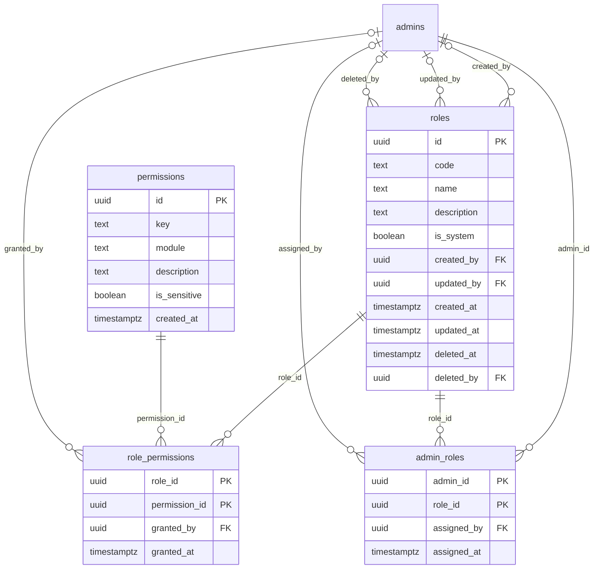

# Module 2 · Roles & Permissions

> **Phase 1 · Foundation** · **Depends on:** M0, M1 · **Owns tables:** `roles`, `permissions`, `role_permissions`, `admin_roles` · **Reads:** `admins` · **Build estimate:** 4 days

## 1. Module Overview

Role-based access control for the admin portal. Five system roles are seeded (Super Admin, Operations Admin, Finance Admin, Verification Admin, Support Admin). Super Admin can create custom roles, edit which permissions a role grants, invite admins, assign one or more roles to each admin, and disable admins. Every API route declares the permission it needs.

## 2. Business Purpose

GuruConnect will grow from one admin (Sameer Bhaiya) to a team. Permissions must be granular enough that a Finance Admin can change prices without seeing Aadhaar documents, and a Support Admin can suspend an abusive parent without touching pricing — and changes must take effect immediately without a deploy.

## 3. User Stories

- As **Super Admin**, I want to invite a new admin by email and give them a role so that they can start work the same day.
- As **Super Admin**, I want to see a permission matrix for a role and tick or untick permissions so that I control exactly what each role can do.
- As **Super Admin**, I want to create a custom role (e.g., "City Launch Admin") by copying an existing role so that I can tailor access quickly.
- As **Super Admin**, I want to disable an admin who left so that they lose access immediately.
- As an **admin**, I want the portal to show only the menus and buttons I can use so that I am not confused by errors.

## 4. Functional Requirements & Business Logic

**FR-2.1 Permission catalogue.** Permissions are defined in code (`packages/shared/permissions.ts`) and synced into `permissions` by the seed on every deploy (`ON CONFLICT DO UPDATE`). Admins cannot create permission keys. Keys removed from code are deleted from the table and from `role_permissions`.

**FR-2.2 System roles.** Seeded with `is_system = true` (matrix in each module's Permissions section). `super_admin` cannot be renamed, deleted or have permissions removed; it implicitly has every permission (checked through `admins.is_super_admin`, which is set when the role is assigned). Other system roles can have permissions edited but cannot be deleted.

**FR-2.3 Custom roles.** Create with name, description and permission list (or "copy from role"). Code is generated from the name (`city_launch_admin`), unique. Delete (soft) only when no admin holds the role; otherwise `CONFLICT_IN_USE` listing holders.

**FR-2.4 Edit role permissions.** `PUT /roles/:id/permissions` replaces the full set (diffed server-side). Requires `If-Match`. On success: audit with added/removed keys, bust the Redis permission cache of every admin holding the role, and publish a `permissions.changed` event so open browser tabs refetch `/auth/me` (via a 60-second poll of `/auth/me?etag=` or SSE).

**FR-2.5 Admins.** List, view, invite, edit name, assign/unassign roles, disable, re-enable, soft-delete.
- **Invite:** creates `admins` row (`status = 'invited'`, random unusable password hash), assigns roles, creates an invite token (Module 1, 72 h) and emails it. Re-send invite regenerates the token.
- **Disable:** `status = 'disabled'`, revoke all sessions, write `revoked_sid` entries.
- **Guard rails:** an admin cannot disable, delete or remove `super_admin` from themselves; the system refuses any change that would leave zero active super admins.

**FR-2.6 Effective permissions.** Union of permissions of all assigned roles (`SELECT DISTINCT p.key …`). Cached in Redis `perm:<adminId>` (5 min). `requirePermission(...keys)` passes when the admin holds **any** of the keys given; `requireAllPermissions` when all are needed.

**FR-2.7 Sensitive permission warning.** Granting a permission with `is_sensitive = true` shows a confirmation listing the sensitive keys and requires a reason, stored in the audit log.

## 5. Validation Rules

| Field | Rule |
| --- | --- |
| role.name | 3–50 chars, unique (case-insensitive) among live roles |
| role.description | ≤ 250 chars |
| permissionKeys | array of known keys, 0–200 items, no duplicates |
| admin.email | valid email, unique among live admins |
| admin.fullName | 2–100 chars |
| roleIds | 1–5 UUIDs of live roles |
| reason | required 5–500 chars when sensitive permissions are granted, or when disabling/deleting an admin |

## 6. API Endpoints

| Method | Path | Permission | Description |
| --- | --- | --- | --- |
| GET | /permissions | roles.read | Permission catalogue grouped by module |
| GET | /roles | roles.read | Roles with admin counts |
| POST | /roles | roles.manage | Create custom role (optionally copy from a role) |
| GET | /roles/:id | roles.read | Role with permission keys and holders |
| PATCH | /roles/:id | roles.manage | Rename / describe (custom roles; description only for system roles) |
| PUT | /roles/:id/permissions | roles.manage | Replace the role's permissions |
| DELETE | /roles/:id | roles.manage | Soft-delete a custom role with no holders |
| GET | /admins | admins.read | List admins |
| POST | /admins/invite | admins.manage | Invite an admin with roles |
| GET | /admins/:id | admins.read | Admin detail with roles, last login, sessions count |
| PATCH | /admins/:id | admins.manage | Edit name |
| PUT | /admins/:id/roles | admins.manage | Replace the admin's roles |
| POST | /admins/:id/resend-invite | admins.manage | New invite email |
| POST | /admins/:id/disable | admins.manage | Disable and sign out everywhere |
| POST | /admins/:id/enable | admins.manage | Re-enable (status back to active) |
| DELETE | /admins/:id | admins.manage | Soft-delete a disabled admin |

## 7. Request Payloads

```json
// POST /roles
{ "name": "City Launch Admin", "description": "Sets up masters and teachers for a new city", "copyFromRoleId": "…ops role id…", "permissionKeys": null }

// PUT /roles/:id/permissions   (If-Match: 2026-09-20T08:11:02.114Z)
{ "permissionKeys": ["locations.read", "locations.manage", "teachers.read", "teachers.update"], "reason": "Needs to add cities" }

// POST /admins/invite
{ "email": "anjali@guruconnect.in", "fullName": "Anjali Menon", "roleIds": ["…verification role id…"], "reason": "New verification hire" }

// POST /admins/:id/disable
{ "reason": "Left the company on 30 Sep" }
```

## 8. Response Payloads

```json
// 200 GET /roles
{ "data": [ { "id": "…", "code": "finance_admin", "name": "Finance Admin", "description": "Owns pricing…", "isSystem": true, "permissionCount": 23, "adminCount": 2, "updatedAt": "…" } ] }

// 200 GET /roles/:id
{ "data": { "id": "…", "code": "verification_admin", "name": "Verification Admin", "isSystem": true, "permissionKeys": ["teachers.read", "teacher_verification.review", "…"],
  "admins": [ { "id": "…", "fullName": "Anjali Menon", "email": "anjali@guruconnect.in" } ], "updatedAt": "2026-09-20T08:11:02.114Z" } }

// 200 GET /permissions
{ "data": [ { "module": "teachers", "permissions": [ { "key": "teachers.read", "description": "View teachers…", "isSensitive": false } ] } ] }

// 201 POST /admins/invite
{ "data": { "id": "…", "email": "anjali@guruconnect.in", "status": "invited", "roles": [ { "code": "verification_admin" } ], "inviteExpiresAt": "2026-09-29T11:00:00Z" } }
```

## 9. PostgreSQL Tables

### `roles`

Named bundles of permissions. System roles are seeded and cannot be deleted.

```sql
CREATE TABLE roles (
  id uuid PRIMARY KEY DEFAULT gen_random_uuid(), -- Primary key
  code text NOT NULL, -- Stable machine name, e.g. super_admin, finance_admin
  name text NOT NULL, -- Display name, e.g. Finance Admin
  description text, -- What this role is for
  is_system boolean NOT NULL DEFAULT false, -- Seeded roles; name/permissions of super_admin are immutable
  created_by uuid REFERENCES admins(id), -- Creator
  updated_by uuid REFERENCES admins(id), -- Last editor
  created_at timestamptz NOT NULL DEFAULT now(), -- Created
  updated_at timestamptz NOT NULL DEFAULT now(), -- Last updated
  deleted_at timestamptz, -- Soft delete (custom roles only, and only when no admin holds it)
  deleted_by uuid REFERENCES admins(id) -- Who deleted it
);
CREATE UNIQUE INDEX uq_roles_code ON roles (code) WHERE deleted_at IS NULL;
CREATE UNIQUE INDEX uq_roles_name ON roles (lower(name)) WHERE deleted_at IS NULL;
CREATE TRIGGER trg_roles_updated BEFORE UPDATE ON roles FOR EACH ROW EXECUTE FUNCTION set_updated_at();
```

### `permissions`

Catalogue of permission keys. Seeded from code; admins cannot create permissions.

```sql
CREATE TABLE permissions (
  id uuid PRIMARY KEY DEFAULT gen_random_uuid(), -- Primary key
  key text NOT NULL, -- Dotted key checked by the API, e.g. teachers.approve
  module text NOT NULL, -- Module slug used to group the permission matrix UI
  description text NOT NULL, -- What the permission allows
  is_sensitive boolean NOT NULL DEFAULT false, -- Sensitive permissions (payments, roles, document unmasking) are highlighted in the UI
  created_at timestamptz NOT NULL DEFAULT now() -- Created
);
CREATE UNIQUE INDEX uq_permissions_key ON permissions (key);
CREATE INDEX idx_permissions_module ON permissions (module);
```

### `role_permissions`

Which permissions each role grants.

```sql
CREATE TABLE role_permissions (
  role_id uuid NOT NULL REFERENCES roles(id) ON DELETE CASCADE, -- Role
  permission_id uuid NOT NULL REFERENCES permissions(id) ON DELETE CASCADE, -- Permission granted
  granted_by uuid REFERENCES admins(id), -- Admin who granted it
  granted_at timestamptz NOT NULL DEFAULT now(), -- When granted
  PRIMARY KEY (role_id, permission_id)
);
CREATE INDEX idx_role_permissions_permission ON role_permissions (permission_id);
```

### `admin_roles`

Which roles each admin holds. An admin may hold several roles; effective permissions are the union.

```sql
CREATE TABLE admin_roles (
  admin_id uuid NOT NULL REFERENCES admins(id) ON DELETE CASCADE, -- Admin
  role_id uuid NOT NULL REFERENCES roles(id) ON DELETE RESTRICT, -- Role held
  assigned_by uuid REFERENCES admins(id), -- Who assigned it
  assigned_at timestamptz NOT NULL DEFAULT now(), -- When assigned
  PRIMARY KEY (admin_id, role_id)
);
CREATE INDEX idx_admin_roles_role ON admin_roles (role_id);
```

Migration file: `sql/migrations/002_m02_roles_permissions.sql`

## 10. Column Definitions

### `roles`

| Column | Type | Null | Default | Constraints / References | Description |
| --- | --- | --- | --- | --- | --- |
| `id` | uuid | no | gen_random_uuid() | PK | Primary key |
| `code` | text | no | — | — | Stable machine name, e.g. super_admin, finance_admin |
| `name` | text | no | — | — | Display name, e.g. Finance Admin |
| `description` | text | yes | — | — | What this role is for |
| `is_system` | boolean | no | false | — | Seeded roles; name/permissions of super_admin are immutable |
| `created_by` | uuid | yes | — | FK → `admins.id` (on delete no action) | Creator |
| `updated_by` | uuid | yes | — | FK → `admins.id` (on delete no action) | Last editor |
| `created_at` | timestamptz | no | now() | — | Created |
| `updated_at` | timestamptz | no | now() | — | Last updated |
| `deleted_at` | timestamptz | yes | — | — | Soft delete (custom roles only, and only when no admin holds it) |
| `deleted_by` | uuid | yes | — | FK → `admins.id` (on delete no action) | Who deleted it |

### `permissions`

| Column | Type | Null | Default | Constraints / References | Description |
| --- | --- | --- | --- | --- | --- |
| `id` | uuid | no | gen_random_uuid() | PK | Primary key |
| `key` | text | no | — | — | Dotted key checked by the API, e.g. teachers.approve |
| `module` | text | no | — | — | Module slug used to group the permission matrix UI |
| `description` | text | no | — | — | What the permission allows |
| `is_sensitive` | boolean | no | false | — | Sensitive permissions (payments, roles, document unmasking) are highlighted in the UI |
| `created_at` | timestamptz | no | now() | — | Created |

### `role_permissions`

| Column | Type | Null | Default | Constraints / References | Description |
| --- | --- | --- | --- | --- | --- |
| `role_id` | uuid | no | — | PK; FK → `roles.id` (on delete cascade) | Role |
| `permission_id` | uuid | no | — | PK; FK → `permissions.id` (on delete cascade) | Permission granted |
| `granted_by` | uuid | yes | — | FK → `admins.id` (on delete no action) | Admin who granted it |
| `granted_at` | timestamptz | no | now() | — | When granted |

**Table constraints:** `PRIMARY KEY (role_id, permission_id)`

### `admin_roles`

| Column | Type | Null | Default | Constraints / References | Description |
| --- | --- | --- | --- | --- | --- |
| `admin_id` | uuid | no | — | PK; FK → `admins.id` (on delete cascade) | Admin |
| `role_id` | uuid | no | — | PK; FK → `roles.id` (on delete restrict) | Role held |
| `assigned_by` | uuid | yes | — | FK → `admins.id` (on delete no action) | Who assigned it |
| `assigned_at` | timestamptz | no | now() | — | When assigned |

**Table constraints:** `PRIMARY KEY (admin_id, role_id)`

## 11. Relationships

**Outgoing foreign keys**

- `roles.created_by` → `admins.id` — optional, many-to-one, on delete **no action**
- `roles.updated_by` → `admins.id` — optional, many-to-one, on delete **no action**
- `roles.deleted_by` → `admins.id` — optional, many-to-one, on delete **no action**
- `role_permissions.role_id` → `roles.id` — required, many-to-one, on delete **cascade**
- `role_permissions.permission_id` → `permissions.id` — required, many-to-one, on delete **cascade**
- `role_permissions.granted_by` → `admins.id` — optional, many-to-one, on delete **no action**
- `admin_roles.admin_id` → `admins.id` — required, many-to-one, on delete **cascade**
- `admin_roles.role_id` → `roles.id` — required, many-to-one, on delete **restrict**
- `admin_roles.assigned_by` → `admins.id` — optional, many-to-one, on delete **no action**

**Entity relationship diagram**



## 12. Indexing Strategy

| Index | Table | Kind | Definition |
| --- | --- | --- | --- |
| `uq_roles_code` | `roles` | unique | `(code) WHERE deleted_at IS NULL` |
| `uq_roles_name` | `roles` | unique | `(lower(name)) WHERE deleted_at IS NULL` |
| `uq_permissions_key` | `permissions` | unique | `(key)` |
| `idx_permissions_module` | `permissions` | btree | `(module)` |
| `idx_role_permissions_permission` | `role_permissions` | btree | `(permission_id)` |
| `idx_admin_roles_role` | `admin_roles` | btree | `(role_id)` |

- `role_permissions` has PK `(role_id, permission_id)` for "permissions of a role" and a secondary index for "roles granting a permission".
- `admin_roles` PK `(admin_id, role_id)` serves effective-permission lookup; `idx_admin_roles_role` serves "who holds this role".

## 13. Permissions

| Permission key | Allows | Sensitive | Super | Ops | Verif. | Finance | Support |
| --- | --- | --- | --- | --- | --- | --- | --- |
| `roles.read` | View roles and the permission matrix | — | ✓ | — | — | — | — |
| `roles.manage` | Create, edit and delete custom roles and change role permissions | yes | ✓ | — | — | — | — |
| `admins.read` | View admin accounts and their roles | — | ✓ | — | — | — | — |
| `admins.manage` | Invite, edit, disable admins and assign roles | yes | ✓ | — | — | — | — |
| `sessions.revoke_any` | Force sign-out of another admin | yes | ✓ | — | — | — | — |

Guard rails in FR-2.5 apply even to super admins. Only super admins can assign the `super_admin` role.

## 14. UI Screens & React Page Structure

| Route | Page | Purpose |
| --- | --- | --- |
| `/settings/roles` | RolesListPage | Role cards with holder counts |
| `/settings/roles/new` | RoleEditorPage | Name, description, copy-from, permission matrix |
| `/settings/roles/:id` | RoleEditorPage | Permission matrix grouped by module with sensitive markers |
| `/settings/admins` | AdminsListPage | Table of admins, invite button |
| `/settings/admins/:id` | AdminDetailPage | Roles, status, last login, sessions, audit trail |

```
src/features/rbac/
  pages/RolesListPage.tsx, RoleEditorPage.tsx, AdminsListPage.tsx, AdminDetailPage.tsx
  components/PermissionMatrix.tsx, RoleCard.tsx, InviteAdminDialog.tsx, AssignRolesDialog.tsx, DisableAdminDialog.tsx
  hooks/usePermission.ts   (can(key), canAny(keys))
  Can.tsx                  (<Can permission="x">…</Can>)
```

## 15. UI Components

- `PermissionMatrix` — rows = modules, columns = actions (read/create/update/delete/special), checkboxes; sensitive keys marked with a lock icon; "Select all in module".
- `RoleCard` — name, description, holders' avatars, permission count, system badge.
- `InviteAdminDialog` — email, name, multi-select roles, reason.
- `AssignRolesDialog` — shows effective permission diff before saving.
- `Can` / `usePermission` — permission gating used across all modules.

## 16. Filters

Admins: status (active, invited, locked, disabled), role, last login (never / > 30 days).

## 17. Search Capabilities

Admins: `q` matches name (trigram) and email prefix. Roles: client-side filter (small list).

## 18. Pagination Requirements

Admins: offset, default 20. Roles and permissions: not paginated (≤ 50 roles, ≤ 200 permissions).

## 19. Audit Logs

| Event | Details |
| --- | --- |
| `role.created` / `role.updated` / `role.deleted` | name, description changes |
| `role.permissions_changed` | added keys, removed keys, reason |
| `admin.invited` | email, roles |
| `admin.invite_resent` | — |
| `admin.roles_changed` | added/removed role codes, reason |
| `admin.updated` | name |
| `admin.disabled` / `admin.enabled` / `admin.deleted` | reason, sessions revoked |

## 20. Error Scenarios

| Scenario | HTTP | Code | Message |
| --- | --- | --- | --- |
| Duplicate role name | 409 | CONFLICT_DUPLICATE | "A role with this name already exists." |
| Unknown permission key | 422 | VALIDATION_FAILED | "Unknown permission: {key}" |
| Editing super_admin permissions | 409 | CONFLICT_STATE | "Super Admin always has every permission." |
| Deleting a system role | 409 | CONFLICT_STATE | "System roles can't be deleted." |
| Deleting a role that admins hold | 409 | CONFLICT_IN_USE | "Remove this role from {n} admins first." |
| Inviting an email that exists | 409 | CONFLICT_DUPLICATE | "An admin with this email already exists." |
| Disabling yourself / last super admin | 409 | CONFLICT_STATE | "You can't remove the last active Super Admin." |
| Assigning super_admin without being one | 403 | FORBIDDEN | "Only a Super Admin can grant Super Admin." |
| Stale matrix (If-Match mismatch) | 409 | VERSION_CONFLICT | "Someone else changed this role. Reload to see their changes." |
| Sensitive permission without reason | 422 | VALIDATION_FAILED | "Add a reason for granting sensitive permissions." |

## 21. Future Scalability Notes & Enhancements

- Scope roles by city or institute (`admin_role_scopes` table with `scope_type`, `scope_id`) when regional teams arrive.
- Time-boxed access grants (auto-expire a role assignment).
- Approval workflow for sensitive permission grants (two-person rule).
- Export the permission matrix as CSV for compliance reviews.

## 22. Security Considerations

- Deny by default: a route without `requirePermission` fails a CI lint rule (`eslint-plugin-guruconnect/require-permission`).
- Permission checks happen server-side on every request; the UI gating is convenience only.
- Cache invalidation on every role/assignment change so revoked access takes effect within one request.
- Two-super-admin minimum recommended; system prevents zero.
