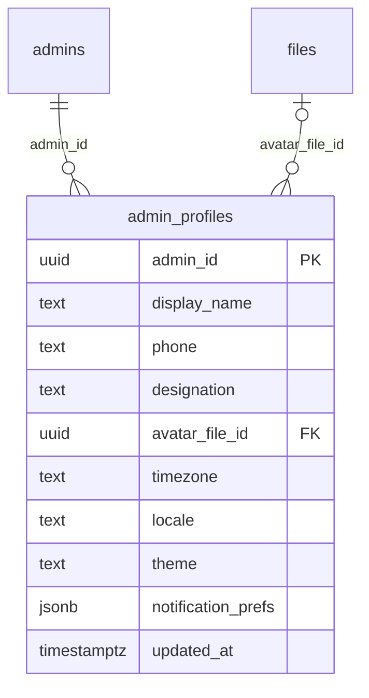

# Module 3 · Admin Profile Management

> **Phase 1 · Foundation** · **Depends on:** M0, M1 · **Owns tables:** `admin_profiles` · **Reads:** `admins`, `files` · **Build estimate:** 1–2 days

## 1. Module Overview

Lets each admin view and edit their own profile (display name, phone, designation, avatar, time zone, theme, notification preferences) and change their password while signed in.

## 2. Business Purpose

Names and photos make the audit trail and case assignments readable ("Anjali approved this"), and personal time zone/theme settings make the portal comfortable for daily use.

## 3. User Stories

- As an **admin**, I want to upload a profile photo so that teammates recognise my actions in timelines.
- As an **admin**, I want to change my password from my account page so that I can rotate it regularly.
- As an **admin**, I want to pick dark mode and my time zone so that dates and the UI suit me.
- As an **admin**, I want to choose which email alerts I get so that my inbox stays useful.

## 4. Functional Requirements & Business Logic

**FR-3.1 View profile.** `GET /me/profile` returns `admins` basics + `admin_profiles` (created lazily with defaults on first read).

**FR-3.2 Edit profile.** `PATCH /me/profile` updates display name, phone, designation, time zone, locale, theme and notification preferences. `fullName` (on `admins`) can also be edited here. Email changes are not self-service (Super Admin edits in Module 2) to protect the login identity.

**FR-3.3 Avatar.** Upload via Module 0 presign with `purpose = admin_avatar`, then `PUT /me/profile/avatar { fileId }`. The API checks the file is `uploaded`, owned by the caller and an image; the old avatar file is soft-deleted. `DELETE /me/profile/avatar` removes it. The UI crops to a square (client-side) before upload; server generates 64/128/256 px variants through the CDN image resizer.

**FR-3.4 Change password.** `POST /me/change-password { currentPassword, newPassword, signOutOtherSessions }`. Verifies current password (counts toward lockout like login), applies the Module 1 policy, updates hash and `password_changed_at`, revokes other sessions (always when `signOutOtherSessions` is true; default true) and keeps the current session by re-issuing tokens.

**FR-3.5 Notification preferences.** Keys: `email_digest` (daily queue summary at 9 AM), `queue_alerts` (email when a queue item breaches SLA), `security_alerts` (always on, not editable).

## 5. Validation Rules

| Field | Rule |
| --- | --- |
| fullName | 2–100 chars |
| displayName | 2–40 chars, optional |
| phone | E.164, optional |
| designation | ≤ 80 chars |
| timezone | valid IANA zone (checked against `Intl.supportedValuesOf('timeZone')`) |
| locale | one of en-IN, hi-IN |
| theme | light, dark, system |
| notificationPrefs | object with boolean `email_digest`, `queue_alerts` only |
| avatar fileId | UUID of an uploaded image file created by the caller, purpose `admin_avatar` |
| currentPassword / newPassword | as Module 1; new ≠ current |

## 6. API Endpoints

| Method | Path | Permission | Description |
| --- | --- | --- | --- |
| GET | /me/profile | authenticated | Own profile |
| PATCH | /me/profile | authenticated | Update own profile (If-Match) |
| PUT | /me/profile/avatar | authenticated | Set avatar from an uploaded file |
| DELETE | /me/profile/avatar | authenticated | Remove avatar |
| POST | /me/change-password | authenticated | Change own password |

## 7. Request Payloads

```json
// PATCH /me/profile   (If-Match: 2026-09-21T09:00:00.000Z)
{ "fullName": "Anjali Menon", "displayName": "Anjali", "designation": "Verification Lead", "phone": "+919845011122", "timezone": "Asia/Kolkata", "theme": "dark", "notificationPrefs": { "email_digest": true, "queue_alerts": false } }

// PUT /me/profile/avatar
{ "fileId": "2d7c…" }

// POST /me/change-password
{ "currentPassword": "••••", "newPassword": "Quiet-River-Lamp-77", "signOutOtherSessions": true }
```

## 8. Response Payloads

```json
// 200 GET /me/profile
{ "data": { "id": "…", "email": "anjali@guruconnect.in", "fullName": "Anjali Menon", "displayName": "Anjali", "designation": "Verification Lead", "phone": "+919845011122",
  "avatar": { "fileId": "2d7c…", "url": "https://cdn.guruconnect.in/admin_avatar/2026/09/2d7c….webp" }, "timezone": "Asia/Kolkata", "locale": "en-IN", "theme": "dark",
  "notificationPrefs": { "email_digest": true, "queue_alerts": false, "security_alerts": true }, "roles": ["Verification Admin"], "lastLoginAt": "…", "updatedAt": "…" } }

// 200 POST /me/change-password
{ "data": { "accessToken": "eyJ…", "expiresIn": 900, "sessionsRevoked": 2 } }
```

## 9. PostgreSQL Tables

### `admin_profiles`

Personal details for an admin, one-to-one with admins.

```sql
CREATE TABLE admin_profiles (
  admin_id uuid PRIMARY KEY REFERENCES admins(id) ON DELETE CASCADE, -- One-to-one with admins
  display_name text, -- Optional short name shown in the top bar
  phone text, -- E.164 phone number
  designation text, -- Job title, e.g. Verification Lead
  avatar_file_id uuid REFERENCES files(id), -- Profile image (public CDN file)
  timezone text NOT NULL DEFAULT 'Asia/Kolkata', -- IANA time zone used to display dates
  locale text NOT NULL DEFAULT 'en-IN', -- UI locale
  theme text NOT NULL DEFAULT 'system' CHECK (theme IN ('light','dark','system')), -- UI theme preference
  notification_prefs jsonb NOT NULL DEFAULT '{"email_digest":true,"queue_alerts":true}'::jsonb, -- Email/alert preferences
  updated_at timestamptz NOT NULL DEFAULT now() -- Last updated
);

CREATE TRIGGER trg_admin_profiles_updated BEFORE UPDATE ON admin_profiles FOR EACH ROW EXECUTE FUNCTION set_updated_at();
```

Migration file: `sql/migrations/003_m03_admin_profile_management.sql`

## 10. Column Definitions

### `admin_profiles`

| Column | Type | Null | Default | Constraints / References | Description |
| --- | --- | --- | --- | --- | --- |
| `admin_id` | uuid | no | — | PK; FK → `admins.id` (on delete cascade) | One-to-one with admins |
| `display_name` | text | yes | — | — | Optional short name shown in the top bar |
| `phone` | text | yes | — | — | E.164 phone number |
| `designation` | text | yes | — | — | Job title, e.g. Verification Lead |
| `avatar_file_id` | uuid | yes | — | FK → `files.id` (on delete no action) | Profile image (public CDN file) |
| `timezone` | text | no | 'Asia/Kolkata' | — | IANA time zone used to display dates |
| `locale` | text | no | 'en-IN' | — | UI locale |
| `theme` | text | no | 'system' | CHECK theme IN ('light','dark','system') | UI theme preference |
| `notification_prefs` | jsonb | no | '{"email_digest":true,"queue_alerts":true}'::jsonb | — | Email/alert preferences |
| `updated_at` | timestamptz | no | now() | — | Last updated |

## 11. Relationships

**Outgoing foreign keys**

- `admin_profiles.admin_id` → `admins.id` — required, many-to-one, on delete **cascade**
- `admin_profiles.avatar_file_id` → `files.id` — optional, many-to-one, on delete **no action**

**Entity relationship diagram**



## 12. Indexing Strategy


Primary key lookup only (`admin_id`).

## 13. Permissions

No module-specific permission keys.

Self-service only; no permission keys. An admin can never edit another admin's profile here (Super Admin uses Module 2 for name/email/status).

## 14. UI Screens & React Page Structure

| Route | Page | Sections |
| --- | --- | --- |
| `/account` | AccountPage | Profile card (avatar, name, designation, phone), Preferences (time zone, theme, locale), Notifications, Security (change password, link to sessions) |

```
src/features/account/
  pages/AccountPage.tsx
  components/ProfileForm.tsx, AvatarUploader.tsx, PreferencesForm.tsx, NotificationPrefs.tsx, ChangePasswordDialog.tsx
```

## 15. UI Components

- `AvatarUploader` — crop (react-easy-crop), preview, remove.
- `ProfileForm` — React Hook Form, dirty-state save bar.
- `ChangePasswordDialog` — current, new, confirm, strength checklist, "Sign out other devices" checkbox.
- Theme switch applies immediately (`data-theme` on `<html>`) and persists.

## 16. Filters

Not applicable.

## 17. Search Capabilities

Not applicable.

## 18. Pagination Requirements

Not applicable.

## 19. Audit Logs

| Event | Details |
| --- | --- |
| `admin_profile.updated` | changed fields (phone masked) |
| `admin_profile.avatar_changed` / `admin_profile.avatar_removed` | file ids |
| `auth.password_changed` | sessions revoked count |
| `auth.password_change_failed` | wrong current password (counts toward lockout) |

## 20. Error Scenarios

| Scenario | HTTP | Code | Message |
| --- | --- | --- | --- |
| Wrong current password | 401 | AUTH_INVALID_CREDENTIALS | "Your current password is incorrect." |
| New password fails policy | 422 | VALIDATION_FAILED | Checklist |
| Avatar file not an image / not yours | 422 | VALIDATION_FAILED | "Upload a JPG, PNG or WebP image." |
| Invalid time zone | 422 | VALIDATION_FAILED | "Pick a time zone from the list." |
| Stale profile | 409 | VERSION_CONFLICT | "Your profile changed in another tab. Reload." |
| Locked after repeated wrong current password | 423 | AUTH_ACCOUNT_LOCKED | "Too many attempts. Try again after {time}." |

## 21. Future Scalability Notes & Enhancements

- Add MFA enrolment here once Module 1 supports TOTP.
- Personal API tokens for automation (scoped, expiring) if integrations are needed.
- Per-admin saved table views and default filters.

## 22. Security Considerations

- Email and roles are not self-editable.
- Password change re-verifies the current password and participates in lockout.
- Avatar files are public but stored under random keys; the old file is deleted.
