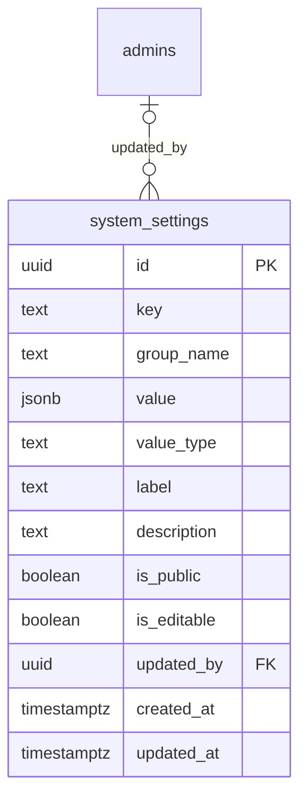

# Module 4 · Global Settings

> **Phase 2 · Configuration** · **Depends on:** M0, M1, M2 · **Owns tables:** `system_settings` · **Build estimate:** 2 days

## 1. Module Overview

A typed key–value settings store for platform-wide values: platform name and tagline, support contact details, grievance officer, legal URLs (terms, privacy, refunds), app version gates (latest/minimum Android and iOS versions, maintenance mode) and operational limits (max children per parent, max teachers per institute). Settings flagged public are served to the mobile app.

## 2. Business Purpose

These values change more often than code ships (a new support number, a forced app update after a security fix, a new terms URL). Admins must change them safely without a deploy, with validation per value type and a full history.

## 3. User Stories

- As **Super Admin**, I want to update the support email and phone so that users reach the right team.
- As **Super Admin**, I want to raise the minimum Android version so that users on an insecure build must update.
- As **Operations Admin**, I want to switch on maintenance mode during a database migration so that users see a friendly screen.
- As a **mobile developer**, I want one public endpoint with all public settings and an ETag so that the app can cache them.

## 4. Functional Requirements & Business Logic

**FR-4.1 Grouped settings.** Settings are grouped (`general`, `contact`, `legal`, `app_versions`, `limits`). The list endpoint returns them grouped, ordered by key.

**FR-4.2 Typed validation.** Each setting has a `value_type` that drives both the server validation and the React input:

| value_type | Validation | Input |
| --- | --- | --- |
| string | 1–200 chars | text |
| number | integer, per-key min/max (table below) | number |
| boolean | true/false | switch |
| url | https URL | text with open-link button |
| email | email | text |
| phone | E.164 | phone input |
| semver | `^\d+\.\d+\.\d+$` | text |
| json | must match the per-key Zod schema | JSON editor |

Per-key extra rules: `limits.parent_max_children` 1–5; `limits.institute_max_teachers` 1–200; `limits.review_min_chars` 10–200; `app.*_min_version` must be ≤ the matching `*_latest_version`.

**FR-4.3 Bulk save.** `PATCH /settings` accepts a map of `key → value` for one group, validates all, and saves them in one transaction (all or nothing). Requires `If-Match` equal to the latest `updated_at` among the submitted keys.

**FR-4.4 Maintenance mode.** Turning `app.maintenance_mode` on requires a reason and a confirmation. While on, the public endpoint returns `maintenance: true` and the mobile API returns 503 for all non-auth routes (admin portal unaffected).

**FR-4.5 Public settings.** `GET /api/v1/app/settings` (mobile, unauthenticated) returns only `is_public = true` settings as a flat object, cached in Redis and with `ETag`/`Cache-Control: max-age=300`. Saving any public setting purges the cache.

**FR-4.6 Read-only settings.** `is_editable = false` rows (e.g., values managed by deploys) are shown greyed out with an explanation; attempts to change them return 409.

**FR-4.7 History.** Each setting's detail shows its audit history (Module 0 entity history on `system_settings`).

New settings are only added by migrations/seeds, never through the UI, so every key has code that reads it.

## 5. Validation Rules

See FR-4.2. Additionally: `value` must be present for every submitted key; unknown keys → 422; `reason` (5–500 chars) required for `app.*` keys and for maintenance mode.

## 6. API Endpoints

| Method | Path | Permission | Description |
| --- | --- | --- | --- |
| GET | /settings | settings.read | All settings grouped |
| GET | /settings/:key | settings.read | One setting with metadata |
| PATCH | /settings | settings.update | Save several settings of one group atomically |
| GET | /api/v1/app/settings (mobile) | public | Public settings for the app (outside the admin base path) |

## 7. Request Payloads

```json
// PATCH /settings   (If-Match: 2026-09-10T06:00:00.000Z)
{ "group": "app_versions", "values": { "app.android_min_version": "1.2.0", "app.android_latest_version": "1.3.1" }, "reason": "Security fix in 1.2.0" }
```

## 8. Response Payloads

```json
// 200 GET /settings
{ "data": { "groups": [
  { "group": "contact", "settings": [
    { "key": "contact.support_email", "label": "Support email", "valueType": "email", "value": "support@guruconnect.in", "isPublic": true, "isEditable": true, "description": "Where users send support requests", "updatedAt": "…", "updatedBy": { "id": "…", "name": "Sameer Bhaiya" } } ] } ] } }

// 200 GET /api/v1/app/settings
{ "data": { "platform.name": "GuruConnect", "contact.support_email": "support@guruconnect.in", "app.android_min_version": "1.2.0", "app.maintenance_mode": false, "limits.parent_max_children": 3 } }
```

## 9. PostgreSQL Tables

### `system_settings`

Typed key–value settings that change platform behaviour without a deploy.

```sql
CREATE TABLE system_settings (
  id uuid PRIMARY KEY DEFAULT gen_random_uuid(), -- Primary key
  key text NOT NULL, -- Dotted key, e.g. platform.name, support.email, app.min_android_version
  group_name text NOT NULL, -- UI group: general, contact, legal, app_versions, limits
  value jsonb NOT NULL, -- Value wrapped in JSON, e.g. "GuruConnect", 3, true
  value_type text NOT NULL CHECK (value_type IN ('string','number','boolean','url','email','phone','semver','json')), -- Drives validation and the input control
  label text NOT NULL, -- Label in the settings form
  description text, -- Help text under the input
  is_public boolean NOT NULL DEFAULT false, -- true = exposed to the mobile app via GET /public/settings
  is_editable boolean NOT NULL DEFAULT true, -- false = read-only in the UI (managed by deploys)
  updated_by uuid REFERENCES admins(id), -- Last editor
  created_at timestamptz NOT NULL DEFAULT now(), -- Created
  updated_at timestamptz NOT NULL DEFAULT now() -- Last updated
);
CREATE UNIQUE INDEX uq_system_settings_key ON system_settings (key);
CREATE INDEX idx_system_settings_group ON system_settings (group_name);
CREATE TRIGGER trg_system_settings_updated BEFORE UPDATE ON system_settings FOR EACH ROW EXECUTE FUNCTION set_updated_at();
```

Migration file: `sql/migrations/004_m04_global_settings.sql`

## 10. Column Definitions

### `system_settings`

| Column | Type | Null | Default | Constraints / References | Description |
| --- | --- | --- | --- | --- | --- |
| `id` | uuid | no | gen_random_uuid() | PK | Primary key |
| `key` | text | no | — | — | Dotted key, e.g. platform.name, support.email, app.min_android_version |
| `group_name` | text | no | — | — | UI group: general, contact, legal, app_versions, limits |
| `value` | jsonb | no | — | — | Value wrapped in JSON, e.g. "GuruConnect", 3, true |
| `value_type` | text | no | — | CHECK value_type IN ('string','number','boolean','url','email','phone','semver','json') | Drives validation and the input control |
| `label` | text | no | — | — | Label in the settings form |
| `description` | text | yes | — | — | Help text under the input |
| `is_public` | boolean | no | false | — | true = exposed to the mobile app via GET /public/settings |
| `is_editable` | boolean | no | true | — | false = read-only in the UI (managed by deploys) |
| `updated_by` | uuid | yes | — | FK → `admins.id` (on delete no action) | Last editor |
| `created_at` | timestamptz | no | now() | — | Created |
| `updated_at` | timestamptz | no | now() | — | Last updated |

## 11. Relationships

**Outgoing foreign keys**

- `system_settings.updated_by` → `admins.id` — optional, many-to-one, on delete **no action**

**Entity relationship diagram**



## 12. Indexing Strategy

| Index | Table | Kind | Definition |
| --- | --- | --- | --- |
| `uq_system_settings_key` | `system_settings` | unique | `(key)` |
| `idx_system_settings_group` | `system_settings` | btree | `(group_name)` |

Unique on `key` for lookups; `group_name` index for the grouped list. The table is tiny (< 200 rows); the public payload is served from Redis.

## 13. Permissions

| Permission key | Allows | Sensitive | Super | Ops | Verif. | Finance | Support |
| --- | --- | --- | --- | --- | --- | --- | --- |
| `settings.read` | View global settings | — | ✓ | ✓ | ✓ | ✓ | ✓ |
| `settings.update` | Change global settings | yes | ✓ | — | — | — | — |

## 14. UI Screens & React Page Structure

| Route | Page | Notes |
| --- | --- | --- |
| `/settings/general` | GlobalSettingsPage | Tabs per group; each tab is one form with Save / Discard; maintenance-mode banner when on |

```
src/features/settings/
  pages/GlobalSettingsPage.tsx
  components/SettingsGroupForm.tsx, SettingInput.tsx (switches on valueType), MaintenanceToggle.tsx, SettingHistoryDrawer.tsx
```

## 15. UI Components

- `SettingInput` renders the right control per `valueType` with inline validation.
- `SettingsGroupForm` shows a sticky save bar when dirty and asks for a reason when required.
- `MaintenanceToggle` — red confirm dialog with typed "MAINTENANCE".
- `SettingHistoryDrawer` — audit trail for one key.

## 16. Filters

Group tabs only.

## 17. Search Capabilities

Client-side filter box over labels and keys.

## 18. Pagination Requirements

Not paginated.

## 19. Audit Logs

| Event | Details |
| --- | --- |
| `setting.updated` | key, old value, new value, reason |
| `setting.maintenance_enabled` / `setting.maintenance_disabled` | reason |

## 20. Error Scenarios

| Scenario | HTTP | Code | Message |
| --- | --- | --- | --- |
| Unknown key | 422 | VALIDATION_FAILED | "Unknown setting: {key}" |
| Value fails type rule | 422 | VALIDATION_FAILED | Field message, e.g. "Enter a version like 1.2.0" |
| Min version above latest | 422 | VALIDATION_FAILED | "Minimum version can't be higher than the latest version." |
| Read-only setting | 409 | CONFLICT_STATE | "This setting is managed by deployments." |
| Stale form | 409 | VERSION_CONFLICT | "Settings changed since you opened this page. Reload." |
| Missing reason | 422 | VALIDATION_FAILED | "Add a reason for this change." |

## 21. Future Scalability Notes & Enhancements

- Per-city overrides (`system_setting_overrides` with `city_id`) if cities need different limits.
- Feature flags with percentage roll-outs (or adopt Unleash/GrowthBook) once experiments start.
- Scheduled setting changes (apply at a future time) using the same pattern as Module 5.

## 22. Security Considerations

- Only `is_public` settings leave the server unauthenticated; never mark secrets public (secrets never live in this table).
- Maintenance mode cannot lock admins out: it only affects `/api/v1/app/*`.
