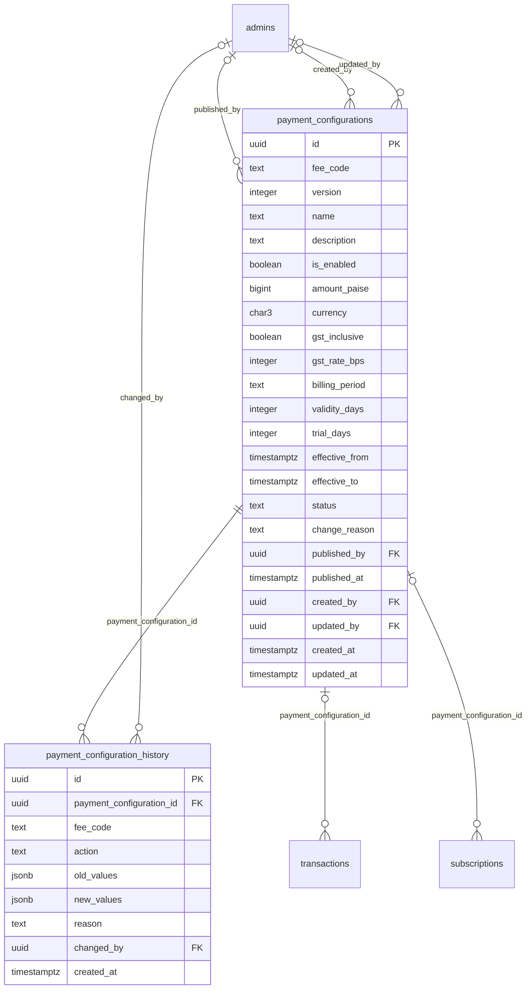

# Module 5 · Dynamic Payment Configuration

> **Phase 2 · Configuration** · **Depends on:** M0, M1, M2 · **Owns tables:** `payment_configurations`, `payment_configuration_history` · **Build estimate:** 5 days

## 1. Module Overview

Admin control over every fee the platform charges: Teacher Registration, Institute Registration, Parent Subscription (monthly, yearly), Student Subscription (monthly, yearly), Premium Teacher listing, Featured Teacher listing and Contact Unlock. Each fee can be switched on or off and priced; changes are saved as versions with an effective date, published immediately or scheduled, and every change is kept in a version history. No code change is needed to change what users pay.

## 2. Business Purpose

The monetisation strategy is not final. Sameer Bhaiya needs to test prices, run launch offers, or make the platform free for a segment — safely. Versioning guarantees that (a) a user is charged exactly the price shown when they started checkout, (b) past invoices can always be explained, and (c) a mistaken change can be rolled back.

## 3. User Stories

- As **Finance Admin**, I want to change the parent yearly price from ₹1,999 to ₹1,799 starting 1 November so that the Diwali offer starts automatically.
- As **Super Admin**, I want to switch the teacher registration fee off during launch so that teachers join free.
- As **Finance Admin**, I want to see every past price of a fee with who changed it and why so that I can explain invoices.
- As **Finance Admin**, I want to preview what users will see before publishing so that I don't publish a mistake.
- As **Super Admin**, I want to cancel a scheduled price change so that I can reverse a decision before it takes effect.
- As the **mobile app**, I want one endpoint that tells me which fees are on and their prices so that purchase screens are always correct.

## 4. Functional Requirements & Business Logic

**Concepts.** A *fee* is identified by `fee_code`. Each fee has versions. Exactly one version is `active` at a time (partial unique index), zero or more are `scheduled` (future `effective_from`), at most one is `draft`. Versions are immutable once published — changes create a new version.

**State machine**
```
draft ──publish(now)──▶ active ──(newer version activates)──▶ superseded
draft ──publish(future)──▶ scheduled ──(scheduler at effective_from)──▶ active
scheduled ──cancel──▶ cancelled
draft ──discard──▶ (deleted)
```

**FR-5.1 List fees.** `GET /payment-configs` returns one card per fee: current active version, next scheduled version (if any), draft (if any), and 30-day usage (captured transactions count and revenue from Module 40, when available).

**FR-5.2 Create/edit draft.** `PUT /payment-configs/:feeCode/draft` creates or replaces the fee's single draft by copying the active version and applying changes (`is_enabled`, `amount_paise`, `gst_inclusive`, `gst_rate_bps`, `billing_period`, `validity_days`, `trial_days`, `name`, `description`). Draft saves are autosaved from the UI (debounced 1 s).

**FR-5.3 Preview.** `GET /payment-configs/:feeCode/draft/preview` returns the user-facing price card (price, per-month equivalent for yearly plans, GST split, trial text, enabled state) and an impact summary: number of live subscriptions on the current version (they keep their price until renewal), number of users currently in checkout (open Razorpay orders < 30 min).

**FR-5.4 Publish.** `POST /payment-configs/:feeCode/draft/publish { effectiveFrom, reason }`:
1. `effectiveFrom` omitted or ≤ now + 1 min → immediate: in one transaction set the current active version to `superseded` with `effective_to = now()`, set the draft to `active` with `effective_from = now()`, `version = max+1`.
2. `effectiveFrom` in the future (≤ 365 days) → draft becomes `scheduled`. Only one scheduled version per fee at a time; publishing another schedule requires cancelling the existing one first.
3. Write `payment_configuration_history` (`published` or `scheduled`) and the audit row.
4. Purge the Redis cache `pricing:v1` and publish a `pricing.changed` event (mobile gets fresh prices on next fetch; open checkout sessions keep the price captured in their Razorpay order).

**FR-5.5 Quick toggle.** `POST /payment-configs/:feeCode/toggle { enabled, reason }` publishes a new version immediately that differs only in `is_enabled`. Use for "switch the fee off now".

**FR-5.6 Scheduler.** BullMQ job `payment-config-activate` runs every minute: for each `scheduled` version with `effective_from ≤ now()`, in a transaction supersede the active version and activate the scheduled one; history action `activated` with `changed_by = NULL`. Idempotent (row lock `FOR UPDATE SKIP LOCKED`).

**FR-5.7 Cancel schedule.** `POST /payment-configs/versions/:id/cancel { reason }` — only `scheduled` versions.

**FR-5.8 Roll back.** `POST /payment-configs/versions/:id/restore { reason, effectiveFrom? }` copies an old version into a new draft and publishes it (a restore is always a new version, history stays linear).

**FR-5.9 Price resolution (used by Modules 30, 32, 40, 41 and the mobile API).** `resolveFee(feeCode, at = now())` returns the version with `status IN ('active','scheduled') AND effective_from ≤ at AND (effective_to IS NULL OR effective_to > at)` ordered by `effective_from DESC LIMIT 1`. The resolved version id and amount are stored on the transaction when the Razorpay order is created, so the price a user saw is the price they pay.

**FR-5.10 Disabled fee behaviour (contract for the mobile app and Modules 30/32/41).**

| Fee off | App behaviour |
| --- | --- |
| TEACHER_REGISTRATION | Registration skips payment; teacher goes straight to the verification queue |
| INSTITUTE_REGISTRATION | Same for institutes |
| PARENT_/STUDENT_SUBSCRIPTION_* | Both periods off → membership screens hidden, users get `free_access` subscriptions (Module 41); one period off → only that plan hidden |
| PREMIUM_TEACHER / FEATURED_TEACHER | Purchase buttons hidden; existing paid periods run to their end |
| CONTACT_UNLOCK | No pay-per-contact option |

**FR-5.11 GST split.** `base = round(amount / (1 + rate))` when `gst_inclusive`; otherwise `amount` is the base and GST is added at checkout. Rounding to the nearest paisa; the split is stored on the transaction.

**FR-5.12 Public pricing endpoint.** `GET /api/v1/app/pricing` returns every fee's resolved active version (enabled flag, amount, period, trial days, display name), cached in Redis for 60 s and purged on publish.

## 5. Validation Rules

| Field | Rule |
| --- | --- |
| feeCode | one of the 9 codes |
| amountPaise | integer 0 … 1,00,00,000 (₹1,00,000); 0 allowed only if `isEnabled` is false or the fee is a trial-only plan |
| isEnabled | boolean |
| gstInclusive | boolean |
| gstRateBps | 0, 500, 1200, 1800 or 2800 |
| billingPeriod | must match the fee: registration → yearly or one_time; *_MONTHLY → monthly; *_YEARLY → yearly; PREMIUM/FEATURED → per_30_days; CONTACT_UNLOCK → per_use |
| validityDays | required unless per_use; 1–1,095; monthly ≈ 28–31, yearly 365/366, per_30_days = 30 |
| trialDays | 0–90; only for subscription fees (else must be 0) |
| effectiveFrom | ISO timestamp, not in the past (> now − 1 min), ≤ now + 365 days |
| reason | required, 5–500 chars, for publish, toggle, cancel, restore |
| name | 3–60 chars; description ≤ 200 |
| Price change guard | a change of more than ±50 % in one version requires `confirmLargeChange: true` |

## 6. API Endpoints

| Method | Path | Permission | Description |
| --- | --- | --- | --- |
| GET | /payment-configs | payment_config.read | All fees with active / scheduled / draft versions |
| GET | /payment-configs/:feeCode | payment_config.read | One fee with all versions |
| PUT | /payment-configs/:feeCode/draft | payment_config.edit | Create or update the draft |
| DELETE | /payment-configs/:feeCode/draft | payment_config.edit | Discard the draft |
| GET | /payment-configs/:feeCode/draft/preview | payment_config.read | Price card + impact summary |
| POST | /payment-configs/:feeCode/draft/publish | payment_config.publish | Publish now or schedule |
| POST | /payment-configs/:feeCode/toggle | payment_config.publish | Switch on/off immediately (new version) |
| POST | /payment-configs/versions/:id/cancel | payment_config.publish | Cancel a scheduled version |
| POST | /payment-configs/versions/:id/restore | payment_config.publish | Restore an old version as a new one |
| GET | /payment-configs/history | payment_config.read | Change history across fees |
| GET | /api/v1/app/pricing (mobile) | public | Resolved active prices |

## 7. Request Payloads

```json
// PUT /payment-configs/PARENT_SUBSCRIPTION_YEARLY/draft   (If-Match: <draft updatedAt> when a draft exists)
{ "isEnabled": true, "amountPaise": 179900, "gstInclusive": true, "gstRateBps": 1800, "billingPeriod": "yearly", "validityDays": 365, "trialDays": 7,
  "name": "Parent membership · Yearly", "description": "Everything in monthly plus refund guarantee" }

// POST /payment-configs/PARENT_SUBSCRIPTION_YEARLY/draft/publish
{ "effectiveFrom": "2026-10-31T18:30:00Z", "reason": "Diwali offer from 1 Nov (IST)", "confirmLargeChange": false }

// POST /payment-configs/TEACHER_REGISTRATION/toggle
{ "enabled": false, "reason": "Free teacher onboarding during launch month" }
```

## 8. Response Payloads

```json
// 200 GET /payment-configs
{ "data": [ {
  "feeCode": "PARENT_SUBSCRIPTION_YEARLY",
  "active":   { "id": "…", "version": 3, "isEnabled": true, "amountPaise": 199900, "billingPeriod": "yearly", "validityDays": 365, "trialDays": 7, "effectiveFrom": "2026-09-18T06:12:00Z", "publishedBy": { "id": "…", "name": "Farah Khan" } },
  "scheduled": { "id": "…", "version": 4, "amountPaise": 179900, "effectiveFrom": "2026-10-31T18:30:00Z" },
  "draft": null,
  "usage30d": { "captured": 412, "revenuePaise": 82358800 } } ] }

// 200 GET /payment-configs/PARENT_SUBSCRIPTION_YEARLY/draft/preview
{ "data": { "card": { "title": "Parent membership · Yearly", "priceText": "₹1,799 / year", "perMonthText": "₹150 / month", "gstText": "incl. ₹274 GST", "trialText": "7-day free trial", "enabled": true },
  "impact": { "liveSubscriptionsOnCurrentVersion": 1824, "openCheckouts": 3, "changePercent": -10.0 } } }

// 200 GET /api/v1/app/pricing
{ "data": { "TEACHER_REGISTRATION": { "enabled": false }, "PARENT_SUBSCRIPTION_YEARLY": { "enabled": true, "amountPaise": 199900, "billingPeriod": "yearly", "trialDays": 7, "name": "Parent membership · Yearly", "versionId": "…" } } }
```

## 9. PostgreSQL Tables

### `payment_configurations`

One row per version of each fee. The app charges whichever version is active at payment time.

```sql
CREATE TABLE payment_configurations (
  id uuid PRIMARY KEY DEFAULT gen_random_uuid(), -- Primary key (one per version)
  fee_code text NOT NULL CHECK (fee_code IN ('TEACHER_REGISTRATION','INSTITUTE_REGISTRATION','PARENT_SUBSCRIPTION_MONTHLY','PARENT_SUBSCRIPTION_YEARLY','STUDENT_SUBSCRIPTION_MONTHLY','STUDENT_SUBSCRIPTION_YEARLY','PREMIUM_TEACHER','FEATURED_TEACHER','CONTACT_UNLOCK')), -- Which fee this row prices
  version integer NOT NULL CHECK (version > 0), -- 1, 2, 3… per fee_code
  name text NOT NULL, -- Display name shown to users, e.g. Parent Membership (Monthly)
  description text, -- Short description shown on the pricing screen
  is_enabled boolean NOT NULL DEFAULT true, -- false = fee switched off; the app hides the purchase and skips the payment step
  amount_paise bigint NOT NULL CHECK (amount_paise >= 0), -- Price in paise (₹499 = 49900)
  currency char(3) NOT NULL DEFAULT 'INR', -- ISO 4217 currency
  gst_inclusive boolean NOT NULL DEFAULT true, -- true = amount already includes GST
  gst_rate_bps integer NOT NULL DEFAULT 1800 CHECK (gst_rate_bps BETWEEN 0 AND 2800), -- GST in basis points (18% = 1800)
  billing_period text NOT NULL CHECK (billing_period IN ('one_time','monthly','quarterly','yearly','per_30_days','per_use')), -- How often it is charged
  validity_days integer CHECK (validity_days IS NULL OR validity_days > 0), -- Access length after payment (NULL for per_use)
  trial_days integer NOT NULL DEFAULT 0 CHECK (trial_days BETWEEN 0 AND 90), -- Free trial before first charge (subscriptions only)
  effective_from timestamptz NOT NULL, -- When this version starts applying
  effective_to timestamptz, -- Set automatically when a newer version becomes effective
  status text NOT NULL DEFAULT 'draft' CHECK (status IN ('draft','scheduled','active','superseded','cancelled')), -- Lifecycle of the version
  change_reason text, -- Required note explaining the change
  published_by uuid REFERENCES admins(id), -- Admin who published
  published_at timestamptz, -- When published
  created_by uuid REFERENCES admins(id), -- Creator of the draft
  updated_by uuid REFERENCES admins(id), -- Last editor
  created_at timestamptz NOT NULL DEFAULT now(), -- Created
  updated_at timestamptz NOT NULL DEFAULT now(), -- Last updated
  CONSTRAINT ck_payment_config_period CHECK (effective_to IS NULL OR effective_to > effective_from)
);
CREATE UNIQUE INDEX uq_payment_config_version ON payment_configurations (fee_code, version);
CREATE UNIQUE INDEX uq_payment_config_one_active ON payment_configurations (fee_code) WHERE status = 'active';
CREATE UNIQUE INDEX uq_payment_config_one_draft ON payment_configurations (fee_code) WHERE status = 'draft';
CREATE INDEX idx_payment_config_lookup ON payment_configurations (fee_code, effective_from DESC) WHERE status IN ('active','scheduled');
CREATE TRIGGER trg_payment_configurations_updated BEFORE UPDATE ON payment_configurations FOR EACH ROW EXECUTE FUNCTION set_updated_at();
```

### `payment_configuration_history`

Immutable change log for payment configurations (create, edit, publish, cancel, activate, supersede).

```sql
CREATE TABLE payment_configuration_history (
  id uuid PRIMARY KEY DEFAULT gen_random_uuid(), -- Primary key
  payment_configuration_id uuid NOT NULL REFERENCES payment_configurations(id) ON DELETE RESTRICT, -- Version that changed
  fee_code text NOT NULL, -- Denormalised for fast filtering
  action text NOT NULL CHECK (action IN ('created','updated','published','scheduled','activated','superseded','cancelled','enabled','disabled')), -- What happened
  old_values jsonb, -- Fields before the change
  new_values jsonb, -- Fields after the change
  reason text, -- Admin's reason
  changed_by uuid REFERENCES admins(id), -- NULL when the scheduler activated a version
  created_at timestamptz NOT NULL DEFAULT now() -- When
);
CREATE INDEX idx_payment_config_history_fee ON payment_configuration_history (fee_code, created_at DESC);
CREATE INDEX idx_payment_config_history_config ON payment_configuration_history (payment_configuration_id, created_at DESC);
```

Migration file: `sql/migrations/005_m05_dynamic_payment_configuration.sql`

## 10. Column Definitions

### `payment_configurations`

| Column | Type | Null | Default | Constraints / References | Description |
| --- | --- | --- | --- | --- | --- |
| `id` | uuid | no | gen_random_uuid() | PK | Primary key (one per version) |
| `fee_code` | text | no | — | CHECK fee_code IN ('TEACHER_REGISTRATION','INSTITUTE_REGISTRATION','PARENT_SUBSCRIPTION_MONTHLY','PARENT_SUBSCRIPTION_YEARLY','STUDENT_SUBSCRIPTION_MONTHLY','STUDENT_SUBSCRIPTION_YEARLY','PREMIUM_TEACHER','FEATURED_TEACHER','CONTACT_UNLOCK') | Which fee this row prices |
| `version` | integer | no | — | CHECK version > 0 | 1, 2, 3… per fee_code |
| `name` | text | no | — | — | Display name shown to users, e.g. Parent Membership (Monthly) |
| `description` | text | yes | — | — | Short description shown on the pricing screen |
| `is_enabled` | boolean | no | true | — | false = fee switched off; the app hides the purchase and skips the payment step |
| `amount_paise` | bigint | no | — | CHECK amount_paise >= 0 | Price in paise (₹499 = 49900) |
| `currency` | char(3) | no | 'INR' | — | ISO 4217 currency |
| `gst_inclusive` | boolean | no | true | — | true = amount already includes GST |
| `gst_rate_bps` | integer | no | 1800 | CHECK gst_rate_bps BETWEEN 0 AND 2800 | GST in basis points (18% = 1800) |
| `billing_period` | text | no | — | CHECK billing_period IN ('one_time','monthly','quarterly','yearly','per_30_days','per_use') | How often it is charged |
| `validity_days` | integer | yes | — | CHECK validity_days IS NULL OR validity_days > 0 | Access length after payment (NULL for per_use) |
| `trial_days` | integer | no | 0 | CHECK trial_days BETWEEN 0 AND 90 | Free trial before first charge (subscriptions only) |
| `effective_from` | timestamptz | no | — | — | When this version starts applying |
| `effective_to` | timestamptz | yes | — | — | Set automatically when a newer version becomes effective |
| `status` | text | no | 'draft' | CHECK status IN ('draft','scheduled','active','superseded','cancelled') | Lifecycle of the version |
| `change_reason` | text | yes | — | — | Required note explaining the change |
| `published_by` | uuid | yes | — | FK → `admins.id` (on delete no action) | Admin who published |
| `published_at` | timestamptz | yes | — | — | When published |
| `created_by` | uuid | yes | — | FK → `admins.id` (on delete no action) | Creator of the draft |
| `updated_by` | uuid | yes | — | FK → `admins.id` (on delete no action) | Last editor |
| `created_at` | timestamptz | no | now() | — | Created |
| `updated_at` | timestamptz | no | now() | — | Last updated |

**Table constraints:** `CONSTRAINT ck_payment_config_period CHECK (effective_to IS NULL OR effective_to > effective_from)`

### `payment_configuration_history`

| Column | Type | Null | Default | Constraints / References | Description |
| --- | --- | --- | --- | --- | --- |
| `id` | uuid | no | gen_random_uuid() | PK | Primary key |
| `payment_configuration_id` | uuid | no | — | FK → `payment_configurations.id` (on delete restrict) | Version that changed |
| `fee_code` | text | no | — | — | Denormalised for fast filtering |
| `action` | text | no | — | CHECK action IN ('created','updated','published','scheduled','activated','superseded','cancelled','enabled','disabled') | What happened |
| `old_values` | jsonb | yes | — | — | Fields before the change |
| `new_values` | jsonb | yes | — | — | Fields after the change |
| `reason` | text | yes | — | — | Admin's reason |
| `changed_by` | uuid | yes | — | FK → `admins.id` (on delete no action) | NULL when the scheduler activated a version |
| `created_at` | timestamptz | no | now() | — | When |

## 11. Relationships

**Outgoing foreign keys**

- `payment_configurations.published_by` → `admins.id` — optional, many-to-one, on delete **no action**
- `payment_configurations.created_by` → `admins.id` — optional, many-to-one, on delete **no action**
- `payment_configurations.updated_by` → `admins.id` — optional, many-to-one, on delete **no action**
- `payment_configuration_history.payment_configuration_id` → `payment_configurations.id` — required, many-to-one, on delete **restrict**
- `payment_configuration_history.changed_by` → `admins.id` — optional, many-to-one, on delete **no action**

**Referenced by**

- `transactions.payment_configuration_id` → `payment_configurations` (module 40) — on delete **restrict**
- `subscriptions.payment_configuration_id` → `payment_configurations` (module 41) — on delete **restrict**

**Entity relationship diagram**



## 12. Indexing Strategy

| Index | Table | Kind | Definition |
| --- | --- | --- | --- |
| `uq_payment_config_version` | `payment_configurations` | unique | `(fee_code, version)` |
| `uq_payment_config_one_active` | `payment_configurations` | unique | `(fee_code) WHERE status = 'active'` |
| `uq_payment_config_one_draft` | `payment_configurations` | unique | `(fee_code) WHERE status = 'draft'` |
| `idx_payment_config_lookup` | `payment_configurations` | btree | `(fee_code, effective_from DESC) WHERE status IN ('active','scheduled')` |
| `idx_payment_config_history_fee` | `payment_configuration_history` | btree | `(fee_code, created_at DESC)` |
| `idx_payment_config_history_config` | `payment_configuration_history` | btree | `(payment_configuration_id, created_at DESC)` |

- `uq_payment_config_one_active` and `uq_payment_config_one_draft` enforce the state rules in the database, so two admins publishing at once cannot create two active versions (the second transaction fails and the API returns 409).
- `idx_payment_config_lookup` serves `resolveFee` (fee_code + effective_from DESC).
- History is read by fee and by version.

## 13. Permissions

| Permission key | Allows | Sensitive | Super | Ops | Verif. | Finance | Support |
| --- | --- | --- | --- | --- | --- | --- | --- |
| `payment_config.read` | View fees, versions and history | — | ✓ | ✓ | — | ✓ | — |
| `payment_config.edit` | Create and edit draft fee versions | yes | ✓ | — | — | ✓ | — |
| `payment_config.publish` | Publish or schedule fee versions (changes what users pay) | yes | ✓ | — | — | ✓ | — |

Separating `payment_config.edit` (drafts) from `payment_config.publish` allows a maker–checker flow: a Finance Admin can prepare a draft that the Super Admin publishes.

## 14. UI Screens & React Page Structure

| Route | Page | Content |
| --- | --- | --- |
| `/payments/config` | PaymentConfigPage | Grid of fee cards (on/off switch, current price, next scheduled change, draft badge); "What users will see" preview panel; change history timeline |
| `/payments/config/:feeCode` | FeeDetailPage | Draft editor, preview, publish/schedule dialog, full version table, restore button |

```
src/features/payment-config/
  pages/PaymentConfigPage.tsx, FeeDetailPage.tsx
  components/FeeCard.tsx, FeeDraftForm.tsx, PricePreviewCard.tsx, PublishDialog.tsx, ToggleFeeDialog.tsx, VersionTable.tsx, ConfigHistoryTimeline.tsx
  api.ts   usePaymentConfigs, useFee, useSaveDraft (debounced), usePublish, useToggle, useCancelVersion, useRestoreVersion
```

## 15. UI Components

- `FeeCard` — fee name, switch, current price, "Changes on 1 Nov → ₹1,799" chip, draft badge, 30-day revenue.
- `FeeDraftForm` — `MoneyInput` (₹ with paise conversion), GST inclusive switch and rate select, period (locked per fee), validity, trial days.
- `PricePreviewCard` — renders the exact app price card from the preview endpoint.
- `PublishDialog` — "Publish now" vs "Schedule" (date-time picker in IST), reason, large-change confirmation, impact summary.
- `VersionTable` — version, status badge, amount, effective from/to, published by, reason, actions (cancel, restore).

## 16. Filters

History: fee code, action, admin, date range. Version table: status.

## 17. Search Capabilities

History: none (filters only).

## 18. Pagination Requirements

Fees: not paginated (9 rows). Versions: offset, 20 per page. History: cursor, 50.

## 19. Audit Logs

| Event | Details |
| --- | --- |
| `payment_config.draft_saved` | fee, changed fields (not written on every autosave — once per 10 minutes per draft, plus on publish) |
| `payment_config.draft_discarded` | fee |
| `payment_config.published` | fee, version, old → new amount/enabled, effectiveFrom, reason |
| `payment_config.scheduled` | same + effectiveFrom |
| `payment_config.toggled` | fee, enabled, reason |
| `payment_config.schedule_cancelled` | version, reason |
| `payment_config.restored` | from version → new version, reason |
| `payment_config.activated` | (system) scheduled version went live |

## 20. Error Scenarios

| Scenario | HTTP | Code | Message |
| --- | --- | --- | --- |
| Unknown fee code | 404 | NOT_FOUND | "Fee not found." |
| Billing period doesn't match fee | 422 | VALIDATION_FAILED | "Yearly plans must use a yearly period." |
| Effective date in the past / > 1 year | 422 | VALIDATION_FAILED | "Pick a time from now up to one year ahead." |
| Price change > 50 % without confirmation | 422 | VALIDATION_FAILED | "This is a {x}% change. Confirm it's intended." |
| Publishing with no draft | 409 | CONFLICT_STATE | "There's no draft to publish." |
| Scheduling when one is already scheduled | 409 | CONFLICT_STATE | "Cancel the change scheduled for {date} first." |
| Concurrent publish (unique index violation) | 409 | VERSION_CONFLICT | "Someone published a change just now. Reload." |
| Cancelling a non-scheduled version | 409 | CONFLICT_STATE | "Only scheduled changes can be cancelled." |
| Draft edited elsewhere | 409 | VERSION_CONFLICT | "This draft changed in another tab." |
| Missing reason | 422 | VALIDATION_FAILED | "Add a reason." |

## 21. Future Scalability Notes & Enhancements

- City- or segment-specific pricing: add `scope jsonb` (city_ids, user_type) and resolve the most specific active version.
- Promo codes and coupons as a separate module referencing fee codes.
- A/B price tests (split by user id hash) with experiment ids stored on transactions.
- Multi-currency when expanding beyond India (currency per version already stored).

## 22. Security Considerations

- Maker–checker via separate edit/publish permissions; publishing requires a reason and is audited.
- Database constraints make impossible states unrepresentable (two active versions, two drafts).
- Prices are captured into the Razorpay order server-side; the app never sends an amount.
- The public pricing endpoint returns only display data, never internal ids other than the version id.
