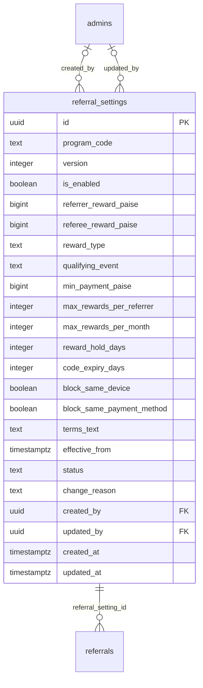

# Module 6 · Referral Configuration

> **Phase 2 · Configuration** · **Depends on:** M0, M1, M2, M5 · **Owns tables:** `referral_settings` · **Build estimate:** 2–3 days

## 1. Module Overview

Configures the three referral programs — learner referrals (parents/students invite others), teacher-refers-teacher and institute referrals: on/off, reward amounts for the referrer and the new user, reward type, the event that qualifies a referral, caps, hold period and anti-fraud rules. Settings are versioned like payment configurations so every referral records the exact rules it earned under.

## 2. Business Purpose

Referrals are a cheap growth channel but easy to abuse. Admins need to tune rewards and rules as they learn, pause a program instantly, and keep an honest record of which rules applied to which reward.

## 3. User Stories

- As **Finance Admin**, I want to set ₹100 for the inviter and ₹100 off for the new parent, paid only after the first payment, so that we only reward real customers.
- As **Super Admin**, I want to pause the teacher referral program if we see abuse so that no new rewards accrue.
- As **Finance Admin**, I want a 7-day hold before rewards are paid so that refunds and fraud can be caught.
- As **Support Admin**, I want to see which rule version a referral used so that I can answer "why did I get ₹50 not ₹100?".

## 4. Functional Requirements & Business Logic

**FR-6.1 Programs.** `LEARNER_REFERRAL` (qualifying event default `first_payment`), `TEACHER_REFERRAL` (`teacher_approved`), `INSTITUTE_REFERRAL` (`institute_approved`). Each has one `active` version and at most one `draft`.

**FR-6.2 Edit & publish.** Same pattern as Module 5 but always effective immediately: `PUT /referral-settings/:program/draft`, `POST /referral-settings/:program/draft/publish { reason }` (supersedes the active version). Quick toggle: `POST /referral-settings/:program/toggle { enabled, reason }`.

**FR-6.3 Rules applied by Module 42.**
1. A referral is created when a new user signs up with a code; it stores the active `referral_setting_id`.
2. When the qualifying event happens (and, for `first_payment`, the payment ≥ `min_payment_paise`), status becomes `qualified`, `reward_release_at = now() + reward_hold_days`.
3. Caps: if the referrer already has `max_rewards_per_referrer` rewarded referrals, or `max_rewards_per_month` this calendar month, the referral is `rejected` with reason `cap_reached`.
4. Fraud rules: `block_same_device` and `block_same_payment_method` put the referral `on_hold` for manual review.
5. `code_expiry_days`: the referee must sign up within N days of first opening the invite link (tracked by the app).
6. When a program is disabled, codes still open the app but no new referral rows are rewarded (created with status `rejected`, reason `program_disabled`); already-qualified referrals continue to release.
7. Rule changes never affect referrals already created — they keep their `referral_setting_id`.

**FR-6.4 Terms text.** Markdown shown on the app's referral screen; the app shows the active version's text.

**FR-6.5 Public endpoint.** `GET /api/v1/app/referral-programs` returns enabled flag, rewards and terms per program (cached 60 s).

## 5. Validation Rules

| Field | Rule |
| --- | --- |
| referrerRewardPaise / refereeRewardPaise | 0 … 1,00,000 paise (₹1,000) each; at least one > 0 when enabled |
| rewardType | wallet_credit, discount, cashback (discount only valid for referee reward) |
| qualifyingEvent | allowed per program (learner: signup/first_payment; teacher: teacher_approved; institute: institute_approved) |
| minPaymentPaise | 0 … 10,00,000; only with first_payment |
| maxRewardsPerReferrer | null or 1–1,000 |
| maxRewardsPerMonth | null or 1–100; ≤ maxRewardsPerReferrer when both set |
| rewardHoldDays | 0–90; must be ≥ 7 when qualifying event is first_payment (covers refund window) |
| codeExpiryDays | null or 1–90 |
| termsText | ≤ 3,000 chars |
| reason | 5–500 chars |

## 6. API Endpoints

| Method | Path | Permission | Description |
| --- | --- | --- | --- |
| GET | /referral-settings | referral_settings.read | Active and draft version per program |
| GET | /referral-settings/:program | referral_settings.read | All versions of a program |
| PUT | /referral-settings/:program/draft | referral_settings.update | Create/update draft |
| DELETE | /referral-settings/:program/draft | referral_settings.update | Discard draft |
| POST | /referral-settings/:program/draft/publish | referral_settings.update | Publish draft (immediate) |
| POST | /referral-settings/:program/toggle | referral_settings.update | Enable/disable immediately |
| GET | /api/v1/app/referral-programs (mobile) | public | Active program rules |

## 7. Request Payloads

```json
// PUT /referral-settings/LEARNER_REFERRAL/draft
{ "isEnabled": true, "referrerRewardPaise": 10000, "refereeRewardPaise": 10000, "rewardType": "wallet_credit", "qualifyingEvent": "first_payment", "minPaymentPaise": 29900,
  "maxRewardsPerReferrer": null, "maxRewardsPerMonth": 20, "rewardHoldDays": 7, "codeExpiryDays": 30, "blockSameDevice": true, "blockSamePaymentMethod": true,
  "termsText": "You get ₹100 when a friend buys Membership with your code…" }

// POST /referral-settings/TEACHER_REFERRAL/toggle
{ "enabled": false, "reason": "Burst of self-referrals from one device range" }
```

## 8. Response Payloads

```json
// 200 GET /referral-settings
{ "data": [ { "programCode": "LEARNER_REFERRAL",
  "active": { "id": "…", "version": 2, "isEnabled": true, "referrerRewardPaise": 10000, "refereeRewardPaise": 10000, "qualifyingEvent": "first_payment", "rewardHoldDays": 7, "maxRewardsPerMonth": 20, "updatedAt": "…" },
  "draft": null, "stats30d": { "referrals": 2318, "rewarded": 352, "paidPaise": 3520000 } } ] }
```

## 9. PostgreSQL Tables

### `referral_settings`

Versioned rules for each referral program. One active version per program.

```sql
CREATE TABLE referral_settings (
  id uuid PRIMARY KEY DEFAULT gen_random_uuid(), -- Primary key (one per version)
  program_code text NOT NULL CHECK (program_code IN ('LEARNER_REFERRAL','TEACHER_REFERRAL','INSTITUTE_REFERRAL')), -- Which program
  version integer NOT NULL CHECK (version > 0), -- Version number per program
  is_enabled boolean NOT NULL DEFAULT true, -- Program on/off; when off, codes still resolve but earn nothing
  referrer_reward_paise bigint NOT NULL DEFAULT 0 CHECK (referrer_reward_paise >= 0), -- Credited to the person who invited
  referee_reward_paise bigint NOT NULL DEFAULT 0 CHECK (referee_reward_paise >= 0), -- Discount or credit for the new user
  reward_type text NOT NULL DEFAULT 'wallet_credit' CHECK (reward_type IN ('wallet_credit','discount','cashback')), -- How rewards are delivered
  qualifying_event text NOT NULL CHECK (qualifying_event IN ('signup','first_payment','teacher_approved','institute_approved')), -- Event that makes a referral count
  min_payment_paise bigint NOT NULL DEFAULT 0 CHECK (min_payment_paise >= 0), -- Minimum first payment for payment-based programs
  max_rewards_per_referrer integer CHECK (max_rewards_per_referrer IS NULL OR max_rewards_per_referrer > 0), -- Lifetime cap per referrer (NULL = no cap)
  max_rewards_per_month integer CHECK (max_rewards_per_month IS NULL OR max_rewards_per_month > 0), -- Monthly cap per referrer
  reward_hold_days integer NOT NULL DEFAULT 7 CHECK (reward_hold_days BETWEEN 0 AND 90), -- Days a reward stays pending for fraud checks / refunds
  code_expiry_days integer CHECK (code_expiry_days IS NULL OR code_expiry_days > 0), -- Days a referee has to sign up after first opening the link
  block_same_device boolean NOT NULL DEFAULT true, -- Reject if referrer and referee share a device fingerprint
  block_same_payment_method boolean NOT NULL DEFAULT true, -- Reject if they share a payment instrument
  terms_text text, -- Terms shown on the referral screen
  effective_from timestamptz NOT NULL DEFAULT now(), -- When this version applies
  status text NOT NULL DEFAULT 'draft' CHECK (status IN ('draft','active','superseded')), -- Version lifecycle
  change_reason text, -- Why it changed
  created_by uuid REFERENCES admins(id), -- Creator
  updated_by uuid REFERENCES admins(id), -- Last editor
  created_at timestamptz NOT NULL DEFAULT now(), -- Created
  updated_at timestamptz NOT NULL DEFAULT now() -- Last updated
);
CREATE UNIQUE INDEX uq_referral_settings_version ON referral_settings (program_code, version);
CREATE UNIQUE INDEX uq_referral_settings_one_active ON referral_settings (program_code) WHERE status = 'active';
CREATE UNIQUE INDEX uq_referral_settings_one_draft ON referral_settings (program_code) WHERE status = 'draft';
CREATE TRIGGER trg_referral_settings_updated BEFORE UPDATE ON referral_settings FOR EACH ROW EXECUTE FUNCTION set_updated_at();
```

Migration file: `sql/migrations/006_m06_referral_configuration.sql`

## 10. Column Definitions

### `referral_settings`

| Column | Type | Null | Default | Constraints / References | Description |
| --- | --- | --- | --- | --- | --- |
| `id` | uuid | no | gen_random_uuid() | PK | Primary key (one per version) |
| `program_code` | text | no | — | CHECK program_code IN ('LEARNER_REFERRAL','TEACHER_REFERRAL','INSTITUTE_REFERRAL') | Which program |
| `version` | integer | no | — | CHECK version > 0 | Version number per program |
| `is_enabled` | boolean | no | true | — | Program on/off; when off, codes still resolve but earn nothing |
| `referrer_reward_paise` | bigint | no | 0 | CHECK referrer_reward_paise >= 0 | Credited to the person who invited |
| `referee_reward_paise` | bigint | no | 0 | CHECK referee_reward_paise >= 0 | Discount or credit for the new user |
| `reward_type` | text | no | 'wallet_credit' | CHECK reward_type IN ('wallet_credit','discount','cashback') | How rewards are delivered |
| `qualifying_event` | text | no | — | CHECK qualifying_event IN ('signup','first_payment','teacher_approved','institute_approved') | Event that makes a referral count |
| `min_payment_paise` | bigint | no | 0 | CHECK min_payment_paise >= 0 | Minimum first payment for payment-based programs |
| `max_rewards_per_referrer` | integer | yes | — | CHECK max_rewards_per_referrer IS NULL OR max_rewards_per_referrer > 0 | Lifetime cap per referrer (NULL = no cap) |
| `max_rewards_per_month` | integer | yes | — | CHECK max_rewards_per_month IS NULL OR max_rewards_per_month > 0 | Monthly cap per referrer |
| `reward_hold_days` | integer | no | 7 | CHECK reward_hold_days BETWEEN 0 AND 90 | Days a reward stays pending for fraud checks / refunds |
| `code_expiry_days` | integer | yes | — | CHECK code_expiry_days IS NULL OR code_expiry_days > 0 | Days a referee has to sign up after first opening the link |
| `block_same_device` | boolean | no | true | — | Reject if referrer and referee share a device fingerprint |
| `block_same_payment_method` | boolean | no | true | — | Reject if they share a payment instrument |
| `terms_text` | text | yes | — | — | Terms shown on the referral screen |
| `effective_from` | timestamptz | no | now() | — | When this version applies |
| `status` | text | no | 'draft' | CHECK status IN ('draft','active','superseded') | Version lifecycle |
| `change_reason` | text | yes | — | — | Why it changed |
| `created_by` | uuid | yes | — | FK → `admins.id` (on delete no action) | Creator |
| `updated_by` | uuid | yes | — | FK → `admins.id` (on delete no action) | Last editor |
| `created_at` | timestamptz | no | now() | — | Created |
| `updated_at` | timestamptz | no | now() | — | Last updated |

## 11. Relationships

**Outgoing foreign keys**

- `referral_settings.created_by` → `admins.id` — optional, many-to-one, on delete **no action**
- `referral_settings.updated_by` → `admins.id` — optional, many-to-one, on delete **no action**

**Referenced by**

- `referrals.referral_setting_id` → `referral_settings` (module 42) — on delete **restrict**

**Entity relationship diagram**



## 12. Indexing Strategy

| Index | Table | Kind | Definition |
| --- | --- | --- | --- |
| `uq_referral_settings_version` | `referral_settings` | unique | `(program_code, version)` |
| `uq_referral_settings_one_active` | `referral_settings` | unique | `(program_code) WHERE status = 'active'` |
| `uq_referral_settings_one_draft` | `referral_settings` | unique | `(program_code) WHERE status = 'draft'` |

Partial unique indexes guarantee one active and one draft version per program; version lookups use `(program_code, version)`.

## 13. Permissions

| Permission key | Allows | Sensitive | Super | Ops | Verif. | Finance | Support |
| --- | --- | --- | --- | --- | --- | --- | --- |
| `referral_settings.read` | View referral program rules | — | ✓ | ✓ | — | ✓ | — |
| `referral_settings.update` | Edit and publish referral program rules | yes | ✓ | — | — | ✓ | — |

## 14. UI Screens & React Page Structure

| Route | Page | Content |
| --- | --- | --- |
| `/payments/referrals-config` | ReferralSettingsPage | One card per program: on/off, rewards, qualifying event, caps, hold, fraud switches, terms editor, version history |

```
src/features/referral-settings/
  pages/ReferralSettingsPage.tsx
  components/ProgramCard.tsx, ProgramRulesForm.tsx, TermsEditor.tsx, ProgramHistory.tsx, PublishRulesDialog.tsx
```

## 15. UI Components

- `ProgramCard` — switch, reward summary sentence ("Inviter gets ₹100 · new user gets ₹100 off · after first payment · 7-day hold").
- `ProgramRulesForm` — money inputs, event select, caps, hold slider, fraud switches.
- `TermsEditor` — Markdown editor with preview.

## 16. Filters

Version history: program, status.

## 17. Search Capabilities

Not applicable.

## 18. Pagination Requirements

Versions: offset, 20.

## 19. Audit Logs

| Event | Details |
| --- | --- |
| `referral_settings.draft_saved` | program, changed fields |
| `referral_settings.published` | program, version, old → new values, reason |
| `referral_settings.toggled` | program, enabled, reason |

## 20. Error Scenarios

| Scenario | HTTP | Code | Message |
| --- | --- | --- | --- |
| Qualifying event not allowed for program | 422 | VALIDATION_FAILED | "Teacher referrals qualify when the teacher is approved." |
| Hold shorter than refund window | 422 | VALIDATION_FAILED | "Hold must be at least 7 days for payment-based rewards." |
| Monthly cap above lifetime cap | 422 | VALIDATION_FAILED | "Monthly cap can't exceed the lifetime cap." |
| Enabled with both rewards 0 | 422 | VALIDATION_FAILED | "Set at least one reward or switch the program off." |
| No draft to publish | 409 | CONFLICT_STATE | "There's no draft to publish." |
| Concurrent publish | 409 | VERSION_CONFLICT | "Someone published just now. Reload." |

## 21. Future Scalability Notes & Enhancements

- Tiered rewards (more per referral after 5 successful referrals).
- Campaign-specific rules attached to campaign codes (Module 42) instead of the program default.
- Scheduled rule changes (reuse Module 5's scheduler).

## 22. Security Considerations

- Changing rewards requires `referral_settings.update` (Finance/Super) and a reason; all versions retained.
- Referrals are bound to the rules version at creation, preventing retroactive manipulation.
