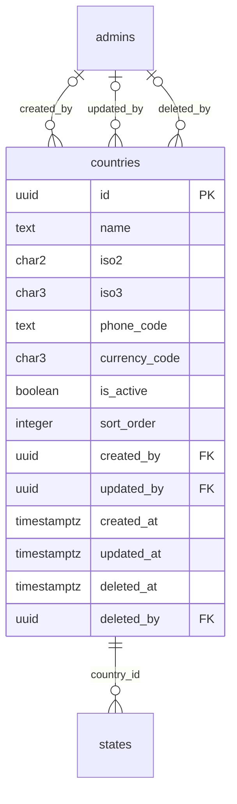

# Module 7 · Country Management

> **Phase 3 · Locations** · **Depends on:** M0, M1, M2 · **Owns tables:** `countries` · **Build estimate:** 1 day

## 1. Module Overview

Maintains the list of countries GuruConnect can operate in. India is seeded and active; other countries can be prepared and kept inactive until launch. Countries are the root of the location hierarchy (country → state → city → area).

## 2. Business Purpose

Every address, phone prefix and currency in the platform hangs off a country. Keeping it as managed data (not hard-coded) lets GuruConnect expand to new markets such as the UAE or Nepal without code changes.

## 3. User Stories

- As **Operations Admin**, I want to add a country and keep it inactive so that I can set up states and cities before launch.
- As **Operations Admin**, I want to deactivate a country so that it disappears from app dropdowns without deleting its data.
- As **any admin with read access**, I want a searchable, filterable list of countries so that I can find one in seconds.
- As **Operations Admin**, I want deleting a country that is in use to be blocked with a clear message so that live records are never orphaned.

## 4. Functional Requirements & Business Logic

**FR-7.1 List.** `GET /countries` returns countries with usage counts, filters, search and sorting. `?active=true&fields=id,name` returns a lightweight list for dropdowns (cached in Redis 10 min, purged on any write in this module).
**FR-7.2 Create.** `POST /countries` validates, generates the slug/code where applicable, inserts, audits and purges caches.
**FR-7.3 Update.** `PATCH /countries/:id` with `If-Match`. Changing identifying fields (code, slug) follows the rules below.
**FR-7.4 Activate / deactivate.** `POST /countries/:id/activate` and `/deactivate` (reason optional). Inactive countries stay on existing records but are hidden from app choices and new admin forms.
**FR-7.5 Delete.** `DELETE /countries/:id` soft-deletes only when no live row references it (states). Otherwise 409 `CONFLICT_IN_USE` with counts per referencing table, and the UI offers "Deactivate instead".
**FR-7.6 Restore.** `POST /countries/:id/restore` (super admin) undeletes if the unique fields are still free.
**FR-7.S1** Deactivating a country cascades visibility: its states, cities and areas are hidden from the app (not modified) because public queries join through active parents.

**FR-7.S2** The country list endpoint for dropdowns (`?active=true&fields=id,name,iso2,phoneCode`) is cached in Redis for 10 minutes and purged on any change in this module.

## 5. Validation Rules

| Field | Label | Rule |
| --- | --- | --- |
| name | Country name | 2–60 chars, unique (case-insensitive) |
| iso2 | ISO alpha-2 | exactly 2 upper-case letters, unique |
| iso3 | ISO alpha-3 | exactly 3 upper-case letters |
| phoneCode | Dialling code | `^\+\d{1,4}$` |
| currencyCode | Currency | ISO 4217, 3 upper-case letters |
| isActive | Active | boolean |
| sortOrder | Order | 0–9,999 |
- Unique checks ignore soft-deleted rows (partial unique indexes); the API maps PostgreSQL error 23505 to `CONFLICT_DUPLICATE` with the conflicting field.
- All strings trimmed; names collapse inner whitespace; slugs lower-case with hyphens.

## 6. API Endpoints

| Method | Path | Permission | Description |
| --- | --- | --- | --- |
| GET | /countries | locations.read | List with filters, search, sort, pagination |
| GET | /countries/:id | locations.read | One country with usage counts |
| POST | /countries | locations.manage | Create |
| PATCH | /countries/:id | locations.manage | Update (If-Match) |
| POST | /countries/:id/activate | locations.manage | Activate |
| POST | /countries/:id/deactivate | locations.manage | Deactivate |
| DELETE | /countries/:id | locations.manage | Soft delete (blocked when in use) |
| POST | /countries/:id/restore | locations.manage + super admin | Restore a deleted country |

## 7. Request Payloads

```json
// POST /countries
{ "name": "United Arab Emirates", "iso2": "AE", "iso3": "ARE", "phoneCode": "+971", "currencyCode": "AED", "isActive": false, "sortOrder": 2 }

// PATCH /countries/:id   (If-Match: 2026-09-20T08:11:02.114Z)
{ "isActive": true, "sortOrder": 5 }

// GET /countries?q=…&active=true&page=1&pageSize=20&sort=name:asc
```

## 8. Response Payloads

```json
// 200 GET /countries
{ "data": [ { "id": "…", "name": "India", "iso2": "IN", "iso3": "IND", "phoneCode": "+91", "currencyCode": "INR", "isActive": true, "sortOrder": 1, "stateCount": 13, "updatedAt": "…" } ], "meta": { "page": 1, "pageSize": 20, "total": 1, "totalPages": 1 } }

// 409 DELETE /countries/:id
{ "error": { "code": "CONFLICT_IN_USE", "message": "This country is used by live records. Deactivate it instead.", "details": { "references": { "states": 214 } } } }
```

## 9. PostgreSQL Tables

### `countries`

Countries the platform can operate in. India is seeded; others stay inactive until launch.

```sql
CREATE TABLE countries (
  id uuid PRIMARY KEY DEFAULT gen_random_uuid(), -- Primary key
  name text NOT NULL, -- Country name, e.g. India
  iso2 char(2) NOT NULL, -- ISO 3166-1 alpha-2, e.g. IN
  iso3 char(3) NOT NULL, -- ISO 3166-1 alpha-3, e.g. IND
  phone_code text NOT NULL, -- Dialling code with plus, e.g. +91
  currency_code char(3) NOT NULL, -- ISO 4217, e.g. INR
  is_active boolean NOT NULL DEFAULT true, -- Inactive countries are hidden in the app
  sort_order integer NOT NULL DEFAULT 0, -- Manual ordering in dropdowns
  created_by uuid REFERENCES admins(id), -- Creator
  updated_by uuid REFERENCES admins(id), -- Last editor
  created_at timestamptz NOT NULL DEFAULT now(), -- Created
  updated_at timestamptz NOT NULL DEFAULT now(), -- Last updated
  deleted_at timestamptz, -- Soft delete
  deleted_by uuid REFERENCES admins(id) -- Who deleted
);
CREATE UNIQUE INDEX uq_countries_iso2 ON countries (iso2) WHERE deleted_at IS NULL;
CREATE UNIQUE INDEX uq_countries_name ON countries (lower(name)) WHERE deleted_at IS NULL;
CREATE TRIGGER trg_countries_updated BEFORE UPDATE ON countries FOR EACH ROW EXECUTE FUNCTION set_updated_at();
```

Migration file: `sql/migrations/007_m07_country_management.sql`

## 10. Column Definitions

### `countries`

| Column | Type | Null | Default | Constraints / References | Description |
| --- | --- | --- | --- | --- | --- |
| `id` | uuid | no | gen_random_uuid() | PK | Primary key |
| `name` | text | no | — | — | Country name, e.g. India |
| `iso2` | char(2) | no | — | — | ISO 3166-1 alpha-2, e.g. IN |
| `iso3` | char(3) | no | — | — | ISO 3166-1 alpha-3, e.g. IND |
| `phone_code` | text | no | — | — | Dialling code with plus, e.g. +91 |
| `currency_code` | char(3) | no | — | — | ISO 4217, e.g. INR |
| `is_active` | boolean | no | true | — | Inactive countries are hidden in the app |
| `sort_order` | integer | no | 0 | — | Manual ordering in dropdowns |
| `created_by` | uuid | yes | — | FK → `admins.id` (on delete no action) | Creator |
| `updated_by` | uuid | yes | — | FK → `admins.id` (on delete no action) | Last editor |
| `created_at` | timestamptz | no | now() | — | Created |
| `updated_at` | timestamptz | no | now() | — | Last updated |
| `deleted_at` | timestamptz | yes | — | — | Soft delete |
| `deleted_by` | uuid | yes | — | FK → `admins.id` (on delete no action) | Who deleted |

## 11. Relationships

**Outgoing foreign keys**

- `countries.created_by` → `admins.id` — optional, many-to-one, on delete **no action**
- `countries.updated_by` → `admins.id` — optional, many-to-one, on delete **no action**
- `countries.deleted_by` → `admins.id` — optional, many-to-one, on delete **no action**

**Referenced by**

- `states.country_id` → `countries` (module 8) — on delete **restrict**

**Entity relationship diagram**



## 12. Indexing Strategy

| Index | Table | Kind | Definition |
| --- | --- | --- | --- |
| `uq_countries_iso2` | `countries` | unique | `(iso2) WHERE deleted_at IS NULL` |
| `uq_countries_name` | `countries` | unique | `(lower(name)) WHERE deleted_at IS NULL` |

- Partial unique indexes enforce uniqueness among live rows only, so a deleted country name can be reused.
- The table is small; sort-order scans are cheap. Usage counts come from indexed foreign keys on the referencing tables.
- Trigram indexes on `name` (where present) back fuzzy search.

## 13. Permissions

| Permission key | Allows | Sensitive | Super | Ops | Verif. | Finance | Support |
| --- | --- | --- | --- | --- | --- | --- | --- |
| `locations.read` | View countries, states, cities and areas | — | ✓ | ✓ | ✓ | — | — |
| `locations.manage` | Create, edit, activate and delete locations | — | ✓ | ✓ | — | — | — |

## 14. UI Screens & React Page Structure

| Route | Page | Content |
| --- | --- | --- |
| `/masters/locations/countries` | CountryListPage | DataTable with filters, search, inline active switch, row actions (edit, deactivate, delete) |
| (drawer) | CountryFormDrawer | Create/edit form with validation |

All master-data pages live under the **Masters** section of the sidebar and share one generic implementation:
```
src/features/masters/
  config/countries.config.ts        column defs, form schema (zod), filters, API paths for this module
  pages/MasterListPage.tsx      generic list driven by the config
  components/MasterFormDrawer.tsx, UsageBadge.tsx, DeleteOrDeactivateDialog.tsx
```

## 15. UI Components

- `MasterListPage` + `countries.config.ts` — list, filters and actions defined declaratively.
- `MasterFormDrawer` — React Hook Form + Zod; parent pickers use `EntityPicker` with async search.
- `DeleteOrDeactivateDialog` — shows reference counts; offers deactivate when delete is blocked.
- `StatusSwitch` — inline active toggle with optimistic update and rollback on error.

## 16. Filters

Active (all / active / inactive). Deleted rows are excluded unless a super admin sets "Show deleted".

## 17. Search Capabilities

`q` matches name (prefix and trigram) and exact `iso2`/`iso3`.

## 18. Pagination Requirements

Offset pagination, default 20, max 100. Sortable fields: name, sortOrder, createdAt. Dropdown mode (`fields=`) returns all active rows unpaginated (hard cap 5,000).

## 19. Audit Logs

| Event | Details |
| --- | --- |
| `country.created` | full new row |
| `country.updated` | changed fields |
| `country.activated` / `country.deactivated` | reason |
| `country.deleted` / `country.restored` | — |

Entity type in the audit log is `countries`.

## 20. Error Scenarios

| Scenario | HTTP | Code | Message |
| --- | --- | --- | --- |
| Duplicate name/code/slug | 409 | CONFLICT_DUPLICATE | "A country with this name already exists." |
| Invalid enum value | 422 | VALIDATION_FAILED | "Pick a value from the list." |
| Delete while referenced | 409 | CONFLICT_IN_USE | "This country is in use. Deactivate it instead." |
| Stale edit | 409 | VERSION_CONFLICT | "Someone else changed this country. Reload." |
| Not found / deleted | 404 | NOT_FOUND | "Country not found." |
| Missing permission | 403 | FORBIDDEN | "You can view countries but not change them." |

## 21. Future Scalability Notes & Enhancements

Localised country names (`name_i18n jsonb`), country-level feature flags, per-country payment gateways.
- Localised names (`name_i18n jsonb`) for Hindi and regional-language apps.
- Public read endpoints can move behind a CDN with 10-minute caching because master data changes rarely.

## 22. Security Considerations

- Writes need `locations.manage`; reads need `locations.read`. Public app endpoints expose only active rows and display fields.
- Imports are validated server-side row by row; CSV formulas (`=`, `+`, `-`, `@` prefixes) are neutralised when exported.
