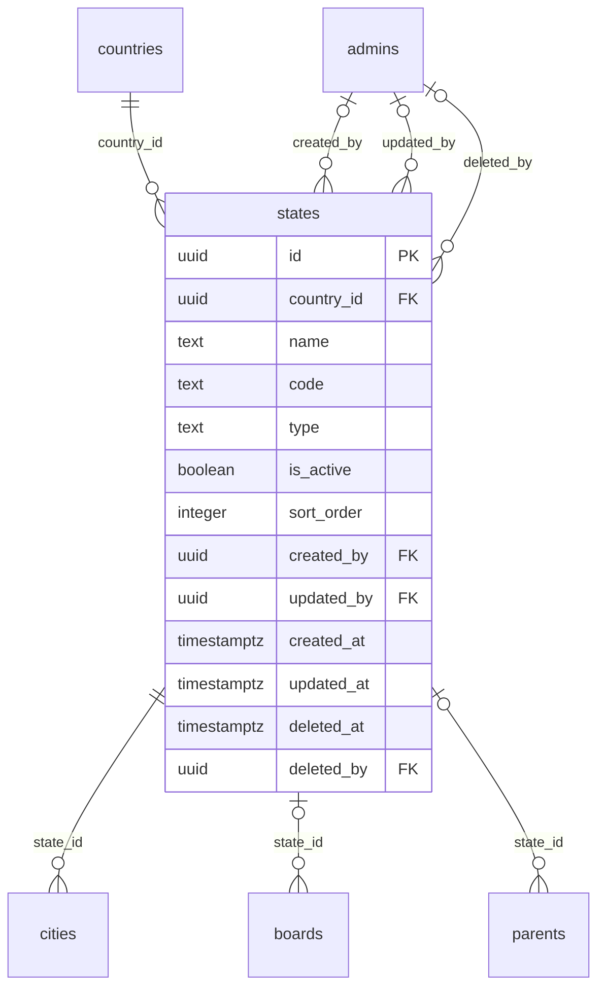

# Module 8 · State Management

> **Phase 3 · Locations** · **Depends on:** M7 · **Owns tables:** `states` · **Build estimate:** 1 day

## 1. Module Overview

Maintains states and union territories under each country. States are used in parent and teacher addresses, state-board mapping (Module 13) and regional reports.

## 2. Business Purpose

State is a required part of Indian addresses and decides which state education board applies. Clean state data keeps filters and reports consistent.

## 3. User Stories

- As **Operations Admin**, I want to add Kerala under India with code KL so that teachers there can register.
- As **Operations Admin**, I want to see how many cities each state has so that I know where coverage is thin.
- As **any admin with read access**, I want a searchable, filterable list of states so that I can find one in seconds.
- As **Operations Admin**, I want deleting a state that is in use to be blocked with a clear message so that live records are never orphaned.

## 4. Functional Requirements & Business Logic

**FR-8.1 List.** `GET /states` returns states with usage counts, filters, search and sorting. `?active=true&fields=id,name` returns a lightweight list for dropdowns (cached in Redis 10 min, purged on any write in this module).
**FR-8.2 Create.** `POST /states` validates, generates the slug/code where applicable, inserts, audits and purges caches.
**FR-8.3 Update.** `PATCH /states/:id` with `If-Match`. Changing identifying fields (code, slug) follows the rules below.
**FR-8.4 Activate / deactivate.** `POST /states/:id/activate` and `/deactivate` (reason optional). Inactive states stay on existing records but are hidden from app choices and new admin forms.
**FR-8.5 Delete.** `DELETE /states/:id` soft-deletes only when no live row references it (cities, boards (state boards), parents). Otherwise 409 `CONFLICT_IN_USE` with counts per referencing table, and the UI offers "Deactivate instead".
**FR-8.6 Restore.** `POST /states/:id/restore` (super admin) undeletes if the unique fields are still free.
**FR-8.S1** Moving a state to another country is not allowed once it has cities (409); create a new state instead.

**FR-8.S2** Bulk import: `POST /states/import` accepts a CSV (`country_iso2,name,code,type`) up to 500 rows; the import is validated as a whole and applied in one transaction; the response lists created/skipped rows.

## 5. Validation Rules

| Field | Label | Rule |
| --- | --- | --- |
| countryId | Country | UUID of an active country |
| name | State name | 2–60 chars, unique within the country |
| code | Code | 1–5 upper-case letters/digits, unique within the country |
| type | Type | state or union_territory |
| isActive | Active | boolean |
| sortOrder | Order | 0–9,999 |
- The parent record (countries) must exist, be active and not deleted.
- Unique checks ignore soft-deleted rows (partial unique indexes); the API maps PostgreSQL error 23505 to `CONFLICT_DUPLICATE` with the conflicting field.
- All strings trimmed; names collapse inner whitespace; slugs lower-case with hyphens.

## 6. API Endpoints

| Method | Path | Permission | Description |
| --- | --- | --- | --- |
| GET | /states | locations.read | List with filters, search, sort, pagination |
| GET | /states/:id | locations.read | One state with usage counts |
| POST | /states | locations.manage | Create |
| PATCH | /states/:id | locations.manage | Update (If-Match) |
| POST | /states/:id/activate | locations.manage | Activate |
| POST | /states/:id/deactivate | locations.manage | Deactivate |
| DELETE | /states/:id | locations.manage | Soft delete (blocked when in use) |
| POST | /states/:id/restore | locations.manage + super admin | Restore a deleted state |
| POST | /states/import | locations.manage | CSV bulk import (≤ 500 rows) |

## 7. Request Payloads

```json
// POST /states
{ "countryId": "…india…", "name": "Kerala", "code": "KL", "type": "state", "isActive": true, "sortOrder": 13 }

// PATCH /states/:id   (If-Match: 2026-09-20T08:11:02.114Z)
{ "isActive": true, "sortOrder": 5 }

// GET /states?q=…&active=true&page=1&pageSize=20&sort=name:asc
```

## 8. Response Payloads

```json
// 200 GET /states
{ "data": [ { "id": "…", "country": { "id": "…", "name": "India" }, "name": "Karnataka", "code": "KA", "type": "state", "isActive": true, "cityCount": 1, "updatedAt": "…" } ], "meta": { "page": 1, "pageSize": 20, "total": 1, "totalPages": 1 } }

// 409 DELETE /states/:id
{ "error": { "code": "CONFLICT_IN_USE", "message": "This state is used by live records. Deactivate it instead.", "details": { "references": { "cities": 214 } } } }
```

## 9. PostgreSQL Tables

### `states`

States and union territories within a country.

```sql
CREATE TABLE states (
  id uuid PRIMARY KEY DEFAULT gen_random_uuid(), -- Primary key
  country_id uuid NOT NULL REFERENCES countries(id) ON DELETE RESTRICT, -- Parent country
  name text NOT NULL, -- State name, e.g. Karnataka
  code text NOT NULL, -- Short code, e.g. KA (ISO 3166-2 suffix)
  type text NOT NULL DEFAULT 'state' CHECK (type IN ('state','union_territory')), -- Administrative type
  is_active boolean NOT NULL DEFAULT true, -- Hidden in the app when false
  sort_order integer NOT NULL DEFAULT 0, -- Manual ordering
  created_by uuid REFERENCES admins(id), -- Creator
  updated_by uuid REFERENCES admins(id), -- Last editor
  created_at timestamptz NOT NULL DEFAULT now(), -- Created
  updated_at timestamptz NOT NULL DEFAULT now(), -- Last updated
  deleted_at timestamptz, -- Soft delete
  deleted_by uuid REFERENCES admins(id) -- Who deleted
);
CREATE UNIQUE INDEX uq_states_country_name ON states (country_id, lower(name)) WHERE deleted_at IS NULL;
CREATE UNIQUE INDEX uq_states_country_code ON states (country_id, code) WHERE deleted_at IS NULL;
CREATE INDEX idx_states_country_active ON states (country_id, is_active) WHERE deleted_at IS NULL;
CREATE TRIGGER trg_states_updated BEFORE UPDATE ON states FOR EACH ROW EXECUTE FUNCTION set_updated_at();
```

Migration file: `sql/migrations/008_m08_state_management.sql`

## 10. Column Definitions

### `states`

| Column | Type | Null | Default | Constraints / References | Description |
| --- | --- | --- | --- | --- | --- |
| `id` | uuid | no | gen_random_uuid() | PK | Primary key |
| `country_id` | uuid | no | — | FK → `countries.id` (on delete restrict) | Parent country |
| `name` | text | no | — | — | State name, e.g. Karnataka |
| `code` | text | no | — | — | Short code, e.g. KA (ISO 3166-2 suffix) |
| `type` | text | no | 'state' | CHECK type IN ('state','union_territory') | Administrative type |
| `is_active` | boolean | no | true | — | Hidden in the app when false |
| `sort_order` | integer | no | 0 | — | Manual ordering |
| `created_by` | uuid | yes | — | FK → `admins.id` (on delete no action) | Creator |
| `updated_by` | uuid | yes | — | FK → `admins.id` (on delete no action) | Last editor |
| `created_at` | timestamptz | no | now() | — | Created |
| `updated_at` | timestamptz | no | now() | — | Last updated |
| `deleted_at` | timestamptz | yes | — | — | Soft delete |
| `deleted_by` | uuid | yes | — | FK → `admins.id` (on delete no action) | Who deleted |

## 11. Relationships

**Outgoing foreign keys**

- `states.country_id` → `countries.id` — required, many-to-one, on delete **restrict**
- `states.created_by` → `admins.id` — optional, many-to-one, on delete **no action**
- `states.updated_by` → `admins.id` — optional, many-to-one, on delete **no action**
- `states.deleted_by` → `admins.id` — optional, many-to-one, on delete **no action**

**Referenced by**

- `cities.state_id` → `states` (module 9) — on delete **restrict**
- `boards.state_id` → `states` (module 13) — on delete **restrict**
- `parents.state_id` → `states` (module 28) — on delete **restrict**

**Entity relationship diagram**



## 12. Indexing Strategy

| Index | Table | Kind | Definition |
| --- | --- | --- | --- |
| `uq_states_country_name` | `states` | unique | `(country_id, lower(name)) WHERE deleted_at IS NULL` |
| `uq_states_country_code` | `states` | unique | `(country_id, code) WHERE deleted_at IS NULL` |
| `idx_states_country_active` | `states` | btree | `(country_id, is_active) WHERE deleted_at IS NULL` |

- Partial unique indexes enforce uniqueness among live rows only, so a deleted state name can be reused.
- Parent-id + active composite indexes serve cascading dropdowns (country → state → city → area) and the "active only" app queries.
- Trigram indexes on `name` (where present) back fuzzy search.

## 13. Permissions

This module uses the permission keys defined for Module 7.

| Permission key | Allows | Sensitive | Super | Ops | Verif. | Finance | Support |
| --- | --- | --- | --- | --- | --- | --- | --- |
| `locations.read` | View countries, states, cities and areas | — | ✓ | ✓ | ✓ | — | — |
| `locations.manage` | Create, edit, activate and delete locations | — | ✓ | ✓ | — | — | — |

## 14. UI Screens & React Page Structure

| Route | Page | Content |
| --- | --- | --- |
| `/masters/locations/states` | StateListPage | DataTable with filters, search, inline active switch, row actions (edit, deactivate, delete) |
| (drawer) | StateFormDrawer | Create/edit form with validation |

All master-data pages live under the **Masters** section of the sidebar and share one generic implementation:
```
src/features/masters/
  config/states.config.ts        column defs, form schema (zod), filters, API paths for this module
  pages/MasterListPage.tsx      generic list driven by the config
  components/MasterFormDrawer.tsx, UsageBadge.tsx, DeleteOrDeactivateDialog.tsx, ImportCsvDialog.tsx
```

## 15. UI Components

- `MasterListPage` + `states.config.ts` — list, filters and actions defined declaratively.
- `MasterFormDrawer` — React Hook Form + Zod; parent pickers use `EntityPicker` with async search.
- `DeleteOrDeactivateDialog` — shows reference counts; offers deactivate when delete is blocked.
- `StatusSwitch` — inline active toggle with optimistic update and rollback on error.
- `ImportCsvDialog` — upload, dry-run table of row errors, confirm apply.

## 16. Filters

Country (required default India), type, active. Deleted rows are excluded unless a super admin sets "Show deleted".

## 17. Search Capabilities

`q` matches name (prefix, trigram) and exact code.

## 18. Pagination Requirements

Offset pagination, default 20, max 100. Sortable fields: name, code, sortOrder, createdAt. Dropdown mode (`fields=`) returns all active rows unpaginated (hard cap 5,000).

## 19. Audit Logs

| Event | Details |
| --- | --- |
| `state.created` | full new row |
| `state.updated` | changed fields |
| `state.activated` / `state.deactivated` | reason |
| `state.deleted` / `state.restored` | — |
| `state.imported` | rows created / skipped |

Entity type in the audit log is `states`.

## 20. Error Scenarios

| Scenario | HTTP | Code | Message |
| --- | --- | --- | --- |
| Duplicate name/code/slug | 409 | CONFLICT_DUPLICATE | "A state with this name already exists." |
| Parent missing or inactive | 422 | VALIDATION_FAILED | "Pick an active parent record." |
| Delete while referenced | 409 | CONFLICT_IN_USE | "This state is in use. Deactivate it instead." |
| Stale edit | 409 | VERSION_CONFLICT | "Someone else changed this state. Reload." |
| Not found / deleted | 404 | NOT_FOUND | "State not found." |
| Missing permission | 403 | FORBIDDEN | "You can view states but not change them." |
| Import has invalid rows | 422 | VALIDATION_FAILED | Row-level error list |

## 21. Future Scalability Notes & Enhancements

GST state codes for invoicing; district level between state and city if rural expansion needs it.
- Localised names (`name_i18n jsonb`) for Hindi and regional-language apps.
- Public read endpoints can move behind a CDN with 10-minute caching because master data changes rarely.

## 22. Security Considerations

- Writes need `locations.manage`; reads need `locations.read`. Public app endpoints expose only active rows and display fields.
- Imports are validated server-side row by row; CSV formulas (`=`, `+`, `-`, `@` prefixes) are neutralised when exported.
