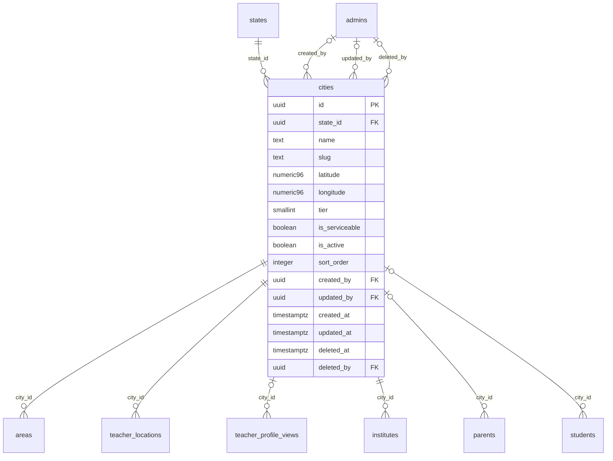

# Module 9 · City Management

> **Phase 3 · Locations** · **Depends on:** M8 · **Owns tables:** `cities` · **Build estimate:** 1–2 days

## 1. Module Overview

Maintains cities under states, including map coordinates, market tier and whether the city is a live ("serviceable") launch city. Cities drive search, featured slots per city, city-wise analytics and banner targeting.

## 2. Business Purpose

GuruConnect launches city by city. Admins need to add a city, prepare its areas and teachers, and flip it to serviceable on launch day without an app release.

## 3. User Stories

- As **Operations Admin**, I want to add Kochi as a tier-2 city and keep it non-serviceable until we have 50 verified teachers.
- As **Super Admin**, I want to mark Kochi serviceable on launch day so that it appears in the city picker.
- As **Operations Admin**, I want to see teachers and users per city so that I can prioritise launches.
- As **any admin with read access**, I want a searchable, filterable list of cities so that I can find one in seconds.
- As **Operations Admin**, I want deleting a city that is in use to be blocked with a clear message so that live records are never orphaned.

## 4. Functional Requirements & Business Logic

**FR-9.1 List.** `GET /cities` returns cities with usage counts, filters, search and sorting. `?active=true&fields=id,name` returns a lightweight list for dropdowns (cached in Redis 10 min, purged on any write in this module).
**FR-9.2 Create.** `POST /cities` validates, generates the slug/code where applicable, inserts, audits and purges caches.
**FR-9.3 Update.** `PATCH /cities/:id` with `If-Match`. Changing identifying fields (code, slug) follows the rules below.
**FR-9.4 Activate / deactivate.** `POST /cities/:id/activate` and `/deactivate` (reason optional). Inactive cities stay on existing records but are hidden from app choices and new admin forms.
**FR-9.5 Delete.** `DELETE /cities/:id` soft-deletes only when no live row references it (areas, teacher_locations, institutes, parents, students). Otherwise 409 `CONFLICT_IN_USE` with counts per referencing table, and the UI offers "Deactivate instead".
**FR-9.6 Restore.** `POST /cities/:id/restore` (super admin) undeletes if the unique fields are still free.
**FR-9.S1** Marking a city serviceable requires a confirmation showing current counts (verified teachers, institutes, areas). A warning appears when there are fewer than 20 verified teachers, but it is not blocking.

**FR-9.S2** Changing a slug is allowed only while the city is not serviceable (deep links and SEO pages use it).

**FR-9.S3** City stats (`GET /cities/:id/stats`) return verified teachers, institutes, parents, students and areas — read from `daily_platform_stats.city_breakdown` when Module 47 exists, else live counts.

## 5. Validation Rules

| Field | Label | Rule |
| --- | --- | --- |
| stateId | State | UUID of an active state |
| name | City name | 2–60 chars, unique within the state |
| slug | Slug | auto from name, `^[a-z0-9-]{2,60}$`, globally unique |
| latitude | Latitude | −90…90, 6 decimals |
| longitude | Longitude | −180…180, 6 decimals |
| tier | Tier | 1, 2 or 3 |
| isServiceable | Serviceable | boolean |
| isActive | Active | boolean |
| sortOrder | Order | 0–9,999 |
- The parent record (states) must exist, be active and not deleted.
- Unique checks ignore soft-deleted rows (partial unique indexes); the API maps PostgreSQL error 23505 to `CONFLICT_DUPLICATE` with the conflicting field.
- All strings trimmed; names collapse inner whitespace; slugs lower-case with hyphens.

## 6. API Endpoints

| Method | Path | Permission | Description |
| --- | --- | --- | --- |
| GET | /cities | locations.read | List with filters, search, sort, pagination |
| GET | /cities/:id | locations.read | One city with usage counts |
| POST | /cities | locations.manage | Create |
| PATCH | /cities/:id | locations.manage | Update (If-Match) |
| POST | /cities/:id/activate | locations.manage | Activate |
| POST | /cities/:id/deactivate | locations.manage | Deactivate |
| DELETE | /cities/:id | locations.manage | Soft delete (blocked when in use) |
| POST | /cities/:id/restore | locations.manage + super admin | Restore a deleted city |
| GET | /cities/:id/stats | locations.manage | Counts of teachers, institutes, users, areas |

## 7. Request Payloads

```json
// POST /cities
{ "stateId": "…kerala…", "name": "Kochi", "slug": "kochi", "latitude": 9.931233, "longitude": 76.267304, "tier": 2, "isServiceable": false, "isActive": true }

// PATCH /cities/:id   (If-Match: 2026-09-20T08:11:02.114Z)
{ "isActive": true, "sortOrder": 5 }

// GET /cities?q=…&active=true&page=1&pageSize=20&sort=name:asc
```

## 8. Response Payloads

```json
// 200 GET /cities
{ "data": [ { "id": "…", "state": { "id": "…", "name": "Karnataka" }, "name": "Bengaluru", "slug": "bengaluru", "tier": 1, "isServiceable": true, "isActive": true, "areaCount": 6, "verifiedTeachers": 3120, "updatedAt": "…" } ], "meta": { "page": 1, "pageSize": 20, "total": 1, "totalPages": 1 } }

// 409 DELETE /cities/:id
{ "error": { "code": "CONFLICT_IN_USE", "message": "This city is used by live records. Deactivate it instead.", "details": { "references": { "areas": 214 } } } }
```

## 9. PostgreSQL Tables

### `cities`

Cities where teachers and institutes can be listed.

```sql
CREATE TABLE cities (
  id uuid PRIMARY KEY DEFAULT gen_random_uuid(), -- Primary key
  state_id uuid NOT NULL REFERENCES states(id) ON DELETE RESTRICT, -- Parent state
  name text NOT NULL, -- City name, e.g. Bengaluru
  slug text NOT NULL, -- URL slug, e.g. bengaluru (used in deep links and SEO pages)
  latitude numeric(9,6) CHECK (latitude BETWEEN -90 AND 90), -- City centre latitude
  longitude numeric(9,6) CHECK (longitude BETWEEN -180 AND 180), -- City centre longitude
  tier smallint CHECK (tier IN (1,2,3)), -- Market tier, used for pricing and featured slots
  is_serviceable boolean NOT NULL DEFAULT false, -- true = shown as a launch city in search
  is_active boolean NOT NULL DEFAULT true, -- Hidden everywhere when false
  sort_order integer NOT NULL DEFAULT 0, -- Manual ordering
  created_by uuid REFERENCES admins(id), -- Creator
  updated_by uuid REFERENCES admins(id), -- Last editor
  created_at timestamptz NOT NULL DEFAULT now(), -- Created
  updated_at timestamptz NOT NULL DEFAULT now(), -- Last updated
  deleted_at timestamptz, -- Soft delete
  deleted_by uuid REFERENCES admins(id) -- Who deleted
);
CREATE UNIQUE INDEX uq_cities_state_name ON cities (state_id, lower(name)) WHERE deleted_at IS NULL;
CREATE UNIQUE INDEX uq_cities_slug ON cities (slug) WHERE deleted_at IS NULL;
CREATE INDEX idx_cities_state_active ON cities (state_id, is_active) WHERE deleted_at IS NULL;
CREATE INDEX idx_cities_name_trgm ON cities USING gin (name gin_trgm_ops);
CREATE TRIGGER trg_cities_updated BEFORE UPDATE ON cities FOR EACH ROW EXECUTE FUNCTION set_updated_at();
```

Migration file: `sql/migrations/009_m09_city_management.sql`

## 10. Column Definitions

### `cities`

| Column | Type | Null | Default | Constraints / References | Description |
| --- | --- | --- | --- | --- | --- |
| `id` | uuid | no | gen_random_uuid() | PK | Primary key |
| `state_id` | uuid | no | — | FK → `states.id` (on delete restrict) | Parent state |
| `name` | text | no | — | — | City name, e.g. Bengaluru |
| `slug` | text | no | — | — | URL slug, e.g. bengaluru (used in deep links and SEO pages) |
| `latitude` | numeric(9,6) | yes | — | CHECK latitude BETWEEN -90 AND 90 | City centre latitude |
| `longitude` | numeric(9,6) | yes | — | CHECK longitude BETWEEN -180 AND 180 | City centre longitude |
| `tier` | smallint | yes | — | CHECK tier IN (1,2,3) | Market tier, used for pricing and featured slots |
| `is_serviceable` | boolean | no | false | — | true = shown as a launch city in search |
| `is_active` | boolean | no | true | — | Hidden everywhere when false |
| `sort_order` | integer | no | 0 | — | Manual ordering |
| `created_by` | uuid | yes | — | FK → `admins.id` (on delete no action) | Creator |
| `updated_by` | uuid | yes | — | FK → `admins.id` (on delete no action) | Last editor |
| `created_at` | timestamptz | no | now() | — | Created |
| `updated_at` | timestamptz | no | now() | — | Last updated |
| `deleted_at` | timestamptz | yes | — | — | Soft delete |
| `deleted_by` | uuid | yes | — | FK → `admins.id` (on delete no action) | Who deleted |

## 11. Relationships

**Outgoing foreign keys**

- `cities.state_id` → `states.id` — required, many-to-one, on delete **restrict**
- `cities.created_by` → `admins.id` — optional, many-to-one, on delete **no action**
- `cities.updated_by` → `admins.id` — optional, many-to-one, on delete **no action**
- `cities.deleted_by` → `admins.id` — optional, many-to-one, on delete **no action**

**Referenced by**

- `areas.city_id` → `cities` (module 10) — on delete **restrict**
- `teacher_locations.city_id` → `cities` (module 20) — on delete **restrict**
- `teacher_profile_views.city_id` → `cities` (module 21) — on delete **no action**
- `institutes.city_id` → `cities` (module 22) — on delete **restrict**
- `parents.city_id` → `cities` (module 28) — on delete **restrict**
- `students.city_id` → `cities` (module 31) — on delete **restrict**

**Entity relationship diagram**



## 12. Indexing Strategy

| Index | Table | Kind | Definition |
| --- | --- | --- | --- |
| `uq_cities_state_name` | `cities` | unique | `(state_id, lower(name)) WHERE deleted_at IS NULL` |
| `uq_cities_slug` | `cities` | unique | `(slug) WHERE deleted_at IS NULL` |
| `idx_cities_state_active` | `cities` | btree | `(state_id, is_active) WHERE deleted_at IS NULL` |
| `idx_cities_name_trgm` | `cities` | gin | `USING gin (name gin_trgm_ops)` |

- Partial unique indexes enforce uniqueness among live rows only, so a deleted city name can be reused.
- Parent-id + active composite indexes serve cascading dropdowns (country → state → city → area) and the "active only" app queries.
- Trigram indexes on `name` (where present) back fuzzy search.

## 13. Permissions

This module uses the permission keys defined for Module 7.

| Permission key | Allows | Sensitive | Super | Ops | Verif. | Finance | Support |
| --- | --- | --- | --- | --- | --- | --- | --- |
| `locations.read` | View countries, states, cities and areas | — | ✓ | ✓ | ✓ | — | — |
| `locations.manage` | Create, edit, activate and delete locations | — | ✓ | ✓ | — | — | — |

## 14. UI Screens & React Page Structure

| Route | Page | Content |
| --- | --- | --- |
| `/masters/locations/cities` | CityListPage | DataTable with filters, search, inline active switch, row actions (edit, deactivate, delete) |
| (drawer) | CityFormDrawer | Create/edit form with validation |

All master-data pages live under the **Masters** section of the sidebar and share one generic implementation:
```
src/features/masters/
  config/cities.config.ts        column defs, form schema (zod), filters, API paths for this module
  pages/MasterListPage.tsx      generic list driven by the config
  components/MasterFormDrawer.tsx, UsageBadge.tsx, DeleteOrDeactivateDialog.tsx
```

## 15. UI Components

- `MasterListPage` + `cities.config.ts` — list, filters and actions defined declaratively.
- `MasterFormDrawer` — React Hook Form + Zod; parent pickers use `EntityPicker` with async search.
- `DeleteOrDeactivateDialog` — shows reference counts; offers deactivate when delete is blocked.
- `StatusSwitch` — inline active toggle with optimistic update and rollback on error.

## 16. Filters

Country, state, tier, serviceable, active. Deleted rows are excluded unless a super admin sets "Show deleted".

## 17. Search Capabilities

`q` matches name (prefix + trigram, ranked by similarity) and exact slug.

## 18. Pagination Requirements

Offset pagination, default 20, max 100. Sortable fields: name, tier, sortOrder, createdAt, verifiedTeachers. Dropdown mode (`fields=`) returns all active rows unpaginated (hard cap 5,000).

## 19. Audit Logs

| Event | Details |
| --- | --- |
| `city.created` | full new row |
| `city.updated` | changed fields |
| `city.activated` / `city.deactivated` | reason |
| `city.deleted` / `city.restored` | — |

Entity type in the audit log is `cities`.

## 20. Error Scenarios

| Scenario | HTTP | Code | Message |
| --- | --- | --- | --- |
| Duplicate name/code/slug | 409 | CONFLICT_DUPLICATE | "A city with this name already exists." |
| Parent missing or inactive | 422 | VALIDATION_FAILED | "Pick an active parent record." |
| Delete while referenced | 409 | CONFLICT_IN_USE | "This city is in use. Deactivate it instead." |
| Stale edit | 409 | VERSION_CONFLICT | "Someone else changed this city. Reload." |
| Not found / deleted | 404 | NOT_FOUND | "City not found." |
| Missing permission | 403 | FORBIDDEN | "You can view cities but not change them." |
| Slug change on a serviceable city | 409 | CONFLICT_STATE | "Slugs can't change after launch." |

## 21. Future Scalability Notes & Enhancements

City boundaries as GeoJSON polygons (PostGIS) for precise "near me" search; per-city pricing and featured-slot counts.
- Localised names (`name_i18n jsonb`) for Hindi and regional-language apps.
- Public read endpoints can move behind a CDN with 10-minute caching because master data changes rarely.

## 22. Security Considerations

- Writes need `locations.manage`; reads need `locations.read`. Public app endpoints expose only active rows and display fields.
- Imports are validated server-side row by row; CSV formulas (`=`, `+`, `-`, `@` prefixes) are neutralised when exported.
