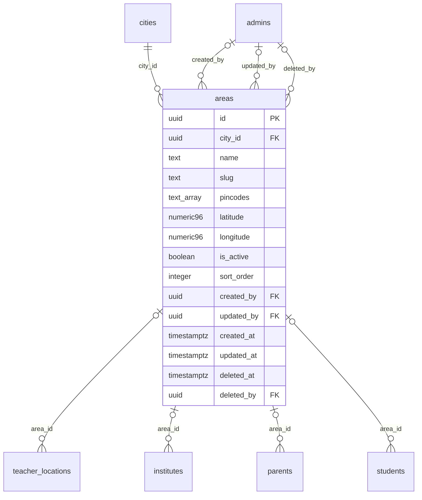

# Module 10 · Area Management

> **Phase 3 · Locations** · **Depends on:** M9 · **Owns tables:** `areas` · **Build estimate:** 1–2 days

## 1. Module Overview

Maintains localities within each city (e.g. Koramangala, HSR Layout) with PIN codes and coordinates. Areas power "nearby teachers", teacher coverage (Module 20) and parent addresses.

## 2. Business Purpose

Parents choose tutors by neighbourhood. Accurate areas with PIN codes make home-tuition matching and distance sorting work.

## 3. User Stories

- As **Operations Admin**, I want to bulk-import 120 areas of Pune from a spreadsheet so that the city is ready quickly.
- As **Operations Admin**, I want to merge two duplicate areas so that teachers and parents point to one record.
- As **any admin with read access**, I want a searchable, filterable list of areas so that I can find one in seconds.
- As **Operations Admin**, I want deleting a area that is in use to be blocked with a clear message so that live records are never orphaned.

## 4. Functional Requirements & Business Logic

**FR-10.1 List.** `GET /areas` returns areas with usage counts, filters, search and sorting. `?active=true&fields=id,name` returns a lightweight list for dropdowns (cached in Redis 10 min, purged on any write in this module).
**FR-10.2 Create.** `POST /areas` validates, generates the slug/code where applicable, inserts, audits and purges caches.
**FR-10.3 Update.** `PATCH /areas/:id` with `If-Match`. Changing identifying fields (code, slug) follows the rules below.
**FR-10.4 Activate / deactivate.** `POST /areas/:id/activate` and `/deactivate` (reason optional). Inactive areas stay on existing records but are hidden from app choices and new admin forms.
**FR-10.5 Delete.** `DELETE /areas/:id` soft-deletes only when no live row references it (teacher_locations, institutes, parents, students). Otherwise 409 `CONFLICT_IN_USE` with counts per referencing table, and the UI offers "Deactivate instead".
**FR-10.6 Restore.** `POST /areas/:id/restore` (super admin) undeletes if the unique fields are still free.
**FR-10.S1 Bulk import.** `POST /areas/import` (CSV `city_slug,name,pincodes,latitude,longitude`, up to 2,000 rows). Validate all rows first; response returns row-level errors; apply only when there are no errors (or with `skipInvalid=true`).

**FR-10.S2 Merge.** `POST /areas/:id/merge { intoAreaId, reason }` moves every reference (`teacher_locations`, `institutes`, `parents`, `students`) from the source to the target area in one transaction, unions PIN codes, then soft-deletes the source. Both areas must be in the same city.

**FR-10.S3 PIN lookup.** `GET /areas/by-pincode/:pin` returns the areas that contain a PIN (used by support and by the app to prefill addresses).

## 5. Validation Rules

| Field | Label | Rule |
| --- | --- | --- |
| cityId | City | UUID of an active city |
| name | Area name | 2–80 chars, unique within the city |
| slug | Slug | auto from name, unique within the city |
| pincodes | PIN codes | 0–20 items, each `^[1-9][0-9]{5}$`, no duplicates |
| latitude | Latitude | optional |
| longitude | Longitude | optional |
| isActive | Active | boolean |
| sortOrder | Order | 0–9,999 |
- The parent record (cities) must exist, be active and not deleted.
- Unique checks ignore soft-deleted rows (partial unique indexes); the API maps PostgreSQL error 23505 to `CONFLICT_DUPLICATE` with the conflicting field.
- All strings trimmed; names collapse inner whitespace; slugs lower-case with hyphens.

## 6. API Endpoints

| Method | Path | Permission | Description |
| --- | --- | --- | --- |
| GET | /areas | locations.read | List with filters, search, sort, pagination |
| GET | /areas/:id | locations.read | One area with usage counts |
| POST | /areas | locations.manage | Create |
| PATCH | /areas/:id | locations.manage | Update (If-Match) |
| POST | /areas/:id/activate | locations.manage | Activate |
| POST | /areas/:id/deactivate | locations.manage | Deactivate |
| DELETE | /areas/:id | locations.manage | Soft delete (blocked when in use) |
| POST | /areas/:id/restore | locations.manage + super admin | Restore a deleted area |
| POST | /areas/import | locations.manage | CSV bulk import (≤ 2,000 rows) |
| POST | /areas/:id/merge | locations.manage | Merge into another area |
| GET | /areas/by-pincode/:pin | locations.manage | Areas containing a PIN code |

## 7. Request Payloads

```json
// POST /areas
{ "cityId": "…bengaluru…", "name": "Koramangala", "pincodes": ["560034", "560095"], "latitude": 12.935242, "longitude": 77.624480, "isActive": true }

// PATCH /areas/:id   (If-Match: 2026-09-20T08:11:02.114Z)
{ "isActive": true, "sortOrder": 5 }

// GET /areas?q=…&active=true&page=1&pageSize=20&sort=name:asc
```

## 8. Response Payloads

```json
// 200 GET /areas
{ "data": [ { "id": "…", "city": { "id": "…", "name": "Bengaluru" }, "name": "Koramangala", "slug": "koramangala", "pincodes": ["560034","560095"], "isActive": true, "teacherCount": 214, "updatedAt": "…" } ], "meta": { "page": 1, "pageSize": 20, "total": 1, "totalPages": 1 } }

// 409 DELETE /areas/:id
{ "error": { "code": "CONFLICT_IN_USE", "message": "This area is used by live records. Deactivate it instead.", "details": { "references": { "teacher_locations": 214 } } } }
```

## 9. PostgreSQL Tables

### `areas`

Localities within a city, used for "nearby" search and teacher coverage.

```sql
CREATE TABLE areas (
  id uuid PRIMARY KEY DEFAULT gen_random_uuid(), -- Primary key
  city_id uuid NOT NULL REFERENCES cities(id) ON DELETE RESTRICT, -- Parent city
  name text NOT NULL, -- Area name, e.g. Koramangala
  slug text NOT NULL, -- Slug unique within the city
  pincodes text[] NOT NULL DEFAULT '{}', -- 6-digit Indian PIN codes covered
  latitude numeric(9,6) CHECK (latitude BETWEEN -90 AND 90), -- Area centre latitude
  longitude numeric(9,6) CHECK (longitude BETWEEN -180 AND 180), -- Area centre longitude
  is_active boolean NOT NULL DEFAULT true, -- Hidden when false
  sort_order integer NOT NULL DEFAULT 0, -- Manual ordering
  created_by uuid REFERENCES admins(id), -- Creator
  updated_by uuid REFERENCES admins(id), -- Last editor
  created_at timestamptz NOT NULL DEFAULT now(), -- Created
  updated_at timestamptz NOT NULL DEFAULT now(), -- Last updated
  deleted_at timestamptz, -- Soft delete
  deleted_by uuid REFERENCES admins(id) -- Who deleted
);
CREATE UNIQUE INDEX uq_areas_city_name ON areas (city_id, lower(name)) WHERE deleted_at IS NULL;
CREATE UNIQUE INDEX uq_areas_city_slug ON areas (city_id, slug) WHERE deleted_at IS NULL;
CREATE INDEX idx_areas_city_active ON areas (city_id, is_active) WHERE deleted_at IS NULL;
CREATE INDEX idx_areas_pincodes ON areas USING gin (pincodes);
CREATE INDEX idx_areas_name_trgm ON areas USING gin (name gin_trgm_ops);
CREATE TRIGGER trg_areas_updated BEFORE UPDATE ON areas FOR EACH ROW EXECUTE FUNCTION set_updated_at();
```

Migration file: `sql/migrations/010_m10_area_management.sql`

## 10. Column Definitions

### `areas`

| Column | Type | Null | Default | Constraints / References | Description |
| --- | --- | --- | --- | --- | --- |
| `id` | uuid | no | gen_random_uuid() | PK | Primary key |
| `city_id` | uuid | no | — | FK → `cities.id` (on delete restrict) | Parent city |
| `name` | text | no | — | — | Area name, e.g. Koramangala |
| `slug` | text | no | — | — | Slug unique within the city |
| `pincodes` | text[] | no | '{}' | — | 6-digit Indian PIN codes covered |
| `latitude` | numeric(9,6) | yes | — | CHECK latitude BETWEEN -90 AND 90 | Area centre latitude |
| `longitude` | numeric(9,6) | yes | — | CHECK longitude BETWEEN -180 AND 180 | Area centre longitude |
| `is_active` | boolean | no | true | — | Hidden when false |
| `sort_order` | integer | no | 0 | — | Manual ordering |
| `created_by` | uuid | yes | — | FK → `admins.id` (on delete no action) | Creator |
| `updated_by` | uuid | yes | — | FK → `admins.id` (on delete no action) | Last editor |
| `created_at` | timestamptz | no | now() | — | Created |
| `updated_at` | timestamptz | no | now() | — | Last updated |
| `deleted_at` | timestamptz | yes | — | — | Soft delete |
| `deleted_by` | uuid | yes | — | FK → `admins.id` (on delete no action) | Who deleted |

## 11. Relationships

**Outgoing foreign keys**

- `areas.city_id` → `cities.id` — required, many-to-one, on delete **restrict**
- `areas.created_by` → `admins.id` — optional, many-to-one, on delete **no action**
- `areas.updated_by` → `admins.id` — optional, many-to-one, on delete **no action**
- `areas.deleted_by` → `admins.id` — optional, many-to-one, on delete **no action**

**Referenced by**

- `teacher_locations.area_id` → `areas` (module 20) — on delete **restrict**
- `institutes.area_id` → `areas` (module 22) — on delete **restrict**
- `parents.area_id` → `areas` (module 28) — on delete **restrict**
- `students.area_id` → `areas` (module 31) — on delete **restrict**

**Entity relationship diagram**



## 12. Indexing Strategy

| Index | Table | Kind | Definition |
| --- | --- | --- | --- |
| `uq_areas_city_name` | `areas` | unique | `(city_id, lower(name)) WHERE deleted_at IS NULL` |
| `uq_areas_city_slug` | `areas` | unique | `(city_id, slug) WHERE deleted_at IS NULL` |
| `idx_areas_city_active` | `areas` | btree | `(city_id, is_active) WHERE deleted_at IS NULL` |
| `idx_areas_pincodes` | `areas` | gin | `USING gin (pincodes)` |
| `idx_areas_name_trgm` | `areas` | gin | `USING gin (name gin_trgm_ops)` |

- Partial unique indexes enforce uniqueness among live rows only, so a deleted area name can be reused.
- Parent-id + active composite indexes serve cascading dropdowns (country → state → city → area) and the "active only" app queries.
- Trigram indexes on `name` (where present) back fuzzy search.

## 13. Permissions

This module uses the permission keys defined for Module 7.

| Permission key | Allows | Sensitive | Super | Ops | Verif. | Finance | Support |
| --- | --- | --- | --- | --- | --- | --- | --- |
| `locations.read` | View countries, states, cities and areas | — | ✓ | ✓ | ✓ | — | — |
| `locations.manage` | Create, edit, activate and delete locations | — | ✓ | ✓ | — | — | — |

## 14. UI Screens & React Page Structure

| Route | Page | Content |
| --- | --- | --- |
| `/masters/locations/areas` | AreaListPage | DataTable with filters, search, inline active switch, row actions (edit, deactivate, delete) |
| (drawer) | AreaFormDrawer | Create/edit form with validation |

All master-data pages live under the **Masters** section of the sidebar and share one generic implementation:
```
src/features/masters/
  config/areas.config.ts        column defs, form schema (zod), filters, API paths for this module
  pages/MasterListPage.tsx      generic list driven by the config
  components/MasterFormDrawer.tsx, UsageBadge.tsx, DeleteOrDeactivateDialog.tsx, ImportCsvDialog.tsx, MergeDialog.tsx
```

## 15. UI Components

- `MasterListPage` + `areas.config.ts` — list, filters and actions defined declaratively.
- `MasterFormDrawer` — React Hook Form + Zod; parent pickers use `EntityPicker` with async search.
- `DeleteOrDeactivateDialog` — shows reference counts; offers deactivate when delete is blocked.
- `StatusSwitch` — inline active toggle with optimistic update and rollback on error.
- `ImportCsvDialog` — upload, dry-run table of row errors, confirm apply.
- `MergeDialog` — pick target, preview how many references move, reason.

## 16. Filters

City (required), active, has coordinates (yes/no). Deleted rows are excluded unless a super admin sets "Show deleted".

## 17. Search Capabilities

`q` matches name (prefix + trigram) or an exact 6-digit PIN code (GIN index on `pincodes`).

## 18. Pagination Requirements

Offset pagination, default 20, max 100. Sortable fields: name, sortOrder, createdAt, teacherCount. Dropdown mode (`fields=`) returns all active rows unpaginated (hard cap 5,000).

## 19. Audit Logs

| Event | Details |
| --- | --- |
| `area.created` | full new row |
| `area.updated` | changed fields |
| `area.activated` / `area.deactivated` | reason |
| `area.deleted` / `area.restored` | — |
| `area.imported` | rows created / skipped |
| `area.merged` | source, target, references moved, reason |

Entity type in the audit log is `areas`.

## 20. Error Scenarios

| Scenario | HTTP | Code | Message |
| --- | --- | --- | --- |
| Duplicate name/code/slug | 409 | CONFLICT_DUPLICATE | "An area with this name already exists." |
| Parent missing or inactive | 422 | VALIDATION_FAILED | "Pick an active parent record." |
| Delete while referenced | 409 | CONFLICT_IN_USE | "This area is in use. Deactivate it instead." |
| Stale edit | 409 | VERSION_CONFLICT | "Someone else changed this area. Reload." |
| Not found / deleted | 404 | NOT_FOUND | "Area not found." |
| Missing permission | 403 | FORBIDDEN | "You can view areas but not change them." |
| Merge across cities | 422 | VALIDATION_FAILED | "Both areas must be in the same city." |
| Import has invalid rows | 422 | VALIDATION_FAILED | Row-level error list |

## 21. Future Scalability Notes & Enhancements

Geocode missing coordinates automatically (Google Geocoding) in a background job; PostGIS points for radius search.
- Localised names (`name_i18n jsonb`) for Hindi and regional-language apps.
- Public read endpoints can move behind a CDN with 10-minute caching because master data changes rarely.

## 22. Security Considerations

- Writes need `locations.manage`; reads need `locations.read`. Public app endpoints expose only active rows and display fields.
- Imports are validated server-side row by row; CSV formulas (`=`, `+`, `-`, `@` prefixes) are neutralised when exported.
