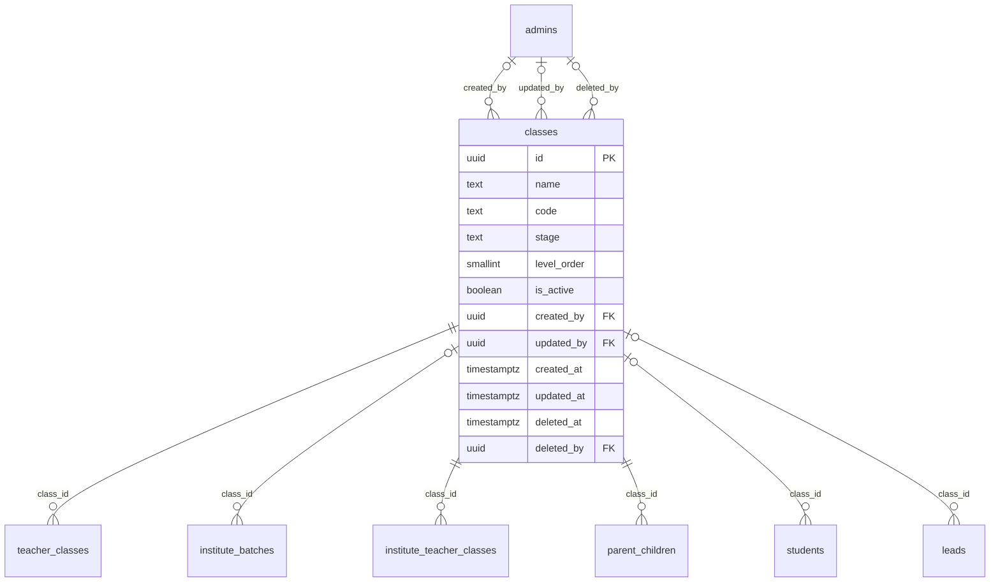

# Module 11 · Class Management

> **Phase 4 · Education Masters** · **Depends on:** M0, M1, M2 · **Owns tables:** `classes` · **Build estimate:** 1 day

## 1. Module Overview

Maintains the grades and levels learners study at — Class 1 to Class 12, Undergraduate, Postgraduate, Competitive exam preparation and Adult learners — each with a stage and a numeric order used for range matching in recommendations.

## 2. Business Purpose

Class is the strongest signal for matching a child to a teacher. The numeric `level_order` lets the system answer "teachers for Class 4" when a teacher covers "Class 1–5".

## 3. User Stories

- As **Operations Admin**, I want to add "Class 11 (Droppers)" as a level so that repeat-year students can be targeted.
- As **Operations Admin**, I want to reorder classes by dragging so that dropdowns show them in teaching order.
- As **any admin with read access**, I want a searchable, filterable list of classes so that I can find one in seconds.
- As **Operations Admin**, I want deleting a class that is in use to be blocked with a clear message so that live records are never orphaned.

## 4. Functional Requirements & Business Logic

**FR-11.1 List.** `GET /classes` returns classes with usage counts, filters, search and sorting. `?active=true&fields=id,name` returns a lightweight list for dropdowns (cached in Redis 10 min, purged on any write in this module).
**FR-11.2 Create.** `POST /classes` validates, generates the slug/code where applicable, inserts, audits and purges caches.
**FR-11.3 Update.** `PATCH /classes/:id` with `If-Match`. Changing identifying fields (code, slug) follows the rules below.
**FR-11.4 Activate / deactivate.** `POST /classes/:id/activate` and `/deactivate` (reason optional). Inactive classes stay on existing records but are hidden from app choices and new admin forms.
**FR-11.5 Delete.** `DELETE /classes/:id` soft-deletes only when no live row references it (teacher_classes, parent_children, students, institute_teacher_classes, institute_batches, leads). Otherwise 409 `CONFLICT_IN_USE` with counts per referencing table, and the UI offers "Deactivate instead".
**FR-11.6 Restore.** `POST /classes/:id/restore` (super admin) undeletes if the unique fields are still free.
**FR-11.S1 Reorder.** `PUT /classes/order { ids: [...] }` rewrites `level_order` in the given sequence (1…n). Reordering warns that recommendation ranges use this order.

**FR-11.S2** `code` is immutable because the mobile app and analytics reference it.

## 5. Validation Rules

| Field | Label | Rule |
| --- | --- | --- |
| name | Name | 2–40 chars, unique |
| code | Code | `^[A-Z0-9_]{2,30}$`, unique, immutable after creation |
| stage | Stage | one of pre_primary, primary, middle, secondary, senior_secondary, undergraduate, postgraduate, competitive, adult |
| levelOrder | Level order | integer 0–50 |
| isActive | Active | boolean |
- Unique checks ignore soft-deleted rows (partial unique indexes); the API maps PostgreSQL error 23505 to `CONFLICT_DUPLICATE` with the conflicting field.
- All strings trimmed; names collapse inner whitespace; slugs lower-case with hyphens.

## 6. API Endpoints

| Method | Path | Permission | Description |
| --- | --- | --- | --- |
| GET | /classes | education_masters.read | List with filters, search, sort, pagination |
| GET | /classes/:id | education_masters.read | One class with usage counts |
| POST | /classes | education_masters.manage | Create |
| PATCH | /classes/:id | education_masters.manage | Update (If-Match) |
| POST | /classes/:id/activate | education_masters.manage | Activate |
| POST | /classes/:id/deactivate | education_masters.manage | Deactivate |
| DELETE | /classes/:id | education_masters.manage | Soft delete (blocked when in use) |
| POST | /classes/:id/restore | education_masters.manage + super admin | Restore a deleted class |
| PUT | /classes/order | education_masters.manage | Reorder (rewrites level_order) |

## 7. Request Payloads

```json
// POST /classes
{ "name": "Class 11 (Droppers)", "code": "CLASS_11_DROP", "stage": "competitive", "levelOrder": 15, "isActive": true }

// PATCH /classes/:id   (If-Match: 2026-09-20T08:11:02.114Z)
{ "isActive": true, "sortOrder": 5 }

// GET /classes?q=…&active=true&page=1&pageSize=20&sort=name:asc
```

## 8. Response Payloads

```json
// 200 GET /classes
{ "data": [ { "id": "…", "name": "Class 10", "code": "CLASS_10", "stage": "secondary", "levelOrder": 10, "isActive": true, "teacherCount": 4120, "childCount": 2211, "updatedAt": "…" } ], "meta": { "page": 1, "pageSize": 20, "total": 1, "totalPages": 1 } }

// 409 DELETE /classes/:id
{ "error": { "code": "CONFLICT_IN_USE", "message": "This class is used by live records. Deactivate it instead.", "details": { "references": { "teacher_classes": 214 } } } }
```

## 9. PostgreSQL Tables

### `classes`

Grades and levels learners study at, from Class 1 to competitive exam preparation.

```sql
CREATE TABLE classes (
  id uuid PRIMARY KEY DEFAULT gen_random_uuid(), -- Primary key
  name text NOT NULL, -- Display name, e.g. Class 10
  code text NOT NULL, -- Stable code, e.g. CLASS_10, UG, COMPETITIVE
  stage text NOT NULL CHECK (stage IN ('pre_primary','primary','middle','secondary','senior_secondary','undergraduate','postgraduate','competitive','adult')), -- Grouping used in filters and recommendations
  level_order smallint NOT NULL, -- Numeric order for range matching (Class 1 = 1 … Class 12 = 12, UG = 13, Competitive = 14)
  is_active boolean NOT NULL DEFAULT true, -- Hidden when false
  created_by uuid REFERENCES admins(id), -- Creator
  updated_by uuid REFERENCES admins(id), -- Last editor
  created_at timestamptz NOT NULL DEFAULT now(), -- Created
  updated_at timestamptz NOT NULL DEFAULT now(), -- Last updated
  deleted_at timestamptz, -- Soft delete
  deleted_by uuid REFERENCES admins(id) -- Who deleted
);
CREATE UNIQUE INDEX uq_classes_code ON classes (code) WHERE deleted_at IS NULL;
CREATE UNIQUE INDEX uq_classes_name ON classes (lower(name)) WHERE deleted_at IS NULL;
CREATE INDEX idx_classes_order ON classes (level_order) WHERE deleted_at IS NULL;
CREATE TRIGGER trg_classes_updated BEFORE UPDATE ON classes FOR EACH ROW EXECUTE FUNCTION set_updated_at();
```

Migration file: `sql/migrations/011_m11_class_management.sql`

## 10. Column Definitions

### `classes`

| Column | Type | Null | Default | Constraints / References | Description |
| --- | --- | --- | --- | --- | --- |
| `id` | uuid | no | gen_random_uuid() | PK | Primary key |
| `name` | text | no | — | — | Display name, e.g. Class 10 |
| `code` | text | no | — | — | Stable code, e.g. CLASS_10, UG, COMPETITIVE |
| `stage` | text | no | — | CHECK stage IN ('pre_primary','primary','middle','secondary','senior_secondary','undergraduate','postgraduate','competitive','adult') | Grouping used in filters and recommendations |
| `level_order` | smallint | no | — | — | Numeric order for range matching (Class 1 = 1 … Class 12 = 12, UG = 13, Competitive = 14) |
| `is_active` | boolean | no | true | — | Hidden when false |
| `created_by` | uuid | yes | — | FK → `admins.id` (on delete no action) | Creator |
| `updated_by` | uuid | yes | — | FK → `admins.id` (on delete no action) | Last editor |
| `created_at` | timestamptz | no | now() | — | Created |
| `updated_at` | timestamptz | no | now() | — | Last updated |
| `deleted_at` | timestamptz | yes | — | — | Soft delete |
| `deleted_by` | uuid | yes | — | FK → `admins.id` (on delete no action) | Who deleted |

## 11. Relationships

**Outgoing foreign keys**

- `classes.created_by` → `admins.id` — optional, many-to-one, on delete **no action**
- `classes.updated_by` → `admins.id` — optional, many-to-one, on delete **no action**
- `classes.deleted_by` → `admins.id` — optional, many-to-one, on delete **no action**

**Referenced by**

- `teacher_classes.class_id` → `classes` (module 19) — on delete **restrict**
- `institute_batches.class_id` → `classes` (module 24) — on delete **restrict**
- `institute_teacher_classes.class_id` → `classes` (module 26) — on delete **restrict**
- `parent_children.class_id` → `classes` (module 29) — on delete **restrict**
- `students.class_id` → `classes` (module 31) — on delete **restrict**
- `leads.class_id` → `classes` (module 38) — on delete **restrict**

**Entity relationship diagram**



## 12. Indexing Strategy

| Index | Table | Kind | Definition |
| --- | --- | --- | --- |
| `uq_classes_code` | `classes` | unique | `(code) WHERE deleted_at IS NULL` |
| `uq_classes_name` | `classes` | unique | `(lower(name)) WHERE deleted_at IS NULL` |
| `idx_classes_order` | `classes` | btree | `(level_order) WHERE deleted_at IS NULL` |

- Partial unique indexes enforce uniqueness among live rows only, so a deleted class name can be reused.
- The table is small; sort-order scans are cheap. Usage counts come from indexed foreign keys on the referencing tables.
- Trigram indexes on `name` (where present) back fuzzy search.

## 13. Permissions

| Permission key | Allows | Sensitive | Super | Ops | Verif. | Finance | Support |
| --- | --- | --- | --- | --- | --- | --- | --- |
| `education_masters.read` | View classes, subjects, boards, teaching modes and teacher categories | — | ✓ | ✓ | ✓ | — | — |
| `education_masters.manage` | Create, edit, activate and delete education master data | — | ✓ | ✓ | — | — | — |

## 14. UI Screens & React Page Structure

| Route | Page | Content |
| --- | --- | --- |
| `/masters/education/classes` | ClassListPage | DataTable with filters, search, inline active switch, row actions (edit, deactivate, delete) |
| (drawer) | ClassFormDrawer | Create/edit form with validation |

All master-data pages live under the **Masters** section of the sidebar and share one generic implementation:
```
src/features/masters/
  config/classes.config.ts        column defs, form schema (zod), filters, API paths for this module
  pages/MasterListPage.tsx      generic list driven by the config
  components/MasterFormDrawer.tsx, UsageBadge.tsx, DeleteOrDeactivateDialog.tsx, SortableList.tsx
```

## 15. UI Components

- `MasterListPage` + `classes.config.ts` — list, filters and actions defined declaratively.
- `MasterFormDrawer` — React Hook Form + Zod; parent pickers use `EntityPicker` with async search.
- `DeleteOrDeactivateDialog` — shows reference counts; offers deactivate when delete is blocked.
- `StatusSwitch` — inline active toggle with optimistic update and rollback on error.
- `SortableList` — drag-and-drop ordering (dnd-kit) with save/cancel.

## 16. Filters

Stage, active. Deleted rows are excluded unless a super admin sets "Show deleted".

## 17. Search Capabilities

`q` matches name and code (prefix).

## 18. Pagination Requirements

Offset pagination, default 20, max 100. Sortable fields: levelOrder (default), name, createdAt. Dropdown mode (`fields=`) returns all active rows unpaginated (hard cap 5,000).

## 19. Audit Logs

| Event | Details |
| --- | --- |
| `class.created` | full new row |
| `class.updated` | changed fields |
| `class.activated` / `class.deactivated` | reason |
| `class.deleted` / `class.restored` | — |
| `class.reordered` | new order |

Entity type in the audit log is `classes`.

## 20. Error Scenarios

| Scenario | HTTP | Code | Message |
| --- | --- | --- | --- |
| Duplicate name/code/slug | 409 | CONFLICT_DUPLICATE | "A class with this name already exists." |
| Invalid enum value | 422 | VALIDATION_FAILED | "Pick a value from the list." |
| Delete while referenced | 409 | CONFLICT_IN_USE | "This class is in use. Deactivate it instead." |
| Stale edit | 409 | VERSION_CONFLICT | "Someone else changed this class. Reload." |
| Not found / deleted | 404 | NOT_FOUND | "Class not found." |
| Missing permission | 403 | FORBIDDEN | "You can view classes but not change them." |
| Changing an existing code | 409 | CONFLICT_STATE | "Class codes can't change." |

## 21. Future Scalability Notes & Enhancements

Country-specific grade systems (Year 1–13 for UK curricula) via a `curriculum` column.
- Localised names (`name_i18n jsonb`) for Hindi and regional-language apps.
- Public read endpoints can move behind a CDN with 10-minute caching because master data changes rarely.

## 22. Security Considerations

- Writes need `education_masters.manage`; reads need `education_masters.read`. Public app endpoints expose only active rows and display fields.
- Imports are validated server-side row by row; CSV formulas (`=`, `+`, `-`, `@` prefixes) are neutralised when exported.
