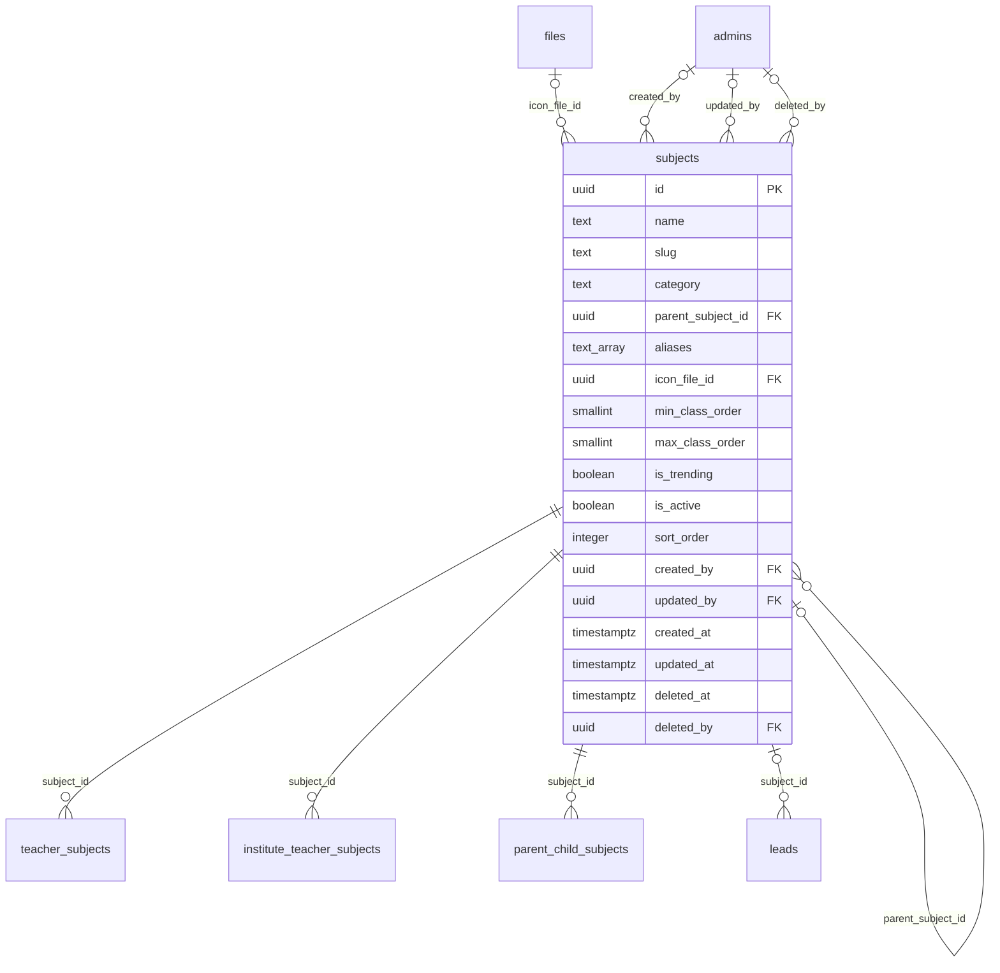

# Module 12 · Subject Management

> **Phase 4 · Education Masters** · **Depends on:** M0, M1, M2, M11 · **Owns tables:** `subjects` · **Build estimate:** 2 days

## 1. Module Overview

Maintains subjects, competitive exams, languages, arts and skills that teachers teach — with categories, optional parent subject, search aliases, an icon, the class range the subject applies to, and a "trending" flag for the app home screen.

## 2. Business Purpose

Subjects are the primary search term. Aliases ("maths" → Mathematics) and hierarchy (Organic Chemistry → Chemistry) make search forgiving; class ranges keep irrelevant subjects out of a Class 3 parent's choices.

## 3. User Stories

- As **Operations Admin**, I want to add "Vedic Maths" under Mathematics with alias "speed maths" so that parents find it.
- As **Operations Admin**, I want to pin five trending subjects so that the app home screen reflects exam season.
- As **Operations Admin**, I want to merge "Maths" into "Mathematics" so that teachers are not split across duplicates.
- As **any admin with read access**, I want a searchable, filterable list of subjects so that I can find one in seconds.
- As **Operations Admin**, I want deleting a subject that is in use to be blocked with a clear message so that live records are never orphaned.

## 4. Functional Requirements & Business Logic

**FR-12.1 List.** `GET /subjects` returns subjects with usage counts, filters, search and sorting. `?active=true&fields=id,name` returns a lightweight list for dropdowns (cached in Redis 10 min, purged on any write in this module).
**FR-12.2 Create.** `POST /subjects` validates, generates the slug/code where applicable, inserts, audits and purges caches.
**FR-12.3 Update.** `PATCH /subjects/:id` with `If-Match`. Changing identifying fields (code, slug) follows the rules below.
**FR-12.4 Activate / deactivate.** `POST /subjects/:id/activate` and `/deactivate` (reason optional). Inactive subjects stay on existing records but are hidden from app choices and new admin forms.
**FR-12.5 Delete.** `DELETE /subjects/:id` soft-deletes only when no live row references it (teacher_subjects, parent_child_subjects, institute_teacher_subjects, leads, child subjects). Otherwise 409 `CONFLICT_IN_USE` with counts per referencing table, and the UI offers "Deactivate instead".
**FR-12.6 Restore.** `POST /subjects/:id/restore` (super admin) undeletes if the unique fields are still free.
**FR-12.S1 Merge.** `POST /subjects/:id/merge { intoSubjectId, reason }` moves references in `teacher_subjects`, `parent_child_subjects`, `institute_teacher_subjects`, `leads` and `institute_batches.subject_ids` (dropping duplicates), adds the source name to the target's aliases, and soft-deletes the source.

**FR-12.S2 Trending.** Setting `isTrending` on an 11th subject returns 409; the UI shows the current 10 to swap.

**FR-12.S3 Class range use.** Module 29 (children) and the app only offer subjects whose range covers the child's class (NULL bounds mean open-ended).

## 5. Validation Rules

| Field | Label | Rule |
| --- | --- | --- |
| name | Name | 2–60 chars, unique |
| slug | Slug | auto, unique |
| category | Category | academic, competitive_exam, language, music_arts, coding_skills, other |
| parentSubjectId | Parent subject | optional UUID; max depth 2; not itself or a descendant |
| aliases | Aliases | 0–15 strings, 2–40 chars each, lower-cased, unique within the subject |
| iconFileId | Icon | optional uploaded image (purpose subject_icon) |
| minClassOrder / maxClassOrder | Class range | optional; min ≤ max; must match existing class orders |
| isTrending | Trending | boolean; at most 10 trending subjects |
| isActive | Active | boolean |
| sortOrder | Order | 0–9,999 |
- Unique checks ignore soft-deleted rows (partial unique indexes); the API maps PostgreSQL error 23505 to `CONFLICT_DUPLICATE` with the conflicting field.
- All strings trimmed; names collapse inner whitespace; slugs lower-case with hyphens.

## 6. API Endpoints

| Method | Path | Permission | Description |
| --- | --- | --- | --- |
| GET | /subjects | education_masters.read | List with filters, search, sort, pagination |
| GET | /subjects/:id | education_masters.read | One subject with usage counts |
| POST | /subjects | education_masters.manage | Create |
| PATCH | /subjects/:id | education_masters.manage | Update (If-Match) |
| POST | /subjects/:id/activate | education_masters.manage | Activate |
| POST | /subjects/:id/deactivate | education_masters.manage | Deactivate |
| DELETE | /subjects/:id | education_masters.manage | Soft delete (blocked when in use) |
| POST | /subjects/:id/restore | education_masters.manage + super admin | Restore a deleted subject |
| POST | /subjects/:id/merge | education_masters.manage | Merge a duplicate subject |

## 7. Request Payloads

```json
// POST /subjects
{ "name": "Vedic Maths", "category": "academic", "parentSubjectId": "…mathematics…", "aliases": ["speed maths"], "minClassOrder": 4, "maxClassOrder": 12, "isTrending": false, "isActive": true }

// PATCH /subjects/:id   (If-Match: 2026-09-20T08:11:02.114Z)
{ "isActive": true, "sortOrder": 5 }

// GET /subjects?q=…&active=true&page=1&pageSize=20&sort=name:asc
```

## 8. Response Payloads

```json
// 200 GET /subjects
{ "data": [ { "id": "…", "name": "Physics", "slug": "physics", "category": "academic", "parent": null, "aliases": [], "classRange": { "min": 9, "max": 14 }, "isTrending": true, "isActive": true, "teacherCount": 2310, "iconUrl": null, "updatedAt": "…" } ], "meta": { "page": 1, "pageSize": 20, "total": 1, "totalPages": 1 } }

// 409 DELETE /subjects/:id
{ "error": { "code": "CONFLICT_IN_USE", "message": "This subject is used by live records. Deactivate it instead.", "details": { "references": { "teacher_subjects": 214 } } } }
```

## 9. PostgreSQL Tables

### `subjects`

Subjects, exams and skills teachers can teach.

```sql
CREATE TABLE subjects (
  id uuid PRIMARY KEY DEFAULT gen_random_uuid(), -- Primary key
  name text NOT NULL, -- Display name, e.g. Physics
  slug text NOT NULL, -- URL slug, e.g. physics
  category text NOT NULL CHECK (category IN ('academic','competitive_exam','language','music_arts','coding_skills','other')), -- Grouping for filters
  parent_subject_id uuid REFERENCES subjects(id) ON DELETE RESTRICT, -- Optional parent, e.g. Organic Chemistry → Chemistry
  aliases text[] NOT NULL DEFAULT '{}', -- Search synonyms, e.g. {maths, math}
  icon_file_id uuid REFERENCES files(id), -- Optional icon shown in the app
  min_class_order smallint, -- Lowest classes.level_order this subject is offered for (NULL = any)
  max_class_order smallint, -- Highest classes.level_order (NULL = any)
  is_trending boolean NOT NULL DEFAULT false, -- Pinned in Trending subjects on the app home screen
  is_active boolean NOT NULL DEFAULT true, -- Hidden when false
  sort_order integer NOT NULL DEFAULT 0, -- Manual ordering
  created_by uuid REFERENCES admins(id), -- Creator
  updated_by uuid REFERENCES admins(id), -- Last editor
  created_at timestamptz NOT NULL DEFAULT now(), -- Created
  updated_at timestamptz NOT NULL DEFAULT now(), -- Last updated
  deleted_at timestamptz, -- Soft delete
  deleted_by uuid REFERENCES admins(id), -- Who deleted
  CONSTRAINT ck_subjects_class_range CHECK (min_class_order IS NULL OR max_class_order IS NULL OR min_class_order <= max_class_order),
  CONSTRAINT ck_subjects_not_self_parent CHECK (parent_subject_id IS NULL OR parent_subject_id <> id)
);
CREATE UNIQUE INDEX uq_subjects_slug ON subjects (slug) WHERE deleted_at IS NULL;
CREATE UNIQUE INDEX uq_subjects_name ON subjects (lower(name)) WHERE deleted_at IS NULL;
CREATE INDEX idx_subjects_category ON subjects (category, is_active) WHERE deleted_at IS NULL;
CREATE INDEX idx_subjects_name_trgm ON subjects USING gin (name gin_trgm_ops);
CREATE INDEX idx_subjects_aliases ON subjects USING gin (aliases);
CREATE TRIGGER trg_subjects_updated BEFORE UPDATE ON subjects FOR EACH ROW EXECUTE FUNCTION set_updated_at();
```

Migration file: `sql/migrations/012_m12_subject_management.sql`

## 10. Column Definitions

### `subjects`

| Column | Type | Null | Default | Constraints / References | Description |
| --- | --- | --- | --- | --- | --- |
| `id` | uuid | no | gen_random_uuid() | PK | Primary key |
| `name` | text | no | — | — | Display name, e.g. Physics |
| `slug` | text | no | — | — | URL slug, e.g. physics |
| `category` | text | no | — | CHECK category IN ('academic','competitive_exam','language','music_arts','coding_skills','other') | Grouping for filters |
| `parent_subject_id` | uuid | yes | — | FK → `subjects.id` (on delete restrict) | Optional parent, e.g. Organic Chemistry → Chemistry |
| `aliases` | text[] | no | '{}' | — | Search synonyms, e.g. {maths, math} |
| `icon_file_id` | uuid | yes | — | FK → `files.id` (on delete no action) | Optional icon shown in the app |
| `min_class_order` | smallint | yes | — | — | Lowest classes.level_order this subject is offered for (NULL = any) |
| `max_class_order` | smallint | yes | — | — | Highest classes.level_order (NULL = any) |
| `is_trending` | boolean | no | false | — | Pinned in Trending subjects on the app home screen |
| `is_active` | boolean | no | true | — | Hidden when false |
| `sort_order` | integer | no | 0 | — | Manual ordering |
| `created_by` | uuid | yes | — | FK → `admins.id` (on delete no action) | Creator |
| `updated_by` | uuid | yes | — | FK → `admins.id` (on delete no action) | Last editor |
| `created_at` | timestamptz | no | now() | — | Created |
| `updated_at` | timestamptz | no | now() | — | Last updated |
| `deleted_at` | timestamptz | yes | — | — | Soft delete |
| `deleted_by` | uuid | yes | — | FK → `admins.id` (on delete no action) | Who deleted |

**Table constraints:** `CONSTRAINT ck_subjects_class_range CHECK (min_class_order IS NULL OR max_class_order IS NULL OR min_class_order <= max_class_order)`; `CONSTRAINT ck_subjects_not_self_parent CHECK (parent_subject_id IS NULL OR parent_subject_id <> id)`

## 11. Relationships

**Outgoing foreign keys**

- `subjects.parent_subject_id` → `subjects.id` — optional, many-to-one, on delete **restrict**
- `subjects.icon_file_id` → `files.id` — optional, many-to-one, on delete **no action**
- `subjects.created_by` → `admins.id` — optional, many-to-one, on delete **no action**
- `subjects.updated_by` → `admins.id` — optional, many-to-one, on delete **no action**
- `subjects.deleted_by` → `admins.id` — optional, many-to-one, on delete **no action**

**Referenced by**

- `teacher_subjects.subject_id` → `subjects` (module 18) — on delete **restrict**
- `institute_teacher_subjects.subject_id` → `subjects` (module 26) — on delete **restrict**
- `parent_child_subjects.subject_id` → `subjects` (module 29) — on delete **restrict**
- `leads.subject_id` → `subjects` (module 38) — on delete **restrict**

**Entity relationship diagram**



## 12. Indexing Strategy

| Index | Table | Kind | Definition |
| --- | --- | --- | --- |
| `uq_subjects_slug` | `subjects` | unique | `(slug) WHERE deleted_at IS NULL` |
| `uq_subjects_name` | `subjects` | unique | `(lower(name)) WHERE deleted_at IS NULL` |
| `idx_subjects_category` | `subjects` | btree | `(category, is_active) WHERE deleted_at IS NULL` |
| `idx_subjects_name_trgm` | `subjects` | gin | `USING gin (name gin_trgm_ops)` |
| `idx_subjects_aliases` | `subjects` | gin | `USING gin (aliases)` |

- Partial unique indexes enforce uniqueness among live rows only, so a deleted subject name can be reused.
- The table is small; sort-order scans are cheap. Usage counts come from indexed foreign keys on the referencing tables.
- Trigram indexes on `name` (where present) back fuzzy search.

## 13. Permissions

This module uses the permission keys defined for Module 11.

| Permission key | Allows | Sensitive | Super | Ops | Verif. | Finance | Support |
| --- | --- | --- | --- | --- | --- | --- | --- |
| `education_masters.read` | View classes, subjects, boards, teaching modes and teacher categories | — | ✓ | ✓ | ✓ | — | — |
| `education_masters.manage` | Create, edit, activate and delete education master data | — | ✓ | ✓ | — | — | — |

## 14. UI Screens & React Page Structure

| Route | Page | Content |
| --- | --- | --- |
| `/masters/education/subjects` | SubjectListPage | DataTable with filters, search, inline active switch, row actions (edit, deactivate, delete) |
| (drawer) | SubjectFormDrawer | Create/edit form with validation |

All master-data pages live under the **Masters** section of the sidebar and share one generic implementation:
```
src/features/masters/
  config/subjects.config.ts        column defs, form schema (zod), filters, API paths for this module
  pages/MasterListPage.tsx      generic list driven by the config
  components/MasterFormDrawer.tsx, UsageBadge.tsx, DeleteOrDeactivateDialog.tsx, MergeDialog.tsx
```

## 15. UI Components

- `MasterListPage` + `subjects.config.ts` — list, filters and actions defined declaratively.
- `MasterFormDrawer` — React Hook Form + Zod; parent pickers use `EntityPicker` with async search.
- `DeleteOrDeactivateDialog` — shows reference counts; offers deactivate when delete is blocked.
- `StatusSwitch` — inline active toggle with optimistic update and rollback on error.
- `MergeDialog` — pick target, preview how many references move, reason.
- `IconUploader` — square image upload with preview.

## 16. Filters

Category, parent subject, trending, active, class (subjects whose range covers it). Deleted rows are excluded unless a super admin sets "Show deleted".

## 17. Search Capabilities

`q` matches name (prefix + trigram) and any alias (GIN on `aliases`).

## 18. Pagination Requirements

Offset pagination, default 20, max 100. Sortable fields: name, sortOrder, teacherCount, createdAt. Dropdown mode (`fields=`) returns all active rows unpaginated (hard cap 5,000).

## 19. Audit Logs

| Event | Details |
| --- | --- |
| `subject.created` | full new row |
| `subject.updated` | changed fields |
| `subject.activated` / `subject.deactivated` | reason |
| `subject.deleted` / `subject.restored` | — |
| `subject.merged` | source, target, references moved, reason |

Entity type in the audit log is `subjects`.

## 20. Error Scenarios

| Scenario | HTTP | Code | Message |
| --- | --- | --- | --- |
| Duplicate name/code/slug | 409 | CONFLICT_DUPLICATE | "A subject with this name already exists." |
| Invalid enum value | 422 | VALIDATION_FAILED | "Pick a value from the list." |
| Delete while referenced | 409 | CONFLICT_IN_USE | "This subject is in use. Deactivate it instead." |
| Stale edit | 409 | VERSION_CONFLICT | "Someone else changed this subject. Reload." |
| Not found / deleted | 404 | NOT_FOUND | "Subject not found." |
| Missing permission | 403 | FORBIDDEN | "You can view subjects but not change them." |
| 11th trending subject | 409 | CONFLICT_STATE | "Up to 10 subjects can be trending." |
| Parent creates a cycle | 422 | VALIDATION_FAILED | "A subject can't be its own parent." |

## 21. Future Scalability Notes & Enhancements

Syllabus topics under subjects (chapter-level matching); multilingual names; automatic trending from search logs.
- Localised names (`name_i18n jsonb`) for Hindi and regional-language apps.
- Public read endpoints can move behind a CDN with 10-minute caching because master data changes rarely.

## 22. Security Considerations

- Writes need `education_masters.manage`; reads need `education_masters.read`. Public app endpoints expose only active rows and display fields.
- Imports are validated server-side row by row; CSV formulas (`=`, `+`, `-`, `@` prefixes) are neutralised when exported.
