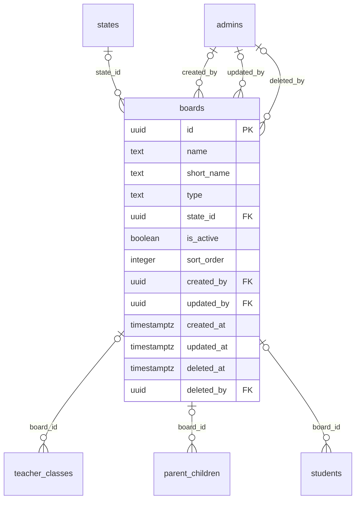

# Module 13 · Board Management

> **Phase 4 · Education Masters** · **Depends on:** M8, M11 · **Owns tables:** `boards` · **Build estimate:** 1 day

## 1. Module Overview

Maintains education boards and curricula — CBSE, ICSE/ISC, IB, IGCSE, NIOS and state boards — used on children, students, teacher class mappings and filters.

## 2. Business Purpose

Parents want tutors who know their child's syllabus. Boards let teachers declare expertise and parents filter by it.

## 3. User Stories

- As **Operations Admin**, I want to add the Kerala State Board linked to Kerala so that parents there can pick it.
- As **Operations Admin**, I want to deactivate a board that no longer exists so that new users cannot pick it but old records keep it.
- As **any admin with read access**, I want a searchable, filterable list of boards so that I can find one in seconds.
- As **Operations Admin**, I want deleting a board that is in use to be blocked with a clear message so that live records are never orphaned.

## 4. Functional Requirements & Business Logic

**FR-13.1 List.** `GET /boards` returns boards with usage counts, filters, search and sorting. `?active=true&fields=id,name` returns a lightweight list for dropdowns (cached in Redis 10 min, purged on any write in this module).
**FR-13.2 Create.** `POST /boards` validates, generates the slug/code where applicable, inserts, audits and purges caches.
**FR-13.3 Update.** `PATCH /boards/:id` with `If-Match`. Changing identifying fields (code, slug) follows the rules below.
**FR-13.4 Activate / deactivate.** `POST /boards/:id/activate` and `/deactivate` (reason optional). Inactive boards stay on existing records but are hidden from app choices and new admin forms.
**FR-13.5 Delete.** `DELETE /boards/:id` soft-deletes only when no live row references it (teacher_classes, parent_children, students). Otherwise 409 `CONFLICT_IN_USE` with counts per referencing table, and the UI offers "Deactivate instead".
**FR-13.6 Restore.** `POST /boards/:id/restore` (super admin) undeletes if the unique fields are still free.
**FR-13.S1** The app shows national and international boards everywhere, and state boards only to users in that state (plus an "Other state board" option).

## 5. Validation Rules

| Field | Label | Rule |
| --- | --- | --- |
| name | Full name | 3–120 chars |
| shortName | Short name | 2–40 chars, unique (case-insensitive) |
| type | Type | national, state, international, university, other |
| stateId | State | required when type = state, must be empty otherwise |
| isActive | Active | boolean |
| sortOrder | Order | 0–9,999 |
- The parent record (states (state boards only)) must exist, be active and not deleted.
- Unique checks ignore soft-deleted rows (partial unique indexes); the API maps PostgreSQL error 23505 to `CONFLICT_DUPLICATE` with the conflicting field.
- All strings trimmed; names collapse inner whitespace; slugs lower-case with hyphens.

## 6. API Endpoints

| Method | Path | Permission | Description |
| --- | --- | --- | --- |
| GET | /boards | education_masters.read | List with filters, search, sort, pagination |
| GET | /boards/:id | education_masters.read | One board with usage counts |
| POST | /boards | education_masters.manage | Create |
| PATCH | /boards/:id | education_masters.manage | Update (If-Match) |
| POST | /boards/:id/activate | education_masters.manage | Activate |
| POST | /boards/:id/deactivate | education_masters.manage | Deactivate |
| DELETE | /boards/:id | education_masters.manage | Soft delete (blocked when in use) |
| POST | /boards/:id/restore | education_masters.manage + super admin | Restore a deleted board |

## 7. Request Payloads

```json
// POST /boards
{ "name": "Kerala Board of Public Examinations", "shortName": "Kerala State Board", "type": "state", "stateId": "…kerala…", "isActive": true }

// PATCH /boards/:id   (If-Match: 2026-09-20T08:11:02.114Z)
{ "isActive": true, "sortOrder": 5 }

// GET /boards?q=…&active=true&page=1&pageSize=20&sort=name:asc
```

## 8. Response Payloads

```json
// 200 GET /boards
{ "data": [ { "id": "…", "name": "Central Board of Secondary Education", "shortName": "CBSE", "type": "national", "state": null, "isActive": true, "usageCount": 5310, "updatedAt": "…" } ], "meta": { "page": 1, "pageSize": 20, "total": 1, "totalPages": 1 } }

// 409 DELETE /boards/:id
{ "error": { "code": "CONFLICT_IN_USE", "message": "This board is used by live records. Deactivate it instead.", "details": { "references": { "teacher_classes": 214 } } } }
```

## 9. PostgreSQL Tables

### `boards`

Education boards and curricula, e.g. CBSE, ICSE, state boards, IB.

```sql
CREATE TABLE boards (
  id uuid PRIMARY KEY DEFAULT gen_random_uuid(), -- Primary key
  name text NOT NULL, -- Full name, e.g. Central Board of Secondary Education
  short_name text NOT NULL, -- Short name shown in chips, e.g. CBSE
  type text NOT NULL CHECK (type IN ('national','state','international','university','other')), -- Board type
  state_id uuid REFERENCES states(id) ON DELETE RESTRICT, -- Required for state boards, NULL otherwise
  is_active boolean NOT NULL DEFAULT true, -- Hidden when false
  sort_order integer NOT NULL DEFAULT 0, -- Manual ordering
  created_by uuid REFERENCES admins(id), -- Creator
  updated_by uuid REFERENCES admins(id), -- Last editor
  created_at timestamptz NOT NULL DEFAULT now(), -- Created
  updated_at timestamptz NOT NULL DEFAULT now(), -- Last updated
  deleted_at timestamptz, -- Soft delete
  deleted_by uuid REFERENCES admins(id), -- Who deleted
  CONSTRAINT ck_boards_state CHECK ((type = 'state') = (state_id IS NOT NULL))
);
CREATE UNIQUE INDEX uq_boards_short_name ON boards (lower(short_name)) WHERE deleted_at IS NULL;
CREATE INDEX idx_boards_type ON boards (type, is_active) WHERE deleted_at IS NULL;
CREATE TRIGGER trg_boards_updated BEFORE UPDATE ON boards FOR EACH ROW EXECUTE FUNCTION set_updated_at();
```

Migration file: `sql/migrations/013_m13_board_management.sql`

## 10. Column Definitions

### `boards`

| Column | Type | Null | Default | Constraints / References | Description |
| --- | --- | --- | --- | --- | --- |
| `id` | uuid | no | gen_random_uuid() | PK | Primary key |
| `name` | text | no | — | — | Full name, e.g. Central Board of Secondary Education |
| `short_name` | text | no | — | — | Short name shown in chips, e.g. CBSE |
| `type` | text | no | — | CHECK type IN ('national','state','international','university','other') | Board type |
| `state_id` | uuid | yes | — | FK → `states.id` (on delete restrict) | Required for state boards, NULL otherwise |
| `is_active` | boolean | no | true | — | Hidden when false |
| `sort_order` | integer | no | 0 | — | Manual ordering |
| `created_by` | uuid | yes | — | FK → `admins.id` (on delete no action) | Creator |
| `updated_by` | uuid | yes | — | FK → `admins.id` (on delete no action) | Last editor |
| `created_at` | timestamptz | no | now() | — | Created |
| `updated_at` | timestamptz | no | now() | — | Last updated |
| `deleted_at` | timestamptz | yes | — | — | Soft delete |
| `deleted_by` | uuid | yes | — | FK → `admins.id` (on delete no action) | Who deleted |

**Table constraints:** `CONSTRAINT ck_boards_state CHECK ((type = 'state') = (state_id IS NOT NULL))`

## 11. Relationships

**Outgoing foreign keys**

- `boards.state_id` → `states.id` — optional, many-to-one, on delete **restrict**
- `boards.created_by` → `admins.id` — optional, many-to-one, on delete **no action**
- `boards.updated_by` → `admins.id` — optional, many-to-one, on delete **no action**
- `boards.deleted_by` → `admins.id` — optional, many-to-one, on delete **no action**

**Referenced by**

- `teacher_classes.board_id` → `boards` (module 19) — on delete **restrict**
- `parent_children.board_id` → `boards` (module 29) — on delete **restrict**
- `students.board_id` → `boards` (module 31) — on delete **restrict**

**Entity relationship diagram**



## 12. Indexing Strategy

| Index | Table | Kind | Definition |
| --- | --- | --- | --- |
| `uq_boards_short_name` | `boards` | unique | `(lower(short_name)) WHERE deleted_at IS NULL` |
| `idx_boards_type` | `boards` | btree | `(type, is_active) WHERE deleted_at IS NULL` |

- Partial unique indexes enforce uniqueness among live rows only, so a deleted board name can be reused.
- Parent-id + active composite indexes serve cascading dropdowns (country → state → city → area) and the "active only" app queries.
- Trigram indexes on `name` (where present) back fuzzy search.

## 13. Permissions

This module uses the permission keys defined for Module 11.

| Permission key | Allows | Sensitive | Super | Ops | Verif. | Finance | Support |
| --- | --- | --- | --- | --- | --- | --- | --- |
| `education_masters.read` | View classes, subjects, boards, teaching modes and teacher categories | — | ✓ | ✓ | ✓ | — | — |
| `education_masters.manage` | Create, edit, activate and delete education master data | — | ✓ | ✓ | — | — | — |

## 14. UI Screens & React Page Structure

| Route | Page | Content |
| --- | --- | --- |
| `/masters/education/boards` | BoardListPage | DataTable with filters, search, inline active switch, row actions (edit, deactivate, delete) |
| (drawer) | BoardFormDrawer | Create/edit form with validation |

All master-data pages live under the **Masters** section of the sidebar and share one generic implementation:
```
src/features/masters/
  config/boards.config.ts        column defs, form schema (zod), filters, API paths for this module
  pages/MasterListPage.tsx      generic list driven by the config
  components/MasterFormDrawer.tsx, UsageBadge.tsx, DeleteOrDeactivateDialog.tsx
```

## 15. UI Components

- `MasterListPage` + `boards.config.ts` — list, filters and actions defined declaratively.
- `MasterFormDrawer` — React Hook Form + Zod; parent pickers use `EntityPicker` with async search.
- `DeleteOrDeactivateDialog` — shows reference counts; offers deactivate when delete is blocked.
- `StatusSwitch` — inline active toggle with optimistic update and rollback on error.

## 16. Filters

Type, state, active. Deleted rows are excluded unless a super admin sets "Show deleted".

## 17. Search Capabilities

`q` matches short name and name (prefix + trigram).

## 18. Pagination Requirements

Offset pagination, default 20, max 100. Sortable fields: sortOrder (default), shortName, createdAt. Dropdown mode (`fields=`) returns all active rows unpaginated (hard cap 5,000).

## 19. Audit Logs

| Event | Details |
| --- | --- |
| `board.created` | full new row |
| `board.updated` | changed fields |
| `board.activated` / `board.deactivated` | reason |
| `board.deleted` / `board.restored` | — |

Entity type in the audit log is `boards`.

## 20. Error Scenarios

| Scenario | HTTP | Code | Message |
| --- | --- | --- | --- |
| Duplicate name/code/slug | 409 | CONFLICT_DUPLICATE | "A board with this name already exists." |
| Parent missing or inactive | 422 | VALIDATION_FAILED | "Pick an active parent record." |
| Delete while referenced | 409 | CONFLICT_IN_USE | "This board is in use. Deactivate it instead." |
| Stale edit | 409 | VERSION_CONFLICT | "Someone else changed this board. Reload." |
| Not found / deleted | 404 | NOT_FOUND | "Board not found." |
| Missing permission | 403 | FORBIDDEN | "You can view boards but not change them." |
| State board without state | 422 | VALIDATION_FAILED | "Pick the state for a state board." |

## 21. Future Scalability Notes & Enhancements

Board-specific class systems and exam calendars (feeds content such as "Board exam timetable").
- Localised names (`name_i18n jsonb`) for Hindi and regional-language apps.
- Public read endpoints can move behind a CDN with 10-minute caching because master data changes rarely.

## 22. Security Considerations

- Writes need `education_masters.manage`; reads need `education_masters.read`. Public app endpoints expose only active rows and display fields.
- Imports are validated server-side row by row; CSV formulas (`=`, `+`, `-`, `@` prefixes) are neutralised when exported.
