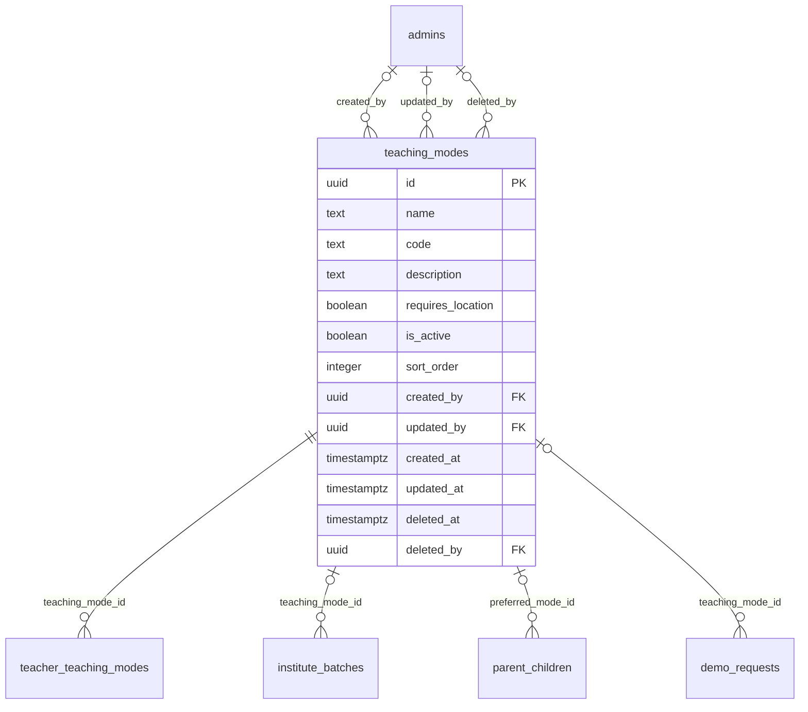

# Module 14 · Teaching Mode Management

> **Phase 4 · Education Masters** · **Depends on:** M0, M1, M2 · **Owns tables:** `teaching_modes` · **Build estimate:** 0.5–1 day

## 1. Module Overview

Maintains how classes are delivered: Online, At teacher's place, Home tuition, Hybrid and Group batch. Each mode says whether a location is needed.

## 2. Business Purpose

Mode is a top filter for parents ("home tutor near me" vs "online"). The `requires_location` flag tells the app when to ask for city/area.

## 3. User Stories

- As **Operations Admin**, I want to rename "Offline" to "At teacher's place" so that parents understand it.
- As **Operations Admin**, I want to add "Recorded course" later without an app update.
- As **any admin with read access**, I want a searchable, filterable list of teaching modes so that I can find one in seconds.
- As **Operations Admin**, I want deleting a teaching mode that is in use to be blocked with a clear message so that live records are never orphaned.

## 4. Functional Requirements & Business Logic

**FR-14.1 List.** `GET /teaching-modes` returns teaching modes with usage counts, filters, search and sorting. `?active=true&fields=id,name` returns a lightweight list for dropdowns (cached in Redis 10 min, purged on any write in this module).
**FR-14.2 Create.** `POST /teaching-modes` validates, generates the slug/code where applicable, inserts, audits and purges caches.
**FR-14.3 Update.** `PATCH /teaching-modes/:id` with `If-Match`. Changing identifying fields (code, slug) follows the rules below.
**FR-14.4 Activate / deactivate.** `POST /teaching-modes/:id/activate` and `/deactivate` (reason optional). Inactive teaching modes stay on existing records but are hidden from app choices and new admin forms.
**FR-14.5 Delete.** `DELETE /teaching-modes/:id` soft-deletes only when no live row references it (teacher_teaching_modes, parent_children.preferred_mode_id, institute_batches, demo_requests). Otherwise 409 `CONFLICT_IN_USE` with counts per referencing table, and the UI offers "Deactivate instead".
**FR-14.6 Restore.** `POST /teaching-modes/:id/restore` (super admin) undeletes if the unique fields are still free.
**FR-14.S1** The five seeded codes (ONLINE, OFFLINE, HOME_TUITION, HYBRID, BATCH) are referenced by app logic and cannot be deleted or deactivated (409); only name, description and order can change.

## 5. Validation Rules

| Field | Label | Rule |
| --- | --- | --- |
| name | Name | 2–40 chars, unique |
| code | Code | `^[A-Z_]{3,30}$`, unique, immutable |
| description | Description | ≤ 200 chars |
| requiresLocation | Needs location | boolean |
| isActive | Active | boolean |
| sortOrder | Order | 0–9,999 |
- Unique checks ignore soft-deleted rows (partial unique indexes); the API maps PostgreSQL error 23505 to `CONFLICT_DUPLICATE` with the conflicting field.
- All strings trimmed; names collapse inner whitespace; slugs lower-case with hyphens.

## 6. API Endpoints

| Method | Path | Permission | Description |
| --- | --- | --- | --- |
| GET | /teaching-modes | education_masters.read | List with filters, search, sort, pagination |
| GET | /teaching-modes/:id | education_masters.read | One teaching mode with usage counts |
| POST | /teaching-modes | education_masters.manage | Create |
| PATCH | /teaching-modes/:id | education_masters.manage | Update (If-Match) |
| POST | /teaching-modes/:id/activate | education_masters.manage | Activate |
| POST | /teaching-modes/:id/deactivate | education_masters.manage | Deactivate |
| DELETE | /teaching-modes/:id | education_masters.manage | Soft delete (blocked when in use) |
| POST | /teaching-modes/:id/restore | education_masters.manage + super admin | Restore a deleted teaching mode |

## 7. Request Payloads

```json
// POST /teaching-modes
{ "name": "Recorded course", "code": "RECORDED", "description": "Pre-recorded lessons with weekly doubt calls", "requiresLocation": false, "isActive": true }

// PATCH /teaching-modes/:id   (If-Match: 2026-09-20T08:11:02.114Z)
{ "isActive": true, "sortOrder": 5 }

// GET /teaching-modes?q=…&active=true&page=1&pageSize=20&sort=name:asc
```

## 8. Response Payloads

```json
// 200 GET /teaching-modes
{ "data": [ { "id": "…", "name": "Home tuition", "code": "HOME_TUITION", "description": "Teacher travels to the student's home", "requiresLocation": true, "isActive": true, "isSystem": true, "teacherCount": 5220 } ], "meta": { "page": 1, "pageSize": 20, "total": 1, "totalPages": 1 } }

// 409 DELETE /teaching-modes/:id
{ "error": { "code": "CONFLICT_IN_USE", "message": "This teaching mode is used by live records. Deactivate it instead.", "details": { "references": { "teacher_teaching_modes": 214 } } } }
```

## 9. PostgreSQL Tables

### `teaching_modes`

How classes are delivered, e.g. Online, Offline at teacher's place, Home tuition, Hybrid.

```sql
CREATE TABLE teaching_modes (
  id uuid PRIMARY KEY DEFAULT gen_random_uuid(), -- Primary key
  name text NOT NULL, -- Display name, e.g. Home tuition
  code text NOT NULL, -- Stable code: ONLINE, OFFLINE, HOME_TUITION, HYBRID, BATCH
  description text, -- Help text shown to teachers
  requires_location boolean NOT NULL DEFAULT true, -- false for ONLINE (no city/area needed)
  is_active boolean NOT NULL DEFAULT true, -- Hidden when false
  sort_order integer NOT NULL DEFAULT 0, -- Manual ordering
  created_by uuid REFERENCES admins(id), -- Creator
  updated_by uuid REFERENCES admins(id), -- Last editor
  created_at timestamptz NOT NULL DEFAULT now(), -- Created
  updated_at timestamptz NOT NULL DEFAULT now(), -- Last updated
  deleted_at timestamptz, -- Soft delete
  deleted_by uuid REFERENCES admins(id) -- Who deleted
);
CREATE UNIQUE INDEX uq_teaching_modes_code ON teaching_modes (code) WHERE deleted_at IS NULL;
CREATE UNIQUE INDEX uq_teaching_modes_name ON teaching_modes (lower(name)) WHERE deleted_at IS NULL;
CREATE TRIGGER trg_teaching_modes_updated BEFORE UPDATE ON teaching_modes FOR EACH ROW EXECUTE FUNCTION set_updated_at();
```

Migration file: `sql/migrations/014_m14_teaching_mode_management.sql`

## 10. Column Definitions

### `teaching_modes`

| Column | Type | Null | Default | Constraints / References | Description |
| --- | --- | --- | --- | --- | --- |
| `id` | uuid | no | gen_random_uuid() | PK | Primary key |
| `name` | text | no | — | — | Display name, e.g. Home tuition |
| `code` | text | no | — | — | Stable code: ONLINE, OFFLINE, HOME_TUITION, HYBRID, BATCH |
| `description` | text | yes | — | — | Help text shown to teachers |
| `requires_location` | boolean | no | true | — | false for ONLINE (no city/area needed) |
| `is_active` | boolean | no | true | — | Hidden when false |
| `sort_order` | integer | no | 0 | — | Manual ordering |
| `created_by` | uuid | yes | — | FK → `admins.id` (on delete no action) | Creator |
| `updated_by` | uuid | yes | — | FK → `admins.id` (on delete no action) | Last editor |
| `created_at` | timestamptz | no | now() | — | Created |
| `updated_at` | timestamptz | no | now() | — | Last updated |
| `deleted_at` | timestamptz | yes | — | — | Soft delete |
| `deleted_by` | uuid | yes | — | FK → `admins.id` (on delete no action) | Who deleted |

## 11. Relationships

**Outgoing foreign keys**

- `teaching_modes.created_by` → `admins.id` — optional, many-to-one, on delete **no action**
- `teaching_modes.updated_by` → `admins.id` — optional, many-to-one, on delete **no action**
- `teaching_modes.deleted_by` → `admins.id` — optional, many-to-one, on delete **no action**

**Referenced by**

- `teacher_teaching_modes.teaching_mode_id` → `teaching_modes` (module 20) — on delete **restrict**
- `institute_batches.teaching_mode_id` → `teaching_modes` (module 24) — on delete **restrict**
- `parent_children.preferred_mode_id` → `teaching_modes` (module 29) — on delete **restrict**
- `demo_requests.teaching_mode_id` → `teaching_modes` (module 39) — on delete **restrict**

**Entity relationship diagram**



## 12. Indexing Strategy

| Index | Table | Kind | Definition |
| --- | --- | --- | --- |
| `uq_teaching_modes_code` | `teaching_modes` | unique | `(code) WHERE deleted_at IS NULL` |
| `uq_teaching_modes_name` | `teaching_modes` | unique | `(lower(name)) WHERE deleted_at IS NULL` |

- Partial unique indexes enforce uniqueness among live rows only, so a deleted teaching mode name can be reused.
- The table is small; sort-order scans are cheap. Usage counts come from indexed foreign keys on the referencing tables.
- Trigram indexes on `name` (where present) back fuzzy search.

## 13. Permissions

This module uses the permission keys defined for Module 11.

| Permission key | Allows | Sensitive | Super | Ops | Verif. | Finance | Support |
| --- | --- | --- | --- | --- | --- | --- | --- |
| `education_masters.read` | View classes, subjects, boards, teaching modes and teacher categories | — | ✓ | ✓ | ✓ | — | — |
| `education_masters.manage` | Create, edit, activate and delete education master data | — | ✓ | ✓ | — | — | — |

## 14. UI Screens & React Page Structure

| Route | Page | Content |
| --- | --- | --- |
| `/masters/education/teaching-modes` | TeachingModeListPage | DataTable with filters, search, inline active switch, row actions (edit, deactivate, delete) |
| (drawer) | TeachingModeFormDrawer | Create/edit form with validation |

All master-data pages live under the **Masters** section of the sidebar and share one generic implementation:
```
src/features/masters/
  config/teaching_modes.config.ts        column defs, form schema (zod), filters, API paths for this module
  pages/MasterListPage.tsx      generic list driven by the config
  components/MasterFormDrawer.tsx, UsageBadge.tsx, DeleteOrDeactivateDialog.tsx
```

## 15. UI Components

- `MasterListPage` + `teaching_modes.config.ts` — list, filters and actions defined declaratively.
- `MasterFormDrawer` — React Hook Form + Zod; parent pickers use `EntityPicker` with async search.
- `DeleteOrDeactivateDialog` — shows reference counts; offers deactivate when delete is blocked.
- `StatusSwitch` — inline active toggle with optimistic update and rollback on error.

## 16. Filters

Active. Deleted rows are excluded unless a super admin sets "Show deleted".

## 17. Search Capabilities

Client-side (fewer than 20 rows).

## 18. Pagination Requirements

Offset pagination, default 20, max 100. Sortable fields: sortOrder (default), name. Dropdown mode (`fields=`) returns all active rows unpaginated (hard cap 5,000).

## 19. Audit Logs

| Event | Details |
| --- | --- |
| `teaching_mode.created` | full new row |
| `teaching_mode.updated` | changed fields |
| `teaching_mode.activated` / `teaching_mode.deactivated` | reason |
| `teaching_mode.deleted` / `teaching_mode.restored` | — |

Entity type in the audit log is `teaching_modes`.

## 20. Error Scenarios

| Scenario | HTTP | Code | Message |
| --- | --- | --- | --- |
| Duplicate name/code/slug | 409 | CONFLICT_DUPLICATE | "A teaching mode with this name already exists." |
| Invalid enum value | 422 | VALIDATION_FAILED | "Pick a value from the list." |
| Delete while referenced | 409 | CONFLICT_IN_USE | "This teaching mode is in use. Deactivate it instead." |
| Stale edit | 409 | VERSION_CONFLICT | "Someone else changed this teaching mode. Reload." |
| Not found / deleted | 404 | NOT_FOUND | "Teaching mode not found." |
| Missing permission | 403 | FORBIDDEN | "You can view teaching modes but not change them." |
| Deactivate/delete a system mode | 409 | CONFLICT_STATE | "Built-in modes can't be removed." |

## 21. Future Scalability Notes & Enhancements

Mode-specific fields (e.g., max travel distance for home tuition, platform for online).
- Localised names (`name_i18n jsonb`) for Hindi and regional-language apps.
- Public read endpoints can move behind a CDN with 10-minute caching because master data changes rarely.

## 22. Security Considerations

- Writes need `education_masters.manage`; reads need `education_masters.read`. Public app endpoints expose only active rows and display fields.
- Imports are validated server-side row by row; CSV formulas (`=`, `+`, `-`, `@` prefixes) are neutralised when exported.
