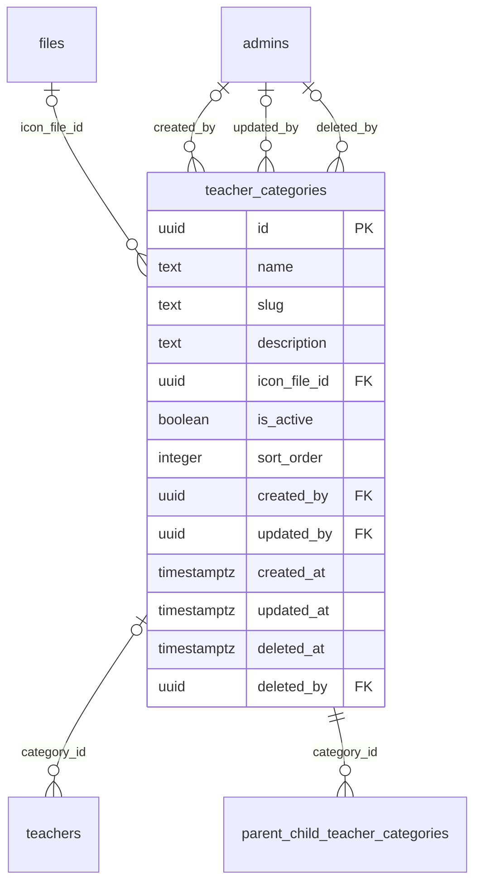

# Module 15 · Teacher Category Management

> **Phase 4 · Education Masters** · **Depends on:** M0, M1, M2 · **Owns tables:** `teacher_categories` · **Build estimate:** 1 day

## 1. Module Overview

Maintains teacher types — Home Tutor, School Teacher, Coaching Faculty, Competitive Exam Faculty, Language Trainer, Music & Arts Teacher, Coding & Skills Mentor — shown as the category grid in the app and used for parent preferences per child.

## 2. Business Purpose

Categories are how parents think ("I need a home tutor for Riya"). They drive home-screen navigation, filters and the per-child recommendation engine.

## 3. User Stories

- As **Operations Admin**, I want to add a "Sports Coach" category with an icon so that it appears on the app home grid.
- As **Operations Admin**, I want to reorder categories so that the most searched appear first.
- As **any admin with read access**, I want a searchable, filterable list of teacher categories so that I can find one in seconds.
- As **Operations Admin**, I want deleting a teacher category that is in use to be blocked with a clear message so that live records are never orphaned.

## 4. Functional Requirements & Business Logic

**FR-15.1 List.** `GET /teacher-categories` returns teacher categories with usage counts, filters, search and sorting. `?active=true&fields=id,name` returns a lightweight list for dropdowns (cached in Redis 10 min, purged on any write in this module).
**FR-15.2 Create.** `POST /teacher-categories` validates, generates the slug/code where applicable, inserts, audits and purges caches.
**FR-15.3 Update.** `PATCH /teacher-categories/:id` with `If-Match`. Changing identifying fields (code, slug) follows the rules below.
**FR-15.4 Activate / deactivate.** `POST /teacher-categories/:id/activate` and `/deactivate` (reason optional). Inactive teacher categories stay on existing records but are hidden from app choices and new admin forms.
**FR-15.5 Delete.** `DELETE /teacher-categories/:id` soft-deletes only when no live row references it (teachers.category_id, parent_child_teacher_categories). Otherwise 409 `CONFLICT_IN_USE` with counts per referencing table, and the UI offers "Deactivate instead".
**FR-15.6 Restore.** `POST /teacher-categories/:id/restore` (super admin) undeletes if the unique fields are still free.
**FR-15.S1 Reorder.** `PUT /teacher-categories/order { ids }` (drag and drop).

**FR-15.S2** Deactivating a category that teachers use keeps it on their profiles but removes it from filters and onboarding choices; the UI shows the number of affected teachers first.

## 5. Validation Rules

| Field | Label | Rule |
| --- | --- | --- |
| name | Name | 2–50 chars, unique |
| slug | Slug | auto, unique |
| description | Description | ≤ 200 chars |
| iconFileId | Icon | optional image (purpose category_icon, 128×128 PNG/SVG-rasterised) |
| isActive | Active | boolean |
| sortOrder | Order | 0–9,999; the first 8 active categories show on the home grid |
- Unique checks ignore soft-deleted rows (partial unique indexes); the API maps PostgreSQL error 23505 to `CONFLICT_DUPLICATE` with the conflicting field.
- All strings trimmed; names collapse inner whitespace; slugs lower-case with hyphens.

## 6. API Endpoints

| Method | Path | Permission | Description |
| --- | --- | --- | --- |
| GET | /teacher-categories | education_masters.read | List with filters, search, sort, pagination |
| GET | /teacher-categories/:id | education_masters.read | One teacher category with usage counts |
| POST | /teacher-categories | education_masters.manage | Create |
| PATCH | /teacher-categories/:id | education_masters.manage | Update (If-Match) |
| POST | /teacher-categories/:id/activate | education_masters.manage | Activate |
| POST | /teacher-categories/:id/deactivate | education_masters.manage | Deactivate |
| DELETE | /teacher-categories/:id | education_masters.manage | Soft delete (blocked when in use) |
| POST | /teacher-categories/:id/restore | education_masters.manage + super admin | Restore a deleted teacher category |
| PUT | /teacher-categories/order | education_masters.manage | Reorder categories |

## 7. Request Payloads

```json
// POST /teacher-categories
{ "name": "Sports Coach", "description": "Cricket, football, swimming and fitness coaches", "iconFileId": "…", "isActive": true }

// PATCH /teacher-categories/:id   (If-Match: 2026-09-20T08:11:02.114Z)
{ "isActive": true, "sortOrder": 5 }

// GET /teacher-categories?q=…&active=true&page=1&pageSize=20&sort=name:asc
```

## 8. Response Payloads

```json
// 200 GET /teacher-categories
{ "data": [ { "id": "…", "name": "Home Tutor", "slug": "home-tutor", "description": "…", "iconUrl": "https://cdn…/home.png", "isActive": true, "sortOrder": 1, "teacherCount": 3890, "childPreferenceCount": 1204 } ], "meta": { "page": 1, "pageSize": 20, "total": 1, "totalPages": 1 } }

// 409 DELETE /teacher-categories/:id
{ "error": { "code": "CONFLICT_IN_USE", "message": "This teacher category is used by live records. Deactivate it instead.", "details": { "references": { "teachers.category_id": 214 } } } }
```

## 9. PostgreSQL Tables

### `teacher_categories`

Types of teacher shown as categories and used in parent preferences, e.g. Home Tutor, Coaching Faculty.

```sql
CREATE TABLE teacher_categories (
  id uuid PRIMARY KEY DEFAULT gen_random_uuid(), -- Primary key
  name text NOT NULL, -- Display name, e.g. Competitive Exam Faculty
  slug text NOT NULL, -- URL slug
  description text, -- Shown on the category page
  icon_file_id uuid REFERENCES files(id), -- Category icon
  is_active boolean NOT NULL DEFAULT true, -- Hidden when false
  sort_order integer NOT NULL DEFAULT 0, -- Order on the app home grid
  created_by uuid REFERENCES admins(id), -- Creator
  updated_by uuid REFERENCES admins(id), -- Last editor
  created_at timestamptz NOT NULL DEFAULT now(), -- Created
  updated_at timestamptz NOT NULL DEFAULT now(), -- Last updated
  deleted_at timestamptz, -- Soft delete
  deleted_by uuid REFERENCES admins(id) -- Who deleted
);
CREATE UNIQUE INDEX uq_teacher_categories_slug ON teacher_categories (slug) WHERE deleted_at IS NULL;
CREATE UNIQUE INDEX uq_teacher_categories_name ON teacher_categories (lower(name)) WHERE deleted_at IS NULL;
CREATE TRIGGER trg_teacher_categories_updated BEFORE UPDATE ON teacher_categories FOR EACH ROW EXECUTE FUNCTION set_updated_at();
```

Migration file: `sql/migrations/015_m15_teacher_category_management.sql`

## 10. Column Definitions

### `teacher_categories`

| Column | Type | Null | Default | Constraints / References | Description |
| --- | --- | --- | --- | --- | --- |
| `id` | uuid | no | gen_random_uuid() | PK | Primary key |
| `name` | text | no | — | — | Display name, e.g. Competitive Exam Faculty |
| `slug` | text | no | — | — | URL slug |
| `description` | text | yes | — | — | Shown on the category page |
| `icon_file_id` | uuid | yes | — | FK → `files.id` (on delete no action) | Category icon |
| `is_active` | boolean | no | true | — | Hidden when false |
| `sort_order` | integer | no | 0 | — | Order on the app home grid |
| `created_by` | uuid | yes | — | FK → `admins.id` (on delete no action) | Creator |
| `updated_by` | uuid | yes | — | FK → `admins.id` (on delete no action) | Last editor |
| `created_at` | timestamptz | no | now() | — | Created |
| `updated_at` | timestamptz | no | now() | — | Last updated |
| `deleted_at` | timestamptz | yes | — | — | Soft delete |
| `deleted_by` | uuid | yes | — | FK → `admins.id` (on delete no action) | Who deleted |

## 11. Relationships

**Outgoing foreign keys**

- `teacher_categories.icon_file_id` → `files.id` — optional, many-to-one, on delete **no action**
- `teacher_categories.created_by` → `admins.id` — optional, many-to-one, on delete **no action**
- `teacher_categories.updated_by` → `admins.id` — optional, many-to-one, on delete **no action**
- `teacher_categories.deleted_by` → `admins.id` — optional, many-to-one, on delete **no action**

**Referenced by**

- `teachers.category_id` → `teacher_categories` (module 16) — on delete **restrict**
- `parent_child_teacher_categories.category_id` → `teacher_categories` (module 29) — on delete **restrict**

**Entity relationship diagram**



## 12. Indexing Strategy

| Index | Table | Kind | Definition |
| --- | --- | --- | --- |
| `uq_teacher_categories_slug` | `teacher_categories` | unique | `(slug) WHERE deleted_at IS NULL` |
| `uq_teacher_categories_name` | `teacher_categories` | unique | `(lower(name)) WHERE deleted_at IS NULL` |

- Partial unique indexes enforce uniqueness among live rows only, so a deleted teacher category name can be reused.
- The table is small; sort-order scans are cheap. Usage counts come from indexed foreign keys on the referencing tables.
- Trigram indexes on `name` (where present) back fuzzy search.

## 13. Permissions

This module uses the permission keys defined for Module 11.

| Permission key | Allows | Sensitive | Super | Ops | Verif. | Finance | Support |
| --- | --- | --- | --- | --- | --- | --- | --- |
| `education_masters.read` | View classes, subjects, boards, teaching modes and teacher categories | — | ✓ | ✓ | ✓ | — | — |
| `education_masters.manage` | Create, edit, activate and delete education master data | — | ✓ | ✓ | — | — | — |

## 14. UI Screens & React Page Structure

| Route | Page | Content |
| --- | --- | --- |
| `/masters/education/teacher-categories` | TeacherCategoryListPage | DataTable with filters, search, inline active switch, row actions (edit, deactivate, delete) |
| (drawer) | TeacherCategoryFormDrawer | Create/edit form with validation |

All master-data pages live under the **Masters** section of the sidebar and share one generic implementation:
```
src/features/masters/
  config/teacher_categories.config.ts        column defs, form schema (zod), filters, API paths for this module
  pages/MasterListPage.tsx      generic list driven by the config
  components/MasterFormDrawer.tsx, UsageBadge.tsx, DeleteOrDeactivateDialog.tsx, SortableList.tsx
```

## 15. UI Components

- `MasterListPage` + `teacher_categories.config.ts` — list, filters and actions defined declaratively.
- `MasterFormDrawer` — React Hook Form + Zod; parent pickers use `EntityPicker` with async search.
- `DeleteOrDeactivateDialog` — shows reference counts; offers deactivate when delete is blocked.
- `StatusSwitch` — inline active toggle with optimistic update and rollback on error.
- `SortableList` — drag-and-drop ordering (dnd-kit) with save/cancel.
- `IconUploader` — square image upload with preview.

## 16. Filters

Active. Deleted rows are excluded unless a super admin sets "Show deleted".

## 17. Search Capabilities

Client-side (small list).

## 18. Pagination Requirements

Offset pagination, default 20, max 100. Sortable fields: sortOrder (default), name, teacherCount. Dropdown mode (`fields=`) returns all active rows unpaginated (hard cap 5,000).

## 19. Audit Logs

| Event | Details |
| --- | --- |
| `teacher_category.created` | full new row |
| `teacher_category.updated` | changed fields |
| `teacher_category.activated` / `teacher_category.deactivated` | reason |
| `teacher_category.deleted` / `teacher_category.restored` | — |
| `teacher_category.reordered` | new order |

Entity type in the audit log is `teacher_categories`.

## 20. Error Scenarios

| Scenario | HTTP | Code | Message |
| --- | --- | --- | --- |
| Duplicate name/code/slug | 409 | CONFLICT_DUPLICATE | "A teacher category with this name already exists." |
| Invalid enum value | 422 | VALIDATION_FAILED | "Pick a value from the list." |
| Delete while referenced | 409 | CONFLICT_IN_USE | "This teacher category is in use. Deactivate it instead." |
| Stale edit | 409 | VERSION_CONFLICT | "Someone else changed this teacher category. Reload." |
| Not found / deleted | 404 | NOT_FOUND | "Teacher category not found." |
| Missing permission | 403 | FORBIDDEN | "You can view teacher categories but not change them." |

## 21. Future Scalability Notes & Enhancements

Allow teachers multiple categories (junction table) if single-category proves limiting.
- Localised names (`name_i18n jsonb`) for Hindi and regional-language apps.
- Public read endpoints can move behind a CDN with 10-minute caching because master data changes rarely.

## 22. Security Considerations

- Writes need `education_masters.manage`; reads need `education_masters.read`. Public app endpoints expose only active rows and display fields.
- Imports are validated server-side row by row; CSV formulas (`=`, `+`, `-`, `@` prefixes) are neutralised when exported.
