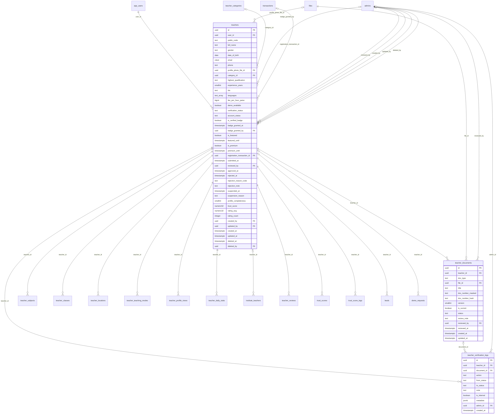

# Module 16 · Teacher Registration Queue

> **Phase 5 · Teachers** · **Depends on:** M0–M2, M5 (fee on/off), M15 · **Owns tables:** `teachers`, `teacher_documents`, `teacher_verification_logs` · **Reads:** `files`, `app_users`, `teacher_categories` · **Build estimate:** 6–7 days

## 1. Module Overview

The verification workspace for new teachers. Teachers register in the app, upload Aadhaar, PAN, educational and professional certificates, pay the registration fee (if enabled) and land in this queue. Verification Admins review each document individually (approve, reject, request re-upload), add notes, see automated checks, and finally approve or reject the application. Approved teachers become visible in search.

## 2. Business Purpose

Trust is GuruConnect's core promise: "every teacher is verified before they appear". This queue is where that promise is kept. It must be fast (target decision within 24 hours), consistent (checklists, reason codes) and fully traceable (every decision logged with who and why).

## 3. User Stories

- As a **Verification Admin**, I want a queue sorted by oldest submission with an SLA timer so that nobody waits more than 24 hours.
- As a **Verification Admin**, I want to open a document in a secure viewer, compare the name with the application and approve it so that I can verify quickly.
- As a **Verification Admin**, I want to request a re-upload with a reason the teacher sees so that they can fix a blurry certificate without re-registering.
- As a **Verification Admin**, I want to see automated checks (name match, duplicate Aadhaar, face match) so that I can focus on risky cases.
- As **Super Admin**, I want only admins with the decide permission to approve or reject a teacher so that final decisions stay with trusted staff.
- As a **Verification Admin**, I want to claim a case so that two reviewers don't work on the same teacher.

## 4. Functional Requirements & Business Logic

**Status machine (`teachers.verification_status`)**
```
draft ──teacher submits──▶ pending ──admin opens/claims──▶ under_review
under_review ──request re-upload──▶ reupload_requested ──teacher re-uploads──▶ pending
under_review ──approve (all required docs approved)──▶ approved
under_review ──reject──▶ rejected ──(teacher may re-apply after 30 days)──▶ draft
approved ──(Module 17) suspend/activate changes account_status only
```
Required documents for approval: current `aadhaar` approved, current `pan` approved, ≥ 1 `education_certificate` approved, profile `photo` present. `professional_certificate` and `experience_letter` are optional but, if uploaded, must not be in `submitted` state at approval time.

**FR-16.1 Queue.** `GET /teacher-verifications` lists teachers in `pending`, `under_review`, `reupload_requested` (default tab: pending + under_review), oldest `submitted_at` first. Each row: name, public code, primary subject, city, submitted age (hours), SLA state (green < 12 h, amber 12–24 h, red > 24 h), assigned reviewer, document summary (e.g., "3/4 approved"), automated-check warnings, payment status (paid / not required / refunded).

**FR-16.2 Claim.** Opening a case with `POST /teacher-verifications/:teacherId/claim` sets `reviewed_by` to the admin and status `pending → under_review`. A case claimed by someone else shows "Being reviewed by Anjali (12 min)". Claims expire after 30 minutes of inactivity (a job clears `reviewed_by` on untouched cases). `?force=true` lets a user with `teacher_verification.decide` take over (logged).

**FR-16.3 Case detail.** `GET /teacher-verifications/:teacherId` returns application data, all current and previous document versions (masked numbers, thumbnails as 60-s signed URLs), automated checks, notes, verification timeline, payment reference, and possible duplicates.

**FR-16.4 Automated checks** (run by a job when documents are submitted; results in `teacher_verification_logs` with `action = 'auto_check'`, `metadata`):

| Check | Rule | Result |
| --- | --- | --- |
| Name match | Fuzzy match (token-set ratio) between application name and names extracted by OCR from Aadhaar and PAN | ≥ 0.85 pass, 0.6–0.85 warn, < 0.6 fail |
| Duplicate identity | Same `doc_number_hash` on another teacher's current Aadhaar/PAN | fail + link to the other teacher |
| Face match | Selfie/profile photo vs Aadhaar photo similarity (vendor API) | ≥ 0.9 pass, 0.75–0.9 warn |
| Age | DOB on Aadhaar ≥ 18 years | fail if under 18 |
| Image quality | Resolution ≥ 800 px short side, not blank | warn |
Automated checks never approve or reject on their own; they only inform the reviewer. The integrations sit behind an `IdentityChecks` interface so vendors can change.

**FR-16.5 Document decisions.** `POST /teacher-documents/:documentId/approve`, `/reject { reasonCode, note }`, `/request-reupload { reasonCode, note }`. Only current versions can be decided. Rejecting or requesting re-upload of any document with the teacher in `under_review` does not change teacher status by itself; the reviewer then uses "Send back for re-upload" (FR-16.7) to notify the teacher once, with all requested items.

**FR-16.6 Notes.** `POST /teacher-verifications/:teacherId/notes { note, isInternal }`. Non-internal notes are shown to the teacher in the app.

**FR-16.7 Send back for re-upload.** `POST /teacher-verifications/:teacherId/request-reupload { message }` — requires at least one document in `reupload_requested`/`rejected`; sets status `reupload_requested`, clears `reviewed_by`, sends push + SMS listing the documents and reasons. When the teacher re-uploads, a new document version is created (`version + 1`, previous `is_current = false`) and the teacher returns to `pending` (keeping the original `submitted_at` for SLA fairness; `resubmitted` logged).

**FR-16.8 Approve.** `POST /teacher-verifications/:teacherId/approve { grantBadge: true, note }` (permission `teacher_verification.decide`):
1. Assert required documents rule; assert no failed duplicate-identity check (or `overrideDuplicate: true` with reason, super admin only).
2. In one transaction: status `approved`, `approved_at`, optionally `is_verified_badge = true` with `badge_granted_*`; log `approved` and `badge_granted`; audit.
3. After commit: enqueue trust score calculation (Module 36), mark teacher searchable (search index refresh), push "You're verified" notification, activate the teacher subscription period if the registration fee was paid (Module 41) — the 12-month validity starts at approval, not payment.
4. If the teacher was referred, emit `teacher.approved` for Module 42.

**FR-16.9 Reject.** `POST /teacher-verifications/:teacherId/reject { reasonCode, note }` (`teacher_verification.decide`): status `rejected`, `rejected_at`, reason stored; push + SMS with the reason; if a registration fee was captured and the fee version says refundable, create a refund request (Module 40, reason `teacher_rejected`, auto-approved). Reason codes: `DOC_UNREADABLE`, `NAME_MISMATCH`, `QUALIFICATION_UNVERIFIED`, `FORGED_DOCUMENT`, `DUPLICATE_ACCOUNT`, `UNDERAGE`, `OTHER`. `FORGED_DOCUMENT` also suspends the `app_users` account and blocks the document hash.

**FR-16.10 Manual creation.** `POST /teachers` (`teachers.create`) lets an admin create a teacher for someone who can't use the app: creates `app_users` (phone), `teachers` (`created_by`), uploads documents via Module 0 files, and can submit directly into the queue. A different admin must approve it (maker–checker: the creator cannot approve the same teacher).

**FR-16.11 SLA alerts.** A job every 15 minutes emails admins with `queue_alerts` on when any case passes 24 hours, and the dashboard (Module 47) shows the queue size and oldest age.

## 5. Validation Rules

| Field | Rule |
| --- | --- |
| reasonCode | required for reject / request-reupload; from the list in FR-16.9 (documents also allow `BLURRY`, `CROPPED`, `EXPIRED`, `WRONG_DOCUMENT`) |
| note | reject/re-upload: 10–500 chars (shown to the teacher; no internal jargon); internal notes 1–2,000 chars |
| message (send back) | 10–500 chars |
| grantBadge | boolean, default true |
| overrideDuplicate | boolean; requires super admin and `reason` 10–500 chars |
| Manual create | fullName 2–100, phone E.164 unique among live app users, email optional unique, gender enum, dateOfBirth ≥ 18 years ago and ≤ 90, categoryId active, experienceYears 0–60, highestQualification 2–120 |
| Decision preconditions | teacher must be `under_review` and claimed by the caller (or `force`) for document decisions, approve and reject |

## 6. API Endpoints

| Method | Path | Permission | Description |
| --- | --- | --- | --- |
| GET | /teacher-verifications | teachers.read | Queue with tabs, filters, SLA |
| GET | /teacher-verifications/stats | teachers.read | Counts per status, oldest age, decisions this week |
| GET | /teacher-verifications/:teacherId | teachers.read | Case detail |
| POST | /teacher-verifications/:teacherId/claim | teacher_verification.review | Claim / take over a case |
| POST | /teacher-verifications/:teacherId/release | teacher_verification.review | Release a claim |
| POST | /teacher-documents/:documentId/approve | teacher_verification.review | Approve a document |
| POST | /teacher-documents/:documentId/reject | teacher_verification.review | Reject a document |
| POST | /teacher-documents/:documentId/request-reupload | teacher_verification.review | Mark for re-upload |
| GET | /teacher-documents/:documentId/file | teacher_documents.unmask | Signed URL to the original (audited) |
| POST | /teacher-verifications/:teacherId/notes | teacher_verification.review | Add note |
| POST | /teacher-verifications/:teacherId/request-reupload | teacher_verification.review | Send back to teacher |
| POST | /teacher-verifications/:teacherId/approve | teacher_verification.decide | Approve teacher |
| POST | /teacher-verifications/:teacherId/reject | teacher_verification.decide | Reject teacher |
| POST | /teachers | teachers.create | Create a teacher manually |

## 7. Request Payloads

```json
// POST /teacher-documents/:documentId/request-reupload
{ "reasonCode": "CROPPED", "note": "The certificate image is cropped; the university seal is not visible. Please upload the full page." }

// POST /teacher-verifications/:teacherId/approve
{ "grantBadge": true, "note": "All documents verified; called teacher to confirm B.Ed." }

// POST /teacher-verifications/:teacherId/reject
{ "reasonCode": "NAME_MISMATCH", "note": "The name on your PAN card doesn't match your Aadhaar. Please re-apply with matching documents." }

// POST /teachers   (manual creation)
{ "fullName": "Kavya Menon", "phone": "+919845022110", "email": "kavya.m@gmail.com", "gender": "female", "dateOfBirth": "1994-06-12", "categoryId": "…home tutor…",
  "highestQualification": "B.Sc., B.Ed. (Primary)", "experienceYears": 4, "documents": [ { "docType": "aadhaar", "fileId": "…", "docNumberLast4": "4821" }, { "docType": "pan", "fileId": "…" } ], "submitForReview": true }
```

## 8. Response Payloads

```json
// 200 GET /teacher-verifications?status=pending&status=under_review
{ "data": [ { "teacherId": "…", "publicCode": "GC-T10280", "fullName": "Karan Chatterjee", "primarySubject": "JEE Advanced", "city": "Jaipur",
  "status": "under_review", "submittedAt": "2026-09-23T10:40:00Z", "ageHours": 68, "sla": "breached", "assignedTo": { "id": "…", "name": "Anjali Menon", "claimedAt": "…" },
  "documents": { "approved": 2, "total": 4 }, "checks": { "nameMatch": "pass", "duplicate": "pass", "faceMatch": "warn" }, "payment": "paid" } ],
  "meta": { "page": 1, "pageSize": 20, "total": 214, "totalPages": 11 } }

// 200 GET /teacher-verifications/:teacherId
{ "data": { "teacher": { "id": "…", "publicCode": "GC-T10280", "fullName": "Karan Chatterjee", "gender": "male", "dateOfBirth": "1995-02-11", "phoneMasked": "+91 98XXX XX120",
    "category": "Coaching Faculty", "highestQualification": "B.Sc., B.Ed.", "experienceYears": 5, "subjects": ["JEE Advanced","Python"], "city": "Jaipur", "status": "under_review" },
  "documents": [ { "id": "…", "docType": "aadhaar", "version": 1, "isCurrent": true, "status": "approved", "numberMasked": "XXXX XXXX 2978", "thumbnailUrl": "https://…signed…", "reviewedBy": "Anjali Menon" },
                 { "id": "…", "docType": "education_certificate", "title": "B.Ed. 2019", "version": 2, "status": "submitted", "previousVersions": [ { "id": "…", "version": 1, "status": "reupload_requested", "reviewNote": "Cropped" } ] } ],
  "checks": [ { "type": "face_match", "result": "warn", "score": 0.62 } ],
  "timeline": [ { "action": "submitted", "at": "…", "by": "teacher" }, { "action": "document_approved", "at": "…", "by": "Anjali Menon", "note": null } ],
  "payment": { "transactionCode": "TXN-7702137", "amountPaise": 49900, "status": "captured" }, "duplicates": [] } }
```

## 9. PostgreSQL Tables

### `teachers`

Teacher profile and verification state. One row per teacher app account.

```sql
CREATE TABLE teachers (
  id uuid PRIMARY KEY DEFAULT gen_random_uuid(), -- Primary key
  user_id uuid NOT NULL REFERENCES app_users(id) ON DELETE RESTRICT, -- Login identity
  public_code text NOT NULL DEFAULT ('GC-T' || nextval('seq_teacher_code')), -- Human-friendly id shown in the portal, e.g. GC-T10241
  full_name text NOT NULL, -- Name as on Aadhaar
  gender text CHECK (gender IN ('female','male','other','undisclosed')), -- Gender
  date_of_birth date, -- Must make the teacher at least 18
  email citext, -- Contact email
  phone text NOT NULL, -- E.164 mobile number
  profile_photo_file_id uuid REFERENCES files(id), -- Public profile photo
  category_id uuid REFERENCES teacher_categories(id) ON DELETE RESTRICT, -- Primary teacher category
  highest_qualification text, -- e.g. M.Sc. Physics
  experience_years smallint CHECK (experience_years BETWEEN 0 AND 60), -- Years of teaching experience
  bio text, -- About the teacher, max 2,000 chars
  languages text[] NOT NULL DEFAULT '{}', -- Languages spoken, e.g. {English, Hindi}
  fee_per_hour_paise bigint CHECK (fee_per_hour_paise IS NULL OR fee_per_hour_paise >= 0), -- Indicative hourly fee
  demo_available boolean NOT NULL DEFAULT true, -- Offers a free demo class
  verification_status text NOT NULL DEFAULT 'draft' CHECK (verification_status IN ('draft','pending','under_review','reupload_requested','approved','rejected')), -- Registration workflow state
  account_status text NOT NULL DEFAULT 'active' CHECK (account_status IN ('active','suspended')), -- Suspended teachers are hidden from search and cannot receive leads
  is_verified_badge boolean NOT NULL DEFAULT false, -- Blue Verified badge on the profile
  badge_granted_at timestamptz, -- When the badge was granted
  badge_granted_by uuid REFERENCES admins(id), -- Who granted it
  is_featured boolean NOT NULL DEFAULT false, -- Featured rail placement
  featured_until timestamptz, -- Paid or manual featured expiry
  is_premium boolean NOT NULL DEFAULT false, -- Premium listing (search boost)
  premium_until timestamptz, -- Premium expiry
  registration_transaction_id uuid, -- Registration fee payment (FK added in migration 040)
  submitted_at timestamptz, -- When the teacher submitted for review
  reviewed_by uuid REFERENCES admins(id), -- Admin currently assigned / last reviewer
  approved_at timestamptz, -- Approval time
  rejected_at timestamptz, -- Rejection time
  rejection_reason_code text, -- e.g. DOC_UNREADABLE, NAME_MISMATCH, FORGED_DOCUMENT
  rejection_note text, -- Explanation sent to the teacher
  suspended_at timestamptz, -- Suspension time
  suspension_reason text, -- Internal reason for suspension
  profile_completeness smallint NOT NULL DEFAULT 0 CHECK (profile_completeness BETWEEN 0 AND 100), -- Percentage, recalculated on profile change
  trust_score numeric(5,2), -- Cached from trust_scores for fast sorting
  rating_avg numeric(3,2), -- Cached average of published reviews
  rating_count integer NOT NULL DEFAULT 0, -- Cached count of published reviews
  created_by uuid REFERENCES admins(id), -- Set when an admin created the teacher manually
  updated_by uuid REFERENCES admins(id), -- Last admin editor
  created_at timestamptz NOT NULL DEFAULT now(), -- Created
  updated_at timestamptz NOT NULL DEFAULT now(), -- Last updated
  deleted_at timestamptz, -- Soft delete
  deleted_by uuid REFERENCES admins(id) -- Who deleted
);
CREATE UNIQUE INDEX uq_teachers_user ON teachers (user_id) WHERE deleted_at IS NULL;
CREATE UNIQUE INDEX uq_teachers_public_code ON teachers (public_code);
CREATE INDEX idx_teachers_queue ON teachers (verification_status, submitted_at) WHERE deleted_at IS NULL;
CREATE INDEX idx_teachers_listing ON teachers (account_status, verification_status, trust_score DESC) WHERE deleted_at IS NULL;
CREATE INDEX idx_teachers_category ON teachers (category_id) WHERE deleted_at IS NULL;
CREATE INDEX idx_teachers_name_trgm ON teachers USING gin (full_name gin_trgm_ops);
CREATE INDEX idx_teachers_featured ON teachers (featured_until) WHERE is_featured AND deleted_at IS NULL;
CREATE TRIGGER trg_teachers_updated BEFORE UPDATE ON teachers FOR EACH ROW EXECUTE FUNCTION set_updated_at();
ALTER TABLE teachers ADD CONSTRAINT fk_teachers_registration_txn FOREIGN KEY (registration_transaction_id) REFERENCES transactions(id) ON DELETE SET NULL;
```

### `teacher_documents`

Every uploaded verification document version. Only one current version per teacher and type.

```sql
CREATE TABLE teacher_documents (
  id uuid PRIMARY KEY DEFAULT gen_random_uuid(), -- Primary key
  teacher_id uuid NOT NULL REFERENCES teachers(id) ON DELETE RESTRICT, -- Owner
  doc_type text NOT NULL CHECK (doc_type IN ('aadhaar','pan','education_certificate','professional_certificate','experience_letter','photo')), -- Document type
  file_id uuid NOT NULL REFERENCES files(id) ON DELETE RESTRICT, -- Private stored file
  title text, -- e.g. B.Ed., Bangalore University 2010 (for certificates)
  doc_number_masked text, -- Masked number shown in the UI, e.g. XXXX XXXX 2978
  doc_number_hash text, -- HMAC-SHA256 of the normalised number, used to detect duplicate accounts
  version smallint NOT NULL DEFAULT 1, -- Upload count for this type
  is_current boolean NOT NULL DEFAULT true, -- false once a newer upload replaces it
  status text NOT NULL DEFAULT 'submitted' CHECK (status IN ('submitted','approved','rejected','reupload_requested')), -- Review state
  review_note text, -- Reason shown to the teacher on reject / re-upload
  reviewed_by uuid REFERENCES admins(id), -- Reviewer
  reviewed_at timestamptz, -- Review time
  created_at timestamptz NOT NULL DEFAULT now(), -- Uploaded
  updated_at timestamptz NOT NULL DEFAULT now() -- Last updated
);
CREATE INDEX idx_teacher_documents_teacher ON teacher_documents (teacher_id, doc_type) WHERE is_current;
CREATE UNIQUE INDEX uq_teacher_documents_current_identity ON teacher_documents (teacher_id, doc_type) WHERE is_current AND doc_type IN ('aadhaar','pan','photo');
CREATE INDEX idx_teacher_documents_hash ON teacher_documents (doc_type, doc_number_hash) WHERE doc_number_hash IS NOT NULL;
CREATE INDEX idx_teacher_documents_pending ON teacher_documents (status, created_at) WHERE is_current AND status = 'submitted';
CREATE TRIGGER trg_teacher_documents_updated BEFORE UPDATE ON teacher_documents FOR EACH ROW EXECUTE FUNCTION set_updated_at();
```

### `teacher_verification_logs`

Timeline of every verification event for a teacher, shown in the review screen.

```sql
CREATE TABLE teacher_verification_logs (
  id uuid PRIMARY KEY DEFAULT gen_random_uuid(), -- Primary key
  teacher_id uuid NOT NULL REFERENCES teachers(id) ON DELETE CASCADE, -- Teacher
  document_id uuid REFERENCES teacher_documents(id) ON DELETE SET NULL, -- Document the event relates to, if any
  action text NOT NULL CHECK (action IN ('submitted','resubmitted','assigned','document_approved','document_rejected','reupload_requested','note_added','approved','rejected','badge_granted','badge_revoked','suspended','activated','auto_check')), -- Event type
  from_status text, -- Teacher verification_status before
  to_status text, -- Teacher verification_status after
  note text, -- Internal note or reason
  is_internal boolean NOT NULL DEFAULT true, -- false = note is also shown to the teacher
  metadata jsonb, -- Extra data, e.g. automated check results {"face_match":0.96}
  admin_id uuid REFERENCES admins(id), -- NULL for teacher or system events
  created_at timestamptz NOT NULL DEFAULT now() -- When
);
CREATE INDEX idx_teacher_verification_logs_teacher ON teacher_verification_logs (teacher_id, created_at DESC);
```

Migration file: `sql/migrations/016_m16_teacher_registration_queue.sql`

## 10. Column Definitions

### `teachers`

| Column | Type | Null | Default | Constraints / References | Description |
| --- | --- | --- | --- | --- | --- |
| `id` | uuid | no | gen_random_uuid() | PK | Primary key |
| `user_id` | uuid | no | — | FK → `app_users.id` (on delete restrict) | Login identity |
| `public_code` | text | no | ('GC-T' \|\| nextval('seq_teacher_code')) | — | Human-friendly id shown in the portal, e.g. GC-T10241 |
| `full_name` | text | no | — | — | Name as on Aadhaar |
| `gender` | text | yes | — | CHECK gender IN ('female','male','other','undisclosed') | Gender |
| `date_of_birth` | date | yes | — | — | Must make the teacher at least 18 |
| `email` | citext | yes | — | — | Contact email |
| `phone` | text | no | — | — | E.164 mobile number |
| `profile_photo_file_id` | uuid | yes | — | FK → `files.id` (on delete no action) | Public profile photo |
| `category_id` | uuid | yes | — | FK → `teacher_categories.id` (on delete restrict) | Primary teacher category |
| `highest_qualification` | text | yes | — | — | e.g. M.Sc. Physics |
| `experience_years` | smallint | yes | — | CHECK experience_years BETWEEN 0 AND 60 | Years of teaching experience |
| `bio` | text | yes | — | — | About the teacher, max 2,000 chars |
| `languages` | text[] | no | '{}' | — | Languages spoken, e.g. {English, Hindi} |
| `fee_per_hour_paise` | bigint | yes | — | CHECK fee_per_hour_paise IS NULL OR fee_per_hour_paise >= 0 | Indicative hourly fee |
| `demo_available` | boolean | no | true | — | Offers a free demo class |
| `verification_status` | text | no | 'draft' | CHECK verification_status IN ('draft','pending','under_review','reupload_requested','approved','rejected') | Registration workflow state |
| `account_status` | text | no | 'active' | CHECK account_status IN ('active','suspended') | Suspended teachers are hidden from search and cannot receive leads |
| `is_verified_badge` | boolean | no | false | — | Blue Verified badge on the profile |
| `badge_granted_at` | timestamptz | yes | — | — | When the badge was granted |
| `badge_granted_by` | uuid | yes | — | FK → `admins.id` (on delete no action) | Who granted it |
| `is_featured` | boolean | no | false | — | Featured rail placement |
| `featured_until` | timestamptz | yes | — | — | Paid or manual featured expiry |
| `is_premium` | boolean | no | false | — | Premium listing (search boost) |
| `premium_until` | timestamptz | yes | — | — | Premium expiry |
| `registration_transaction_id` | uuid | yes | — | FK → `transactions.id` (on delete set null), added in migration 040 | Registration fee payment (FK added in migration 040) |
| `submitted_at` | timestamptz | yes | — | — | When the teacher submitted for review |
| `reviewed_by` | uuid | yes | — | FK → `admins.id` (on delete no action) | Admin currently assigned / last reviewer |
| `approved_at` | timestamptz | yes | — | — | Approval time |
| `rejected_at` | timestamptz | yes | — | — | Rejection time |
| `rejection_reason_code` | text | yes | — | — | e.g. DOC_UNREADABLE, NAME_MISMATCH, FORGED_DOCUMENT |
| `rejection_note` | text | yes | — | — | Explanation sent to the teacher |
| `suspended_at` | timestamptz | yes | — | — | Suspension time |
| `suspension_reason` | text | yes | — | — | Internal reason for suspension |
| `profile_completeness` | smallint | no | 0 | CHECK profile_completeness BETWEEN 0 AND 100 | Percentage, recalculated on profile change |
| `trust_score` | numeric(5,2) | yes | — | — | Cached from trust_scores for fast sorting |
| `rating_avg` | numeric(3,2) | yes | — | — | Cached average of published reviews |
| `rating_count` | integer | no | 0 | — | Cached count of published reviews |
| `created_by` | uuid | yes | — | FK → `admins.id` (on delete no action) | Set when an admin created the teacher manually |
| `updated_by` | uuid | yes | — | FK → `admins.id` (on delete no action) | Last admin editor |
| `created_at` | timestamptz | no | now() | — | Created |
| `updated_at` | timestamptz | no | now() | — | Last updated |
| `deleted_at` | timestamptz | yes | — | — | Soft delete |
| `deleted_by` | uuid | yes | — | FK → `admins.id` (on delete no action) | Who deleted |

### `teacher_documents`

| Column | Type | Null | Default | Constraints / References | Description |
| --- | --- | --- | --- | --- | --- |
| `id` | uuid | no | gen_random_uuid() | PK | Primary key |
| `teacher_id` | uuid | no | — | FK → `teachers.id` (on delete restrict) | Owner |
| `doc_type` | text | no | — | CHECK doc_type IN ('aadhaar','pan','education_certificate','professional_certificate','experience_letter','photo') | Document type |
| `file_id` | uuid | no | — | FK → `files.id` (on delete restrict) | Private stored file |
| `title` | text | yes | — | — | e.g. B.Ed., Bangalore University 2010 (for certificates) |
| `doc_number_masked` | text | yes | — | — | Masked number shown in the UI, e.g. XXXX XXXX 2978 |
| `doc_number_hash` | text | yes | — | — | HMAC-SHA256 of the normalised number, used to detect duplicate accounts |
| `version` | smallint | no | 1 | — | Upload count for this type |
| `is_current` | boolean | no | true | — | false once a newer upload replaces it |
| `status` | text | no | 'submitted' | CHECK status IN ('submitted','approved','rejected','reupload_requested') | Review state |
| `review_note` | text | yes | — | — | Reason shown to the teacher on reject / re-upload |
| `reviewed_by` | uuid | yes | — | FK → `admins.id` (on delete no action) | Reviewer |
| `reviewed_at` | timestamptz | yes | — | — | Review time |
| `created_at` | timestamptz | no | now() | — | Uploaded |
| `updated_at` | timestamptz | no | now() | — | Last updated |

### `teacher_verification_logs`

| Column | Type | Null | Default | Constraints / References | Description |
| --- | --- | --- | --- | --- | --- |
| `id` | uuid | no | gen_random_uuid() | PK | Primary key |
| `teacher_id` | uuid | no | — | FK → `teachers.id` (on delete cascade) | Teacher |
| `document_id` | uuid | yes | — | FK → `teacher_documents.id` (on delete set null) | Document the event relates to, if any |
| `action` | text | no | — | CHECK action IN ('submitted','resubmitted','assigned','document_approved','document_rejected','reupload_requested','note_added','approved','rejected','badge_granted','badge_revoked','suspended','activated','auto_check') | Event type |
| `from_status` | text | yes | — | — | Teacher verification_status before |
| `to_status` | text | yes | — | — | Teacher verification_status after |
| `note` | text | yes | — | — | Internal note or reason |
| `is_internal` | boolean | no | true | — | false = note is also shown to the teacher |
| `metadata` | jsonb | yes | — | — | Extra data, e.g. automated check results {"face_match":0.96} |
| `admin_id` | uuid | yes | — | FK → `admins.id` (on delete no action) | NULL for teacher or system events |
| `created_at` | timestamptz | no | now() | — | When |

## 11. Relationships

**Outgoing foreign keys**

- `teachers.user_id` → `app_users.id` — required, many-to-one, on delete **restrict**
- `teachers.profile_photo_file_id` → `files.id` — optional, many-to-one, on delete **no action**
- `teachers.category_id` → `teacher_categories.id` — optional, many-to-one, on delete **restrict**
- `teachers.badge_granted_by` → `admins.id` — optional, many-to-one, on delete **no action**
- `teachers.registration_transaction_id` → `transactions.id` — optional, many-to-one, on delete **set null**
- `teachers.reviewed_by` → `admins.id` — optional, many-to-one, on delete **no action**
- `teachers.created_by` → `admins.id` — optional, many-to-one, on delete **no action**
- `teachers.updated_by` → `admins.id` — optional, many-to-one, on delete **no action**
- `teachers.deleted_by` → `admins.id` — optional, many-to-one, on delete **no action**
- `teacher_documents.teacher_id` → `teachers.id` — required, many-to-one, on delete **restrict**
- `teacher_documents.file_id` → `files.id` — required, many-to-one, on delete **restrict**
- `teacher_documents.reviewed_by` → `admins.id` — optional, many-to-one, on delete **no action**
- `teacher_verification_logs.teacher_id` → `teachers.id` — required, many-to-one, on delete **cascade**
- `teacher_verification_logs.document_id` → `teacher_documents.id` — optional, many-to-one, on delete **set null**
- `teacher_verification_logs.admin_id` → `admins.id` — optional, many-to-one, on delete **no action**

**Referenced by**

- `teacher_subjects.teacher_id` → `teachers` (module 18) — on delete **cascade**
- `teacher_classes.teacher_id` → `teachers` (module 19) — on delete **cascade**
- `teacher_locations.teacher_id` → `teachers` (module 20) — on delete **cascade**
- `teacher_teaching_modes.teacher_id` → `teachers` (module 20) — on delete **cascade**
- `teacher_profile_views.teacher_id` → `teachers` (module 21) — on delete **cascade**
- `teacher_daily_stats.teacher_id` → `teachers` (module 21) — on delete **cascade**
- `institute_teachers.teacher_id` → `teachers` (module 26) — on delete **set null**
- `teacher_reviews.teacher_id` → `teachers` (module 33) — on delete **cascade**
- `trust_scores.teacher_id` → `teachers` (module 36) — on delete **cascade**
- `trust_score_logs.teacher_id` → `teachers` (module 37) — on delete **cascade**
- `leads.teacher_id` → `teachers` (module 38) — on delete **restrict**
- `demo_requests.teacher_id` → `teachers` (module 39) — on delete **restrict**

**Entity relationship diagram**



## 12. Indexing Strategy

| Index | Table | Kind | Definition |
| --- | --- | --- | --- |
| `uq_teachers_user` | `teachers` | unique | `(user_id) WHERE deleted_at IS NULL` |
| `uq_teachers_public_code` | `teachers` | unique | `(public_code)` |
| `idx_teachers_queue` | `teachers` | btree | `(verification_status, submitted_at) WHERE deleted_at IS NULL` |
| `idx_teachers_listing` | `teachers` | btree | `(account_status, verification_status, trust_score DESC) WHERE deleted_at IS NULL` |
| `idx_teachers_category` | `teachers` | btree | `(category_id) WHERE deleted_at IS NULL` |
| `idx_teachers_name_trgm` | `teachers` | gin | `USING gin (full_name gin_trgm_ops)` |
| `idx_teachers_featured` | `teachers` | btree | `(featured_until) WHERE is_featured AND deleted_at IS NULL` |
| `idx_teacher_documents_teacher` | `teacher_documents` | btree | `(teacher_id, doc_type) WHERE is_current` |
| `uq_teacher_documents_current_identity` | `teacher_documents` | unique | `(teacher_id, doc_type) WHERE is_current AND doc_type IN ('aadhaar','pan','photo')` |
| `idx_teacher_documents_hash` | `teacher_documents` | btree | `(doc_type, doc_number_hash) WHERE doc_number_hash IS NOT NULL` |
| `idx_teacher_documents_pending` | `teacher_documents` | btree | `(status, created_at) WHERE is_current AND status = 'submitted'` |
| `idx_teacher_verification_logs_teacher` | `teacher_verification_logs` | btree | `(teacher_id, created_at DESC)` |

- `idx_teachers_queue (verification_status, submitted_at)` serves the queue ordered by age.
- `idx_teacher_documents_hash` finds duplicate identities across teachers in O(log n).
- `idx_teacher_documents_pending` serves "documents awaiting review" counts.
- `uq_teacher_documents_current_identity` guarantees one current Aadhaar, PAN and photo per teacher.

## 13. Permissions

| Permission key | Allows | Sensitive | Super | Ops | Verif. | Finance | Support |
| --- | --- | --- | --- | --- | --- | --- | --- |
| `teachers.read` | View teachers and their verification queue | — | ✓ | ✓ | ✓ | ✓ | ✓ |
| `teacher_verification.review` | Approve, reject or request re-upload of individual documents; add notes | — | ✓ | — | ✓ | — | — |
| `teacher_verification.decide` | Approve or reject a teacher application | yes | ✓ | — | ✓ | — | — |
| `teacher_documents.unmask` | View unmasked Aadhaar/PAN numbers and original files (logged) | yes | ✓ | — | ✓ | — | — |

Review (per-document decisions, notes, send back) and decide (approve/reject teacher) are separate so junior reviewers can prepare cases that a senior finalises. The admin who manually created a teacher cannot approve that teacher.

## 14. UI Screens & React Page Structure

| Route | Page | Content |
| --- | --- | --- |
| `/teachers/verification` | VerificationQueuePage | KPI strip (in queue, re-upload requested, avg review time, approved this week), tabs (New, Under review, Re-upload, Over 24 h), queue table |
| `/teachers/verification/:teacherId` | VerificationCasePage | Split view: left = application & checks & timeline; right = document grid with viewer; sticky decision bar |
| `/teachers/new` | CreateTeacherPage | 3-step manual creation wizard |

```
src/features/teacher-verification/
  pages/VerificationQueuePage.tsx, VerificationCasePage.tsx, CreateTeacherPage.tsx
  components/QueueTable.tsx, SlaBadge.tsx, ClaimBanner.tsx, DocumentCard.tsx, DocumentViewer.tsx (zoom/rotate, watermark overlay),
             DocumentDecisionMenu.tsx, AutomatedChecksPanel.tsx, VerificationTimeline.tsx, NotesPanel.tsx,
             DecisionBar.tsx (Reject · Send back · Approve), RejectDialog.tsx, ApproveDialog.tsx (badge toggle), DuplicateAlert.tsx
  api.ts
```

## 15. UI Components

- `DocumentCard` — thumbnail, type, masked number, version chip, status badge, Approve / Re-upload / Reject buttons.
- `DocumentViewer` — full-screen, zoom, rotate, side-by-side with previous version; watermark with the admin's email and time.
- `AutomatedChecksPanel` — pass/warn/fail list with scores.
- `DecisionBar` — disabled Approve with tooltip listing what's missing.
- `SlaBadge` — green/amber/red by age.

## 16. Filters

Status tab, SLA state, assigned to (me / unassigned / anyone), city, category, has failed check, payment status, submitted date range.

## 17. Search Capabilities

`q` matches teacher name (trigram), public code (exact), phone last 10 digits (exact, only with `users.pii`), and email prefix.

## 18. Pagination Requirements

Offset, default 20; default sort `submitted_at ASC`; sortable: submittedAt, fullName, city. Case timeline uses cursor (latest 50).

## 19. Audit Logs

| Event | Details |
| --- | --- |
| `teacher_verification.claimed` / `.released` / `.taken_over` | reviewer |
| `teacher_document.approved` / `.rejected` / `.reupload_requested` | document id, type, reason code |
| `teacher_document.unmasked` | document id, type |
| `teacher_verification.note_added` | internal flag |
| `teacher_verification.sent_back` | documents listed |
| `teacher.approved` | badge granted, note |
| `teacher.rejected` | reason code, refund created |
| `teacher.created_manually` | created by |
| `teacher_verification.duplicate_overridden` | reason |

## 20. Error Scenarios

| Scenario | HTTP | Code | Message |
| --- | --- | --- | --- |
| Decide on a case claimed by someone else | 409 | CONFLICT_STATE | "Anjali is reviewing this case. Take over?" |
| Approve with missing/unapproved required documents | 409 | CONFLICT_STATE | "Approve Aadhaar, PAN and at least one education certificate first." |
| Approve with duplicate identity | 409 | CONFLICT_STATE | "This Aadhaar is already used by GC-T10112." |
| Decide on a non-current document version | 409 | CONFLICT_STATE | "A newer version of this document was uploaded." |
| Reject without reason | 422 | VALIDATION_FAILED | "Pick a reason and add a note for the teacher." |
| Send back with nothing marked | 409 | CONFLICT_STATE | "Mark at least one document for re-upload." |
| Creator approving own manual teacher | 403 | FORBIDDEN | "Another admin must approve a teacher you created." |
| Teacher not in a reviewable status | 409 | CONFLICT_STATE | "This teacher is {status}." |
| Unmask without permission | 403 | FORBIDDEN | "You don't have access to original documents." |
| Refund creation failed after reject | 502 | GATEWAY_ERROR | Rejection saved; banner "Refund couldn't be created — retry from Transactions." |

## 21. Future Scalability Notes & Enhancements

- DigiLocker / UIDAI offline e-KYC and NSDL PAN verification APIs to replace manual checks for identity documents.
- University registry integrations (NAD / DigiLocker academic records) for certificates.
- Round-robin auto-assignment and reviewer workload balancing.
- Two-reviewer rule for high-risk cases (failed checks).
- Queue partitioning by city/language when reviewers specialise.

## 22. Security Considerations

- Originals are only accessible through audited, 60-second signed URLs with a watermarked viewer; downloads disabled in the UI.
- Aadhaar numbers are never stored in full: only masked last 4 and an HMAC (key in KMS) for duplicate detection.
- Maker–checker for manually created teachers; decide permission separated from review.
- Forged-document rejections block the identity hash from future sign-ups.
