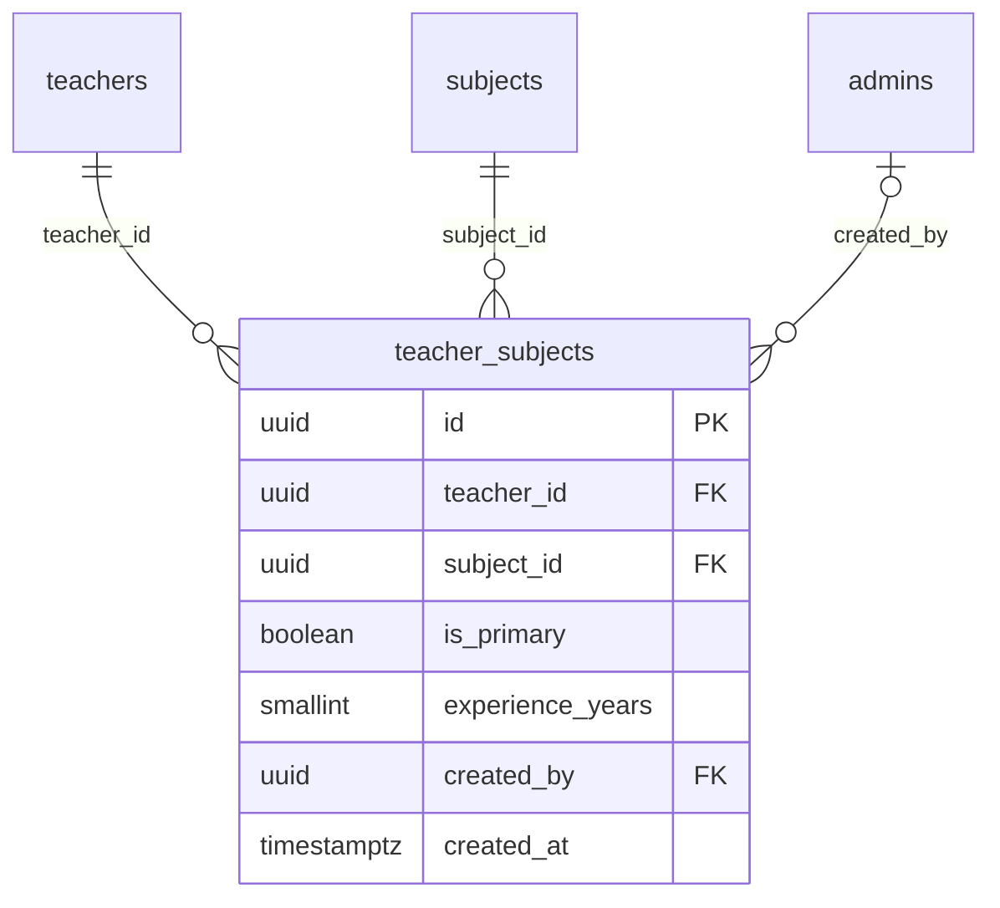

# Module 18 · Teacher Subject Mapping

> **Phase 5 · Teachers** · **Depends on:** M12, M16 · **Owns tables:** `teacher_subjects` · **Reads:** `teachers`, `subjects` · **Build estimate:** 1 day

## 1. Module Overview

Manages which subjects a teacher teaches, which one is primary, and optional years of experience per subject. Shown and edited on the teacher detail page (Subjects & classes tab).

## 2. Business Purpose

Subject mapping drives search results, recommendations and analytics ("how many Physics teachers in Pune?"). Admins must be able to correct mappings when teachers pick wrong subjects.

## 3. User Stories

- As **Operations Admin**, I want to add "JEE Advanced" to a Physics teacher so that JEE parents find them.
- As **Operations Admin**, I want to mark Physics as the primary subject so that it shows first on the teacher card.
- As **Verification Admin**, I want to see whether the subjects match the qualification so that I can flag mismatches.

## 4. Functional Requirements & Business Logic

**FR-18.1 List.** `GET /teachers/:teacherId/subjects` returns mapped subjects with category and primary flag.

**FR-18.2 Replace set.** `PUT /teachers/:teacherId/subjects { items: [{ subjectId, isPrimary, experienceYears }] }` replaces the whole set in one transaction (diffed: inserts new, deletes removed, updates changed). Exactly one primary when the set is non-empty (if none is marked, the first item becomes primary).

**FR-18.3 Limits.** 1–10 subjects per teacher; only active subjects; approved teachers must keep at least one subject.

**FR-18.4 Side effects.** After commit: refresh the teacher's search document, recompute profile completeness (Module 17), and emit `teacher.subjects_changed` (recommendation cache for parents is invalidated for affected subjects).

**FR-18.5 Qualification hint.** The UI shows a soft warning when a subject's category is `competitive_exam` and experience < 2 years, or when the subject is far from the declared qualification (simple keyword rules) — informational only.

## 5. Validation Rules

| Field | Rule |
| --- | --- |
| items | 1–10 items (0 only for teachers in `draft`) |
| subjectId | active subject, unique within items |
| isPrimary | at most one true |
| experienceYears | optional, 0–60, ≤ teacher's total experience |

## 6. API Endpoints

| Method | Path | Permission | Description |
| --- | --- | --- | --- |
| GET | /teachers/:teacherId/subjects | teachers.read | Current subjects |
| PUT | /teachers/:teacherId/subjects | teachers.update | Replace subject set |

## 7. Request Payloads

```json
// PUT /teachers/:teacherId/subjects
{ "items": [ { "subjectId": "…physics…", "isPrimary": true, "experienceYears": 14 }, { "subjectId": "…jee-advanced…", "isPrimary": false, "experienceYears": 10 } ], "reason": "Teacher asked to add JEE Advanced" }
```

## 8. Response Payloads

```json
// 200 PUT /teachers/:teacherId/subjects
{ "data": { "items": [ { "subjectId": "…", "name": "Physics", "category": "academic", "isPrimary": true, "experienceYears": 14 }, { "subjectId": "…", "name": "JEE Advanced", "category": "competitive_exam", "isPrimary": false, "experienceYears": 10 } ],
  "added": ["JEE Advanced"], "removed": [] } }
```

## 9. PostgreSQL Tables

### `teacher_subjects`

Subjects a teacher teaches.

```sql
CREATE TABLE teacher_subjects (
  id uuid PRIMARY KEY DEFAULT gen_random_uuid(), -- Primary key
  teacher_id uuid NOT NULL REFERENCES teachers(id) ON DELETE CASCADE, -- Teacher
  subject_id uuid NOT NULL REFERENCES subjects(id) ON DELETE RESTRICT, -- Subject
  is_primary boolean NOT NULL DEFAULT false, -- Primary subject shown first on cards (max one per teacher)
  experience_years smallint CHECK (experience_years BETWEEN 0 AND 60), -- Years teaching this subject
  created_by uuid REFERENCES admins(id), -- Set when an admin added it
  created_at timestamptz NOT NULL DEFAULT now() -- Created
);
CREATE UNIQUE INDEX uq_teacher_subjects ON teacher_subjects (teacher_id, subject_id);
CREATE UNIQUE INDEX uq_teacher_subjects_primary ON teacher_subjects (teacher_id) WHERE is_primary;
CREATE INDEX idx_teacher_subjects_subject ON teacher_subjects (subject_id, teacher_id);
```

Migration file: `sql/migrations/018_m18_teacher_subject_mapping.sql`

## 10. Column Definitions

### `teacher_subjects`

| Column | Type | Null | Default | Constraints / References | Description |
| --- | --- | --- | --- | --- | --- |
| `id` | uuid | no | gen_random_uuid() | PK | Primary key |
| `teacher_id` | uuid | no | — | FK → `teachers.id` (on delete cascade) | Teacher |
| `subject_id` | uuid | no | — | FK → `subjects.id` (on delete restrict) | Subject |
| `is_primary` | boolean | no | false | — | Primary subject shown first on cards (max one per teacher) |
| `experience_years` | smallint | yes | — | CHECK experience_years BETWEEN 0 AND 60 | Years teaching this subject |
| `created_by` | uuid | yes | — | FK → `admins.id` (on delete no action) | Set when an admin added it |
| `created_at` | timestamptz | no | now() | — | Created |

## 11. Relationships

**Outgoing foreign keys**

- `teacher_subjects.teacher_id` → `teachers.id` — required, many-to-one, on delete **cascade**
- `teacher_subjects.subject_id` → `subjects.id` — required, many-to-one, on delete **restrict**
- `teacher_subjects.created_by` → `admins.id` — optional, many-to-one, on delete **no action**

**Entity relationship diagram**



## 12. Indexing Strategy

| Index | Table | Kind | Definition |
| --- | --- | --- | --- |
| `uq_teacher_subjects` | `teacher_subjects` | unique | `(teacher_id, subject_id)` |
| `uq_teacher_subjects_primary` | `teacher_subjects` | unique | `(teacher_id) WHERE is_primary` |
| `idx_teacher_subjects_subject` | `teacher_subjects` | btree | `(subject_id, teacher_id)` |

Unique `(teacher_id, subject_id)` prevents duplicates; partial unique on `teacher_id WHERE is_primary` enforces one primary; `(subject_id, teacher_id)` serves "teachers for a subject" in search and analytics.

## 13. Permissions

This module uses the permission keys defined for Module 17.

| Permission key | Allows | Sensitive | Super | Ops | Verif. | Finance | Support |
| --- | --- | --- | --- | --- | --- | --- | --- |
| `teachers.update` | Edit teacher profiles and mappings | — | ✓ | ✓ | — | — | — |
| `teachers.suspend` | Suspend and re-activate teachers | yes | ✓ | ✓ | — | — | — |
| `teachers.badge` | Grant or revoke the Verified badge | yes | ✓ | — | ✓ | — | — |
| `teachers.feature` | Mark teachers as featured or premium manually | — | ✓ | ✓ | — | — | — |
| `teachers.create` | Create a teacher manually on their behalf | — | ✓ | ✓ | — | — | — |

## 14. UI Screens & React Page Structure

Section on `/teachers/:id` → **Subjects & classes** tab (shared with Module 19).
```
src/features/teachers/tabs/MappingsTab.tsx
src/features/teachers/components/SubjectMappingEditor.tsx
```

## 15. UI Components

- `SubjectMappingEditor` — async multi-select grouped by category, primary radio, experience input per row, save/cancel bar, soft warnings.

## 16. Filters

Not applicable (small set per teacher). Directory filtering by subject lives in Module 17.

## 17. Search Capabilities

The subject picker searches subjects by name and alias (Module 12 endpoint).

## 18. Pagination Requirements

Not paginated (≤ 10 rows).

## 19. Audit Logs

| Event | Details |
| --- | --- |
| `teacher.subjects_changed` | added, removed, primary before/after, reason |

## 20. Error Scenarios

| Scenario | HTTP | Code | Message |
| --- | --- | --- | --- |
| More than 10 subjects | 422 | VALIDATION_FAILED | "A teacher can have up to 10 subjects." |
| Two primary subjects | 422 | VALIDATION_FAILED | "Pick one primary subject." |
| Removing all subjects from an approved teacher | 409 | CONFLICT_STATE | "Approved teachers need at least one subject." |
| Inactive subject | 422 | VALIDATION_FAILED | "{name} is no longer offered." |
| Duplicate subject in payload | 422 | VALIDATION_FAILED | "Each subject can be added once." |

## 21. Future Scalability Notes & Enhancements

- Per-subject fees and levels (beginner/advanced).
- Topic-level expertise under subjects when Module 12 adds syllabus topics.

## 22. Security Considerations

Only `teachers.update` can change mappings; the teacher's own app edits go through the mobile API with the same validation.
