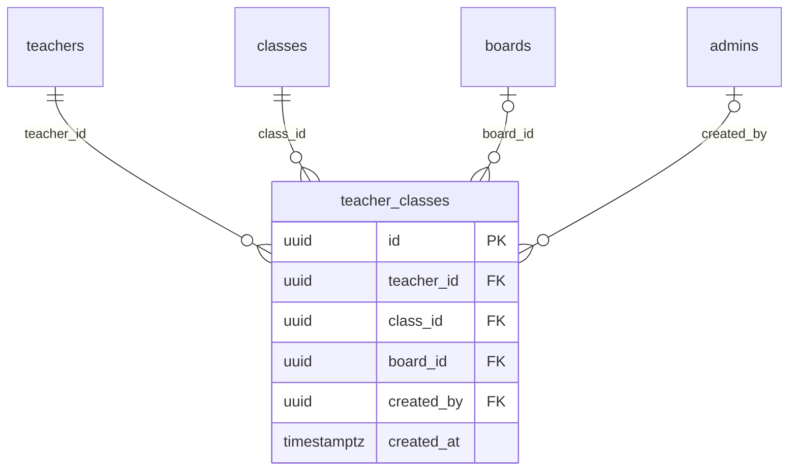

# Module 19 · Teacher Class Mapping

> **Phase 5 · Teachers** · **Depends on:** M11, M13, M16 · **Owns tables:** `teacher_classes` · **Reads:** `teachers`, `classes`, `boards` · **Build estimate:** 1 day

## 1. Module Overview

Manages which classes a teacher covers and, optionally, for which boards (e.g., Class 11–12 for CBSE and ICSE). Edited in the same Subjects & classes tab as Module 18.

## 2. Business Purpose

Class coverage is the main input for per-child recommendations (Module 29) — a Class 4 child should only see teachers covering Class 4.

## 3. User Stories

- As **Operations Admin**, I want to set a teacher to Class 9–12, CBSE only, so that recommendations are accurate.
- As **Operations Admin**, I want to select a range ("Class 6 to 10") in one action so that editing is quick.

## 4. Functional Requirements & Business Logic

**FR-19.1 List.** `GET /teachers/:teacherId/classes` returns rows `{ class, board|null }` plus a compressed summary ("Class 9–12 · CBSE, ICSE").

**FR-19.2 Replace set.** `PUT /teachers/:teacherId/classes { classIds: [...], boardIds: [...] | [] }` expands to the cartesian product (each class × each board, or board NULL = any board when `boardIds` is empty) and replaces the set in one transaction.

**FR-19.3 Range helper.** The UI offers "from/to" class selectors that fill `classIds` using `level_order`.

**FR-19.4 Limits.** 1–16 classes, 0–5 boards; approved teachers must keep ≥ 1 class. Subjects with a class range (Module 12) must overlap at least one mapped class — otherwise a warning is returned (`warnings[]`), not an error.

**FR-19.5 Side effects.** Same as Module 18 (search refresh, completeness, recommendation cache invalidation).

## 5. Validation Rules

| Field | Rule |
| --- | --- |
| classIds | 1–16 active classes, unique |
| boardIds | 0–5 active boards, unique |
| reason | optional, ≤ 500 chars |

## 6. API Endpoints

| Method | Path | Permission | Description |
| --- | --- | --- | --- |
| GET | /teachers/:teacherId/classes | teachers.read | Current classes and boards |
| PUT | /teachers/:teacherId/classes | teachers.update | Replace class/board coverage |

## 7. Request Payloads

```json
// PUT /teachers/:teacherId/classes
{ "classIds": ["…class-11…", "…class-12…", "…competitive…"], "boardIds": ["…cbse…"], "reason": "Teacher teaches CBSE only" }
```

## 8. Response Payloads

```json
// 200
{ "data": { "summary": "Class 11–12, Competitive exam preparation · CBSE", "rows": [ { "classId": "…", "className": "Class 11", "boardId": "…", "boardName": "CBSE" } ],
  "warnings": [ { "code": "SUBJECT_CLASS_MISMATCH", "message": "Python is usually taught from Class 5; no mapped class overlaps." } ] } }
```

## 9. PostgreSQL Tables

### `teacher_classes`

Classes (and optionally boards) a teacher covers.

```sql
CREATE TABLE teacher_classes (
  id uuid PRIMARY KEY DEFAULT gen_random_uuid(), -- Primary key
  teacher_id uuid NOT NULL REFERENCES teachers(id) ON DELETE CASCADE, -- Teacher
  class_id uuid NOT NULL REFERENCES classes(id) ON DELETE RESTRICT, -- Class
  board_id uuid REFERENCES boards(id) ON DELETE RESTRICT, -- Board; NULL = any board
  created_by uuid REFERENCES admins(id), -- Set when an admin added it
  created_at timestamptz NOT NULL DEFAULT now() -- Created
);
CREATE UNIQUE INDEX uq_teacher_classes ON teacher_classes (teacher_id, class_id, COALESCE(board_id, '00000000-0000-0000-0000-000000000000'::uuid));
CREATE INDEX idx_teacher_classes_class ON teacher_classes (class_id, teacher_id);
```

Migration file: `sql/migrations/019_m19_teacher_class_mapping.sql`

## 10. Column Definitions

### `teacher_classes`

| Column | Type | Null | Default | Constraints / References | Description |
| --- | --- | --- | --- | --- | --- |
| `id` | uuid | no | gen_random_uuid() | PK | Primary key |
| `teacher_id` | uuid | no | — | FK → `teachers.id` (on delete cascade) | Teacher |
| `class_id` | uuid | no | — | FK → `classes.id` (on delete restrict) | Class |
| `board_id` | uuid | yes | — | FK → `boards.id` (on delete restrict) | Board; NULL = any board |
| `created_by` | uuid | yes | — | FK → `admins.id` (on delete no action) | Set when an admin added it |
| `created_at` | timestamptz | no | now() | — | Created |

## 11. Relationships

**Outgoing foreign keys**

- `teacher_classes.teacher_id` → `teachers.id` — required, many-to-one, on delete **cascade**
- `teacher_classes.class_id` → `classes.id` — required, many-to-one, on delete **restrict**
- `teacher_classes.board_id` → `boards.id` — optional, many-to-one, on delete **restrict**
- `teacher_classes.created_by` → `admins.id` — optional, many-to-one, on delete **no action**

**Entity relationship diagram**



## 12. Indexing Strategy

| Index | Table | Kind | Definition |
| --- | --- | --- | --- |
| `uq_teacher_classes` | `teacher_classes` | unique | `(teacher_id, class_id, COALESCE(board_id, '00000000-0000-0000-0000-000000000000'::uuid))` |
| `idx_teacher_classes_class` | `teacher_classes` | btree | `(class_id, teacher_id)` |

Unique `(teacher_id, class_id, COALESCE(board_id, zero-uuid))` makes "any board" a distinct, non-duplicable entry; `(class_id, teacher_id)` serves recommendation queries.

## 13. Permissions

This module uses the permission keys defined for Module 17.

| Permission key | Allows | Sensitive | Super | Ops | Verif. | Finance | Support |
| --- | --- | --- | --- | --- | --- | --- | --- |
| `teachers.update` | Edit teacher profiles and mappings | — | ✓ | ✓ | — | — | — |
| `teachers.suspend` | Suspend and re-activate teachers | yes | ✓ | ✓ | — | — | — |
| `teachers.badge` | Grant or revoke the Verified badge | yes | ✓ | — | ✓ | — | — |
| `teachers.feature` | Mark teachers as featured or premium manually | — | ✓ | ✓ | — | — | — |
| `teachers.create` | Create a teacher manually on their behalf | — | ✓ | ✓ | — | — | — |

## 14. UI Screens & React Page Structure

Section on `/teachers/:id` → **Subjects & classes** tab.
```
src/features/teachers/components/ClassCoverageEditor.tsx
```

## 15. UI Components

- `ClassCoverageEditor` — range selector (from/to) plus checkboxes by stage, board multi-select, summary preview, warnings list.

## 16. Filters

Not applicable.

## 17. Search Capabilities

Not applicable.

## 18. Pagination Requirements

Not paginated (≤ 80 rows: 16 classes × 5 boards).

## 19. Audit Logs

| Event | Details |
| --- | --- |
| `teacher.classes_changed` | before/after summaries, reason |

## 20. Error Scenarios

| Scenario | HTTP | Code | Message |
| --- | --- | --- | --- |
| No classes for approved teacher | 409 | CONFLICT_STATE | "Approved teachers need at least one class." |
| Inactive class or board | 422 | VALIDATION_FAILED | "{name} is no longer available." |
| Too many boards | 422 | VALIDATION_FAILED | "Pick up to 5 boards." |

## 21. Future Scalability Notes & Enhancements

Per-class fees and batch sizes; board-specific experience.

## 22. Security Considerations

Same as Module 18.
