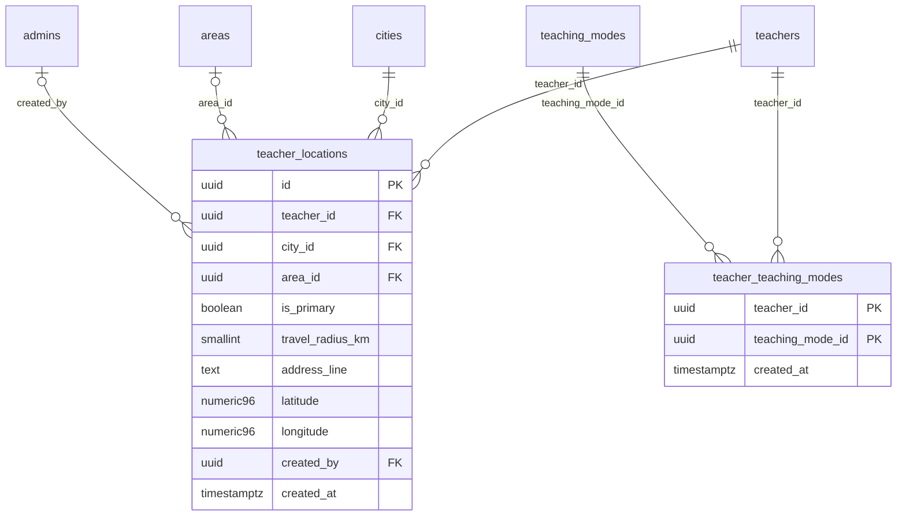

# Module 20 · Teacher Location Mapping

> **Phase 5 · Teachers** · **Depends on:** M9, M10, M14, M16 · **Owns tables:** `teacher_locations`, `teacher_teaching_modes` · **Reads:** `teachers`, `cities`, `areas`, `teaching_modes` · **Build estimate:** 2 days

## 1. Module Overview

Manages where and how a teacher teaches: the cities and areas they serve (with a primary base and travel radius for home tuition) and the teaching modes they offer (Online, At teacher's place, Home tuition, Hybrid, Group batch).

## 2. Business Purpose

"Nearby" and "home tutor in Koramangala" are the most common parent searches. Correct locations and modes make those results trustworthy; online-only teachers must be visible everywhere without a location.

## 3. User Stories

- As **Operations Admin**, I want to set a teacher's base to Koramangala with a 5 km radius for home tuition so that nearby parents see them.
- As **Operations Admin**, I want to mark a teacher as online-only so that they appear in every city's online results.
- As **Operations Admin**, I want to add a second city for a teacher who teaches in two places.

## 4. Functional Requirements & Business Logic

**FR-20.1 List.** `GET /teachers/:teacherId/locations` returns locations (city, area, primary, radius, address shown to admins only) and modes.

**FR-20.2 Replace locations.** `PUT /teachers/:teacherId/locations { items: [{ cityId, areaId?, isPrimary, travelRadiusKm?, addressLine?, latitude?, longitude? }] }` — replace set; exactly one primary when non-empty; area must belong to the city; geocode address or fall back to the area centre (background job fills coordinates).

**FR-20.3 Replace modes.** `PUT /teachers/:teacherId/teaching-modes { modeIds: [...] }` — 1–5 active modes.

**FR-20.4 Consistency rules.**
- If any mode has `requires_location = true`, at least one location is required.
- `HOME_TUITION` requires `travelRadiusKm` on the primary location (1–50).
- Online-only teachers (all modes `requires_location = false`) may have zero locations; their primary city (for analytics) is taken from the app user profile.
- Max 3 cities, max 15 area rows per teacher.

**FR-20.5 Side effects.** Refresh the teacher search document (geo point for distance sorting), recompute completeness, invalidate "nearby" caches for affected areas.

## 5. Validation Rules

| Field | Rule |
| --- | --- |
| cityId | active city |
| areaId | optional, active area in that city |
| isPrimary | exactly one true when items exist |
| travelRadiusKm | 0–50; required for primary when HOME_TUITION is offered |
| addressLine | ≤ 200 chars; never exposed publicly |
| latitude/longitude | optional, valid ranges, within 50 km of the city centre |
| modeIds | 1–5 active teaching modes, unique |

## 6. API Endpoints

| Method | Path | Permission | Description |
| --- | --- | --- | --- |
| GET | /teachers/:teacherId/locations | teachers.read | Locations and modes |
| PUT | /teachers/:teacherId/locations | teachers.update | Replace locations |
| PUT | /teachers/:teacherId/teaching-modes | teachers.update | Replace modes |

## 7. Request Payloads

```json
// PUT /teachers/:teacherId/locations
{ "items": [ { "cityId": "…bengaluru…", "areaId": "…koramangala…", "isPrimary": true, "travelRadiusKm": 5, "addressLine": "5th Block, Koramangala" }, { "cityId": "…bengaluru…", "areaId": "…hsr…", "isPrimary": false } ], "reason": "Teacher added HSR" }

// PUT /teachers/:teacherId/teaching-modes
{ "modeIds": ["…online…", "…home_tuition…"] }
```

## 8. Response Payloads

```json
// 200 GET /teachers/:teacherId/locations
{ "data": { "locations": [ { "id": "…", "city": "Bengaluru", "area": "Koramangala", "isPrimary": true, "travelRadiusKm": 5, "addressLine": "5th Block, Koramangala", "hasCoordinates": true } ],
  "modes": [ { "id": "…", "code": "ONLINE", "name": "Online" }, { "id": "…", "code": "HOME_TUITION", "name": "Home tuition" } ] } }
```

## 9. PostgreSQL Tables

### `teacher_locations`

Cities and areas a teacher serves, with travel radius for home tuition.

```sql
CREATE TABLE teacher_locations (
  id uuid PRIMARY KEY DEFAULT gen_random_uuid(), -- Primary key
  teacher_id uuid NOT NULL REFERENCES teachers(id) ON DELETE CASCADE, -- Teacher
  city_id uuid NOT NULL REFERENCES cities(id) ON DELETE RESTRICT, -- City served
  area_id uuid REFERENCES areas(id) ON DELETE RESTRICT, -- Area; NULL = whole city
  is_primary boolean NOT NULL DEFAULT false, -- Home base shown on the profile (max one)
  travel_radius_km smallint CHECK (travel_radius_km BETWEEN 0 AND 50), -- How far the teacher travels for home tuition
  address_line text, -- Teaching address for "at teacher's place" (never shown publicly in full)
  latitude numeric(9,6), -- Geocoded latitude of the address or area
  longitude numeric(9,6), -- Geocoded longitude
  created_by uuid REFERENCES admins(id), -- Set when an admin added it
  created_at timestamptz NOT NULL DEFAULT now() -- Created
);
CREATE UNIQUE INDEX uq_teacher_locations ON teacher_locations (teacher_id, city_id, COALESCE(area_id, '00000000-0000-0000-0000-000000000000'::uuid));
CREATE UNIQUE INDEX uq_teacher_locations_primary ON teacher_locations (teacher_id) WHERE is_primary;
CREATE INDEX idx_teacher_locations_city_area ON teacher_locations (city_id, area_id);
```

### `teacher_teaching_modes`

Teaching modes a teacher offers (Online, Home tuition, …).

```sql
CREATE TABLE teacher_teaching_modes (
  teacher_id uuid NOT NULL REFERENCES teachers(id) ON DELETE CASCADE, -- Teacher
  teaching_mode_id uuid NOT NULL REFERENCES teaching_modes(id) ON DELETE RESTRICT, -- Mode offered
  created_at timestamptz NOT NULL DEFAULT now(), -- Created
  PRIMARY KEY (teacher_id, teaching_mode_id)
);
CREATE INDEX idx_teacher_teaching_modes_mode ON teacher_teaching_modes (teaching_mode_id);
```

Migration file: `sql/migrations/020_m20_teacher_location_mapping.sql`

## 10. Column Definitions

### `teacher_locations`

| Column | Type | Null | Default | Constraints / References | Description |
| --- | --- | --- | --- | --- | --- |
| `id` | uuid | no | gen_random_uuid() | PK | Primary key |
| `teacher_id` | uuid | no | — | FK → `teachers.id` (on delete cascade) | Teacher |
| `city_id` | uuid | no | — | FK → `cities.id` (on delete restrict) | City served |
| `area_id` | uuid | yes | — | FK → `areas.id` (on delete restrict) | Area; NULL = whole city |
| `is_primary` | boolean | no | false | — | Home base shown on the profile (max one) |
| `travel_radius_km` | smallint | yes | — | CHECK travel_radius_km BETWEEN 0 AND 50 | How far the teacher travels for home tuition |
| `address_line` | text | yes | — | — | Teaching address for "at teacher's place" (never shown publicly in full) |
| `latitude` | numeric(9,6) | yes | — | — | Geocoded latitude of the address or area |
| `longitude` | numeric(9,6) | yes | — | — | Geocoded longitude |
| `created_by` | uuid | yes | — | FK → `admins.id` (on delete no action) | Set when an admin added it |
| `created_at` | timestamptz | no | now() | — | Created |

### `teacher_teaching_modes`

| Column | Type | Null | Default | Constraints / References | Description |
| --- | --- | --- | --- | --- | --- |
| `teacher_id` | uuid | no | — | PK; FK → `teachers.id` (on delete cascade) | Teacher |
| `teaching_mode_id` | uuid | no | — | PK; FK → `teaching_modes.id` (on delete restrict) | Mode offered |
| `created_at` | timestamptz | no | now() | — | Created |

**Table constraints:** `PRIMARY KEY (teacher_id, teaching_mode_id)`

## 11. Relationships

**Outgoing foreign keys**

- `teacher_locations.teacher_id` → `teachers.id` — required, many-to-one, on delete **cascade**
- `teacher_locations.city_id` → `cities.id` — required, many-to-one, on delete **restrict**
- `teacher_locations.area_id` → `areas.id` — optional, many-to-one, on delete **restrict**
- `teacher_locations.created_by` → `admins.id` — optional, many-to-one, on delete **no action**
- `teacher_teaching_modes.teacher_id` → `teachers.id` — required, many-to-one, on delete **cascade**
- `teacher_teaching_modes.teaching_mode_id` → `teaching_modes.id` — required, many-to-one, on delete **restrict**

**Entity relationship diagram**



## 12. Indexing Strategy

| Index | Table | Kind | Definition |
| --- | --- | --- | --- |
| `uq_teacher_locations` | `teacher_locations` | unique | `(teacher_id, city_id, COALESCE(area_id, '00000000-0000-0000-0000-000000000000'::uuid))` |
| `uq_teacher_locations_primary` | `teacher_locations` | unique | `(teacher_id) WHERE is_primary` |
| `idx_teacher_locations_city_area` | `teacher_locations` | btree | `(city_id, area_id)` |
| `idx_teacher_teaching_modes_mode` | `teacher_teaching_modes` | btree | `(teaching_mode_id)` |

`(city_id, area_id)` serves area/city searches; partial unique primary index enforces one base; unique `(teacher_id, city_id, COALESCE(area_id, zero))` blocks duplicates. At scale add a PostGIS `geography(Point)` column with a GiST index for radius search.

## 13. Permissions

This module uses the permission keys defined for Module 17.

| Permission key | Allows | Sensitive | Super | Ops | Verif. | Finance | Support |
| --- | --- | --- | --- | --- | --- | --- | --- |
| `teachers.update` | Edit teacher profiles and mappings | — | ✓ | ✓ | — | — | — |
| `teachers.suspend` | Suspend and re-activate teachers | yes | ✓ | ✓ | — | — | — |
| `teachers.badge` | Grant or revoke the Verified badge | yes | ✓ | — | ✓ | — | — |
| `teachers.feature` | Mark teachers as featured or premium manually | — | ✓ | ✓ | — | — | — |
| `teachers.create` | Create a teacher manually on their behalf | — | ✓ | ✓ | — | — | — |

## 14. UI Screens & React Page Structure

Section on `/teachers/:id` → **Locations & modes** tab.
```
src/features/teachers/tabs/LocationsTab.tsx
src/features/teachers/components/LocationEditor.tsx, ModeSelector.tsx, CoverageMap.tsx (static map preview with radius circle)
```

## 15. UI Components

- `LocationEditor` — city → area cascading pickers, primary radio, radius slider, address input.
- `ModeSelector` — checkbox cards with descriptions.
- `CoverageMap` — static map image (Mapbox/Google Static Maps) with radius circle; no interactive map needed.

## 16. Filters

Not applicable.

## 17. Search Capabilities

City/area pickers search Modules 9–10.

## 18. Pagination Requirements

Not paginated.

## 19. Audit Logs

| Event | Details |
| --- | --- |
| `teacher.locations_changed` | before/after (addresses masked), reason |
| `teacher.modes_changed` | before/after |

## 20. Error Scenarios

| Scenario | HTTP | Code | Message |
| --- | --- | --- | --- |
| Area not in the chosen city | 422 | VALIDATION_FAILED | "Koramangala isn't in Mumbai." |
| Offline mode without location | 422 | VALIDATION_FAILED | "Add at least one location for in-person teaching." |
| Home tuition without radius | 422 | VALIDATION_FAILED | "Set how far the teacher travels for home tuition." |
| More than 3 cities | 422 | VALIDATION_FAILED | "A teacher can serve up to 3 cities." |
| Coordinates far from city | 422 | VALIDATION_FAILED | "The pin is outside the city." |

## 21. Future Scalability Notes & Enhancements

PostGIS for true distance search and polygons; availability per location (weekday/time) when scheduling moves on-platform.

## 22. Security Considerations

`addressLine` and exact coordinates are admin-only; the app shows area-level location and approximate distance only.
