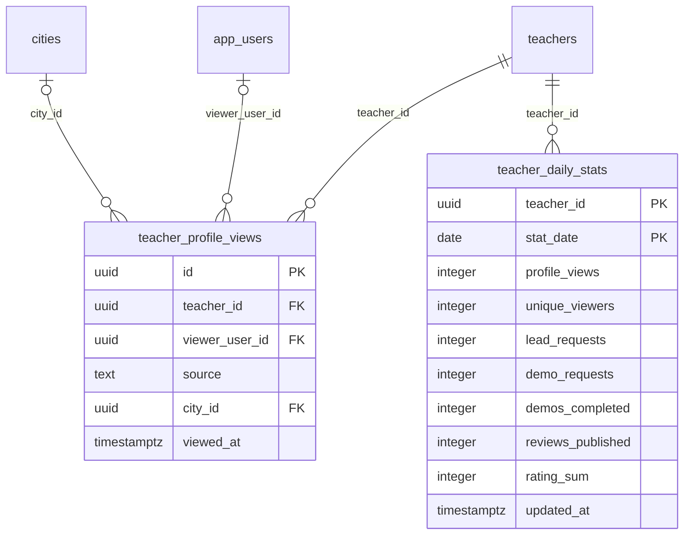

# Module 21 · Teacher Analytics

> **Phase 5 · Teachers** · **Depends on:** M16, M17 (M33, M38, M39 for full metrics) · **Owns tables:** `teacher_profile_views`, `teacher_daily_stats` · **Reads:** `teachers`, `leads`, `demo_requests`, `teacher_reviews` · **Build estimate:** 3 days

## 1. Module Overview

Per-teacher and cross-teacher analytics: profile views, unique viewers, lead requests, demo requests and completions, reviews and rating over time, and conversion from view to lead to demo. Raw view events are recorded by the mobile API; a nightly (and hourly for today) job rolls them up into `teacher_daily_stats`, which all screens read.

## 2. Business Purpose

Admins use these numbers to pick featured teachers, spot teachers who ignore leads, and show teachers the value of premium listings. Reading from a roll-up table keeps screens fast regardless of event volume.

## 3. User Stories

- As **Operations Admin**, I want to see a teacher's views, leads and conversion for the last 30 days so that I can advise them.
- As **Operations Admin**, I want a leaderboard of teachers by lead conversion in a city so that I can choose featured teachers.
- As **Support Admin**, I want to see a teacher's response rate so that I can act on "teacher never replies" complaints.

## 4. Functional Requirements & Business Logic

**FR-21.1 Event capture (mobile API contract).** `POST /api/v1/app/events/profile-view { teacherId, source }` inserts into `teacher_profile_views` (deduplicated: same viewer + teacher within 30 minutes counts once, enforced with a Redis key `pv:<viewer>:<teacher>` TTL 30 min).

**FR-21.2 Roll-up job.** `analytics-rollup` hourly for today and nightly (01:00 IST) for yesterday: `INSERT … ON CONFLICT (teacher_id, stat_date) DO UPDATE` with counts from `teacher_profile_views`, `leads`, `demo_requests` and `teacher_reviews`. Re-runnable for any date range (`POST /teacher-analytics/rebuild { from, to }`, super admin).

**FR-21.3 Teacher metrics.** `GET /teachers/:id/analytics?from&to&granularity=day|week|month` returns series and totals: views, unique viewers, leads, demo requests, demos completed, reviews, average rating (rating_sum / reviews), view→lead %, lead→demo %, demo→completion %, response rate (leads with `first_response_at` within 24 h / leads), median first response time.

**FR-21.4 Leaderboard.** `GET /teacher-analytics/leaderboard?cityId&subjectId&metric=leads|conversion|rating|views&from&to` — top 50 approved, active teachers; conversion metrics require ≥ 20 views to qualify.

**FR-21.5 Source breakdown.** Views by `source` for a teacher (search, featured, recommended, nearby, shared link, institute page).

**FR-21.6 Retention.** Raw `teacher_profile_views` older than 13 months are deleted monthly (roll-ups are kept forever).

## 5. Validation Rules

| Param | Rule |
| --- | --- |
| from / to | dates, to ≥ from, span ≤ 366 days (≤ 90 days for granularity=day) |
| granularity | day, week, month |
| metric | leads, conversion, rating, views |
| cityId / subjectId | optional active ids |

## 6. API Endpoints

| Method | Path | Permission | Description |
| --- | --- | --- | --- |
| GET | /teachers/:id/analytics | teacher_analytics.read | Series + totals for one teacher |
| GET | /teachers/:id/analytics/sources | teacher_analytics.read | Views by source |
| GET | /teacher-analytics/leaderboard | teacher_analytics.read | Top teachers by metric |
| POST | /teacher-analytics/rebuild | super admin | Recompute roll-ups for a date range (async) |

## 7. Request Payloads

```json
// GET /teachers/:id/analytics?from=2026-08-28&to=2026-09-26&granularity=day
// POST /teacher-analytics/rebuild
{ "from": "2026-09-01", "to": "2026-09-25" }
```

## 8. Response Payloads

```json
// 200 GET /teachers/:id/analytics
{ "data": { "totals": { "views": 1284, "uniqueViewers": 1011, "leads": 37, "demoRequests": 18, "demosCompleted": 11, "reviews": 6, "avgRating": 4.83,
  "viewToLeadPct": 2.9, "leadToDemoPct": 48.6, "responseRatePct": 94.6, "medianFirstResponseMinutes": 22 },
  "series": [ { "date": "2026-09-20", "views": 142, "leads": 2, "demoRequests": 1, "reviews": 0 } ] } }

// 200 GET /teacher-analytics/leaderboard?cityId=…&metric=conversion
{ "data": [ { "teacherId": "…", "fullName": "Rohan Mehta", "views": 890, "leads": 51, "conversionPct": 5.7, "rating": 4.8, "trustScore": 91 } ] }
```

## 9. PostgreSQL Tables

### `teacher_profile_views`

Raw profile-view events from the app. High volume; partition by month when it exceeds ~50M rows.

```sql
CREATE TABLE teacher_profile_views (
  id uuid PRIMARY KEY DEFAULT gen_random_uuid(), -- Primary key
  teacher_id uuid NOT NULL REFERENCES teachers(id) ON DELETE CASCADE, -- Teacher viewed
  viewer_user_id uuid REFERENCES app_users(id) ON DELETE SET NULL, -- Viewer, NULL for signed-out views
  source text NOT NULL DEFAULT 'search' CHECK (source IN ('search','home_featured','home_recommended','nearby','shared_link','institute_page','other')), -- Where the view came from
  city_id uuid REFERENCES cities(id), -- Viewer city at the time
  viewed_at timestamptz NOT NULL DEFAULT now() -- When
);
CREATE INDEX idx_teacher_profile_views_teacher ON teacher_profile_views (teacher_id, viewed_at DESC);
```

### `teacher_daily_stats`

Daily roll-up per teacher, written by a nightly job. All analytics screens read from here.

```sql
CREATE TABLE teacher_daily_stats (
  teacher_id uuid NOT NULL REFERENCES teachers(id) ON DELETE CASCADE, -- Teacher
  stat_date date NOT NULL, -- Day (Asia/Kolkata)
  profile_views integer NOT NULL DEFAULT 0, -- Views that day
  unique_viewers integer NOT NULL DEFAULT 0, -- Distinct signed-in viewers
  lead_requests integer NOT NULL DEFAULT 0, -- Leads created
  demo_requests integer NOT NULL DEFAULT 0, -- Demo requests created
  demos_completed integer NOT NULL DEFAULT 0, -- Demos marked completed
  reviews_published integer NOT NULL DEFAULT 0, -- Reviews published
  rating_sum integer NOT NULL DEFAULT 0, -- Sum of star ratings published that day (average = rating_sum / reviews_published)
  updated_at timestamptz NOT NULL DEFAULT now(), -- Last recomputed
  PRIMARY KEY (teacher_id, stat_date)
);
CREATE INDEX idx_teacher_daily_stats_date ON teacher_daily_stats (stat_date);
```

Migration file: `sql/migrations/021_m21_teacher_analytics.sql`

## 10. Column Definitions

### `teacher_profile_views`

| Column | Type | Null | Default | Constraints / References | Description |
| --- | --- | --- | --- | --- | --- |
| `id` | uuid | no | gen_random_uuid() | PK | Primary key |
| `teacher_id` | uuid | no | — | FK → `teachers.id` (on delete cascade) | Teacher viewed |
| `viewer_user_id` | uuid | yes | — | FK → `app_users.id` (on delete set null) | Viewer, NULL for signed-out views |
| `source` | text | no | 'search' | CHECK source IN ('search','home_featured','home_recommended','nearby','shared_link','institute_page','other') | Where the view came from |
| `city_id` | uuid | yes | — | FK → `cities.id` (on delete no action) | Viewer city at the time |
| `viewed_at` | timestamptz | no | now() | — | When |

### `teacher_daily_stats`

| Column | Type | Null | Default | Constraints / References | Description |
| --- | --- | --- | --- | --- | --- |
| `teacher_id` | uuid | no | — | PK; FK → `teachers.id` (on delete cascade) | Teacher |
| `stat_date` | date | no | — | PK | Day (Asia/Kolkata) |
| `profile_views` | integer | no | 0 | — | Views that day |
| `unique_viewers` | integer | no | 0 | — | Distinct signed-in viewers |
| `lead_requests` | integer | no | 0 | — | Leads created |
| `demo_requests` | integer | no | 0 | — | Demo requests created |
| `demos_completed` | integer | no | 0 | — | Demos marked completed |
| `reviews_published` | integer | no | 0 | — | Reviews published |
| `rating_sum` | integer | no | 0 | — | Sum of star ratings published that day (average = rating_sum / reviews_published) |
| `updated_at` | timestamptz | no | now() | — | Last recomputed |

**Table constraints:** `PRIMARY KEY (teacher_id, stat_date)`

## 11. Relationships

**Outgoing foreign keys**

- `teacher_profile_views.teacher_id` → `teachers.id` — required, many-to-one, on delete **cascade**
- `teacher_profile_views.viewer_user_id` → `app_users.id` — optional, many-to-one, on delete **set null**
- `teacher_profile_views.city_id` → `cities.id` — optional, many-to-one, on delete **no action**
- `teacher_daily_stats.teacher_id` → `teachers.id` — required, many-to-one, on delete **cascade**

**Entity relationship diagram**



## 12. Indexing Strategy

| Index | Table | Kind | Definition |
| --- | --- | --- | --- |
| `idx_teacher_profile_views_teacher` | `teacher_profile_views` | btree | `(teacher_id, viewed_at DESC)` |
| `idx_teacher_daily_stats_date` | `teacher_daily_stats` | btree | `(stat_date)` |

- `teacher_daily_stats` PK `(teacher_id, stat_date)` serves per-teacher ranges; `idx_teacher_daily_stats_date` serves leaderboards over a date range.
- `teacher_profile_views (teacher_id, viewed_at DESC)` serves the roll-up. Partition by month (`PARTITION BY RANGE (viewed_at)`) when it passes ~50 M rows; dropping old partitions implements FR-21.6 cheaply.

## 13. Permissions

| Permission key | Allows | Sensitive | Super | Ops | Verif. | Finance | Support |
| --- | --- | --- | --- | --- | --- | --- | --- |
| `teacher_analytics.read` | View teacher analytics | — | ✓ | ✓ | ✓ | — | — |

## 14. UI Screens & React Page Structure

| Route | Page | Content |
| --- | --- | --- |
| `/teachers/:id` → Analytics tab | TeacherAnalyticsTab | KPI tiles, views/leads line chart, funnel, source bars, response rate |
| `/analytics/teachers/leaderboard` | TeacherLeaderboardPage | Filters (city, subject, period, metric) + ranked table |

```
src/features/teacher-analytics/
  TeacherAnalyticsTab.tsx, TeacherLeaderboardPage.tsx
  components/KpiTiles.tsx, ViewsLeadsChart.tsx (Recharts), FunnelBars.tsx, SourceBars.tsx
```

## 15. UI Components

- `KpiTiles` — values with period-over-period deltas.
- `ViewsLeadsChart` — two series on one axis family (counts), crosshair tooltip; no dual axes.
- `FunnelBars` — views → leads → demos → completed with % between steps.

## 16. Filters

Date range presets (7d, 30d, 90d, 12m, custom), granularity; leaderboard: city, subject, metric, period.

## 17. Search Capabilities

Leaderboard: optional teacher name filter (client-side on the 50 results).

## 18. Pagination Requirements

Series are bounded by the date range; leaderboard fixed top 50.

## 19. Audit Logs

| Event | Details |
| --- | --- |
| `teacher_analytics.rebuild_requested` | date range |
Read-only views are not audited.

## 20. Error Scenarios

| Scenario | HTTP | Code | Message |
| --- | --- | --- | --- |
| Range too long for daily granularity | 422 | VALIDATION_FAILED | "Daily view supports up to 90 days. Pick weekly or monthly." |
| to before from | 422 | VALIDATION_FAILED | "End date must be after start date." |
| Rebuild already running | 409 | CONFLICT_STATE | "A rebuild is already running." |
| Teacher not found | 404 | NOT_FOUND | "Teacher not found." |

## 21. Future Scalability Notes & Enhancements

- Stream events through Kafka/Kinesis into a columnar store (ClickHouse/BigQuery) when views exceed tens of millions per month; keep `teacher_daily_stats` as the serving table.
- Same analytics for teachers inside the teacher app (read from the same roll-up).

## 22. Security Considerations

Viewer identities are never shown; only counts. Leaderboards exclude suspended teachers.
