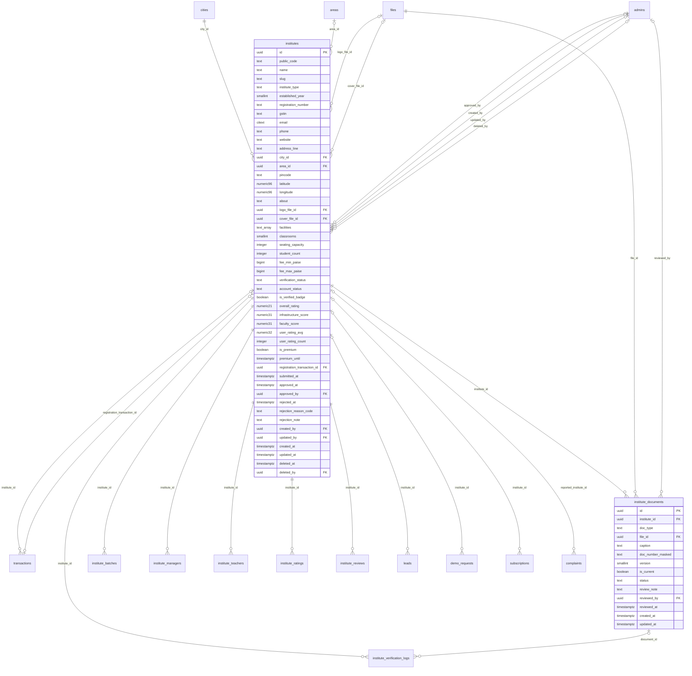

# Module 22 · Institute Registration Queue

> **Phase 6 · Institutes** · **Depends on:** M0–M2, M5, M9, M10 (M25 for the manager shown in the queue) · **Owns tables:** `institutes`, `institute_documents` · **Reads:** `files`, `cities`, `areas`, `institute_managers` · **Build estimate:** 4 days

## 1. Module Overview

Institutes (coaching centres, tuition centres, schools, music, coding, language and sports academies) register in the app through their manager, upload registration documents and campus photos, pay the institute fee if enabled, and arrive in this queue. Verification Admins review documents one by one (approve, reject, request re-upload) before the institute moves to evaluation and decision (Module 23).

## 2. Business Purpose

Parents trust an institute listing only if GuruConnect has checked that it legally exists at the stated address. Document review is the first gate; it must be quick and consistent, with a clear record of what was checked.

## 3. User Stories

- As a **Verification Admin**, I want a queue of new institutes with how long each has waited so that I review the oldest first.
- As a **Verification Admin**, I want to open the registration certificate and PAN side by side with the application so that I can confirm name and address.
- As a **Verification Admin**, I want to request a better photo of the certificate with a reason so that the manager can fix it in the app.
- As an **Operations Admin**, I want to onboard an institute on its behalf so that centres without smartphones can join.

## 4. Functional Requirements & Business Logic

**Status machine (`institutes.verification_status`)** — this module moves an institute from `pending` to `under_review` and `docs_requested`; Module 23 owns the rest.
```
draft ──manager submits──▶ pending ──admin opens──▶ under_review
under_review ──request documents──▶ docs_requested ──manager re-uploads──▶ pending
under_review ──all required docs approved──▶ (Module 23: visit_scheduled / evaluation_done / approved / rejected)
```
Required documents: `registration_certificate`, `pan` (or `gst_certificate`), `manager_aadhaar`, at least 6 `campus_photo`. Optional: `fire_safety_noc`, `other`.

**FR-22.1 Queue.** `GET /institute-verifications` — institutes in `pending`, `under_review`, `docs_requested`, `visit_scheduled`, `evaluation_done`, oldest first, with type, city, manager, teacher count, documents summary, fee status, age and SLA (target: document review within 48 h, full decision within 5 working days).

**FR-22.2 Case detail.** `GET /institute-verifications/:instituteId` — application (name, type, established year, registration number, GSTIN, address, facilities claimed, classrooms, seating, students, courses), manager (Module 25), documents with versions, photos gallery, timeline (Module 23 logs), payment reference.

**FR-22.3 Document decisions.** `POST /institute-documents/:id/approve`, `/reject { reasonCode, note }`, `/request-reupload { reasonCode, note }` — same rules as Module 16 (current version only; notes shown to the manager).

**FR-22.4 Send back.** `POST /institute-verifications/:instituteId/request-documents { message }` sets `docs_requested` and notifies the primary manager (push + SMS + email) listing items and reasons. Re-uploads create new versions and return the institute to `pending`.

**FR-22.5 Automated checks.** GSTIN format + checksum and (when an API key is configured) GST portal lookup of legal name and address; PIN code matches the area; registration-number format per state; duplicate detection by GSTIN, registration number and phone across institutes. Results appear in the case as pass/warn/fail.

**FR-22.6 Manual onboarding.** `POST /institutes` (`institutes.update`) creates the institute in `draft` with a primary manager invite (Module 25) and lets the admin upload documents. Another admin must make the final decision (Module 23).

**FR-22.7 Slug & code.** `public_code` `GC-I` + 4-digit sequence; `slug` from name + area (`apex-jee-academy-koramangala`), unique.

## 5. Validation Rules

| Field | Rule |
| --- | --- |
| name | 3–120 chars |
| instituteType | enum |
| establishedYear | 1800 … current year |
| registrationNumber | 4–40 chars, `[A-Za-z0-9/-]` |
| gstin | optional, `^\d{2}[A-Z]{5}\d{4}[A-Z][1-9A-Z]Z[0-9A-Z]$` + checksum; first two digits must match the state's GST code |
| phone | E.164; email optional valid; website https |
| address | addressLine 5–200; cityId active; areaId in city; pincode 6 digits |
| facilities | from the facilities list (ac_classrooms, cctv, library, science_lab, computer_lab, test_centre, parking, wheelchair_access, drinking_water, separate_washrooms, sound_proof_rooms, instrument_library, sports_ground, other) |
| classrooms 0–500; seatingCapacity 0–20,000; studentCount 0–100,000 | |
| document decisions | as Module 16 (reason code + 10–500-char note for reject/re-upload) |

## 6. API Endpoints

| Method | Path | Permission | Description |
| --- | --- | --- | --- |
| GET | /institute-verifications | institutes.read | Queue |
| GET | /institute-verifications/stats | institutes.read | Counts per status, oldest age |
| GET | /institute-verifications/:instituteId | institutes.read | Case detail |
| POST | /institute-documents/:id/approve | institute_documents.review | Approve a document |
| POST | /institute-documents/:id/reject | institute_documents.review | Reject a document |
| POST | /institute-documents/:id/request-reupload | institute_documents.review | Mark for re-upload |
| GET | /institute-documents/:id/file | institute_documents.unmask | Signed URL to the original (audited) |
| POST | /institute-verifications/:instituteId/request-documents | institute_documents.review | Send back to the manager |
| POST | /institutes | institutes.update | Manual onboarding (draft + manager invite) |

## 7. Request Payloads

```json
// POST /institute-documents/:id/request-reupload
{ "reasonCode": "CROPPED", "note": "The registration certificate is cut off at the bottom. Please upload the full page including the seal." }

// POST /institutes   (manual onboarding)
{ "name": "Little Scholars Tuition Hub", "instituteType": "tuition_centre", "establishedYear": 2020, "phone": "+919822011234", "addressLine": "Plot 12, Paud Road",
  "cityId": "…pune…", "areaId": "…kothrud…", "pincode": "411038", "facilities": ["cctv","drinking_water"], "manager": { "fullName": "Snehal Patil", "phone": "+919822011234", "email": "snehal@littlescholars.in" } }
```

## 8. Response Payloads

```json
// 200 GET /institute-verifications
{ "data": [ { "instituteId": "…", "publicCode": "GC-I2124", "name": "Vidya Commerce Classes", "type": "coaching_centre", "city": "Mumbai", "area": "Andheri",
  "manager": { "name": "Rajesh Shah", "phoneMasked": "+91 98XXX XX314" }, "teachers": 5, "status": "pending", "submittedAt": "…", "ageHours": 20,
  "documents": { "approved": 1, "total": 4 }, "checks": { "gstin": "pass", "duplicate": "pass" }, "payment": "paid" } ], "meta": { "page": 1, "pageSize": 20, "total": 44, "totalPages": 3 } }
```

## 9. PostgreSQL Tables

### `institutes`

Coaching centres, tuition centres, schools and academies. Rated by GuruConnect after verification.

```sql
CREATE TABLE institutes (
  id uuid PRIMARY KEY DEFAULT gen_random_uuid(), -- Primary key
  public_code text NOT NULL DEFAULT ('GC-I' || nextval('seq_institute_code')), -- Human-friendly id, e.g. GC-I2101
  name text NOT NULL, -- Institute name
  slug text NOT NULL, -- URL slug for the public page
  institute_type text NOT NULL CHECK (institute_type IN ('coaching_centre','tuition_centre','school','music_school','coding_academy','language_institute','sports_academy','other')), -- Type
  established_year smallint CHECK (established_year BETWEEN 1800 AND 2100), -- Year founded
  registration_number text, -- Shop & Establishment / Trust / Society registration number
  gstin text, -- 15-char GSTIN, optional
  email citext, -- Official email
  phone text NOT NULL, -- Official phone (E.164)
  website text, -- https URL
  address_line text NOT NULL, -- Street address
  city_id uuid NOT NULL REFERENCES cities(id) ON DELETE RESTRICT, -- City
  area_id uuid REFERENCES areas(id) ON DELETE RESTRICT, -- Area
  pincode text CHECK (pincode ~ '^[1-9][0-9]{5}$'), -- 6-digit PIN
  latitude numeric(9,6), -- Geocoded latitude
  longitude numeric(9,6), -- Geocoded longitude
  about text, -- Description, max 3,000 chars
  logo_file_id uuid REFERENCES files(id), -- Logo
  cover_file_id uuid REFERENCES files(id), -- Cover photo
  facilities text[] NOT NULL DEFAULT '{}', -- Claimed facilities, e.g. {ac_classrooms, cctv, library}
  classrooms smallint CHECK (classrooms >= 0), -- Number of classrooms
  seating_capacity integer CHECK (seating_capacity >= 0), -- Total seats
  student_count integer CHECK (student_count >= 0), -- Approximate current students
  fee_min_paise bigint, -- Lowest course fee
  fee_max_paise bigint, -- Highest course fee
  verification_status text NOT NULL DEFAULT 'draft' CHECK (verification_status IN ('draft','pending','under_review','docs_requested','visit_scheduled','evaluation_done','approved','rejected')), -- Workflow state
  account_status text NOT NULL DEFAULT 'active' CHECK (account_status IN ('active','suspended')), -- Suspended institutes are hidden
  is_verified_badge boolean NOT NULL DEFAULT false, -- Verified Institute badge
  overall_rating numeric(2,1) CHECK (overall_rating BETWEEN 1 AND 5), -- Current GuruConnect rating (cached from institute_ratings)
  infrastructure_score numeric(3,1) CHECK (infrastructure_score BETWEEN 0 AND 10), -- Cached from the current rating
  faculty_score numeric(3,1) CHECK (faculty_score BETWEEN 0 AND 10), -- Cached from the current rating
  user_rating_avg numeric(3,2), -- Cached average of published institute reviews
  user_rating_count integer NOT NULL DEFAULT 0, -- Cached count of published reviews
  is_premium boolean NOT NULL DEFAULT false, -- Premium listing
  premium_until timestamptz, -- Premium expiry
  registration_transaction_id uuid, -- Registration fee payment (FK added in migration 040)
  submitted_at timestamptz, -- Submitted for review
  approved_at timestamptz, -- Approved
  approved_by uuid REFERENCES admins(id), -- Approver
  rejected_at timestamptz, -- Rejected
  rejection_reason_code text, -- e.g. FAKE_REGISTRATION, ADDRESS_NOT_FOUND
  rejection_note text, -- Message to the institute
  created_by uuid REFERENCES admins(id), -- Admin creator (manual onboarding)
  updated_by uuid REFERENCES admins(id), -- Last admin editor
  created_at timestamptz NOT NULL DEFAULT now(), -- Created
  updated_at timestamptz NOT NULL DEFAULT now(), -- Last updated
  deleted_at timestamptz, -- Soft delete
  deleted_by uuid REFERENCES admins(id), -- Who deleted
  CONSTRAINT ck_institutes_fee_range CHECK (fee_min_paise IS NULL OR fee_max_paise IS NULL OR fee_min_paise <= fee_max_paise)
);
CREATE UNIQUE INDEX uq_institutes_public_code ON institutes (public_code);
CREATE UNIQUE INDEX uq_institutes_slug ON institutes (slug) WHERE deleted_at IS NULL;
CREATE INDEX idx_institutes_queue ON institutes (verification_status, submitted_at) WHERE deleted_at IS NULL;
CREATE INDEX idx_institutes_city ON institutes (city_id, area_id) WHERE deleted_at IS NULL;
CREATE INDEX idx_institutes_name_trgm ON institutes USING gin (name gin_trgm_ops);
CREATE TRIGGER trg_institutes_updated BEFORE UPDATE ON institutes FOR EACH ROW EXECUTE FUNCTION set_updated_at();
ALTER TABLE institutes ADD CONSTRAINT fk_institutes_registration_txn FOREIGN KEY (registration_transaction_id) REFERENCES transactions(id) ON DELETE SET NULL;
```

### `institute_documents`

Institute verification documents and campus photos, versioned like teacher documents.

```sql
CREATE TABLE institute_documents (
  id uuid PRIMARY KEY DEFAULT gen_random_uuid(), -- Primary key
  institute_id uuid NOT NULL REFERENCES institutes(id) ON DELETE RESTRICT, -- Owner
  doc_type text NOT NULL CHECK (doc_type IN ('registration_certificate','pan','gst_certificate','manager_aadhaar','campus_photo','fire_safety_noc','other')), -- Type
  file_id uuid NOT NULL REFERENCES files(id) ON DELETE RESTRICT, -- Stored file
  caption text, -- e.g. Classroom A (for campus photos)
  doc_number_masked text, -- Masked number for display
  version smallint NOT NULL DEFAULT 1, -- Upload count for this type
  is_current boolean NOT NULL DEFAULT true, -- false once replaced
  status text NOT NULL DEFAULT 'submitted' CHECK (status IN ('submitted','approved','rejected','reupload_requested')), -- Review state
  review_note text, -- Reason shown to the institute manager
  reviewed_by uuid REFERENCES admins(id), -- Reviewer
  reviewed_at timestamptz, -- Review time
  created_at timestamptz NOT NULL DEFAULT now(), -- Uploaded
  updated_at timestamptz NOT NULL DEFAULT now() -- Last updated
);
CREATE INDEX idx_institute_documents_institute ON institute_documents (institute_id, doc_type) WHERE is_current;
CREATE TRIGGER trg_institute_documents_updated BEFORE UPDATE ON institute_documents FOR EACH ROW EXECUTE FUNCTION set_updated_at();
```

Migration file: `sql/migrations/022_m22_institute_registration_queue.sql`

## 10. Column Definitions

### `institutes`

| Column | Type | Null | Default | Constraints / References | Description |
| --- | --- | --- | --- | --- | --- |
| `id` | uuid | no | gen_random_uuid() | PK | Primary key |
| `public_code` | text | no | ('GC-I' \|\| nextval('seq_institute_code')) | — | Human-friendly id, e.g. GC-I2101 |
| `name` | text | no | — | — | Institute name |
| `slug` | text | no | — | — | URL slug for the public page |
| `institute_type` | text | no | — | CHECK institute_type IN ('coaching_centre','tuition_centre','school','music_school','coding_academy','language_institute','sports_academy','other') | Type |
| `established_year` | smallint | yes | — | CHECK established_year BETWEEN 1800 AND 2100 | Year founded |
| `registration_number` | text | yes | — | — | Shop & Establishment / Trust / Society registration number |
| `gstin` | text | yes | — | — | 15-char GSTIN, optional |
| `email` | citext | yes | — | — | Official email |
| `phone` | text | no | — | — | Official phone (E.164) |
| `website` | text | yes | — | — | https URL |
| `address_line` | text | no | — | — | Street address |
| `city_id` | uuid | no | — | FK → `cities.id` (on delete restrict) | City |
| `area_id` | uuid | yes | — | FK → `areas.id` (on delete restrict) | Area |
| `pincode` | text | yes | — | CHECK pincode ~ '^[1-9][0-9]{5}$' | 6-digit PIN |
| `latitude` | numeric(9,6) | yes | — | — | Geocoded latitude |
| `longitude` | numeric(9,6) | yes | — | — | Geocoded longitude |
| `about` | text | yes | — | — | Description, max 3,000 chars |
| `logo_file_id` | uuid | yes | — | FK → `files.id` (on delete no action) | Logo |
| `cover_file_id` | uuid | yes | — | FK → `files.id` (on delete no action) | Cover photo |
| `facilities` | text[] | no | '{}' | — | Claimed facilities, e.g. {ac_classrooms, cctv, library} |
| `classrooms` | smallint | yes | — | CHECK classrooms >= 0 | Number of classrooms |
| `seating_capacity` | integer | yes | — | CHECK seating_capacity >= 0 | Total seats |
| `student_count` | integer | yes | — | CHECK student_count >= 0 | Approximate current students |
| `fee_min_paise` | bigint | yes | — | — | Lowest course fee |
| `fee_max_paise` | bigint | yes | — | — | Highest course fee |
| `verification_status` | text | no | 'draft' | CHECK verification_status IN ('draft','pending','under_review','docs_requested','visit_scheduled','evaluation_done','approved','rejected') | Workflow state |
| `account_status` | text | no | 'active' | CHECK account_status IN ('active','suspended') | Suspended institutes are hidden |
| `is_verified_badge` | boolean | no | false | — | Verified Institute badge |
| `overall_rating` | numeric(2,1) | yes | — | CHECK overall_rating BETWEEN 1 AND 5 | Current GuruConnect rating (cached from institute_ratings) |
| `infrastructure_score` | numeric(3,1) | yes | — | CHECK infrastructure_score BETWEEN 0 AND 10 | Cached from the current rating |
| `faculty_score` | numeric(3,1) | yes | — | CHECK faculty_score BETWEEN 0 AND 10 | Cached from the current rating |
| `user_rating_avg` | numeric(3,2) | yes | — | — | Cached average of published institute reviews |
| `user_rating_count` | integer | no | 0 | — | Cached count of published reviews |
| `is_premium` | boolean | no | false | — | Premium listing |
| `premium_until` | timestamptz | yes | — | — | Premium expiry |
| `registration_transaction_id` | uuid | yes | — | FK → `transactions.id` (on delete set null), added in migration 040 | Registration fee payment (FK added in migration 040) |
| `submitted_at` | timestamptz | yes | — | — | Submitted for review |
| `approved_at` | timestamptz | yes | — | — | Approved |
| `approved_by` | uuid | yes | — | FK → `admins.id` (on delete no action) | Approver |
| `rejected_at` | timestamptz | yes | — | — | Rejected |
| `rejection_reason_code` | text | yes | — | — | e.g. FAKE_REGISTRATION, ADDRESS_NOT_FOUND |
| `rejection_note` | text | yes | — | — | Message to the institute |
| `created_by` | uuid | yes | — | FK → `admins.id` (on delete no action) | Admin creator (manual onboarding) |
| `updated_by` | uuid | yes | — | FK → `admins.id` (on delete no action) | Last admin editor |
| `created_at` | timestamptz | no | now() | — | Created |
| `updated_at` | timestamptz | no | now() | — | Last updated |
| `deleted_at` | timestamptz | yes | — | — | Soft delete |
| `deleted_by` | uuid | yes | — | FK → `admins.id` (on delete no action) | Who deleted |

**Table constraints:** `CONSTRAINT ck_institutes_fee_range CHECK (fee_min_paise IS NULL OR fee_max_paise IS NULL OR fee_min_paise <= fee_max_paise)`

### `institute_documents`

| Column | Type | Null | Default | Constraints / References | Description |
| --- | --- | --- | --- | --- | --- |
| `id` | uuid | no | gen_random_uuid() | PK | Primary key |
| `institute_id` | uuid | no | — | FK → `institutes.id` (on delete restrict) | Owner |
| `doc_type` | text | no | — | CHECK doc_type IN ('registration_certificate','pan','gst_certificate','manager_aadhaar','campus_photo','fire_safety_noc','other') | Type |
| `file_id` | uuid | no | — | FK → `files.id` (on delete restrict) | Stored file |
| `caption` | text | yes | — | — | e.g. Classroom A (for campus photos) |
| `doc_number_masked` | text | yes | — | — | Masked number for display |
| `version` | smallint | no | 1 | — | Upload count for this type |
| `is_current` | boolean | no | true | — | false once replaced |
| `status` | text | no | 'submitted' | CHECK status IN ('submitted','approved','rejected','reupload_requested') | Review state |
| `review_note` | text | yes | — | — | Reason shown to the institute manager |
| `reviewed_by` | uuid | yes | — | FK → `admins.id` (on delete no action) | Reviewer |
| `reviewed_at` | timestamptz | yes | — | — | Review time |
| `created_at` | timestamptz | no | now() | — | Uploaded |
| `updated_at` | timestamptz | no | now() | — | Last updated |

## 11. Relationships

**Outgoing foreign keys**

- `institutes.city_id` → `cities.id` — required, many-to-one, on delete **restrict**
- `institutes.area_id` → `areas.id` — optional, many-to-one, on delete **restrict**
- `institutes.logo_file_id` → `files.id` — optional, many-to-one, on delete **no action**
- `institutes.cover_file_id` → `files.id` — optional, many-to-one, on delete **no action**
- `institutes.registration_transaction_id` → `transactions.id` — optional, many-to-one, on delete **set null**
- `institutes.approved_by` → `admins.id` — optional, many-to-one, on delete **no action**
- `institutes.created_by` → `admins.id` — optional, many-to-one, on delete **no action**
- `institutes.updated_by` → `admins.id` — optional, many-to-one, on delete **no action**
- `institutes.deleted_by` → `admins.id` — optional, many-to-one, on delete **no action**
- `institute_documents.institute_id` → `institutes.id` — required, many-to-one, on delete **restrict**
- `institute_documents.file_id` → `files.id` — required, many-to-one, on delete **restrict**
- `institute_documents.reviewed_by` → `admins.id` — optional, many-to-one, on delete **no action**

**Referenced by**

- `institute_verification_logs.institute_id` → `institutes` (module 23) — on delete **cascade**
- `institute_verification_logs.document_id` → `institute_documents` (module 23) — on delete **set null**
- `institute_batches.institute_id` → `institutes` (module 24) — on delete **cascade**
- `institute_managers.institute_id` → `institutes` (module 25) — on delete **cascade**
- `institute_teachers.institute_id` → `institutes` (module 26) — on delete **cascade**
- `institute_ratings.institute_id` → `institutes` (module 27) — on delete **cascade**
- `institute_reviews.institute_id` → `institutes` (module 34) — on delete **cascade**
- `leads.institute_id` → `institutes` (module 38) — on delete **restrict**
- `demo_requests.institute_id` → `institutes` (module 39) — on delete **restrict**
- `transactions.institute_id` → `institutes` (module 40) — on delete **restrict**
- `subscriptions.institute_id` → `institutes` (module 41) — on delete **restrict**
- `complaints.reported_institute_id` → `institutes` (module 43) — on delete **restrict**

**Entity relationship diagram**



## 12. Indexing Strategy

| Index | Table | Kind | Definition |
| --- | --- | --- | --- |
| `uq_institutes_public_code` | `institutes` | unique | `(public_code)` |
| `uq_institutes_slug` | `institutes` | unique | `(slug) WHERE deleted_at IS NULL` |
| `idx_institutes_queue` | `institutes` | btree | `(verification_status, submitted_at) WHERE deleted_at IS NULL` |
| `idx_institutes_city` | `institutes` | btree | `(city_id, area_id) WHERE deleted_at IS NULL` |
| `idx_institutes_name_trgm` | `institutes` | gin | `USING gin (name gin_trgm_ops)` |
| `idx_institute_documents_institute` | `institute_documents` | btree | `(institute_id, doc_type) WHERE is_current` |

`idx_institutes_queue (verification_status, submitted_at)` for the queue; `idx_institute_documents_institute` for current documents; trigram index on name for search; duplicate checks use exact lookups on GSTIN / registration number (add partial unique indexes on `gstin` and `registration_number` once data is clean).

## 13. Permissions

| Permission key | Allows | Sensitive | Super | Ops | Verif. | Finance | Support |
| --- | --- | --- | --- | --- | --- | --- | --- |
| `institutes.read` | View institutes and the institute queue | — | ✓ | ✓ | ✓ | ✓ | ✓ |
| `institute_documents.review` | Approve, reject or request re-upload of institute documents | — | ✓ | — | ✓ | — | — |
| `institute_documents.unmask` | View original institute documents and manager Aadhaar (logged) | yes | ✓ | — | ✓ | — | — |

## 14. UI Screens & React Page Structure

| Route | Page | Content |
| --- | --- | --- |
| `/institutes/verification` | InstituteQueuePage | KPI strip, status tabs, queue table |
| `/institutes/:id/review` | InstituteReviewPage | Details, documents, photos, checks, timeline + evaluation panel (Module 27) and decision bar (Module 23) |
| `/institutes/new` | CreateInstitutePage | Manual onboarding wizard |

```
src/features/institute-verification/
  pages/InstituteQueuePage.tsx, InstituteReviewPage.tsx, CreateInstitutePage.tsx
  components/InstituteDetailsCard.tsx, InstituteDocumentList.tsx, CampusPhotoGrid.tsx, InstituteChecksPanel.tsx, RequestDocumentsDialog.tsx
```

## 15. UI Components

- `InstituteDocumentList` — rows with status, view, approve, re-upload, reject.
- `CampusPhotoGrid` — lightbox with captions; photo approval per image.
- `InstituteChecksPanel` — GSTIN, PIN, duplicate checks.

## 16. Filters

Status, type, city, fee paid, age (> 48 h), assigned reviewer, submitted date range.

## 17. Search Capabilities

`q`: public code exact, name trigram, GSTIN exact, registration number exact, manager phone (last 10 digits, `users.pii`).

## 18. Pagination Requirements

Offset, default 20; default sort `submitted_at ASC`.

## 19. Audit Logs

| Event | Details |
| --- | --- |
| `institute_document.approved` / `.rejected` / `.reupload_requested` | document, reason |
| `institute_document.unmasked` | document |
| `institute_verification.documents_requested` | items |
| `institute.created_manually` | admin |

## 20. Error Scenarios

| Scenario | HTTP | Code | Message |
| --- | --- | --- | --- |
| Decide on a non-current document | 409 | CONFLICT_STATE | "A newer version was uploaded." |
| Invalid GSTIN | 422 | VALIDATION_FAILED | "Enter a valid 15-character GSTIN." |
| GSTIN state mismatch | 422 | VALIDATION_FAILED | "GSTIN is registered in another state." |
| Duplicate institute (GSTIN/registration/phone) | 409 | CONFLICT_DUPLICATE | "This matches GC-I2101 Apex JEE Academy." |
| Send back with nothing marked | 409 | CONFLICT_STATE | "Mark at least one document first." |
| Unmask without permission | 403 | FORBIDDEN | "You don't have access to original documents." |

## 21. Future Scalability Notes & Enhancements

- GST and MCA (company) API verification; Google Places match for address and photos.
- Branch support: `parent_institute_id` for chains with many centres.

## 22. Security Considerations

Same document protections as Module 16 (private files, audited signed URLs, watermark viewer). Manager Aadhaar handled like teacher Aadhaar (masked + HMAC).
