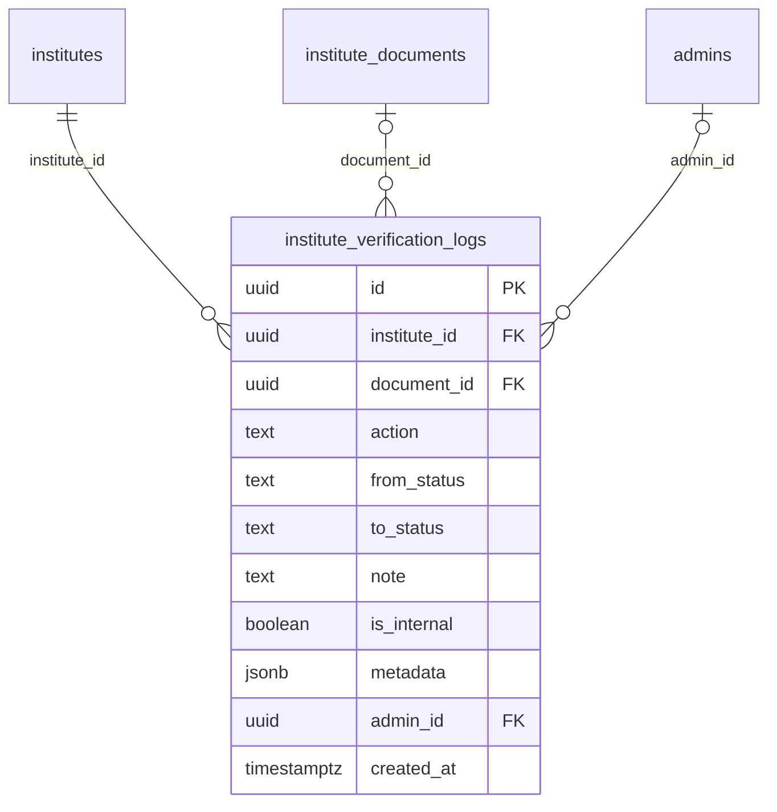

# Module 23 · Institute Verification

> **Phase 6 · Institutes** · **Depends on:** M22, M25, M27 · **Owns tables:** `institute_verification_logs` · **Reads:** `institutes`, `institute_documents`, `institute_ratings`, `institute_managers` · **Build estimate:** 3 days

## 1. Module Overview

The decision step for institutes after document review: schedule and record the evaluation (site visit or video walkthrough), then Approve (verify and publish with the Verified Institute badge) or Reject. Keeps the full verification timeline.

## 2. Business Purpose

Institutes affect many families at once. GuruConnect's promise is that a verified institute exists, is safe and has qualified teachers — so approval requires documents plus a completed evaluation and an assigned rating.

## 3. User Stories

- As a **Verification Admin**, I want to schedule a site visit with the manager so that I can check the campus.
- As **Super Admin (Sameer Bhaiya)**, I want to approve an institute only after its rating is submitted so that every verified institute shows a rating.
- As a **Verification Admin**, I want to reject an institute with a clear reason so that the manager knows what to fix.
- As **Super Admin**, I want to revoke an institute's badge if serious complaints are upheld.

## 4. Functional Requirements & Business Logic

**Status machine (continued from Module 22)**
```
under_review ──all required docs approved──▶ under_review (docs complete flag)
under_review ──schedule visit──▶ visit_scheduled ──visit recorded + rating submitted (M27)──▶ evaluation_done
evaluation_done ──approve──▶ approved        (any review state) ──reject──▶ rejected
approved ──suspend/activate (M24) changes account_status; badge revoke keeps status approved
rejected ──manager may re-apply after 30 days──▶ draft
```

**FR-23.1 Schedule evaluation.** `POST /institute-verifications/:id/schedule-visit { method: site_visit|video_walkthrough, visitAt, assignedAdminId, note }` — requires all required documents approved; sets `visit_scheduled`; notifies the manager with date/time and what to prepare (classrooms, fire exits, washrooms, registers); calendar invite (ICS) emailed to the assigned admin. Reschedule with the same endpoint (logged).

**FR-23.2 Record visit.** `POST /institute-verifications/:id/visit-completed { visitedAt, note }` logs `visit_completed`. The evaluation itself is entered in Module 27; submitting a rating moves the institute to `evaluation_done` (Module 27 calls this module's service).

**FR-23.3 Approve.** `POST /institute-verifications/:id/approve { grantBadge: true, note }` (`institute_verification.decide`). Preconditions: required documents approved; a submitted current rating exists (Module 27); primary manager `active`; not suspended. Effects: `approved`, `approved_at/by`, badge, cache the rating fields on `institutes`, make public, notify manager, start the institute registration period (Module 41) if paid, emit `institute.approved` (referrals, Module 42).

**FR-23.4 Reject.** `POST /institute-verifications/:id/reject { reasonCode, note }` — reason codes `FAKE_REGISTRATION`, `ADDRESS_NOT_FOUND`, `UNSAFE_PREMISES`, `UNQUALIFIED_FACULTY`, `DUPLICATE`, `DOCS_NOT_PROVIDED`, `OTHER`. Refund per fee rules (Module 40, reason `institute_rejected`). `FAKE_REGISTRATION` also suspends the manager's app account.

**FR-23.5 Badge.** `POST /institutes/:id/badge { grant, reason }` — revoke/grant for approved institutes (e.g., after upheld complaints).

**FR-23.6 Timeline.** `GET /institute-verifications/:id/timeline` — all `institute_verification_logs` entries with actor and notes; notes can be internal or visible to the manager (`POST …/notes`).

**FR-23.7 Re-evaluation.** Approved institutes are re-evaluated every 12 months (`institute_ratings.next_review_due`). A daily job lists due institutes in the queue with status unchanged (still approved) and flag `re_evaluation_due`.

## 5. Validation Rules

| Field | Rule |
| --- | --- |
| method | site_visit or video_walkthrough |
| visitAt | future (≤ 60 days) when scheduling; past (≤ 7 days ago) for visit-completed |
| assignedAdminId | active admin holding `institute_ratings.rate` |
| reasonCode | list above; note 10–500 chars (shown to manager) |
| grantBadge | boolean, default true |
| Preconditions | as in FR-23.1 and FR-23.3 |

## 6. API Endpoints

| Method | Path | Permission | Description |
| --- | --- | --- | --- |
| POST | /institute-verifications/:id/schedule-visit | institute_verification.decide | Schedule or reschedule evaluation |
| POST | /institute-verifications/:id/visit-completed | institute_ratings.rate | Record that the visit happened |
| POST | /institute-verifications/:id/approve | institute_verification.decide | Approve and publish |
| POST | /institute-verifications/:id/reject | institute_verification.decide | Reject |
| POST | /institutes/:id/badge | institute_verification.decide | Grant / revoke badge |
| GET | /institute-verifications/:id/timeline | institutes.read | Verification timeline |
| POST | /institute-verifications/:id/notes | institute_documents.review | Add note |

## 7. Request Payloads

```json
// POST /institute-verifications/:id/schedule-visit
{ "method": "site_visit", "visitAt": "2026-09-29T05:30:00Z", "assignedAdminId": "…anjali…", "note": "Please keep the test hall and fire exits accessible." }

// POST /institute-verifications/:id/approve
{ "grantBadge": true, "note": "Separate test hall; ramp recommended at entrance." }
```

## 8. Response Payloads

```json
// 200 POST /institute-verifications/:id/approve
{ "data": { "id": "…", "verificationStatus": "approved", "isVerifiedBadge": true, "overallRating": 4.5, "infrastructureScore": 8.8, "facultyScore": 9.1, "approvedAt": "2026-09-26T12:02:11Z" } }

// 200 GET /institute-verifications/:id/timeline
{ "data": [ { "action": "visit_scheduled", "at": "…", "by": "Sameer Bhaiya", "note": "…", "metadata": { "method": "site_visit", "visitAt": "2026-09-29T05:30:00Z" } } ] }
```

## 9. PostgreSQL Tables

### `institute_verification_logs`

Timeline of institute verification events.

```sql
CREATE TABLE institute_verification_logs (
  id uuid PRIMARY KEY DEFAULT gen_random_uuid(), -- Primary key
  institute_id uuid NOT NULL REFERENCES institutes(id) ON DELETE CASCADE, -- Institute
  document_id uuid REFERENCES institute_documents(id) ON DELETE SET NULL, -- Related document
  action text NOT NULL CHECK (action IN ('submitted','resubmitted','document_approved','document_rejected','docs_requested','visit_scheduled','visit_completed','evaluation_saved','approved','rejected','badge_granted','badge_revoked','suspended','activated','note_added')), -- Event
  from_status text, -- Status before
  to_status text, -- Status after
  note text, -- Note or reason
  is_internal boolean NOT NULL DEFAULT true, -- false = visible to the institute manager
  metadata jsonb, -- e.g. {"visit_at":"2026-09-29T05:30:00Z","method":"site_visit"}
  admin_id uuid REFERENCES admins(id), -- Actor
  created_at timestamptz NOT NULL DEFAULT now() -- When
);
CREATE INDEX idx_institute_verification_logs_inst ON institute_verification_logs (institute_id, created_at DESC);
```

Migration file: `sql/migrations/023_m23_institute_verification.sql`

## 10. Column Definitions

### `institute_verification_logs`

| Column | Type | Null | Default | Constraints / References | Description |
| --- | --- | --- | --- | --- | --- |
| `id` | uuid | no | gen_random_uuid() | PK | Primary key |
| `institute_id` | uuid | no | — | FK → `institutes.id` (on delete cascade) | Institute |
| `document_id` | uuid | yes | — | FK → `institute_documents.id` (on delete set null) | Related document |
| `action` | text | no | — | CHECK action IN ('submitted','resubmitted','document_approved','document_rejected','docs_requested','visit_scheduled','visit_completed','evaluation_saved','approved','rejected','badge_granted','badge_revoked','suspended','activated','note_added') | Event |
| `from_status` | text | yes | — | — | Status before |
| `to_status` | text | yes | — | — | Status after |
| `note` | text | yes | — | — | Note or reason |
| `is_internal` | boolean | no | true | — | false = visible to the institute manager |
| `metadata` | jsonb | yes | — | — | e.g. {"visit_at":"2026-09-29T05:30:00Z","method":"site_visit"} |
| `admin_id` | uuid | yes | — | FK → `admins.id` (on delete no action) | Actor |
| `created_at` | timestamptz | no | now() | — | When |

## 11. Relationships

**Outgoing foreign keys**

- `institute_verification_logs.institute_id` → `institutes.id` — required, many-to-one, on delete **cascade**
- `institute_verification_logs.document_id` → `institute_documents.id` — optional, many-to-one, on delete **set null**
- `institute_verification_logs.admin_id` → `admins.id` — optional, many-to-one, on delete **no action**

**Entity relationship diagram**



## 12. Indexing Strategy

| Index | Table | Kind | Definition |
| --- | --- | --- | --- |
| `idx_institute_verification_logs_inst` | `institute_verification_logs` | btree | `(institute_id, created_at DESC)` |

`idx_institute_verification_logs_inst (institute_id, created_at DESC)` for timelines; queue via `idx_institutes_queue`.

## 13. Permissions

| Permission key | Allows | Sensitive | Super | Ops | Verif. | Finance | Support |
| --- | --- | --- | --- | --- | --- | --- | --- |
| `institute_verification.decide` | Schedule visits, approve or reject institutes, grant the badge | yes | ✓ | — | ✓ | — | — |

Only `institute_verification.decide` can approve/reject/schedule; the admin who performed the evaluation can also approve (institutes need a visit; a two-person rule is optional via settings `institutes.require_second_approver`, default off).

## 14. UI Screens & React Page Structure

Decision controls live on `/institutes/:id/review` (Module 22 page): a status stepper (Documents → Evaluation → Decision), "Schedule visit" dialog, "Approve & publish" and "Reject" in the sticky decision bar, timeline panel.
```
src/features/institute-verification/components/StatusStepper.tsx, ScheduleVisitDialog.tsx, ApproveInstituteDialog.tsx, RejectInstituteDialog.tsx, InstituteTimeline.tsx
```

## 15. UI Components

- `StatusStepper` — shows which preconditions are met.
- `ScheduleVisitDialog` — method, date-time (IST), assignee, note to manager; shows manager's contact.
- `ApproveInstituteDialog` — rating summary, badge toggle, note.

## 16. Filters

Queue filters from Module 22 plus: evaluation due (re-evaluation), assigned evaluator.

## 17. Search Capabilities

As Module 22.

## 18. Pagination Requirements

Timeline: cursor, 50 per page.

## 19. Audit Logs

| Event | Details |
| --- | --- |
| `institute.visit_scheduled` / `.visit_rescheduled` | method, time, assignee |
| `institute.visit_completed` | time |
| `institute.approved` | badge, rating version |
| `institute.rejected` | reason code, refund |
| `institute.badge_granted` / `.badge_revoked` | reason |

## 20. Error Scenarios

| Scenario | HTTP | Code | Message |
| --- | --- | --- | --- |
| Schedule before documents approved | 409 | CONFLICT_STATE | "Approve all required documents first." |
| Approve without submitted rating | 409 | CONFLICT_STATE | "Submit the evaluation and rating first." |
| Approve with inactive primary manager | 409 | CONFLICT_STATE | "The institute needs an active primary manager." |
| Visit time in the past when scheduling | 422 | VALIDATION_FAILED | "Pick a future date and time." |
| Assignee lacks rating permission | 422 | VALIDATION_FAILED | "This admin can't evaluate institutes." |
| Reject without reason | 422 | VALIDATION_FAILED | "Pick a reason and add a note." |

## 21. Future Scalability Notes & Enhancements

Field-agent mobile app for visits with geotagged photos and offline checklists; third-party inspection partners in new cities.

## 22. Security Considerations

Decisions restricted to `institute_verification.decide`; all transitions logged with actor, reason and time; manager-visible notes clearly separated from internal ones.
