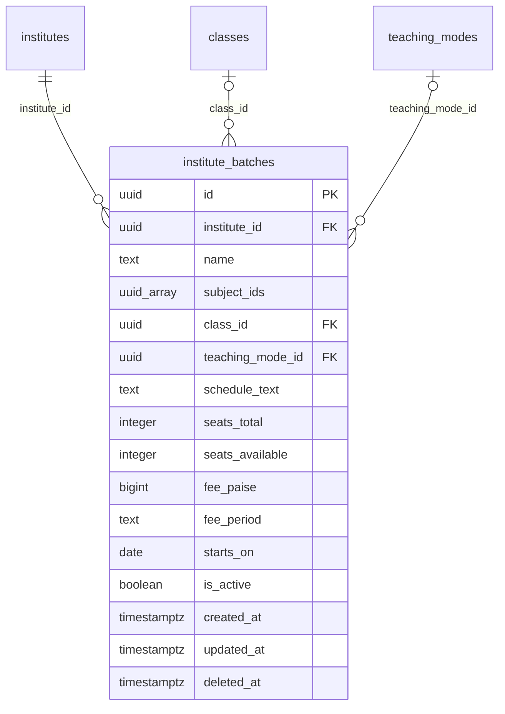

# Module 24 · Institute Profile Management

> **Phase 6 · Institutes** · **Depends on:** M22, M23 · **Owns tables:** `institute_batches` · **Reads:** `institutes`, `files`, `cities`, `areas`, `subjects`, `classes`, `teaching_modes` · **Build estimate:** 3 days

## 1. Module Overview

The admin directory of institutes and the institute detail page: edit profile data (about, contact, address, facilities, fees, photos), manage courses and batches shown on the public profile, suspend or re-activate, set premium listing, and see tabs for managers (25), teachers (26), ratings (27), reviews (34), leads (38) and complaints (43).

## 2. Business Purpose

Institutes change timings, fees and batches often; managers do this in the app, but support must be able to correct data, handle takedown requests and suspend an institute during an investigation.

## 3. User Stories

- As **Operations Admin**, I want to fix an institute's address and PIN so that it appears in the right area.
- As **Operations Admin**, I want to add a "JEE 2027 weekend batch" with seats and fee so that parents see accurate batches.
- As **Support Admin**, I want to suspend an institute during a fraud investigation so that it stops getting enquiries.
- As **Operations Admin**, I want to list all verified institutes in Pune with their rating so that I can plan a campaign.

## 4. Functional Requirements & Business Logic

**FR-24.1 Directory.** `GET /institutes` — name, code, type, city/area, manager, teachers count, verification status, account status, overall rating, infrastructure/faculty scores, user rating, premium flag, created date. Export like Module 17.

**FR-24.2 Detail.** `GET /institutes/:id` — full profile, cached rating fields, counts (teachers active, batches, leads 30d, reviews, open complaints), current subscription.

**FR-24.3 Edit.** `PATCH /institutes/:id` (If-Match) for name*, type, established year, registration number*, GSTIN*, contact (phone, email, website), address* (line, city, area, PIN, coordinates), about, logo, cover, facilities, classrooms, seating, student count, fee range. Starred fields on an approved institute require a reason and add a `profile_changed_after_approval` log; changing address city or facilities flags the next evaluation as due (`re_evaluation_due`).

**FR-24.4 Batches.** CRUD on `institute_batches` (soft delete). Each batch: name, subjects, class, mode, schedule text, seats total/available, fee and period, start date, active. Max 50 active batches per institute.

**FR-24.5 Suspend / activate.** Same behaviour as Module 17 applied to institutes: hidden from search, open leads marked unavailable, upcoming campus visits/demos cancelled, managers notified; optional auto re-activate date.

**FR-24.6 Premium (manual).** `POST /institutes/:id/premium { premium, until, reason }`.

**FR-24.7 Photos.** `PUT /institutes/:id/photos` sets the public gallery order from approved `campus_photo` documents (max 20); the cover must be one of them or a separate upload.

## 5. Validation Rules

Profile fields as Module 22. Batches: name 3–80; subjectIds 1–6 active subjects; classId active; seatsTotal 1–1,000; seatsAvailable 0…seatsTotal; feePaise 0…1,00,00,000; feePeriod enum; startsOn ≥ today − 365 days; schedule text ≤ 120. Suspend reason 10–500; until ≤ 365 days.

## 6. API Endpoints

| Method | Path | Permission | Description |
| --- | --- | --- | --- |
| GET | /institutes | institutes.read | Directory |
| GET | /institutes/export | institutes.read | CSV export |
| GET | /institutes/:id | institutes.read | Detail |
| PATCH | /institutes/:id | institutes.update | Edit profile (If-Match) |
| PUT | /institutes/:id/photos | institutes.update | Public gallery order |
| GET | /institutes/:id/batches | institutes.read | Batches |
| POST | /institutes/:id/batches | institutes.update | Add batch |
| PATCH | /institute-batches/:batchId | institutes.update | Edit batch |
| DELETE | /institute-batches/:batchId | institutes.update | Remove batch (soft) |
| POST | /institutes/:id/suspend | institutes.suspend | Suspend |
| POST | /institutes/:id/activate | institutes.suspend | Re-activate |
| POST | /institutes/:id/premium | institutes.update | Complimentary premium |

## 7. Request Payloads

```json
// POST /institutes/:id/batches
{ "name": "JEE 2027 · Class 12 weekend", "subjectIds": ["…physics…","…chemistry…","…mathematics…"], "classId": "…class-12…", "teachingModeId": "…batch…",
  "scheduleText": "Sat–Sun 9 AM–1 PM", "seatsTotal": 30, "seatsAvailable": 6, "feePaise": 12000000, "feePeriod": "yearly", "startsOn": "2026-10-04", "isActive": true }

// POST /institutes/:id/suspend
{ "reason": "Complaint CS-4488: fee collected, classes not started. Investigating.", "notifyManagers": true, "until": null }
```

## 8. Response Payloads

```json
// 200 GET /institutes/:id
{ "data": { "id": "…", "publicCode": "GC-I2101", "name": "Apex JEE Academy", "type": "coaching_centre", "verificationStatus": "approved", "accountStatus": "active", "isVerifiedBadge": true,
  "rating": { "overall": 4.5, "infrastructure": 8.8, "faculty": 9.1, "evaluatedAt": "2026-08-14" }, "userRating": { "avg": 4.7, "count": 486 },
  "address": { "line": "3rd Floor, 80 Feet Rd", "city": "Bengaluru", "area": "Koramangala", "pincode": "560034" }, "facilities": ["ac_classrooms","cctv","library","test_centre","parking"],
  "counts": { "teachersActive": 6, "batches": 3, "leads30d": 41, "reviews": 486, "complaintsOpen": 0 }, "updatedAt": "…" } }
```

## 9. PostgreSQL Tables

### `institute_batches`

Courses and batches an institute runs, shown on its public profile.

```sql
CREATE TABLE institute_batches (
  id uuid PRIMARY KEY DEFAULT gen_random_uuid(), -- Primary key
  institute_id uuid NOT NULL REFERENCES institutes(id) ON DELETE CASCADE, -- Institute
  name text NOT NULL, -- e.g. JEE 2027 · Class 12
  subject_ids uuid[] NOT NULL DEFAULT '{}', -- Subjects covered (validated against subjects in the API)
  class_id uuid REFERENCES classes(id) ON DELETE RESTRICT, -- Target class
  teaching_mode_id uuid REFERENCES teaching_modes(id) ON DELETE RESTRICT, -- Mode
  schedule_text text, -- e.g. Weekdays 4–7 PM
  seats_total integer CHECK (seats_total >= 0), -- Capacity
  seats_available integer CHECK (seats_available >= 0), -- Remaining seats
  fee_paise bigint CHECK (fee_paise >= 0), -- Course fee
  fee_period text CHECK (fee_period IN ('one_time','monthly','quarterly','yearly')), -- Fee period
  starts_on date, -- Start date
  is_active boolean NOT NULL DEFAULT true, -- Shown on profile
  created_at timestamptz NOT NULL DEFAULT now(), -- Created
  updated_at timestamptz NOT NULL DEFAULT now(), -- Updated
  deleted_at timestamptz, -- Soft delete
  CONSTRAINT ck_institute_batches_seats CHECK (seats_total IS NULL OR seats_available IS NULL OR seats_available <= seats_total)
);
CREATE INDEX idx_institute_batches_inst ON institute_batches (institute_id) WHERE deleted_at IS NULL;
CREATE TRIGGER trg_institute_batches_updated BEFORE UPDATE ON institute_batches FOR EACH ROW EXECUTE FUNCTION set_updated_at();
```

Migration file: `sql/migrations/024_m24_institute_profile_management.sql`

## 10. Column Definitions

### `institute_batches`

| Column | Type | Null | Default | Constraints / References | Description |
| --- | --- | --- | --- | --- | --- |
| `id` | uuid | no | gen_random_uuid() | PK | Primary key |
| `institute_id` | uuid | no | — | FK → `institutes.id` (on delete cascade) | Institute |
| `name` | text | no | — | — | e.g. JEE 2027 · Class 12 |
| `subject_ids` | uuid[] | no | '{}' | — | Subjects covered (validated against subjects in the API) |
| `class_id` | uuid | yes | — | FK → `classes.id` (on delete restrict) | Target class |
| `teaching_mode_id` | uuid | yes | — | FK → `teaching_modes.id` (on delete restrict) | Mode |
| `schedule_text` | text | yes | — | — | e.g. Weekdays 4–7 PM |
| `seats_total` | integer | yes | — | CHECK seats_total >= 0 | Capacity |
| `seats_available` | integer | yes | — | CHECK seats_available >= 0 | Remaining seats |
| `fee_paise` | bigint | yes | — | CHECK fee_paise >= 0 | Course fee |
| `fee_period` | text | yes | — | CHECK fee_period IN ('one_time','monthly','quarterly','yearly') | Fee period |
| `starts_on` | date | yes | — | — | Start date |
| `is_active` | boolean | no | true | — | Shown on profile |
| `created_at` | timestamptz | no | now() | — | Created |
| `updated_at` | timestamptz | no | now() | — | Updated |
| `deleted_at` | timestamptz | yes | — | — | Soft delete |

**Table constraints:** `CONSTRAINT ck_institute_batches_seats CHECK (seats_total IS NULL OR seats_available IS NULL OR seats_available <= seats_total)`

## 11. Relationships

**Outgoing foreign keys**

- `institute_batches.institute_id` → `institutes.id` — required, many-to-one, on delete **cascade**
- `institute_batches.class_id` → `classes.id` — optional, many-to-one, on delete **restrict**
- `institute_batches.teaching_mode_id` → `teaching_modes.id` — optional, many-to-one, on delete **restrict**

**Entity relationship diagram**



## 12. Indexing Strategy

| Index | Table | Kind | Definition |
| --- | --- | --- | --- |
| `idx_institute_batches_inst` | `institute_batches` | btree | `(institute_id) WHERE deleted_at IS NULL` |

`idx_institutes_city` for city/area filters, trigram for names, `idx_institute_batches_inst` for batches.

## 13. Permissions

| Permission key | Allows | Sensitive | Super | Ops | Verif. | Finance | Support |
| --- | --- | --- | --- | --- | --- | --- | --- |
| `institutes.update` | Edit institute profiles, batches and facilities | — | ✓ | ✓ | — | — | — |
| `institutes.suspend` | Suspend and re-activate institutes | yes | ✓ | ✓ | — | — | — |

## 14. UI Screens & React Page Structure

| Route | Page | Content |
| --- | --- | --- |
| `/institutes` | InstitutesDirectoryPage | Tabs (Review queue → M22, Verified, Suspended, Rejected, All), filters, table |
| `/institutes/:id` | InstituteDetailPage | Header (logo, badge, rating, status, actions); tabs: Profile · Batches · Photos · Managers (M25) · Teachers (M26) · Ratings (M27) · Reviews (M34) · Leads (M38) · Complaints (M43) · Activity |

```
src/features/institutes/
  pages/InstitutesDirectoryPage.tsx, InstituteDetailPage.tsx
  components/InstituteHeader.tsx, InstituteProfileForm.tsx, BatchTable.tsx, BatchFormDrawer.tsx, PhotoGalleryEditor.tsx, SuspendInstituteDialog.tsx
```

## 15. UI Components

- `InstituteProfileForm` — sections: basics, contact, address (cascading pickers), facilities checklist, capacity, fees.
- `BatchTable` + `BatchFormDrawer`.
- `PhotoGalleryEditor` — drag to reorder, choose cover.

## 16. Filters

Verification status, account status, type, city, area, overall rating (min), infrastructure score (min), premium, has open complaints, re-evaluation due, created date range.

## 17. Search Capabilities

`q`: code exact, name trigram, GSTIN exact, phone last 10 digits (`users.pii`).

## 18. Pagination Requirements

Offset, default 20; sort by name, overallRating, userRatingAvg, createdAt, teachersCount. Batches not paginated (≤ 50).

## 19. Audit Logs

| Event | Details |
| --- | --- |
| `institute.updated` | changed fields, reason |
| `institute.batch_created` / `_updated` / `_deleted` | batch |
| `institute.photos_reordered` | — |
| `institute.suspended` / `institute.activated` | reason |
| `institute.premium_set` / `_cleared` | until |

## 20. Error Scenarios

| Scenario | HTTP | Code | Message |
| --- | --- | --- | --- |
| Verified field change without reason | 422 | VALIDATION_FAILED | "Add a reason for changing verified details." |
| Seats available > total | 422 | VALIDATION_FAILED | "Available seats can't exceed total seats." |
| More than 50 active batches | 409 | CONFLICT_STATE | "Deactivate an old batch first." |
| Suspend already suspended | 409 | CONFLICT_STATE | "Already suspended." |
| Stale edit | 409 | VERSION_CONFLICT | "Someone else changed this institute. Reload." |

## 21. Future Scalability Notes & Enhancements

Branches/chains, timetable per batch, batch enrolment through the app, SEO landing pages per institute.

## 22. Security Considerations

Edits audited with reason; suspension cascades to search and leads; photos are public but documents stay private.
