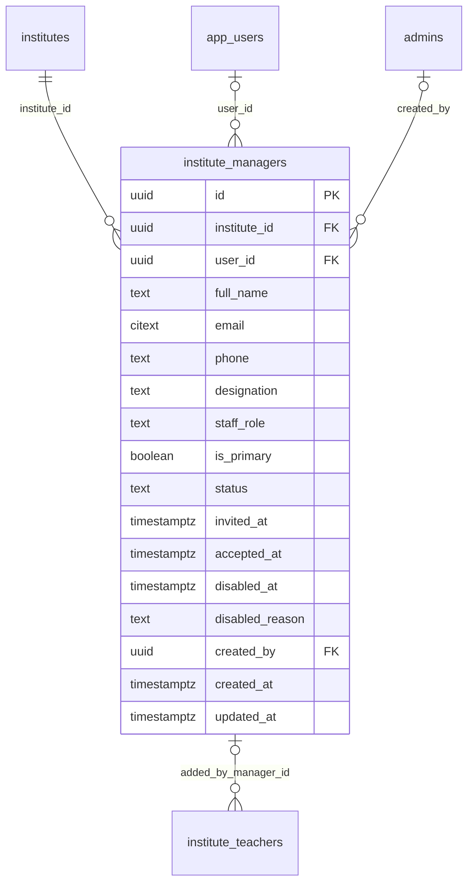

# Module 25 · Institute Manager Accounts

> **Phase 6 · Institutes** · **Depends on:** M22 · **Owns tables:** `institute_managers` · **Reads:** `institutes`, `app_users` · **Build estimate:** 2 days

## 1. Module Overview

Manages the app accounts that act for an institute: exactly one active **primary manager** (full control, including teachers) and optional **counsellors** (enquiries only). Admins can view them, resend invites, disable accounts and — for ownership disputes or staff changes — replace the primary manager.

## 2. Business Purpose

The requirement is explicit: only the institute manager can manage institute teachers in the app. That rule depends on knowing, reliably, who the manager is. Admins need a safe, audited way to change it when an institute's ownership or staff changes.

## 3. User Stories

- As **Support Admin**, I want to see who manages an institute and who the counsellors are so that I can verify a caller.
- As **Super Admin**, I want to replace the primary manager when the centre head leaves so that the new head can manage teachers.
- As **Support Admin**, I want to disable a counsellor who misused enquiries so that they lose access immediately.

## 4. Functional Requirements & Business Logic

**FR-25.1 Roles (app-side enforcement contract).**

| Capability in the app | Manager | Counsellor |
| --- | --- | --- |
| View/respond to enquiries, assign to teacher | ✓ | ✓ |
| Edit institute profile, batches, photos | ✓ | — |
| Add / edit / remove institute teachers, assign subjects & classes | ✓ | — |
| Invite / remove counsellors | ✓ | — |
| Billing and registration fee | ✓ | — |
The mobile API checks `institute_managers.staff_role = 'manager'` (and `status = 'active'`) for every teacher-management endpoint (Module 26); this module is where admins see and change those roles.

**FR-25.2 List & detail.** `GET /institutes/:id/managers` — name, phone (masked), email, role, primary flag, status, invited/accepted dates, last active (from `app_users`).

**FR-25.3 Resend invite.** For `invited` staff, sends a new SMS/email deep link (72 h).

**FR-25.4 Disable / enable.** `POST /institute-managers/:id/disable { reason }` — revokes their app sessions for this institute; the primary manager cannot be disabled unless a replacement is set in the same request.

**FR-25.5 Replace primary.** `POST /institutes/:id/managers/replace-primary { newManager: { existingStaffId | fullName, phone, email }, reason, evidenceFileId? }` (`institute_managers.manage`, sensitive): in one transaction the old primary becomes `is_primary = false`, `staff_role = 'counsellor'` or `disabled` (choice), the new person becomes primary manager (invite sent if new); both notified. Evidence (authorisation letter on letterhead) is recommended for ownership changes.

**FR-25.6 Change role.** `POST /institute-managers/:id/role { staffRole }` — promote a counsellor to manager (non-primary managers allowed, max 3 managers) or demote.

## 5. Validation Rules

| Field | Rule |
| --- | --- |
| fullName | 2–100; phone E.164 (unique among active staff of the institute); email optional |
| staffRole | manager or counsellor; max 3 active managers and 10 counsellors per institute |
| reason | 10–500 chars for disable, replace, role change |
| evidenceFileId | optional uploaded private document |

## 6. API Endpoints

| Method | Path | Permission | Description |
| --- | --- | --- | --- |
| GET | /institutes/:id/managers | institute_managers.read | Staff list |
| GET | /institute-managers/:staffId | institute_managers.read | One staff member |
| POST | /institute-managers/:staffId/resend-invite | institute_managers.manage | New invite |
| POST | /institute-managers/:staffId/disable | institute_managers.manage | Disable |
| POST | /institute-managers/:staffId/enable | institute_managers.manage | Re-enable |
| POST | /institute-managers/:staffId/role | institute_managers.manage | Change role |
| POST | /institutes/:id/managers/replace-primary | institute_managers.manage | Replace the primary manager |

## 7. Request Payloads

```json
// POST /institutes/:id/managers/replace-primary
{ "newManager": { "fullName": "Kavita Rao", "phone": "+919880012345", "email": "kavita@apexjee.in" }, "oldPrimaryAction": "demote_to_counsellor", "reason": "Suresh Menon left; letter from the owner attached", "evidenceFileId": "…" }
```

## 8. Response Payloads

```json
// 200 GET /institutes/:id/managers
{ "data": [ { "id": "…", "fullName": "Suresh Menon", "phoneMasked": "+91 98XXX XX122", "email": "suresh@apexjee.in", "staffRole": "manager", "isPrimary": true, "status": "active", "acceptedAt": "…", "lastActiveAt": "…" },
            { "id": "…", "fullName": "Kavita Rao", "staffRole": "counsellor", "isPrimary": false, "status": "active" } ] }
```

## 9. PostgreSQL Tables

### `institute_managers`

App accounts that act for an institute. Exactly one active primary manager; counsellors can only handle leads.

```sql
CREATE TABLE institute_managers (
  id uuid PRIMARY KEY DEFAULT gen_random_uuid(), -- Primary key
  institute_id uuid NOT NULL REFERENCES institutes(id) ON DELETE CASCADE, -- Institute
  user_id uuid REFERENCES app_users(id) ON DELETE RESTRICT, -- Linked app account (NULL until an invite is accepted)
  full_name text NOT NULL, -- Name
  email citext, -- Email
  phone text NOT NULL, -- E.164 phone
  designation text, -- e.g. Centre Head
  staff_role text NOT NULL DEFAULT 'manager' CHECK (staff_role IN ('manager','counsellor')), -- manager = full control incl. teachers; counsellor = leads only
  is_primary boolean NOT NULL DEFAULT false, -- The accountable owner; exactly one active per institute
  status text NOT NULL DEFAULT 'invited' CHECK (status IN ('invited','active','disabled')), -- Account state
  invited_at timestamptz, -- Invite sent
  accepted_at timestamptz, -- Invite accepted
  disabled_at timestamptz, -- Disabled
  disabled_reason text, -- Why
  created_by uuid REFERENCES admins(id), -- Admin who created/replaced it (NULL when self-registered)
  created_at timestamptz NOT NULL DEFAULT now(), -- Created
  updated_at timestamptz NOT NULL DEFAULT now(), -- Updated
  CONSTRAINT ck_institute_managers_primary_is_manager CHECK (NOT is_primary OR staff_role = 'manager')
);
CREATE UNIQUE INDEX uq_institute_managers_primary ON institute_managers (institute_id) WHERE is_primary AND status <> 'disabled';
CREATE UNIQUE INDEX uq_institute_managers_user ON institute_managers (institute_id, user_id) WHERE user_id IS NOT NULL AND status <> 'disabled';
CREATE INDEX idx_institute_managers_phone ON institute_managers (phone);
CREATE TRIGGER trg_institute_managers_updated BEFORE UPDATE ON institute_managers FOR EACH ROW EXECUTE FUNCTION set_updated_at();
```

Migration file: `sql/migrations/025_m25_institute_manager_accounts.sql`

## 10. Column Definitions

### `institute_managers`

| Column | Type | Null | Default | Constraints / References | Description |
| --- | --- | --- | --- | --- | --- |
| `id` | uuid | no | gen_random_uuid() | PK | Primary key |
| `institute_id` | uuid | no | — | FK → `institutes.id` (on delete cascade) | Institute |
| `user_id` | uuid | yes | — | FK → `app_users.id` (on delete restrict) | Linked app account (NULL until an invite is accepted) |
| `full_name` | text | no | — | — | Name |
| `email` | citext | yes | — | — | Email |
| `phone` | text | no | — | — | E.164 phone |
| `designation` | text | yes | — | — | e.g. Centre Head |
| `staff_role` | text | no | 'manager' | CHECK staff_role IN ('manager','counsellor') | manager = full control incl. teachers; counsellor = leads only |
| `is_primary` | boolean | no | false | — | The accountable owner; exactly one active per institute |
| `status` | text | no | 'invited' | CHECK status IN ('invited','active','disabled') | Account state |
| `invited_at` | timestamptz | yes | — | — | Invite sent |
| `accepted_at` | timestamptz | yes | — | — | Invite accepted |
| `disabled_at` | timestamptz | yes | — | — | Disabled |
| `disabled_reason` | text | yes | — | — | Why |
| `created_by` | uuid | yes | — | FK → `admins.id` (on delete no action) | Admin who created/replaced it (NULL when self-registered) |
| `created_at` | timestamptz | no | now() | — | Created |
| `updated_at` | timestamptz | no | now() | — | Updated |

**Table constraints:** `CONSTRAINT ck_institute_managers_primary_is_manager CHECK (NOT is_primary OR staff_role = 'manager')`

## 11. Relationships

**Outgoing foreign keys**

- `institute_managers.institute_id` → `institutes.id` — required, many-to-one, on delete **cascade**
- `institute_managers.user_id` → `app_users.id` — optional, many-to-one, on delete **restrict**
- `institute_managers.created_by` → `admins.id` — optional, many-to-one, on delete **no action**

**Referenced by**

- `institute_teachers.added_by_manager_id` → `institute_managers` (module 26) — on delete **set null**

**Entity relationship diagram**



## 12. Indexing Strategy

| Index | Table | Kind | Definition |
| --- | --- | --- | --- |
| `uq_institute_managers_primary` | `institute_managers` | unique | `(institute_id) WHERE is_primary AND status <> 'disabled'` |
| `uq_institute_managers_user` | `institute_managers` | unique | `(institute_id, user_id) WHERE user_id IS NOT NULL AND status <> 'disabled'` |
| `idx_institute_managers_phone` | `institute_managers` | btree | `(phone)` |

`uq_institute_managers_primary` guarantees one non-disabled primary per institute at the database level; `uq_institute_managers_user` prevents the same user being added twice; phone index for support lookups.

## 13. Permissions

| Permission key | Allows | Sensitive | Super | Ops | Verif. | Finance | Support |
| --- | --- | --- | --- | --- | --- | --- | --- |
| `institute_managers.read` | View institute managers and counsellors | — | ✓ | ✓ | ✓ | — | — |
| `institute_managers.manage` | Replace the primary manager, disable staff accounts | yes | ✓ | — | — | — | — |

## 14. UI Screens & React Page Structure

Tab **Managers** on `/institutes/:id`: staff table, role badges, actions; "Replace primary manager" wizard.
```
src/features/institutes/tabs/ManagersTab.tsx
src/features/institutes/components/ReplacePrimaryDialog.tsx, StaffRoleDialog.tsx
```

## 15. UI Components

- `ReplacePrimaryDialog` — choose existing staff or enter new person, what happens to the old primary, reason, evidence upload, confirmation text.
- Staff table with "Primary" crown badge and last-active time.

## 16. Filters

Role, status.

## 17. Search Capabilities

Client-side (≤ 13 rows per institute). Global search finds managers by phone through Module 0.

## 18. Pagination Requirements

Not paginated.

## 19. Audit Logs

| Event | Details |
| --- | --- |
| `institute_manager.invite_resent` | staff |
| `institute_manager.disabled` / `.enabled` | reason |
| `institute_manager.role_changed` | from → to, reason |
| `institute_manager.primary_replaced` | old, new, old primary action, reason, evidence file |

## 20. Error Scenarios

| Scenario | HTTP | Code | Message |
| --- | --- | --- | --- |
| Disable primary without replacement | 409 | CONFLICT_STATE | "Set a new primary manager first." |
| Too many managers/counsellors | 409 | CONFLICT_STATE | "An institute can have up to 3 managers and 10 counsellors." |
| Phone already on staff | 409 | CONFLICT_DUPLICATE | "This number is already on the team." |
| Resend invite for an active account | 409 | CONFLICT_STATE | "This person has already joined." |

## 21. Future Scalability Notes & Enhancements

Granular per-staff permissions (custom institute roles) and staff activity logs visible to the manager.

## 22. Security Considerations

Primary replacement is sensitive (ownership), requires a reason and is audited with optional evidence; both old and new contacts are notified so hijacking is visible.
