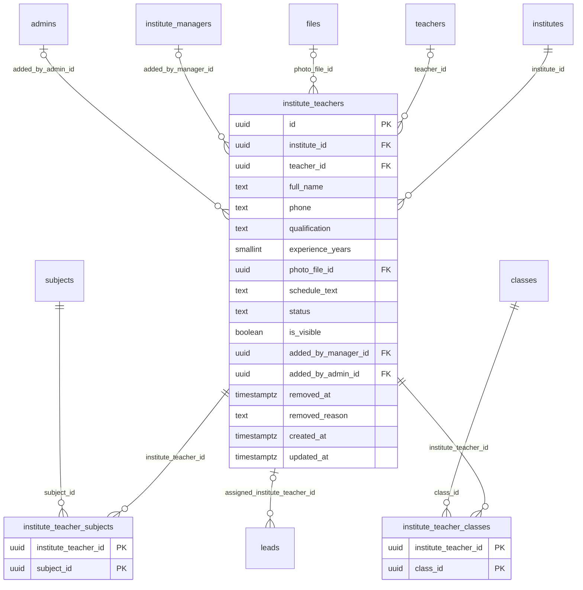

# Module 26 · Institute Teacher Management

> **Phase 6 · Institutes** · **Depends on:** M22, M25, M11, M12 · **Owns tables:** `institute_teachers`, `institute_teacher_subjects`, `institute_teacher_classes` · **Reads:** `institutes`, `teachers`, `institute_managers`, `subjects`, `classes` · **Build estimate:** 3 days

## 1. Module Overview

Teachers listed under an institute. In the app, only the institute manager can add, edit or remove them and assign their subjects and classes; each added teacher receives an SMS link to complete their own Aadhaar/PAN check. In the admin portal, staff can view every institute's teacher list and, with a support-override permission, correct or remove entries.

## 2. Business Purpose

Parents judge an institute by its faculty. The list must be accurate and verified, and only accountable people (the manager, or GuruConnect admins) may change it.

## 3. User Stories

- As a **Verification Admin**, I want to see which institute teachers have completed their ID check so that I can rate faculty quality.
- As **Support Admin**, I want to remove a teacher who has left but is still listed, after the institute ignores requests, so that the profile is honest.
- As **Operations Admin**, I want to link an institute teacher to their existing GuruConnect teacher profile so that their trust score shows on the institute page.

## 4. Functional Requirements & Business Logic

**FR-26.1 App rules (contract for the mobile API).**
- Only `institute_managers` with `staff_role = 'manager'` and `status = 'active'` can call add/edit/remove/assign endpoints; counsellors get 403.
- Adding a teacher: name, phone, qualification, experience, photo, subjects (1–6), classes (1–10), schedule, visibility. If the phone matches an approved GuruConnect teacher, the manager is offered to link (teacher must accept in their app).
- On add, an SMS invite asks the teacher to verify identity (Aadhaar/PAN) through a lightweight flow; until done, `status = 'id_pending'` and the teacher shows on the profile without the Verified tick (and only if `is_visible`).
- Removing sets `status = 'removed'`, `removed_at`, reason; the row stays for history.
- Limit: `limits.institute_max_teachers` (Module 4) active teachers.

**FR-26.2 Admin list.** `GET /institutes/:id/teachers` — name, linked teacher code (if any), subjects, classes, ID status, visible, added by (manager name), added date, trust score of linked teacher.

**FR-26.3 Admin override.** With `institute_teachers.manage`: edit fields, change visibility, remove, link/unlink to a teacher profile. Every override requires a reason and notifies the primary manager ("GuruConnect support updated …").

**FR-26.4 ID status sync.** When the invited person completes verification (approved by Module 16's lightweight flow or by linking to an approved teacher), `status` becomes `active`. Faculty stats used by Module 27 (count, % qualified, average experience, average linked trust score) are computed from active rows.

**FR-26.5 Cross-institute view.** `GET /institute-teachers?phone=` (support) shows every institute listing that phone — detects the same teacher listed at many centres.

## 5. Validation Rules

| Field | Rule |
| --- | --- |
| fullName | 2–100 |
| phone | E.164, unique among non-removed teachers of the institute |
| qualification | ≤ 120; experienceYears 0–60 |
| subjectIds | 1–6 active subjects; classIds 1–10 active classes |
| scheduleText | ≤ 120 |
| reason (admin override) | 10–500 chars |
| teacherId (link) | approved, active teacher; not already linked to this institute |

## 6. API Endpoints

| Method | Path | Permission | Description |
| --- | --- | --- | --- |
| GET | /institutes/:id/teachers | institute_teachers.read | Institute's teachers |
| GET | /institute-teachers/:itId | institute_teachers.read | One entry with subjects/classes |
| GET | /institute-teachers | institute_teachers.read | Cross-institute search (by phone or teacherId) |
| PATCH | /institute-teachers/:itId | institute_teachers.manage | Admin override edit |
| PUT | /institute-teachers/:itId/subjects | institute_teachers.manage | Replace subjects |
| PUT | /institute-teachers/:itId/classes | institute_teachers.manage | Replace classes |
| POST | /institute-teachers/:itId/link | institute_teachers.manage | Link to a GuruConnect teacher |
| POST | /institute-teachers/:itId/remove | institute_teachers.manage | Remove with reason |

## 7. Request Payloads

```json
// POST /institute-teachers/:itId/remove
{ "reason": "Teacher confirmed she left in August; manager didn't respond to 2 reminders." }

// PUT /institute-teachers/:itId/classes
{ "classIds": ["…class-11…","…class-12…"], "reason": "Correcting classes per manager's email" }
```

## 8. Response Payloads

```json
// 200 GET /institutes/:id/teachers
{ "data": [ { "id": "…", "fullName": "Imran Qureshi", "linkedTeacher": { "id": "…", "publicCode": "GC-T10252", "trustScore": 90 }, "subjects": ["Physics"], "classes": ["Class 11","Class 12","Droppers"],
  "status": "active", "isVisible": true, "addedBy": { "type": "manager", "name": "Suresh Menon" }, "createdAt": "…" } ],
  "meta": { "activeCount": 5, "limit": 25, "qualifiedPct": 100, "avgExperienceYears": 12.3 } }
```

## 9. PostgreSQL Tables

### `institute_teachers`

Teachers listed under an institute. Added, edited and removed only by an institute manager (or an admin).

```sql
CREATE TABLE institute_teachers (
  id uuid PRIMARY KEY DEFAULT gen_random_uuid(), -- Primary key
  institute_id uuid NOT NULL REFERENCES institutes(id) ON DELETE CASCADE, -- Institute
  teacher_id uuid REFERENCES teachers(id) ON DELETE SET NULL, -- Linked GuruConnect teacher profile, if the teacher has one
  full_name text NOT NULL, -- Name as on Aadhaar
  phone text NOT NULL, -- E.164 phone, used for the ID-check SMS invite
  qualification text, -- e.g. M.Sc. Chemistry
  experience_years smallint CHECK (experience_years BETWEEN 0 AND 60), -- Experience
  photo_file_id uuid REFERENCES files(id), -- Photo
  schedule_text text, -- e.g. Weekdays 4–7 PM
  status text NOT NULL DEFAULT 'id_pending' CHECK (status IN ('id_pending','active','removed')), -- id_pending until Aadhaar/PAN verified
  is_visible boolean NOT NULL DEFAULT true, -- Shown on the institute's public profile
  added_by_manager_id uuid REFERENCES institute_managers(id) ON DELETE SET NULL, -- Manager who added
  added_by_admin_id uuid REFERENCES admins(id), -- Admin who added (support override)
  removed_at timestamptz, -- When removed
  removed_reason text, -- Why removed
  created_at timestamptz NOT NULL DEFAULT now(), -- Created
  updated_at timestamptz NOT NULL DEFAULT now() -- Updated
);
CREATE UNIQUE INDEX uq_institute_teachers_phone ON institute_teachers (institute_id, phone) WHERE status <> 'removed';
CREATE INDEX idx_institute_teachers_inst ON institute_teachers (institute_id, status);
CREATE INDEX idx_institute_teachers_teacher ON institute_teachers (teacher_id) WHERE teacher_id IS NOT NULL;
CREATE TRIGGER trg_institute_teachers_updated BEFORE UPDATE ON institute_teachers FOR EACH ROW EXECUTE FUNCTION set_updated_at();
```

### `institute_teacher_subjects`

Subjects assigned to an institute teacher.

```sql
CREATE TABLE institute_teacher_subjects (
  institute_teacher_id uuid NOT NULL REFERENCES institute_teachers(id) ON DELETE CASCADE, -- Institute teacher
  subject_id uuid NOT NULL REFERENCES subjects(id) ON DELETE RESTRICT, -- Subject
  PRIMARY KEY (institute_teacher_id, subject_id)
);

```

### `institute_teacher_classes`

Classes assigned to an institute teacher.

```sql
CREATE TABLE institute_teacher_classes (
  institute_teacher_id uuid NOT NULL REFERENCES institute_teachers(id) ON DELETE CASCADE, -- Institute teacher
  class_id uuid NOT NULL REFERENCES classes(id) ON DELETE RESTRICT, -- Class
  PRIMARY KEY (institute_teacher_id, class_id)
);

```

Migration file: `sql/migrations/026_m26_institute_teacher_management.sql`

## 10. Column Definitions

### `institute_teachers`

| Column | Type | Null | Default | Constraints / References | Description |
| --- | --- | --- | --- | --- | --- |
| `id` | uuid | no | gen_random_uuid() | PK | Primary key |
| `institute_id` | uuid | no | — | FK → `institutes.id` (on delete cascade) | Institute |
| `teacher_id` | uuid | yes | — | FK → `teachers.id` (on delete set null) | Linked GuruConnect teacher profile, if the teacher has one |
| `full_name` | text | no | — | — | Name as on Aadhaar |
| `phone` | text | no | — | — | E.164 phone, used for the ID-check SMS invite |
| `qualification` | text | yes | — | — | e.g. M.Sc. Chemistry |
| `experience_years` | smallint | yes | — | CHECK experience_years BETWEEN 0 AND 60 | Experience |
| `photo_file_id` | uuid | yes | — | FK → `files.id` (on delete no action) | Photo |
| `schedule_text` | text | yes | — | — | e.g. Weekdays 4–7 PM |
| `status` | text | no | 'id_pending' | CHECK status IN ('id_pending','active','removed') | id_pending until Aadhaar/PAN verified |
| `is_visible` | boolean | no | true | — | Shown on the institute's public profile |
| `added_by_manager_id` | uuid | yes | — | FK → `institute_managers.id` (on delete set null) | Manager who added |
| `added_by_admin_id` | uuid | yes | — | FK → `admins.id` (on delete no action) | Admin who added (support override) |
| `removed_at` | timestamptz | yes | — | — | When removed |
| `removed_reason` | text | yes | — | — | Why removed |
| `created_at` | timestamptz | no | now() | — | Created |
| `updated_at` | timestamptz | no | now() | — | Updated |

### `institute_teacher_subjects`

| Column | Type | Null | Default | Constraints / References | Description |
| --- | --- | --- | --- | --- | --- |
| `institute_teacher_id` | uuid | no | — | PK; FK → `institute_teachers.id` (on delete cascade) | Institute teacher |
| `subject_id` | uuid | no | — | PK; FK → `subjects.id` (on delete restrict) | Subject |

**Table constraints:** `PRIMARY KEY (institute_teacher_id, subject_id)`

### `institute_teacher_classes`

| Column | Type | Null | Default | Constraints / References | Description |
| --- | --- | --- | --- | --- | --- |
| `institute_teacher_id` | uuid | no | — | PK; FK → `institute_teachers.id` (on delete cascade) | Institute teacher |
| `class_id` | uuid | no | — | PK; FK → `classes.id` (on delete restrict) | Class |

**Table constraints:** `PRIMARY KEY (institute_teacher_id, class_id)`

## 11. Relationships

**Outgoing foreign keys**

- `institute_teachers.institute_id` → `institutes.id` — required, many-to-one, on delete **cascade**
- `institute_teachers.teacher_id` → `teachers.id` — optional, many-to-one, on delete **set null**
- `institute_teachers.photo_file_id` → `files.id` — optional, many-to-one, on delete **no action**
- `institute_teachers.added_by_manager_id` → `institute_managers.id` — optional, many-to-one, on delete **set null**
- `institute_teachers.added_by_admin_id` → `admins.id` — optional, many-to-one, on delete **no action**
- `institute_teacher_subjects.institute_teacher_id` → `institute_teachers.id` — required, many-to-one, on delete **cascade**
- `institute_teacher_subjects.subject_id` → `subjects.id` — required, many-to-one, on delete **restrict**
- `institute_teacher_classes.institute_teacher_id` → `institute_teachers.id` — required, many-to-one, on delete **cascade**
- `institute_teacher_classes.class_id` → `classes.id` — required, many-to-one, on delete **restrict**

**Referenced by**

- `leads.assigned_institute_teacher_id` → `institute_teachers` (module 38) — on delete **set null**

**Entity relationship diagram**



## 12. Indexing Strategy

| Index | Table | Kind | Definition |
| --- | --- | --- | --- |
| `uq_institute_teachers_phone` | `institute_teachers` | unique | `(institute_id, phone) WHERE status <> 'removed'` |
| `idx_institute_teachers_inst` | `institute_teachers` | btree | `(institute_id, status)` |
| `idx_institute_teachers_teacher` | `institute_teachers` | btree | `(teacher_id) WHERE teacher_id IS NOT NULL` |

Partial unique `(institute_id, phone) WHERE status <> 'removed'`; `(institute_id, status)` for lists; `teacher_id` for "institutes this teacher is listed at".

## 13. Permissions

| Permission key | Allows | Sensitive | Super | Ops | Verif. | Finance | Support |
| --- | --- | --- | --- | --- | --- | --- | --- |
| `institute_teachers.read` | View teachers listed under institutes | — | ✓ | ✓ | ✓ | — | ✓ |
| `institute_teachers.manage` | Support override: add, edit or remove institute teachers | — | ✓ | ✓ | — | — | — |

Admin override only with `institute_teachers.manage`; the app's manager-only rule is enforced in the mobile API using `institute_managers` (Module 25).

## 14. UI Screens & React Page Structure

Tab **Teachers** on `/institutes/:id` + a "Listed at institutes" panel on the teacher detail page (Module 17).
```
src/features/institutes/tabs/TeachersTab.tsx
src/features/institutes/components/InstituteTeacherDrawer.tsx, LinkTeacherDialog.tsx, RemoveInstituteTeacherDialog.tsx
```

## 15. UI Components

- Teachers table with ID-status badges and "added by manager / by support" labels.
- `InstituteTeacherDrawer` — details, subject/class editors, visibility switch (override mode shows a reason field).
- `LinkTeacherDialog` — search approved teachers by phone/code.

## 16. Filters

Status (active, id_pending, removed), subject, class, visible.

## 17. Search Capabilities

Name (client-side within an institute); cross-institute search by phone or teacher code.

## 18. Pagination Requirements

Institute list not paginated (≤ 200); cross-institute search offset 20.

## 19. Audit Logs

| Event | Details |
| --- | --- |
| `institute_teacher.updated_by_admin` | changed fields, reason |
| `institute_teacher.subjects_changed_by_admin` / `.classes_changed_by_admin` | reason |
| `institute_teacher.linked` / `.unlinked` | teacher code |
| `institute_teacher.removed_by_admin` | reason |
Manager actions in the app are recorded with `actor_type = 'app_user'`.

## 20. Error Scenarios

| Scenario | HTTP | Code | Message |
| --- | --- | --- | --- |
| Counsellor calls a manager-only app endpoint | 403 | FORBIDDEN | "Only the institute manager can manage teachers." |
| Institute teacher limit reached | 409 | CONFLICT_STATE | "Your plan allows up to 25 teachers." |
| Duplicate phone within institute | 409 | CONFLICT_DUPLICATE | "This teacher is already listed." |
| Link to non-approved teacher | 409 | CONFLICT_STATE | "Only approved teachers can be linked." |
| Override without reason | 422 | VALIDATION_FAILED | "Add a reason; the manager will be notified." |

## 21. Future Scalability Notes & Enhancements

Teacher-accepted linking with shared reviews; per-batch teacher assignment; faculty change history on the public profile.

## 22. Security Considerations

Manager-only enforcement server-side; admin overrides audited and notified to the manager; teacher phone numbers masked without `users.pii`.
