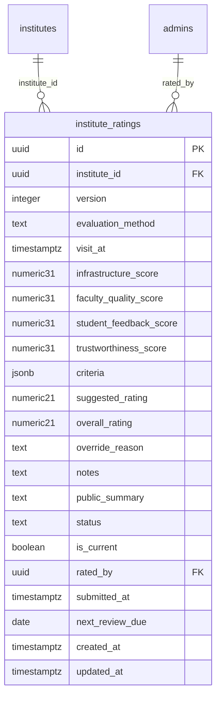

# Module 27 · Institute Rating System

> **Phase 6 · Institutes** · **Depends on:** M22, M23, M26 (M34 and M43 feed two criteria) · **Owns tables:** `institute_ratings` · **Reads:** `institutes`, `institute_teachers`, `institute_reviews`, `complaints` · **Build estimate:** 3–4 days

## 1. Module Overview

Sameer Bhaiya (or an admin with `institute_ratings.rate`) evaluates each institute on four criteria — Infrastructure, Faculty Quality, Student Feedback and Trustworthiness — each scored 0–10 with sub-criteria, and assigns an Overall Rating from 1 to 5 in half steps. The system suggests an overall rating from the scores; the admin can deviate with a reason. Ratings are versioned; the current submitted version is shown publicly on the institute profile with the infrastructure score and the Verified badge.

## 2. Business Purpose

User reviews alone can be gamed and are sparse for new institutes. A GuruConnect evaluation gives parents an independent, explainable quality signal and makes the Verified badge mean something.

## 3. User Stories

- As **Super Admin**, I want to score infrastructure sub-criteria during a visit on my laptop so that the evaluation is consistent.
- As **Super Admin**, I want the system to pre-fill student feedback from reviews and trustworthiness from documents and complaints so that I only adjust.
- As **Super Admin**, I want to see the suggested rating and choose the final one so that judgement stays with me.
- As **Super Admin**, I want every past evaluation kept so that I can compare this year with last year.

## 4. Functional Requirements & Business Logic

**FR-27.1 Criteria and sub-criteria (each 0–10, half steps).**

| Criterion | Sub-criteria (average = criterion score) | Pre-fill source |
| --- | --- | --- |
| Infrastructure | Classrooms & seating · Safety (CCTV, fire exits, first aid) · Library, labs & test hall · Accessibility & location · Hygiene, water, washrooms | Manual |
| Faculty quality | Qualified faculty (% PG/B.Ed.) · Teaching experience · Demo class audit · Average trust score of linked teachers (auto, /10) | Module 26 stats (auto values editable except trust average) |
| Student feedback | Published review average scaled to 10 (Bayesian: `(C·m + Σr)/(C + n)` with C = 10, m = 4.0) · Response to reviews · Complaint-free rate | Module 34 + 43, editable with reason |
| Trustworthiness | Documents authenticity · Fee transparency · Complaint history (upheld complaints in 12 months) · Registration age | Module 22 + 43 |

**FR-27.2 Suggested rating.** `suggested = round_half( 1 + 4 × (0.30·Infra + 0.30·Faculty + 0.20·Feedback + 0.20·Trust) / 10 )`, where `round_half` rounds to the nearest 0.5 and the result is clamped to 1–5. Weights live in `system_settings` key `institutes.rating_weights` (JSON) and are copied into `criteria.weights` of each rating for reproducibility.

**FR-27.3 Draft & submit.** `POST /institutes/:id/ratings` creates a draft (version = max + 1) pre-filled per FR-27.1. `PATCH /institute-ratings/:ratingId` autosaves the draft. `POST /institute-ratings/:ratingId/submit { overallRating, overrideReason?, publicSummary? }`:
- If `|overall − suggested| > 0.5`, `overrideReason` (20–500 chars) is required.
- In one transaction: previous current rating → `is_current = false`, `status = 'superseded'`; new → `submitted`, `is_current = true`, `submitted_at`, `next_review_due = today + 12 months`; cache `overall_rating`, `infrastructure_score`, `faculty_score` on `institutes`; call Module 23 to move `visit_scheduled → evaluation_done` if applicable.
- If the institute is already approved, the new rating is public immediately (manager notified with the summary).

**FR-27.4 Compare.** `GET /institutes/:id/ratings` lists versions; `GET /institute-ratings/:ratingId` shows details; the UI can diff two versions.

**FR-27.5 Public display contract.** The app shows: overall rating (x.x / 5), infrastructure score (x.x / 10), faculty score (x.x / 10), evaluation method and date, public summary, Verified badge — never the private notes or sub-scores other than those listed.

**FR-27.6 Re-evaluation reminders.** Daily job: institutes whose current rating `next_review_due ≤ today + 14` appear in the queue filter "Re-evaluation due" and trigger an email to raters.

**FR-27.7 Leaderboard.** `GET /institute-ratings/leaderboard?cityId&type` — top-rated approved institutes (used for featured institute rails later).

## 5. Validation Rules

| Field | Rule |
| --- | --- |
| evaluationMethod | site_visit, video_walkthrough, document_only (document_only allowed only for re-evaluations without facility changes) |
| visitAt | ≤ now, ≥ now − 30 days |
| each sub-score | number 0–10 in 0.5 steps |
| overallRating | 1–5 in 0.5 steps |
| overrideReason | required when deviation > 0.5; 20–500 chars |
| notes | ≤ 4,000 chars (internal) |
| publicSummary | ≤ 200 chars, no contact details |
| Preconditions | institute not rejected/deleted; only one draft per institute; rater has `institute_ratings.rate` |

## 6. API Endpoints

| Method | Path | Permission | Description |
| --- | --- | --- | --- |
| GET | /institutes/:id/ratings | institute_ratings.read | Rating versions |
| POST | /institutes/:id/ratings | institute_ratings.rate | Start a draft (pre-filled) |
| GET | /institute-ratings/:ratingId | institute_ratings.read | One rating with criteria |
| PATCH | /institute-ratings/:ratingId | institute_ratings.rate | Update draft (If-Match) |
| POST | /institute-ratings/:ratingId/submit | institute_ratings.rate | Submit and make current |
| DELETE | /institute-ratings/:ratingId | institute_ratings.rate | Discard a draft |
| GET | /institute-ratings/leaderboard | institute_ratings.read | Top-rated institutes |

## 7. Request Payloads

```json
// PATCH /institute-ratings/:ratingId   (If-Match: …)
{ "evaluationMethod": "site_visit", "visitAt": "2026-09-24T06:00:00Z",
  "criteria": { "infrastructure": { "classrooms": 8.5, "safety": 7, "libraryLabs": 8, "accessibility": 6.5, "hygiene": 8 },
                "faculty": { "qualified": 9, "experience": 8.5, "demoAudit": 8.6 },
                "feedback": { "reviewScore": 8.4, "responseToReviews": 7, "complaintFree": 9 },
                "trust": { "documents": 10, "feeTransparency": 8, "complaintHistory": 9, "registrationAge": 8 } },
  "notes": "Fire exit partly blocked by chairs — advised to clear. Separate girls' washroom." }

// POST /institute-ratings/:ratingId/submit
{ "overallRating": 4.0, "overrideReason": null, "publicSummary": "Well-run NEET centre with a separate biology lab." }
```

## 8. Response Payloads

```json
// 200 GET /institute-ratings/:ratingId
{ "data": { "id": "…", "instituteId": "…", "version": 1, "status": "draft", "evaluationMethod": "site_visit",
  "scores": { "infrastructure": 7.6, "facultyQuality": 8.6, "studentFeedback": 8.1, "trustworthiness": 8.8 }, "suggestedRating": 4.0,
  "prefill": { "faculty.avgTrust": 84, "feedback.reviewAvg": 4.4, "feedback.reviewCount": 57, "trust.upheldComplaints12m": 0 }, "ratedBy": { "id": "…", "name": "Sameer Bhaiya" }, "updatedAt": "…" } }
```

## 9. PostgreSQL Tables

### `institute_ratings`

Evaluations by GuruConnect admins. The latest submitted version is current and drives the public rating.

```sql
CREATE TABLE institute_ratings (
  id uuid PRIMARY KEY DEFAULT gen_random_uuid(), -- Primary key
  institute_id uuid NOT NULL REFERENCES institutes(id) ON DELETE CASCADE, -- Institute
  version integer NOT NULL, -- 1, 2, 3… per institute (re-evaluations)
  evaluation_method text NOT NULL CHECK (evaluation_method IN ('site_visit','video_walkthrough','document_only')), -- How it was evaluated
  visit_at timestamptz, -- When the visit happened
  infrastructure_score numeric(3,1) NOT NULL CHECK (infrastructure_score BETWEEN 0 AND 10), -- Classrooms, safety, labs, accessibility, hygiene
  faculty_quality_score numeric(3,1) NOT NULL CHECK (faculty_quality_score BETWEEN 0 AND 10), -- Qualifications, experience, teacher trust, demo audit
  student_feedback_score numeric(3,1) NOT NULL CHECK (student_feedback_score BETWEEN 0 AND 10), -- Derived from published reviews, adjustable by admin
  trustworthiness_score numeric(3,1) NOT NULL CHECK (trustworthiness_score BETWEEN 0 AND 10), -- Documents, complaint history, fee transparency
  criteria jsonb NOT NULL DEFAULT '{}'::jsonb, -- Sub-scores, e.g. {"infrastructure":{"classrooms":9,"safety":8}}
  suggested_rating numeric(2,1) NOT NULL CHECK (suggested_rating BETWEEN 1 AND 5), -- Computed by the formula
  overall_rating numeric(2,1) NOT NULL CHECK (overall_rating BETWEEN 1 AND 5 AND overall_rating * 2 = round(overall_rating * 2)), -- Final rating in half steps, chosen by the admin
  override_reason text, -- Required when overall differs from suggested by more than 0.5
  notes text, -- Reviewer notes (internal)
  public_summary text, -- Optional line shown on the profile
  status text NOT NULL DEFAULT 'draft' CHECK (status IN ('draft','submitted','superseded')), -- draft is editable; submitted is final
  is_current boolean NOT NULL DEFAULT false, -- The rating shown publicly
  rated_by uuid NOT NULL REFERENCES admins(id), -- Evaluator
  submitted_at timestamptz, -- When finalised
  next_review_due date, -- Re-evaluation date (default +12 months)
  created_at timestamptz NOT NULL DEFAULT now(), -- Created
  updated_at timestamptz NOT NULL DEFAULT now() -- Updated
);
CREATE UNIQUE INDEX uq_institute_ratings_version ON institute_ratings (institute_id, version);
CREATE UNIQUE INDEX uq_institute_ratings_current ON institute_ratings (institute_id) WHERE is_current;
CREATE INDEX idx_institute_ratings_due ON institute_ratings (next_review_due) WHERE is_current;
CREATE TRIGGER trg_institute_ratings_updated BEFORE UPDATE ON institute_ratings FOR EACH ROW EXECUTE FUNCTION set_updated_at();
```

Migration file: `sql/migrations/027_m27_institute_rating_system.sql`

## 10. Column Definitions

### `institute_ratings`

| Column | Type | Null | Default | Constraints / References | Description |
| --- | --- | --- | --- | --- | --- |
| `id` | uuid | no | gen_random_uuid() | PK | Primary key |
| `institute_id` | uuid | no | — | FK → `institutes.id` (on delete cascade) | Institute |
| `version` | integer | no | — | — | 1, 2, 3… per institute (re-evaluations) |
| `evaluation_method` | text | no | — | CHECK evaluation_method IN ('site_visit','video_walkthrough','document_only') | How it was evaluated |
| `visit_at` | timestamptz | yes | — | — | When the visit happened |
| `infrastructure_score` | numeric(3,1) | no | — | CHECK infrastructure_score BETWEEN 0 AND 10 | Classrooms, safety, labs, accessibility, hygiene |
| `faculty_quality_score` | numeric(3,1) | no | — | CHECK faculty_quality_score BETWEEN 0 AND 10 | Qualifications, experience, teacher trust, demo audit |
| `student_feedback_score` | numeric(3,1) | no | — | CHECK student_feedback_score BETWEEN 0 AND 10 | Derived from published reviews, adjustable by admin |
| `trustworthiness_score` | numeric(3,1) | no | — | CHECK trustworthiness_score BETWEEN 0 AND 10 | Documents, complaint history, fee transparency |
| `criteria` | jsonb | no | '{}'::jsonb | — | Sub-scores, e.g. {"infrastructure":{"classrooms":9,"safety":8}} |
| `suggested_rating` | numeric(2,1) | no | — | CHECK suggested_rating BETWEEN 1 AND 5 | Computed by the formula |
| `overall_rating` | numeric(2,1) | no | — | CHECK overall_rating BETWEEN 1 AND 5 AND overall_rating * 2 = round(overall_rating * 2) | Final rating in half steps, chosen by the admin |
| `override_reason` | text | yes | — | — | Required when overall differs from suggested by more than 0.5 |
| `notes` | text | yes | — | — | Reviewer notes (internal) |
| `public_summary` | text | yes | — | — | Optional line shown on the profile |
| `status` | text | no | 'draft' | CHECK status IN ('draft','submitted','superseded') | draft is editable; submitted is final |
| `is_current` | boolean | no | false | — | The rating shown publicly |
| `rated_by` | uuid | no | — | FK → `admins.id` (on delete no action) | Evaluator |
| `submitted_at` | timestamptz | yes | — | — | When finalised |
| `next_review_due` | date | yes | — | — | Re-evaluation date (default +12 months) |
| `created_at` | timestamptz | no | now() | — | Created |
| `updated_at` | timestamptz | no | now() | — | Updated |

## 11. Relationships

**Outgoing foreign keys**

- `institute_ratings.institute_id` → `institutes.id` — required, many-to-one, on delete **cascade**
- `institute_ratings.rated_by` → `admins.id` — required, many-to-one, on delete **no action**

**Entity relationship diagram**



## 12. Indexing Strategy

| Index | Table | Kind | Definition |
| --- | --- | --- | --- |
| `uq_institute_ratings_version` | `institute_ratings` | unique | `(institute_id, version)` |
| `uq_institute_ratings_current` | `institute_ratings` | unique | `(institute_id) WHERE is_current` |
| `idx_institute_ratings_due` | `institute_ratings` | btree | `(next_review_due) WHERE is_current` |

`uq_institute_ratings_current` guarantees one public rating; `uq_institute_ratings_version` orders history; `idx_institute_ratings_due` powers re-evaluation reminders.

## 13. Permissions

| Permission key | Allows | Sensitive | Super | Ops | Verif. | Finance | Support |
| --- | --- | --- | --- | --- | --- | --- | --- |
| `institute_ratings.read` | View institute evaluations | — | ✓ | ✓ | ✓ | — | — |
| `institute_ratings.rate` | Create and submit institute evaluations and overall rating | yes | ✓ | — | ✓ | — | — |

`institute_ratings.rate` is sensitive: it changes what parents see. Super Admin and Verification Admin hold it by default.

## 14. UI Screens & React Page Structure

Evaluation panel on `/institutes/:id/review` (Module 22) and tab **Ratings** on `/institutes/:id`.
```
src/features/institute-ratings/
  EvaluationPanel.tsx         sliders per sub-criterion, live criterion scores, suggested rating, star selector, status select, notes
  RatingHistoryTab.tsx        versions table + compare two versions
  PublicPreviewCard.tsx       exactly what the app will show
  RatingLeaderboardPage.tsx   /analytics/institutes/leaderboard
```

## 15. UI Components

- `ScoreSlider` — 0–10, 0.5 steps, keyboard accessible, shows value.
- `CriterionCard` — sub-sliders + computed average + pre-fill hint ("From 57 reviews: 8.4").
- `OverallRatingPicker` — 1–5 half steps, highlights suggested value, asks for override reason when far.
- `PublicPreviewCard`.

## 16. Filters

Ratings history: status. Leaderboard: city, type, min overall.

## 17. Search Capabilities

Leaderboard: institute name (client-side).

## 18. Pagination Requirements

History not paginated (few versions); leaderboard top 50.

## 19. Audit Logs

| Event | Details |
| --- | --- |
| `institute_rating.draft_created` | version |
| `institute_rating.submitted` | version, four scores, suggested, overall, override reason |
| `institute_rating.discarded` | version |

## 20. Error Scenarios

| Scenario | HTTP | Code | Message |
| --- | --- | --- | --- |
| Draft already exists | 409 | CONFLICT_STATE | "Finish or discard the existing draft first." |
| Score not in 0.5 steps / out of range | 422 | VALIDATION_FAILED | "Scores go from 0 to 10 in half steps." |
| Overall far from suggested without reason | 422 | VALIDATION_FAILED | "Explain why the rating differs from the suggested {x}." |
| Submitting a non-draft | 409 | CONFLICT_STATE | "This evaluation was already submitted." |
| Institute rejected/deleted | 409 | CONFLICT_STATE | "This institute can't be rated." |
| Stale draft | 409 | VERSION_CONFLICT | "This draft changed in another tab." |

## 21. Future Scalability Notes & Enhancements

Evaluation templates per institute type (music school vs coaching centre); photo evidence per sub-criterion; external auditor accounts; publishing rating methodology publicly.

## 22. Security Considerations

Ratings are only created by permitted admins, versioned and immutable after submit; override reasons are mandatory and audited; private notes never leave the admin API.
