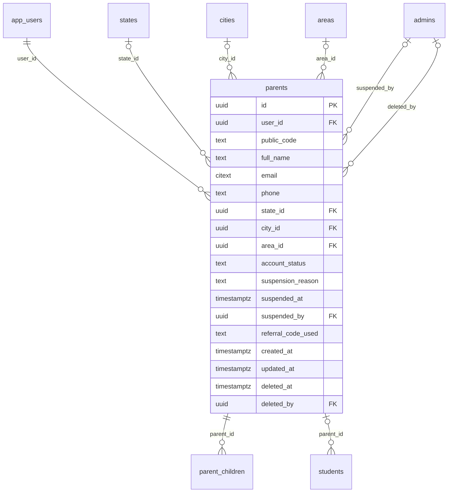

# Module 28 · Parent Management

> **Phase 7 · Parents** · **Depends on:** M0–M2, M9, M10 · **Owns tables:** `parents` · **Reads:** `app_users`, `cities`, `areas`, `states` · **Build estimate:** 3 days

## 1. Module Overview

Admin directory and detail view of parent accounts: profile, location, children summary (Module 29), subscription (Module 30), leads and demos, reviews written, complaints (as reporter or reported), payments and an activity log. Admins can edit profile fields, suspend/re-activate and soft-delete parents.

## 2. Business Purpose

Support must resolve parent issues quickly ("I paid but can't contact teachers"), and safety staff must be able to stop an abusive parent from contacting teachers. One consolidated parent page avoids hunting through modules.

## 3. User Stories

- As **Support Admin**, I want to search a parent by phone and see their subscription and last payments so that I can answer a billing call.
- As **Support Admin**, I want to suspend a parent reported for harassment so that they can't contact teachers.
- As **Operations Admin**, I want to filter parents by city and subscription status so that I can plan campaigns.
- As **Super Admin**, I want to process an account-deletion request so that we meet privacy obligations.

## 4. Functional Requirements & Business Logic

**FR-28.1 Directory.** `GET /parents` — name, code, masked phone, email, city/area, children count and classes, subscription status (trial/active/expired/free), lifetime spend, leads count, last active, account status, joined.

**FR-28.2 Detail.** `GET /parents/:id` — profile, children (M29), current subscription (M30), counts, recent activity. Tabs call their modules: Leads & demos (M38–39), Reviews (M33–34 by author), Payments (M40 by user), Referrals (M42), Complaints (M43 both directions), Activity (audit + app events).

**FR-28.3 Edit.** `PATCH /parents/:id` (If-Match): full name, email, state, city, area. Phone changes are not allowed from the portal (OTP-verified in the app); support can initiate a "change number" flow that sends an OTP to the new number (`POST /parents/:id/change-phone-request`).

**FR-28.4 Suspend / activate.** `POST /parents/:id/suspend { reason, complaintId?, until? }` — sets `account_status = 'suspended'` on `parents` and `app_users`, revokes app sessions, cancels pending demo requests (learners' side), hides their pending reviews; subscription time is not refunded automatically (Finance decides via Module 40). `activate` reverses.

**FR-28.5 Delete (privacy).** `DELETE /parents/:id { reason, requestSource: user_request|admin }` (super admin): soft-deletes parent, children and app user; a job after 30 days anonymises PII (name → "Deleted user", phone/email nulled) while retaining transactions (8-year tax retention) and complaint records.

**FR-28.6 PII masking.** Phone/email masked unless the admin holds `users.pii`; `POST /parents/:id/reveal-contact` returns full values and audits `parent.pii_viewed`.

**FR-28.7 Public code.** `GC-P` + 5-digit sequence, generated on creation.

## 5. Validation Rules

| Field | Rule |
| --- | --- |
| fullName | 2–100 |
| email | valid, unique among live app users |
| stateId / cityId / areaId | active; area within city; city within state |
| suspend.reason | 10–500; until ≤ 365 days |
| delete.reason | 10–500 |

## 6. API Endpoints

| Method | Path | Permission | Description |
| --- | --- | --- | --- |
| GET | /parents | parents.read | Directory |
| GET | /parents/export | parents.read | CSV (masked unless users.pii) |
| GET | /parents/:id | parents.read | Detail |
| PATCH | /parents/:id | parents.update | Edit profile |
| POST | /parents/:id/reveal-contact | users.pii | Full phone/email (audited) |
| POST | /parents/:id/change-phone-request | parents.update | Start OTP phone change |
| POST | /parents/:id/suspend | parents.suspend | Suspend |
| POST | /parents/:id/activate | parents.suspend | Re-activate |
| DELETE | /parents/:id | super admin | Delete account (privacy) |

## 7. Request Payloads

```json
// POST /parents/:id/suspend
{ "reason": "Upheld harassment complaint CS-4471 from a teacher", "complaintId": "…", "until": null }
```

## 8. Response Payloads

```json
// 200 GET /parents
{ "data": [ { "id": "…", "publicCode": "GC-P50121", "fullName": "Lakshmi Venkatesh", "phoneMasked": "+91 98XXX XX210", "email": "lakshmi.v@gmail.com", "city": "Bengaluru", "area": "Koramangala",
  "children": [ { "name": "Aarav", "class": "Class 12" }, { "name": "Riya", "class": "Class 4" } ], "subscription": { "status": "active", "plan": "PARENT_SUBSCRIPTION_YEARLY", "endsAt": "2027-09-26" },
  "lifetimeSpendPaise": 199900, "leads": 7, "lastActiveAt": "…", "accountStatus": "active", "createdAt": "…" } ], "meta": { "page": 1, "pageSize": 20, "total": 48920, "totalPages": 2446, "totalIsEstimate": false } }
```

## 9. PostgreSQL Tables

### `parents`

Parent profile, one per parent app account.

```sql
CREATE TABLE parents (
  id uuid PRIMARY KEY DEFAULT gen_random_uuid(), -- Primary key
  user_id uuid NOT NULL REFERENCES app_users(id) ON DELETE RESTRICT, -- Login identity
  public_code text NOT NULL DEFAULT ('GC-P' || nextval('seq_parent_code')), -- e.g. GC-P50121
  full_name text NOT NULL, -- Name
  email citext, -- Email
  phone text NOT NULL, -- E.164 phone
  state_id uuid REFERENCES states(id) ON DELETE RESTRICT, -- State
  city_id uuid REFERENCES cities(id) ON DELETE RESTRICT, -- City
  area_id uuid REFERENCES areas(id) ON DELETE RESTRICT, -- Area (optional)
  account_status text NOT NULL DEFAULT 'active' CHECK (account_status IN ('active','suspended')), -- Suspended parents cannot contact teachers
  suspension_reason text, -- Internal reason
  suspended_at timestamptz, -- When suspended
  suspended_by uuid REFERENCES admins(id), -- Who suspended
  referral_code_used text, -- Code entered at sign-up
  created_at timestamptz NOT NULL DEFAULT now(), -- Created
  updated_at timestamptz NOT NULL DEFAULT now(), -- Updated
  deleted_at timestamptz, -- Soft delete
  deleted_by uuid REFERENCES admins(id) -- Admin who deleted, if an admin did
);
CREATE UNIQUE INDEX uq_parents_user ON parents (user_id) WHERE deleted_at IS NULL;
CREATE UNIQUE INDEX uq_parents_public_code ON parents (public_code);
CREATE INDEX idx_parents_city ON parents (city_id, area_id) WHERE deleted_at IS NULL;
CREATE INDEX idx_parents_name_trgm ON parents USING gin (full_name gin_trgm_ops);
CREATE TRIGGER trg_parents_updated BEFORE UPDATE ON parents FOR EACH ROW EXECUTE FUNCTION set_updated_at();
```

Migration file: `sql/migrations/028_m28_parent_management.sql`

## 10. Column Definitions

### `parents`

| Column | Type | Null | Default | Constraints / References | Description |
| --- | --- | --- | --- | --- | --- |
| `id` | uuid | no | gen_random_uuid() | PK | Primary key |
| `user_id` | uuid | no | — | FK → `app_users.id` (on delete restrict) | Login identity |
| `public_code` | text | no | ('GC-P' \|\| nextval('seq_parent_code')) | — | e.g. GC-P50121 |
| `full_name` | text | no | — | — | Name |
| `email` | citext | yes | — | — | Email |
| `phone` | text | no | — | — | E.164 phone |
| `state_id` | uuid | yes | — | FK → `states.id` (on delete restrict) | State |
| `city_id` | uuid | yes | — | FK → `cities.id` (on delete restrict) | City |
| `area_id` | uuid | yes | — | FK → `areas.id` (on delete restrict) | Area (optional) |
| `account_status` | text | no | 'active' | CHECK account_status IN ('active','suspended') | Suspended parents cannot contact teachers |
| `suspension_reason` | text | yes | — | — | Internal reason |
| `suspended_at` | timestamptz | yes | — | — | When suspended |
| `suspended_by` | uuid | yes | — | FK → `admins.id` (on delete no action) | Who suspended |
| `referral_code_used` | text | yes | — | — | Code entered at sign-up |
| `created_at` | timestamptz | no | now() | — | Created |
| `updated_at` | timestamptz | no | now() | — | Updated |
| `deleted_at` | timestamptz | yes | — | — | Soft delete |
| `deleted_by` | uuid | yes | — | FK → `admins.id` (on delete no action) | Admin who deleted, if an admin did |

## 11. Relationships

**Outgoing foreign keys**

- `parents.user_id` → `app_users.id` — required, many-to-one, on delete **restrict**
- `parents.state_id` → `states.id` — optional, many-to-one, on delete **restrict**
- `parents.city_id` → `cities.id` — optional, many-to-one, on delete **restrict**
- `parents.area_id` → `areas.id` — optional, many-to-one, on delete **restrict**
- `parents.suspended_by` → `admins.id` — optional, many-to-one, on delete **no action**
- `parents.deleted_by` → `admins.id` — optional, many-to-one, on delete **no action**

**Referenced by**

- `parent_children.parent_id` → `parents` (module 29) — on delete **cascade**
- `students.parent_id` → `parents` (module 31) — on delete **set null**

**Entity relationship diagram**



## 12. Indexing Strategy

| Index | Table | Kind | Definition |
| --- | --- | --- | --- |
| `uq_parents_user` | `parents` | unique | `(user_id) WHERE deleted_at IS NULL` |
| `uq_parents_public_code` | `parents` | unique | `(public_code)` |
| `idx_parents_city` | `parents` | btree | `(city_id, area_id) WHERE deleted_at IS NULL` |
| `idx_parents_name_trgm` | `parents` | gin | `USING gin (full_name gin_trgm_ops)` |

`uq_parents_user`, `uq_parents_public_code`; `idx_parents_city` for location filters; trigram on name. Subscription filters join `subscriptions` via `idx_subscriptions_user`; spend via a materialised `lifetime_spend` computed nightly in `daily` job or on demand with `idx_transactions_user`.

## 13. Permissions

| Permission key | Allows | Sensitive | Super | Ops | Verif. | Finance | Support |
| --- | --- | --- | --- | --- | --- | --- | --- |
| `parents.read` | View parents (masked contact details) | — | ✓ | ✓ | — | ✓ | ✓ |
| `parents.update` | Edit parent profiles | — | ✓ | ✓ | — | — | — |
| `parents.suspend` | Suspend and re-activate parents | yes | ✓ | ✓ | — | — | — |
| `users.pii` | See full phone numbers and emails of parents, students and requesters (logged) | yes | ✓ | — | — | — | ✓ |

## 14. UI Screens & React Page Structure

| Route | Page | Content |
| --- | --- | --- |
| `/users/parents` | ParentsListPage | Filters, table, bulk message (M46 user_list), export |
| `/users/parents/:id` | ParentDetailPage | Header (name, code, status, subscription chip); tabs: Overview · Children · Subscription · Leads & demos · Reviews · Payments · Referrals · Complaints · Activity |

```
src/features/parents/
  pages/ParentsListPage.tsx, ParentDetailPage.tsx
  components/ParentHeader.tsx, ParentProfileForm.tsx, SuspendUserDialog.tsx (shared with M31), RevealContactButton.tsx, DeleteAccountDialog.tsx
```

## 15. UI Components

- `RevealContactButton` — shows masked value, reveals on click (permission + audit), auto-hides after 30 s.
- `SuspendUserDialog` — reason, link to complaint, optional until date, impact summary.

## 16. Filters

City, area, subscription status (trial, active, grace, expired, cancelled, free_access, none), children's class, account status, joined date range, last active (7/30/90 days / never), has open complaint, referred (yes/no).

## 17. Search Capabilities

`q`: code exact; name trigram; email prefix; phone last 10 digits (exact; with `users.pii` only — otherwise the phone search box is hidden).

## 18. Pagination Requirements

Offset, default 20; sort by createdAt (default desc), fullName, lastActiveAt, lifetimeSpendPaise. Estimated totals when unfiltered and > 100k rows.

## 19. Audit Logs

| Event | Details |
| --- | --- |
| `parent.updated` | changed fields |
| `parent.pii_viewed` | fields revealed |
| `parent.phone_change_requested` | — |
| `parent.suspended` / `parent.activated` | reason, complaint |
| `parent.deleted` | reason, source |
| `parent.exported` | filter summary, rows |

## 20. Error Scenarios

| Scenario | HTTP | Code | Message |
| --- | --- | --- | --- |
| Email used by another account | 409 | CONFLICT_DUPLICATE | "This email belongs to another account." |
| Area not in city | 422 | VALIDATION_FAILED | "Pick an area in the selected city." |
| Suspend already suspended | 409 | CONFLICT_STATE | "Already suspended." |
| Reveal without permission | 403 | FORBIDDEN | "You can't view full contact details." |
| Stale edit | 409 | VERSION_CONFLICT | "Profile changed elsewhere. Reload." |

## 21. Future Scalability Notes & Enhancements

Segment builder saved as named audiences for notifications (M46); CRM-style notes and tags on parents; data-export (DSAR) automation.

## 22. Security Considerations

PII masked by default and revealed only with an audited permission; deletions follow the DPDP Act 2023 retention rules (transactions kept for tax law, identities anonymised).
