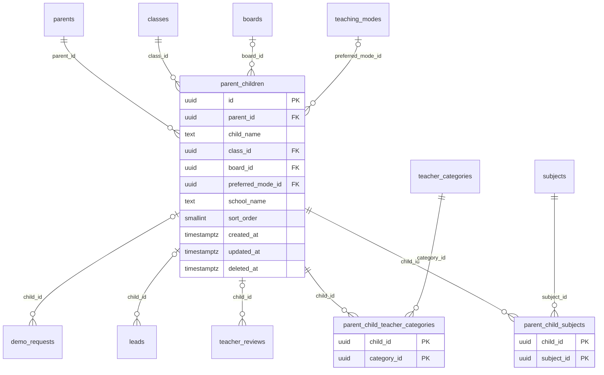

# Module 29 · Parent Children Management

> **Phase 7 · Parents** · **Depends on:** M28, M11–M15 · **Owns tables:** `parent_children`, `parent_child_subjects`, `parent_child_teacher_categories` · **Reads:** `parents`, `classes`, `boards`, `subjects`, `teacher_categories`, `teaching_modes` · **Build estimate:** 2–3 days

## 1. Module Overview

Each parent can add multiple children (up to the `limits.parent_max_children` setting, default 3) with the child's first name, class, board, subjects needed, types of teacher wanted and preferred mode. The app uses these to show per-child recommendations. The admin portal shows children on the parent page, lets support correct them, and exposes aggregate demand ("how many Class 10 CBSE children need Maths in Pune?").

## 2. Business Purpose

Per-child preferences are the input to GuruConnect's recommendation engine. Admins need visibility for support and aggregated demand data to decide which teachers to recruit where.

## 3. User Stories

- As **Support Admin**, I want to see a parent's children with class and needs so that I can explain why certain teachers were recommended.
- As **Operations Admin**, I want demand counts by class, subject and city so that I can recruit teachers where demand is unmet.
- As **Support Admin**, I want to fix a child's class when a parent picked the wrong one so that recommendations improve immediately.

## 4. Functional Requirements & Business Logic

**FR-29.1 Children of a parent.** `GET /parents/:parentId/children` returns children with class, board, subjects, teacher categories, preferred mode, created date.

**FR-29.2 Edit / remove (support).** `PATCH /parent-children/:childId` (reason required) and `DELETE /parent-children/:childId` (soft). The parent is notified in-app that support updated their preferences.

**FR-29.3 Rules (shared with the mobile API).**
- 1 … `limits.parent_max_children` children per parent (default 3).
- `child_name`: first name only, 1–40 chars (data minimisation for minors; no date of birth, no photo).
- Subjects must be offered for the child's class (Module 12 class range); changing the class drops subjects that no longer fit.
- 0–6 subjects, 0–4 teacher categories; preferred mode optional.

**FR-29.4 Recommendation contract.** For a child, eligible teachers are approved, active, and have a `teacher_classes` row with the child's class (board NULL or equal). Score = 5 (class) + 3 × (category match) + 3 × (subject match) + 1 × (mode match) + trust_score/100 + 0.5 × (within 4 km of parent's area). Top 20 per child are cached in Redis `rec:<childId>` for 6 hours and invalidated when the child or matched teacher mappings change. Admin endpoint `GET /parent-children/:childId/recommendations` shows the same list with the score breakdown for support.

**FR-29.5 Demand analytics.** `GET /children-demand?cityId&classId&subjectId&categoryId` returns counts of children (live, not deleted) grouped by the requested dimensions, plus supply (approved teachers matching) and a gap ratio.

## 5. Validation Rules

| Field | Rule |
| --- | --- |
| childName | 1–40 chars, letters/spaces only |
| classId | active class |
| boardId | optional active board (state boards only in the parent's state or "other") |
| subjectIds | 0–6 active subjects valid for the class |
| categoryIds | 0–4 active teacher categories |
| preferredModeId | optional active mode |
| reason (support edit) | 10–500 |

## 6. API Endpoints

| Method | Path | Permission | Description |
| --- | --- | --- | --- |
| GET | /parents/:parentId/children | parent_children.read | Children of a parent |
| GET | /parent-children/:childId | parent_children.read | One child |
| PATCH | /parent-children/:childId | parent_children.manage | Support edit (reason) |
| DELETE | /parent-children/:childId | parent_children.manage | Remove child (soft) |
| GET | /parent-children/:childId/recommendations | parent_children.read | Recommendations with score breakdown |
| GET | /children-demand | parent_children.read | Aggregated demand vs supply |

## 7. Request Payloads

```json
// PATCH /parent-children/:childId
{ "classId": "…class-5…", "subjectIds": ["…mathematics…", "…english…"], "categoryIds": ["…home-tutor…"], "preferredModeId": "…home_tuition…", "reason": "Parent called: Riya moved to Class 5" }
```

## 8. Response Payloads

```json
// 200 GET /parents/:parentId/children
{ "data": [ { "id": "…", "childName": "Aarav", "class": { "id": "…", "name": "Class 12" }, "board": { "id": "…", "shortName": "CBSE" }, "subjects": ["Physics","JEE Main"],
  "teacherCategories": ["Competitive Exam Faculty","School Teacher"], "preferredMode": null, "createdAt": "…" } ] }

// 200 GET /parent-children/:childId/recommendations
{ "data": [ { "teacherId": "…", "fullName": "Imran Qureshi", "score": 12.4, "breakdown": { "class": 5, "category": 3, "subject": 3, "mode": 1, "trust": 0.9, "distance": 0 } } ] }

// 200 GET /children-demand?cityId=…&groupBy=class,subject
{ "data": [ { "class": "Class 10", "subject": "Mathematics", "children": 1204, "matchingTeachers": 188, "childrenPerTeacher": 6.4 } ] }
```

## 9. PostgreSQL Tables

### `parent_children`

Children a parent is finding teachers for. Drives per-child recommendations.

```sql
CREATE TABLE parent_children (
  id uuid PRIMARY KEY DEFAULT gen_random_uuid(), -- Primary key
  parent_id uuid NOT NULL REFERENCES parents(id) ON DELETE CASCADE, -- Parent
  child_name text NOT NULL, -- First name only (data minimisation for minors)
  class_id uuid NOT NULL REFERENCES classes(id) ON DELETE RESTRICT, -- Class the child studies in
  board_id uuid REFERENCES boards(id) ON DELETE RESTRICT, -- Board
  preferred_mode_id uuid REFERENCES teaching_modes(id) ON DELETE RESTRICT, -- Preferred teaching mode; NULL = any
  school_name text, -- Optional school
  sort_order smallint NOT NULL DEFAULT 0, -- Order in the child switcher
  created_at timestamptz NOT NULL DEFAULT now(), -- Created
  updated_at timestamptz NOT NULL DEFAULT now(), -- Updated
  deleted_at timestamptz -- Soft delete
);
CREATE INDEX idx_parent_children_parent ON parent_children (parent_id) WHERE deleted_at IS NULL;
CREATE INDEX idx_parent_children_class ON parent_children (class_id) WHERE deleted_at IS NULL;
CREATE TRIGGER trg_parent_children_updated BEFORE UPDATE ON parent_children FOR EACH ROW EXECUTE FUNCTION set_updated_at();
```

### `parent_child_subjects`

Subjects needed for a child.

```sql
CREATE TABLE parent_child_subjects (
  child_id uuid NOT NULL REFERENCES parent_children(id) ON DELETE CASCADE, -- Child
  subject_id uuid NOT NULL REFERENCES subjects(id) ON DELETE RESTRICT, -- Subject needed
  PRIMARY KEY (child_id, subject_id)
);
CREATE INDEX idx_parent_child_subjects_subject ON parent_child_subjects (subject_id);
```

### `parent_child_teacher_categories`

Types of teacher the parent wants for a child (Home Tutor, Competitive Exam Faculty, …).

```sql
CREATE TABLE parent_child_teacher_categories (
  child_id uuid NOT NULL REFERENCES parent_children(id) ON DELETE CASCADE, -- Child
  category_id uuid NOT NULL REFERENCES teacher_categories(id) ON DELETE RESTRICT, -- Teacher category wanted
  PRIMARY KEY (child_id, category_id)
);

```

Migration file: `sql/migrations/029_m29_parent_children_management.sql`

## 10. Column Definitions

### `parent_children`

| Column | Type | Null | Default | Constraints / References | Description |
| --- | --- | --- | --- | --- | --- |
| `id` | uuid | no | gen_random_uuid() | PK | Primary key |
| `parent_id` | uuid | no | — | FK → `parents.id` (on delete cascade) | Parent |
| `child_name` | text | no | — | — | First name only (data minimisation for minors) |
| `class_id` | uuid | no | — | FK → `classes.id` (on delete restrict) | Class the child studies in |
| `board_id` | uuid | yes | — | FK → `boards.id` (on delete restrict) | Board |
| `preferred_mode_id` | uuid | yes | — | FK → `teaching_modes.id` (on delete restrict) | Preferred teaching mode; NULL = any |
| `school_name` | text | yes | — | — | Optional school |
| `sort_order` | smallint | no | 0 | — | Order in the child switcher |
| `created_at` | timestamptz | no | now() | — | Created |
| `updated_at` | timestamptz | no | now() | — | Updated |
| `deleted_at` | timestamptz | yes | — | — | Soft delete |

### `parent_child_subjects`

| Column | Type | Null | Default | Constraints / References | Description |
| --- | --- | --- | --- | --- | --- |
| `child_id` | uuid | no | — | PK; FK → `parent_children.id` (on delete cascade) | Child |
| `subject_id` | uuid | no | — | PK; FK → `subjects.id` (on delete restrict) | Subject needed |

**Table constraints:** `PRIMARY KEY (child_id, subject_id)`

### `parent_child_teacher_categories`

| Column | Type | Null | Default | Constraints / References | Description |
| --- | --- | --- | --- | --- | --- |
| `child_id` | uuid | no | — | PK; FK → `parent_children.id` (on delete cascade) | Child |
| `category_id` | uuid | no | — | PK; FK → `teacher_categories.id` (on delete restrict) | Teacher category wanted |

**Table constraints:** `PRIMARY KEY (child_id, category_id)`

## 11. Relationships

**Outgoing foreign keys**

- `parent_children.parent_id` → `parents.id` — required, many-to-one, on delete **cascade**
- `parent_children.class_id` → `classes.id` — required, many-to-one, on delete **restrict**
- `parent_children.board_id` → `boards.id` — optional, many-to-one, on delete **restrict**
- `parent_children.preferred_mode_id` → `teaching_modes.id` — optional, many-to-one, on delete **restrict**
- `parent_child_subjects.child_id` → `parent_children.id` — required, many-to-one, on delete **cascade**
- `parent_child_subjects.subject_id` → `subjects.id` — required, many-to-one, on delete **restrict**
- `parent_child_teacher_categories.child_id` → `parent_children.id` — required, many-to-one, on delete **cascade**
- `parent_child_teacher_categories.category_id` → `teacher_categories.id` — required, many-to-one, on delete **restrict**

**Referenced by**

- `teacher_reviews.child_id` → `parent_children` (module 33) — on delete **set null**
- `leads.child_id` → `parent_children` (module 38) — on delete **set null**
- `demo_requests.child_id` → `parent_children` (module 39) — on delete **set null**

**Entity relationship diagram**



## 12. Indexing Strategy

| Index | Table | Kind | Definition |
| --- | --- | --- | --- |
| `idx_parent_children_parent` | `parent_children` | btree | `(parent_id) WHERE deleted_at IS NULL` |
| `idx_parent_children_class` | `parent_children` | btree | `(class_id) WHERE deleted_at IS NULL` |
| `idx_parent_child_subjects_subject` | `parent_child_subjects` | btree | `(subject_id)` |

`idx_parent_children_parent` for a parent's children; `idx_parent_children_class` and `idx_parent_child_subjects_subject` for demand aggregation. Demand queries run on a read replica when available.

## 13. Permissions

| Permission key | Allows | Sensitive | Super | Ops | Verif. | Finance | Support |
| --- | --- | --- | --- | --- | --- | --- | --- |
| `parent_children.read` | View children linked to parents | — | ✓ | ✓ | — | — | ✓ |
| `parent_children.manage` | Edit or remove children on a parent's behalf | — | ✓ | ✓ | — | — | — |

## 14. UI Screens & React Page Structure

Tab **Children** on `/users/parents/:id`; page `/analytics/demand` (DemandPage) with filters and a heat table (class × subject) for a city.
```
src/features/children/
  ChildrenTab.tsx, ChildEditDrawer.tsx, RecommendationDebugDrawer.tsx
  DemandPage.tsx, DemandHeatTable.tsx
```

## 15. UI Components

- Child cards (name, class, board, chips for subjects/categories, mode).
- `RecommendationDebugDrawer` — ranked teachers with score bars.
- `DemandHeatTable` — sequential single-hue colour scale for children per teacher; values printed in cells.

## 16. Filters

Demand: city (required), class, subject, category, board.

## 17. Search Capabilities

Not applicable (children are reached through their parent).

## 18. Pagination Requirements

Children not paginated (≤ 5); demand table not paginated (bounded by classes × subjects).

## 19. Audit Logs

| Event | Details |
| --- | --- |
| `parent_child.updated_by_admin` | changed fields, reason |
| `parent_child.deleted_by_admin` | reason |
Parent actions in the app are logged with `actor_type = 'app_user'`.

## 20. Error Scenarios

| Scenario | HTTP | Code | Message |
| --- | --- | --- | --- |
| Subject not offered for class | 422 | VALIDATION_FAILED | "Physics isn't offered for Class 4." |
| Too many subjects/categories | 422 | VALIDATION_FAILED | "Pick up to 6 subjects and 4 teacher types." |
| Child limit reached (app) | 409 | CONFLICT_STATE | "You can add up to 3 children." |
| Missing reason (support edit) | 422 | VALIDATION_FAILED | "Add a reason; the parent will be notified." |

## 21. Future Scalability Notes & Enhancements

Learning-to-rank recommendations using lead/demo outcomes; content recommendations (blogs by `class_ids`, Module 45) per child; school-level cohorts.

## 22. Security Considerations

Children are minors: store first name only, no DOB/photo; children data never exported with parent contact details in the same file unless the admin holds `users.pii`.
