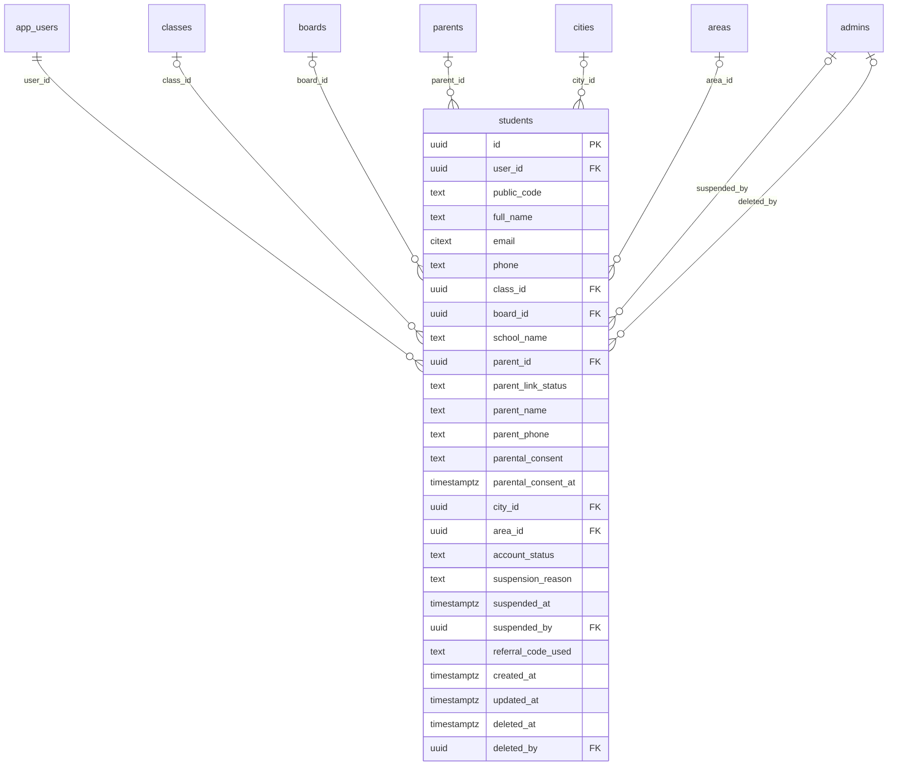

# Module 31 · Student Management

> **Phase 8 · Students** · **Depends on:** M0–M2, M9–M13, M28 · **Owns tables:** `students` · **Reads:** `app_users`, `classes`, `boards`, `cities`, `areas`, `parents` · **Build estimate:** 2–3 days

## 1. Module Overview

Admin directory and detail view of students who signed up themselves (typically Class 9 and above, college students and exam aspirants): class, board, school/college, optional parent link and parent contact, location, subscription (M32), leads, reviews and complaints. Admins can edit, link to a parent account, suspend/activate and delete.

## 2. Business Purpose

Students are a distinct audience (JEE/NEET aspirants, adult learners) with their own subscriptions and safety considerations. Support and safety teams need the same one-page view as for parents.

## 3. User Stories

- As **Support Admin**, I want to find a student by phone and see their class, subscription and leads so that I can help them.
- As **Support Admin**, I want to link a student to their parent's account when the parent asks so that the parent sees demo bookings.
- As **Support Admin**, I want to suspend a student who sent abusive messages to a teacher.

## 4. Functional Requirements & Business Logic

**FR-31.1 Directory.** `GET /students` — name, code, masked phone, class, board, school, city, parent linked (yes/no), subscription status, leads, last active, account status.

**FR-31.2 Detail.** `GET /students/:id` — profile, parent link, subscription, counts; tabs reuse Modules 32, 38–39, 33–34, 40, 42, 43.

**FR-31.3 Edit.** `PATCH /students/:id` (If-Match): full name, email, class, board, school name, parent name/phone, city, area.

**FR-31.4 Link parent.** `POST /students/:id/link-parent { parentId, reason }` — both accounts must exist; the parent receives an in-app request to confirm; link becomes effective on confirmation (`parent_id` set). `unlink` removes it.

**FR-31.5 Suspend/activate/delete.** Same as Module 28 (shared `SuspendUserDialog`, same cascade rules).

**FR-31.6 Minors.** If the student's class is below Class 9 (level_order < 9) at sign-up, the app requires a parent phone and sends a consent SMS; admins see "Parental consent: confirmed / pending". Students with pending consent cannot contact teachers.

**FR-31.7 Public code.** `GC-S` + 5-digit sequence.

## 5. Validation Rules

| Field | Rule |
| --- | --- |
| fullName | 2–100 |
| email | valid, unique among live app users |
| classId / boardId | active |
| schoolName | ≤ 120 |
| parentName | 2–100 optional; parentPhone E.164 optional (required when class < 9) |
| cityId / areaId | active; area within city |
| link-parent.parentId | live parent, not already linked to this student |

## 6. API Endpoints

| Method | Path | Permission | Description |
| --- | --- | --- | --- |
| GET | /students | students.read | Directory |
| GET | /students/export | students.read | CSV |
| GET | /students/:id | students.read | Detail |
| PATCH | /students/:id | students.update | Edit |
| POST | /students/:id/reveal-contact | users.pii | Full phone/email (audited) |
| POST | /students/:id/link-parent | students.update | Request parent link |
| POST | /students/:id/unlink-parent | students.update | Remove parent link |
| POST | /students/:id/suspend | students.suspend | Suspend |
| POST | /students/:id/activate | students.suspend | Re-activate |
| DELETE | /students/:id | super admin | Delete account |

## 7. Request Payloads

```json
// POST /students/:id/link-parent
{ "parentId": "…", "reason": "Parent Lakshmi V. called to link her son's account" }
```

## 8. Response Payloads

```json
// 200 GET /students/:id
{ "data": { "id": "…", "publicCode": "GC-S50140", "fullName": "Aarav Kumar", "phoneMasked": "+91 99XXX XX817", "class": "Class 12", "board": "CBSE", "schoolName": "National Public School, Koramangala",
  "parent": { "id": "…", "name": "Lakshmi Venkatesh", "linkStatus": "confirmed" }, "parentalConsent": "not_required", "city": "Bengaluru",
  "subscription": { "status": "trial", "trialEndsAt": "2026-10-01T00:00:00Z" }, "accountStatus": "active", "updatedAt": "…" } }
```

## 9. PostgreSQL Tables

### `students`

Student profile, one per student app account.

```sql
CREATE TABLE students (
  id uuid PRIMARY KEY DEFAULT gen_random_uuid(), -- Primary key
  user_id uuid NOT NULL REFERENCES app_users(id) ON DELETE RESTRICT, -- Login identity
  public_code text NOT NULL DEFAULT ('GC-S' || nextval('seq_student_code')), -- e.g. GC-S50140
  full_name text NOT NULL, -- Name
  email citext, -- Email
  phone text NOT NULL, -- E.164 phone
  class_id uuid REFERENCES classes(id) ON DELETE RESTRICT, -- Current class
  board_id uuid REFERENCES boards(id) ON DELETE RESTRICT, -- Board
  school_name text, -- School or college
  parent_id uuid REFERENCES parents(id) ON DELETE SET NULL, -- Linked parent account, if any
  parent_link_status text NOT NULL DEFAULT 'none' CHECK (parent_link_status IN ('none','pending','confirmed')), -- Link requested by support or the student; confirmed by the parent in the app
  parent_name text, -- Optional parent name given at sign-up
  parent_phone text, -- Optional parent phone (E.164)
  parental_consent text NOT NULL DEFAULT 'not_required' CHECK (parental_consent IN ('not_required','pending','confirmed','declined')), -- Required for students below Class 9
  parental_consent_at timestamptz, -- When the parent confirmed by SMS link
  city_id uuid REFERENCES cities(id) ON DELETE RESTRICT, -- City
  area_id uuid REFERENCES areas(id) ON DELETE RESTRICT, -- Area
  account_status text NOT NULL DEFAULT 'active' CHECK (account_status IN ('active','suspended')), -- Account status
  suspension_reason text, -- Internal reason
  suspended_at timestamptz, -- When suspended
  suspended_by uuid REFERENCES admins(id), -- Who suspended
  referral_code_used text, -- Code entered at sign-up
  created_at timestamptz NOT NULL DEFAULT now(), -- Created
  updated_at timestamptz NOT NULL DEFAULT now(), -- Updated
  deleted_at timestamptz, -- Soft delete
  deleted_by uuid REFERENCES admins(id) -- Admin who deleted
);
CREATE UNIQUE INDEX uq_students_user ON students (user_id) WHERE deleted_at IS NULL;
CREATE UNIQUE INDEX uq_students_public_code ON students (public_code);
CREATE INDEX idx_students_class ON students (class_id) WHERE deleted_at IS NULL;
CREATE INDEX idx_students_city ON students (city_id) WHERE deleted_at IS NULL;
CREATE INDEX idx_students_name_trgm ON students USING gin (full_name gin_trgm_ops);
CREATE TRIGGER trg_students_updated BEFORE UPDATE ON students FOR EACH ROW EXECUTE FUNCTION set_updated_at();
```

Migration file: `sql/migrations/031_m31_student_management.sql`

## 10. Column Definitions

### `students`

| Column | Type | Null | Default | Constraints / References | Description |
| --- | --- | --- | --- | --- | --- |
| `id` | uuid | no | gen_random_uuid() | PK | Primary key |
| `user_id` | uuid | no | — | FK → `app_users.id` (on delete restrict) | Login identity |
| `public_code` | text | no | ('GC-S' \|\| nextval('seq_student_code')) | — | e.g. GC-S50140 |
| `full_name` | text | no | — | — | Name |
| `email` | citext | yes | — | — | Email |
| `phone` | text | no | — | — | E.164 phone |
| `class_id` | uuid | yes | — | FK → `classes.id` (on delete restrict) | Current class |
| `board_id` | uuid | yes | — | FK → `boards.id` (on delete restrict) | Board |
| `school_name` | text | yes | — | — | School or college |
| `parent_id` | uuid | yes | — | FK → `parents.id` (on delete set null) | Linked parent account, if any |
| `parent_link_status` | text | no | 'none' | CHECK parent_link_status IN ('none','pending','confirmed') | Link requested by support or the student; confirmed by the parent in the app |
| `parent_name` | text | yes | — | — | Optional parent name given at sign-up |
| `parent_phone` | text | yes | — | — | Optional parent phone (E.164) |
| `parental_consent` | text | no | 'not_required' | CHECK parental_consent IN ('not_required','pending','confirmed','declined') | Required for students below Class 9 |
| `parental_consent_at` | timestamptz | yes | — | — | When the parent confirmed by SMS link |
| `city_id` | uuid | yes | — | FK → `cities.id` (on delete restrict) | City |
| `area_id` | uuid | yes | — | FK → `areas.id` (on delete restrict) | Area |
| `account_status` | text | no | 'active' | CHECK account_status IN ('active','suspended') | Account status |
| `suspension_reason` | text | yes | — | — | Internal reason |
| `suspended_at` | timestamptz | yes | — | — | When suspended |
| `suspended_by` | uuid | yes | — | FK → `admins.id` (on delete no action) | Who suspended |
| `referral_code_used` | text | yes | — | — | Code entered at sign-up |
| `created_at` | timestamptz | no | now() | — | Created |
| `updated_at` | timestamptz | no | now() | — | Updated |
| `deleted_at` | timestamptz | yes | — | — | Soft delete |
| `deleted_by` | uuid | yes | — | FK → `admins.id` (on delete no action) | Admin who deleted |

## 11. Relationships

**Outgoing foreign keys**

- `students.user_id` → `app_users.id` — required, many-to-one, on delete **restrict**
- `students.class_id` → `classes.id` — optional, many-to-one, on delete **restrict**
- `students.board_id` → `boards.id` — optional, many-to-one, on delete **restrict**
- `students.parent_id` → `parents.id` — optional, many-to-one, on delete **set null**
- `students.city_id` → `cities.id` — optional, many-to-one, on delete **restrict**
- `students.area_id` → `areas.id` — optional, many-to-one, on delete **restrict**
- `students.suspended_by` → `admins.id` — optional, many-to-one, on delete **no action**
- `students.deleted_by` → `admins.id` — optional, many-to-one, on delete **no action**

**Entity relationship diagram**



## 12. Indexing Strategy

| Index | Table | Kind | Definition |
| --- | --- | --- | --- |
| `uq_students_user` | `students` | unique | `(user_id) WHERE deleted_at IS NULL` |
| `uq_students_public_code` | `students` | unique | `(public_code)` |
| `idx_students_class` | `students` | btree | `(class_id) WHERE deleted_at IS NULL` |
| `idx_students_city` | `students` | btree | `(city_id) WHERE deleted_at IS NULL` |
| `idx_students_name_trgm` | `students` | gin | `USING gin (full_name gin_trgm_ops)` |

`uq_students_user`, `idx_students_class`, `idx_students_city`, trigram on name.

## 13. Permissions

| Permission key | Allows | Sensitive | Super | Ops | Verif. | Finance | Support |
| --- | --- | --- | --- | --- | --- | --- | --- |
| `students.read` | View students | — | ✓ | ✓ | — | ✓ | ✓ |
| `students.update` | Edit student profiles | — | ✓ | ✓ | — | — | — |
| `students.suspend` | Suspend and re-activate students | yes | ✓ | ✓ | — | — | — |

## 14. UI Screens & React Page Structure

| Route | Page | Content |
| --- | --- | --- |
| `/users/students` | StudentsListPage | Filters, table, export |
| `/users/students/:id` | StudentDetailPage | Header; tabs: Overview · Subscription · Leads & demos · Reviews · Payments · Referrals · Complaints · Activity |

```
src/features/students/
  pages/StudentsListPage.tsx, StudentDetailPage.tsx
  components/StudentHeader.tsx, StudentProfileForm.tsx, LinkParentDialog.tsx, ConsentBadge.tsx
```

## 15. UI Components

`LinkParentDialog` (parent search by phone/code), `ConsentBadge`, shared `SuspendUserDialog`, `RevealContactButton`.

## 16. Filters

Class (multi), board, city, subscription status, parent linked, parental consent pending, account status, joined range, last active.

## 17. Search Capabilities

Code exact; name trigram; school name trigram; email prefix; phone last 10 digits (`users.pii`).

## 18. Pagination Requirements

Offset, default 20; sort createdAt, fullName, lastActiveAt, class.

## 19. Audit Logs

| Event | Details |
| --- | --- |
| `student.updated` | changed fields |
| `student.pii_viewed` | — |
| `student.parent_link_requested` / `.parent_unlinked` | parent, reason |
| `student.suspended` / `.activated` / `.deleted` | reason |

## 20. Error Scenarios

| Scenario | HTTP | Code | Message |
| --- | --- | --- | --- |
| Parent phone missing for a student below Class 9 | 422 | VALIDATION_FAILED | "Students below Class 9 need a parent's number." |
| Link to a parent already linked | 409 | CONFLICT_STATE | "Already linked." |
| Email used by another account | 409 | CONFLICT_DUPLICATE | "This email belongs to another account." |
| Suspend already suspended | 409 | CONFLICT_STATE | "Already suspended." |

## 21. Future Scalability Notes & Enhancements

School/college master table with verified institutions; student progress tracking with teachers.

## 22. Security Considerations

Minor protections (consent, limited data), PII masking and audited reveal, same deletion rules as parents.
