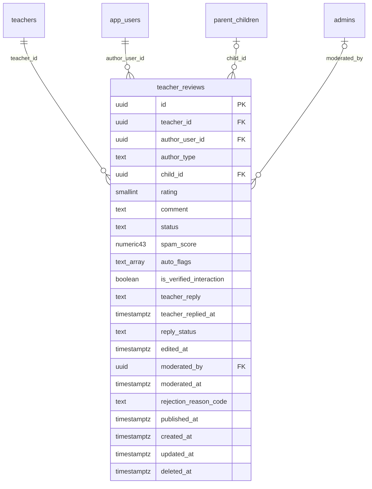

# Module 33 · Teacher Reviews

> **Phase 9 · Reviews** · **Depends on:** M16, M28, M31 (M35 moderates, M36 consumes) · **Owns tables:** `teacher_reviews` · **Reads:** `teachers`, `app_users`, `parent_children`, `leads`, `demo_requests` · **Build estimate:** 3 days

## 1. Module Overview

Reviews of teachers written by registered parents and students: a 1–5 star rating, written feedback, the reviewer's role (Parent Review or Student Review), a verified-interaction flag, and the teacher's public reply. This module gives admins the list and detail of teacher reviews, per-teacher rating summaries, and keeps the cached `rating_avg`/`rating_count` on teachers correct. Moderation actions live in Module 35.

## 2. Business Purpose

Reviews are half of the trust promise. Admins need to see every review a teacher has (including rejected ones), understand how ratings are computed, and trust that only genuine, moderated reviews affect ratings and trust scores.

## 3. User Stories

- As **Support Admin**, I want to see all reviews of a teacher with their status so that I can answer "why was my review not published?".
- As **Operations Admin**, I want a teacher's rating summary split by parents and students so that I can spot mismatches.
- As **Verification Admin**, I want to know whether a reviewer actually had a demo or lead with the teacher so that I can weigh the review.

## 4. Functional Requirements & Business Logic

**FR-33.1 Business rules (enforced by the mobile API; shown here because admins must understand them).**
- Only registered parents and students with an active account can review; one review per (teacher, author) — editing replaces it.
- A review requires a completed demo or a lead older than 3 days with the teacher (`is_verified_interaction = true`); reviews without interaction are allowed only when `settings reviews.allow_unverified = true` (default false).
- Text 30–1,500 chars (min from `limits.review_min_chars`); rating 1–5.
- New and edited reviews start as `pending`. Auto-moderation (Module 35) may publish automatically when spam score < 0.15 and no auto flags, otherwise it waits for a moderator.
- Author edits allowed within 90 days; edits reset status to `pending` and set `edited_at`.
- Teacher replies (one per review, ≤ 1,000 chars) are moderated (`reply_status`).

**FR-33.2 Rating cache.** On every transition into or out of `published`, recompute in the same transaction: `teachers.rating_avg = avg(rating)`, `rating_count = count(*)` of published, non-deleted reviews, then enqueue trust recalculation (Module 36, trigger `review_published` / `review_removed`).

**FR-33.3 Lists.** `GET /teacher-reviews` (all teachers) and `GET /teachers/:id/reviews` with status and role filters; each item shows teacher, author (name initial + role), child class if parent, stars, text, spam score, auto flags, verified interaction, reply and reply status, dates.

**FR-33.4 Summary.** `GET /teachers/:id/reviews/summary` — average (overall, parents, students), distribution 1–5, count by status, reply rate, Bayesian-smoothed rating used by trust (Module 36).

**FR-33.5 Author view.** `GET /app-users/:userId/reviews` — every review written by a user (teacher and institute reviews), used to spot serial reviewers.

**FR-33.6 Deletion.** Author deletion (app) soft-deletes; admins hide via Module 35 rather than delete.

## 5. Validation Rules

Query: status (pending, published, rejected, flagged, hidden), authorType (parent, student), rating 1–5, hasReply, verifiedInteraction, spamScoreMin 0–1, date range ≤ 366 days.

## 6. API Endpoints

| Method | Path | Permission | Description |
| --- | --- | --- | --- |
| GET | /teacher-reviews | teacher_reviews.read | All teacher reviews with filters |
| GET | /teacher-reviews/:id | teacher_reviews.read | One review with moderation history |
| GET | /teachers/:id/reviews | teacher_reviews.read | Reviews of one teacher |
| GET | /teachers/:id/reviews/summary | teacher_reviews.read | Rating summary |
| GET | /app-users/:userId/reviews | teacher_reviews.read | Reviews written by a user |

## 7. Request Payloads

```json
// GET /teacher-reviews?status=pending&authorType=parent&spamScoreMin=0.5&page=1&pageSize=20&sort=createdAt:asc
```

## 8. Response Payloads

```json
// 200 GET /teachers/:id/reviews/summary
{ "data": { "avg": 4.9, "count": 312, "byRole": { "parent": { "avg": 4.9, "count": 181 }, "student": { "avg": 4.8, "count": 131 } },
  "distribution": { "5": 244, "4": 47, "3": 15, "2": 3, "1": 3 }, "byStatus": { "published": 312, "pending": 4, "rejected": 11, "flagged": 1, "hidden": 2 },
  "replyRatePct": 64, "bayesianRating": 4.86 } }

// 200 GET /teacher-reviews/:id
{ "data": { "id": "…", "teacher": { "id": "…", "name": "Dr. Ananya Iyer" }, "author": { "userId": "…", "displayName": "Lakshmi V.", "type": "parent", "childClass": "Class 12" },
  "rating": 5, "comment": "My son's Physics went from 58 to 91…", "status": "published", "spamScore": 0.04, "autoFlags": [], "isVerifiedInteraction": true,
  "reply": { "text": "Thank you! Aarav worked very hard.", "status": "published", "repliedAt": "…" }, "moderation": [ { "action": "auto_approved", "at": "…" } ], "createdAt": "…" } }
```

## 9. PostgreSQL Tables

### `teacher_reviews`

Reviews of teachers by parents and students. Only published reviews count toward ratings and trust.

```sql
CREATE TABLE teacher_reviews (
  id uuid PRIMARY KEY DEFAULT gen_random_uuid(), -- Primary key
  teacher_id uuid NOT NULL REFERENCES teachers(id) ON DELETE CASCADE, -- Teacher reviewed
  author_user_id uuid NOT NULL REFERENCES app_users(id) ON DELETE RESTRICT, -- Reviewer
  author_type text NOT NULL CHECK (author_type IN ('parent','student')), -- Reviewer role at the time
  child_id uuid REFERENCES parent_children(id) ON DELETE SET NULL, -- Child the parent is reviewing for
  rating smallint NOT NULL CHECK (rating BETWEEN 1 AND 5), -- Stars
  comment text NOT NULL, -- Review text, 30–1,500 chars
  status text NOT NULL DEFAULT 'pending' CHECK (status IN ('pending','published','rejected','flagged','hidden')), -- Moderation state
  spam_score numeric(4,3) CHECK (spam_score BETWEEN 0 AND 1), -- Automated spam probability
  auto_flags text[] NOT NULL DEFAULT '{}', -- e.g. {contact_info, repeated_text, rating_burst}
  is_verified_interaction boolean NOT NULL DEFAULT false, -- Reviewer had a completed lead or demo with the teacher
  teacher_reply text, -- Public reply by the teacher
  teacher_replied_at timestamptz, -- Reply time
  reply_status text CHECK (reply_status IN ('pending','published','rejected')), -- Replies are moderated too
  edited_at timestamptz, -- Last edit by the author (edits send the review back to pending)
  moderated_by uuid REFERENCES admins(id), -- Last moderator
  moderated_at timestamptz, -- Last moderation time
  rejection_reason_code text, -- e.g. CONTACT_DETAILS, ABUSIVE, NOT_A_TEACHING_EXPERIENCE
  published_at timestamptz, -- First published
  created_at timestamptz NOT NULL DEFAULT now(), -- Created
  updated_at timestamptz NOT NULL DEFAULT now(), -- Updated
  deleted_at timestamptz -- Soft delete (author deleted it or account deleted)
);
CREATE UNIQUE INDEX uq_teacher_reviews_author ON teacher_reviews (teacher_id, author_user_id) WHERE deleted_at IS NULL;
CREATE INDEX idx_teacher_reviews_queue ON teacher_reviews (status, created_at) WHERE deleted_at IS NULL;
CREATE INDEX idx_teacher_reviews_teacher ON teacher_reviews (teacher_id, status, published_at DESC) WHERE deleted_at IS NULL;
CREATE TRIGGER trg_teacher_reviews_updated BEFORE UPDATE ON teacher_reviews FOR EACH ROW EXECUTE FUNCTION set_updated_at();
```

Migration file: `sql/migrations/033_m33_teacher_reviews.sql`

## 10. Column Definitions

### `teacher_reviews`

| Column | Type | Null | Default | Constraints / References | Description |
| --- | --- | --- | --- | --- | --- |
| `id` | uuid | no | gen_random_uuid() | PK | Primary key |
| `teacher_id` | uuid | no | — | FK → `teachers.id` (on delete cascade) | Teacher reviewed |
| `author_user_id` | uuid | no | — | FK → `app_users.id` (on delete restrict) | Reviewer |
| `author_type` | text | no | — | CHECK author_type IN ('parent','student') | Reviewer role at the time |
| `child_id` | uuid | yes | — | FK → `parent_children.id` (on delete set null) | Child the parent is reviewing for |
| `rating` | smallint | no | — | CHECK rating BETWEEN 1 AND 5 | Stars |
| `comment` | text | no | — | — | Review text, 30–1,500 chars |
| `status` | text | no | 'pending' | CHECK status IN ('pending','published','rejected','flagged','hidden') | Moderation state |
| `spam_score` | numeric(4,3) | yes | — | CHECK spam_score BETWEEN 0 AND 1 | Automated spam probability |
| `auto_flags` | text[] | no | '{}' | — | e.g. {contact_info, repeated_text, rating_burst} |
| `is_verified_interaction` | boolean | no | false | — | Reviewer had a completed lead or demo with the teacher |
| `teacher_reply` | text | yes | — | — | Public reply by the teacher |
| `teacher_replied_at` | timestamptz | yes | — | — | Reply time |
| `reply_status` | text | yes | — | CHECK reply_status IN ('pending','published','rejected') | Replies are moderated too |
| `edited_at` | timestamptz | yes | — | — | Last edit by the author (edits send the review back to pending) |
| `moderated_by` | uuid | yes | — | FK → `admins.id` (on delete no action) | Last moderator |
| `moderated_at` | timestamptz | yes | — | — | Last moderation time |
| `rejection_reason_code` | text | yes | — | — | e.g. CONTACT_DETAILS, ABUSIVE, NOT_A_TEACHING_EXPERIENCE |
| `published_at` | timestamptz | yes | — | — | First published |
| `created_at` | timestamptz | no | now() | — | Created |
| `updated_at` | timestamptz | no | now() | — | Updated |
| `deleted_at` | timestamptz | yes | — | — | Soft delete (author deleted it or account deleted) |

## 11. Relationships

**Outgoing foreign keys**

- `teacher_reviews.teacher_id` → `teachers.id` — required, many-to-one, on delete **cascade**
- `teacher_reviews.author_user_id` → `app_users.id` — required, many-to-one, on delete **restrict**
- `teacher_reviews.child_id` → `parent_children.id` — optional, many-to-one, on delete **set null**
- `teacher_reviews.moderated_by` → `admins.id` — optional, many-to-one, on delete **no action**

**Entity relationship diagram**



## 12. Indexing Strategy

| Index | Table | Kind | Definition |
| --- | --- | --- | --- |
| `uq_teacher_reviews_author` | `teacher_reviews` | unique | `(teacher_id, author_user_id) WHERE deleted_at IS NULL` |
| `idx_teacher_reviews_queue` | `teacher_reviews` | btree | `(status, created_at) WHERE deleted_at IS NULL` |
| `idx_teacher_reviews_teacher` | `teacher_reviews` | btree | `(teacher_id, status, published_at DESC) WHERE deleted_at IS NULL` |

`uq_teacher_reviews_author` enforces one live review per author per teacher; `idx_teacher_reviews_teacher (teacher_id, status, published_at DESC)` serves profile lists; `idx_teacher_reviews_queue (status, created_at)` serves moderation queues.

## 13. Permissions

| Permission key | Allows | Sensitive | Super | Ops | Verif. | Finance | Support |
| --- | --- | --- | --- | --- | --- | --- | --- |
| `teacher_reviews.read` | View teacher reviews | — | ✓ | ✓ | ✓ | — | ✓ |

## 14. UI Screens & React Page Structure

| Route | Page | Content |
| --- | --- | --- |
| `/reviews/teachers` | TeacherReviewsPage | All teacher reviews (status tabs, filters) — moderation actions come from Module 35 |
| `/teachers/:id` → Reviews tab | TeacherReviewsTab | Summary (distribution bars, by role), list |

```
src/features/reviews/
  pages/TeacherReviewsPage.tsx
  components/ReviewCard.tsx (shared with M34/M35), RatingSummary.tsx, RatingDistribution.tsx, ReviewerBadge.tsx
```

## 15. UI Components

- `ReviewCard` — author role tag, stars, text, verified-interaction tick, spam meter, flags, reply block, status badge, action slot (filled by Module 35).
- `RatingDistribution` — horizontal bars 5→1 with counts.

## 16. Filters

Status, role, rating, verified interaction, has reply, reply status, spam score ≥, city, teacher, date range.

## 17. Search Capabilities

`q` over review text (PostgreSQL full-text `to_tsvector('english', comment)` — add the GIN index when the table passes ~100k rows) and teacher name/code.

## 18. Pagination Requirements

Offset, default 20; sort createdAt (default desc; asc for pending), rating, spamScore.

## 19. Audit Logs

Read-only module; moderation events are logged by Module 35. Rating cache updates are part of those transactions.

## 20. Error Scenarios

| Scenario | HTTP | Code | Message |
| --- | --- | --- | --- |
| Review not found / deleted | 404 | NOT_FOUND | "Review not found." |
| Invalid filter | 422 | VALIDATION_FAILED | Field message |

## 21. Future Scalability Notes & Enhancements

Review photos; aspect ratings for teachers (clarity, punctuality); helpful votes; translation of reviews.

## 22. Security Considerations

Reviewer identity shown to admins as display name + role only; full contact via the user page with `users.pii`.
