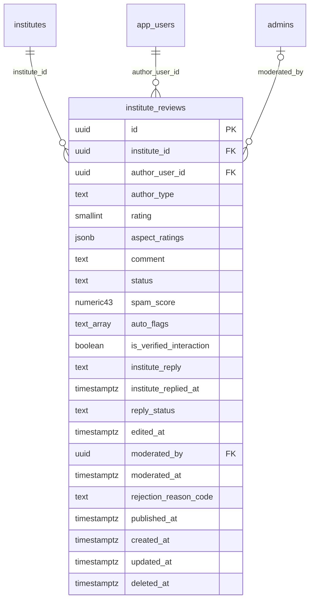

# Module 34 · Institute Reviews

> **Phase 9 · Reviews** · **Depends on:** M22, M28, M31 (M35 moderates, M27 consumes) · **Owns tables:** `institute_reviews` · **Reads:** `institutes`, `app_users`, `leads` · **Build estimate:** 2 days

## 1. Module Overview

Reviews of institutes by parents and students: overall stars, optional aspect ratings (teaching, infrastructure, value, safety), text, verified-interaction flag and the institute manager's reply. Same list/summary/cache behaviour as Module 33, feeding the Student Feedback criterion of institute ratings (Module 27).

## 2. Business Purpose

Families share experiences of coaching centres widely; capturing them on-platform, moderated, gives the Student Feedback score real data and gives parents honest signals.

## 3. User Stories

- As **Verification Admin**, I want an institute's review average and aspect scores before I rate it so that my Student Feedback score is grounded.
- As **Support Admin**, I want to see an institute's replies to reviews so that I can check they are professional.

## 4. Functional Requirements & Business Logic

**FR-34.1 Rules.** As FR-33.1 with: interaction = a lead or campus-visit demo with the institute; aspect ratings optional 1–5 each for `teaching`, `infrastructure`, `value`, `safety`; replies written by the institute's manager or counsellors (moderated).

**FR-34.2 Rating cache.** On publish/unpublish, recompute `institutes.user_rating_avg` and `user_rating_count`; mark the institute's current rating as "feedback changed" if the average moves by ≥ 0.3 since the rating was submitted (shown as a hint to raters).

**FR-34.3 Lists and summary.** `GET /institute-reviews`, `GET /institutes/:id/reviews`, `GET /institutes/:id/reviews/summary` (overall, by role, distribution, aspect averages, reply rate, Bayesian average /10 used by Module 27).

## 5. Validation Rules

As Module 33 plus `aspect` filter (teaching, infrastructure, value, safety) and `aspectMin` 1–5.

## 6. API Endpoints

| Method | Path | Permission | Description |
| --- | --- | --- | --- |
| GET | /institute-reviews | institute_reviews.read | All institute reviews |
| GET | /institute-reviews/:id | institute_reviews.read | One review with moderation history |
| GET | /institutes/:id/reviews | institute_reviews.read | Reviews of one institute |
| GET | /institutes/:id/reviews/summary | institute_reviews.read | Summary incl. aspect averages |

## 7. Request Payloads

```json
// GET /institute-reviews?status=flagged&page=1&pageSize=20
```

## 8. Response Payloads

```json
// 200 GET /institutes/:id/reviews/summary
{ "data": { "avg": 4.7, "count": 486, "byRole": { "parent": { "avg": 4.7, "count": 301 }, "student": { "avg": 4.6, "count": 185 } }, "distribution": { "5": 360, "4": 90, "3": 22, "2": 8, "1": 6 },
  "aspects": { "teaching": 4.8, "infrastructure": 4.5, "value": 4.2, "safety": 4.7 }, "replyRatePct": 71, "feedbackScore10": 9.3 } }
```

## 9. PostgreSQL Tables

### `institute_reviews`

Reviews of institutes by parents and students.

```sql
CREATE TABLE institute_reviews (
  id uuid PRIMARY KEY DEFAULT gen_random_uuid(), -- Primary key
  institute_id uuid NOT NULL REFERENCES institutes(id) ON DELETE CASCADE, -- Institute reviewed
  author_user_id uuid NOT NULL REFERENCES app_users(id) ON DELETE RESTRICT, -- Reviewer
  author_type text NOT NULL CHECK (author_type IN ('parent','student')), -- Reviewer role
  rating smallint NOT NULL CHECK (rating BETWEEN 1 AND 5), -- Overall stars
  aspect_ratings jsonb NOT NULL DEFAULT '{}'::jsonb, -- Optional 1–5 per aspect, e.g. {"teaching":5,"infrastructure":4,"value":4}
  comment text NOT NULL, -- Review text, 30–1,500 chars
  status text NOT NULL DEFAULT 'pending' CHECK (status IN ('pending','published','rejected','flagged','hidden')), -- Moderation state
  spam_score numeric(4,3) CHECK (spam_score BETWEEN 0 AND 1), -- Automated spam probability
  auto_flags text[] NOT NULL DEFAULT '{}', -- Automated flags
  is_verified_interaction boolean NOT NULL DEFAULT false, -- Reviewer had a lead or campus visit
  institute_reply text, -- Public reply by the institute manager
  institute_replied_at timestamptz, -- Reply time
  reply_status text CHECK (reply_status IN ('pending','published','rejected')), -- Reply moderation
  edited_at timestamptz, -- Last author edit
  moderated_by uuid REFERENCES admins(id), -- Last moderator
  moderated_at timestamptz, -- Last moderation time
  rejection_reason_code text, -- Reason code
  published_at timestamptz, -- First published
  created_at timestamptz NOT NULL DEFAULT now(), -- Created
  updated_at timestamptz NOT NULL DEFAULT now(), -- Updated
  deleted_at timestamptz -- Soft delete
);
CREATE UNIQUE INDEX uq_institute_reviews_author ON institute_reviews (institute_id, author_user_id) WHERE deleted_at IS NULL;
CREATE INDEX idx_institute_reviews_queue ON institute_reviews (status, created_at) WHERE deleted_at IS NULL;
CREATE INDEX idx_institute_reviews_inst ON institute_reviews (institute_id, status, published_at DESC) WHERE deleted_at IS NULL;
CREATE TRIGGER trg_institute_reviews_updated BEFORE UPDATE ON institute_reviews FOR EACH ROW EXECUTE FUNCTION set_updated_at();
```

Migration file: `sql/migrations/034_m34_institute_reviews.sql`

## 10. Column Definitions

### `institute_reviews`

| Column | Type | Null | Default | Constraints / References | Description |
| --- | --- | --- | --- | --- | --- |
| `id` | uuid | no | gen_random_uuid() | PK | Primary key |
| `institute_id` | uuid | no | — | FK → `institutes.id` (on delete cascade) | Institute reviewed |
| `author_user_id` | uuid | no | — | FK → `app_users.id` (on delete restrict) | Reviewer |
| `author_type` | text | no | — | CHECK author_type IN ('parent','student') | Reviewer role |
| `rating` | smallint | no | — | CHECK rating BETWEEN 1 AND 5 | Overall stars |
| `aspect_ratings` | jsonb | no | '{}'::jsonb | — | Optional 1–5 per aspect, e.g. {"teaching":5,"infrastructure":4,"value":4} |
| `comment` | text | no | — | — | Review text, 30–1,500 chars |
| `status` | text | no | 'pending' | CHECK status IN ('pending','published','rejected','flagged','hidden') | Moderation state |
| `spam_score` | numeric(4,3) | yes | — | CHECK spam_score BETWEEN 0 AND 1 | Automated spam probability |
| `auto_flags` | text[] | no | '{}' | — | Automated flags |
| `is_verified_interaction` | boolean | no | false | — | Reviewer had a lead or campus visit |
| `institute_reply` | text | yes | — | — | Public reply by the institute manager |
| `institute_replied_at` | timestamptz | yes | — | — | Reply time |
| `reply_status` | text | yes | — | CHECK reply_status IN ('pending','published','rejected') | Reply moderation |
| `edited_at` | timestamptz | yes | — | — | Last author edit |
| `moderated_by` | uuid | yes | — | FK → `admins.id` (on delete no action) | Last moderator |
| `moderated_at` | timestamptz | yes | — | — | Last moderation time |
| `rejection_reason_code` | text | yes | — | — | Reason code |
| `published_at` | timestamptz | yes | — | — | First published |
| `created_at` | timestamptz | no | now() | — | Created |
| `updated_at` | timestamptz | no | now() | — | Updated |
| `deleted_at` | timestamptz | yes | — | — | Soft delete |

## 11. Relationships

**Outgoing foreign keys**

- `institute_reviews.institute_id` → `institutes.id` — required, many-to-one, on delete **cascade**
- `institute_reviews.author_user_id` → `app_users.id` — required, many-to-one, on delete **restrict**
- `institute_reviews.moderated_by` → `admins.id` — optional, many-to-one, on delete **no action**

**Entity relationship diagram**



## 12. Indexing Strategy

| Index | Table | Kind | Definition |
| --- | --- | --- | --- |
| `uq_institute_reviews_author` | `institute_reviews` | unique | `(institute_id, author_user_id) WHERE deleted_at IS NULL` |
| `idx_institute_reviews_queue` | `institute_reviews` | btree | `(status, created_at) WHERE deleted_at IS NULL` |
| `idx_institute_reviews_inst` | `institute_reviews` | btree | `(institute_id, status, published_at DESC) WHERE deleted_at IS NULL` |

Mirrors Module 33: unique author per institute, `(institute_id, status, published_at DESC)`, `(status, created_at)`.

## 13. Permissions

| Permission key | Allows | Sensitive | Super | Ops | Verif. | Finance | Support |
| --- | --- | --- | --- | --- | --- | --- | --- |
| `institute_reviews.read` | View institute reviews | — | ✓ | ✓ | ✓ | — | ✓ |

## 14. UI Screens & React Page Structure

| Route | Page | Content |
| --- | --- | --- |
| `/reviews/institutes` | InstituteReviewsPage | List with tabs and filters |
| `/institutes/:id` → Reviews tab | InstituteReviewsTab | Summary with aspect bars, list |
Reuses `ReviewCard`, `RatingDistribution`; adds `AspectBars`.

## 15. UI Components

`AspectBars` (four horizontal bars 1–5), shared review components.

## 16. Filters

Status, role, rating, aspect ≥, verified interaction, has reply, city, institute, date range.

## 17. Search Capabilities

Text search over comments; institute name/code.

## 18. Pagination Requirements

Offset, default 20.

## 19. Audit Logs

Read-only; moderation events in Module 35.

## 20. Error Scenarios

| Scenario | HTTP | Code | Message |
| --- | --- | --- | --- |
| Review not found | 404 | NOT_FOUND | "Review not found." |
| Invalid aspect | 422 | VALIDATION_FAILED | "Unknown aspect." |

## 21. Future Scalability Notes & Enhancements

Batch-level reviews; alumni verification (results) badges.

## 22. Security Considerations

Same as Module 33.
