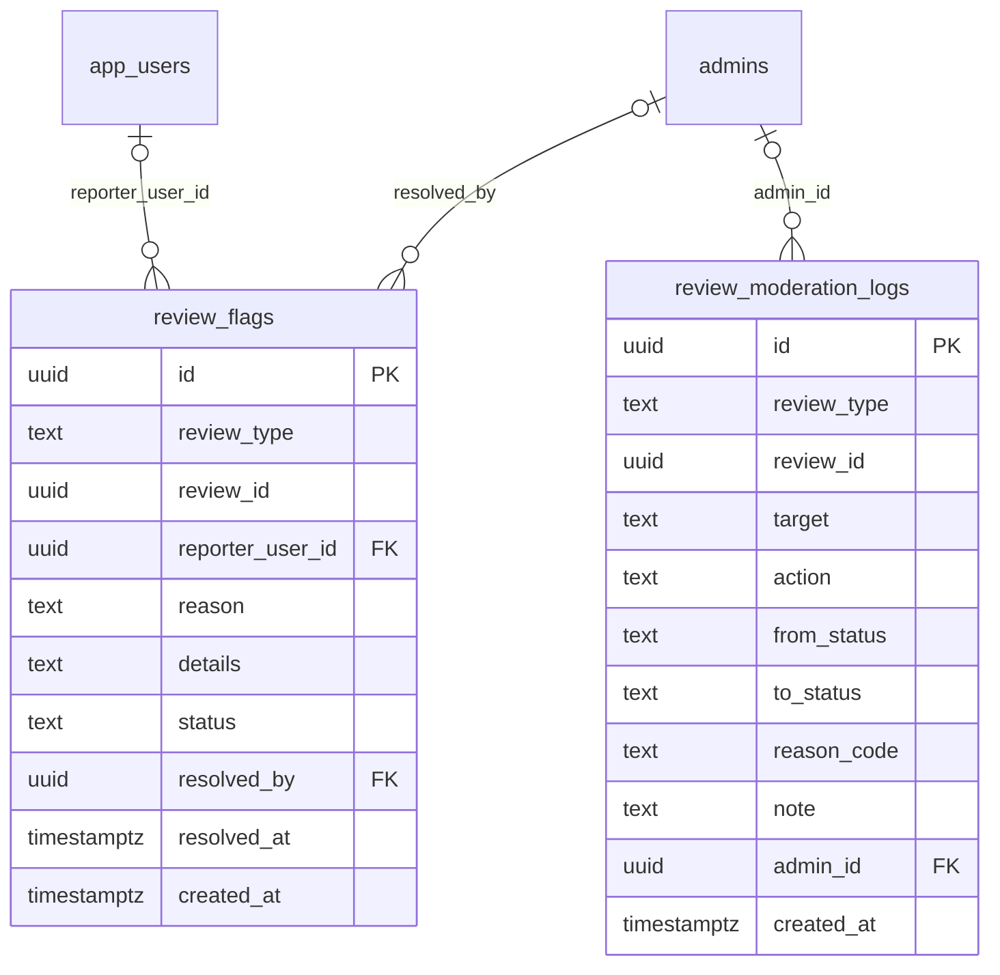

# Module 35 · Review Moderation

> **Phase 9 · Reviews** · **Depends on:** M33, M34 · **Owns tables:** `review_flags`, `review_moderation_logs` · **Reads:** `teacher_reviews`, `institute_reviews` · **Build estimate:** 4 days

## 1. Module Overview

One moderation workspace for teacher and institute reviews and their replies: an approval queue for pending items, a flagged queue (user reports and automated flags), spam detection with scores and reasons, and actions — approve, reject with a reason code, flag, hide, restore. Every decision is logged and updates rating caches and trust scores.

## 2. Business Purpose

Fake, abusive or contact-sharing reviews destroy trust and can move money off-platform. Moderation must be fast (target: pending reviews decided within 24 hours), consistent (reason codes) and explainable (log of every decision).

## 3. User Stories

- As **Support Admin**, I want a queue of pending reviews with spam scores so that I approve clean ones in one click and look closely at risky ones.
- As **Support Admin**, I want to reject a review with a reason the reviewer sees so that they can rewrite it within the rules.
- As **Support Admin**, I want to handle reviews reported by teachers ("this parent never took a class") with the evidence in view.
- As **Super Admin**, I want to see which moderator decided each review so that decisions can be reviewed.

## 4. Functional Requirements & Business Logic

**FR-35.1 Auto-moderation pipeline** (on create/edit, in a job):

| Rule | Flag | Effect |
| --- | --- | --- |
| Phone number, email, UPI id or URL in text | `contact_info` | Spam score +0.6; never auto-publish |
| Same text (≥ 90 % similarity) as another review in 30 days | `repeated_text` | +0.4 |
| ≥ 5 reviews for one teacher within 24 h from accounts < 7 days old | `rating_burst` | +0.4; also raises a trust anomaly (M36) |
| Profanity / slurs (Hindi + English lists) | `abusive_language` | +0.5 |
| Reviewer shares device/IP with the teacher | `self_review` | +0.8 |
| No verified interaction | `unverified` | +0.2 |
Score clipped to 0–1. If score < 0.15 and no flags → `published` automatically (`auto_approved`); ≥ 0.85 → `flagged` (`auto_flagged`); else stays `pending`.

**FR-35.2 Queues.** `GET /review-moderation/queue?type=teacher|institute|all&tab=pending|flagged|replies|reported` — ordered oldest first; each item includes the review, author history (reviews count, rejected count), teacher/institute, flags, open reports.

**FR-35.3 Decisions.** `POST /review-moderation/:reviewType/:reviewId/approve`, `/reject { reasonCode, note }`, `/flag { note }`, `/hide { reasonCode, note }` (published → hidden, e.g., legal request), `/restore { note }` (hidden/rejected → published). Replies: same endpoints with `/reply/approve` and `/reply/reject`. Each decision writes `review_moderation_logs`, updates the review (`moderated_by`, `moderated_at`, `rejection_reason_code`, `published_at` on first publish), recomputes rating caches (M33/M34) and enqueues trust recalculation (teacher reviews).

Reason codes: `CONTACT_DETAILS`, `ABUSIVE`, `NOT_A_TEACHING_EXPERIENCE`, `FAKE_OR_PAID`, `DUPLICATE`, `PERSONAL_INFORMATION`, `LEGAL_REQUEST`, `OTHER`.

**FR-35.4 Reports (flags).** Users and teachers report reviews in the app (`review_flags`, one per reporter per review). Three open reports move a published review to `flagged` (still visible until decided — setting `reviews.hide_when_flagged`, default false). `POST /review-flags/:id/resolve { outcome: upheld|dismissed, note }`; upholding a report on a published review requires choosing hide or reject.

**FR-35.5 Bulk actions.** Select up to 50 items → approve or reject with one reason. Each item is processed and logged individually; the response lists per-item results.

**FR-35.6 Notifications.** Reviewer: published / rejected (with reason text). Teacher/institute: new published review, and reply approved/rejected.

**FR-35.7 Analytics.** `GET /review-moderation/stats?from&to` — volume by status, auto-approval rate, median time to decision, rejections by reason, per-moderator decisions.

## 5. Validation Rules

| Field | Rule |
| --- | --- |
| reviewType | teacher, institute |
| reasonCode | list above; required for reject/hide |
| note | 0–500 chars (shown to reviewer on reject when `shareNote = true`) |
| outcome | upheld, dismissed |
| bulk ids | 1–50 unique ids of the same review type and current status |
| State rules | approve: pending/flagged → published; reject: pending/flagged → rejected; hide: published → hidden; restore: hidden/rejected → published; flag: published/pending → flagged |

## 6. API Endpoints

| Method | Path | Permission | Description |
| --- | --- | --- | --- |
| GET | /review-moderation/queue | reviews.moderate | Pending / flagged / replies / reported queues |
| GET | /review-moderation/stats | reviews.moderate | Moderation analytics |
| POST | /review-moderation/:reviewType/:reviewId/approve | reviews.moderate | Publish |
| POST | /review-moderation/:reviewType/:reviewId/reject | reviews.moderate | Reject with reason |
| POST | /review-moderation/:reviewType/:reviewId/flag | reviews.moderate | Flag for second look |
| POST | /review-moderation/:reviewType/:reviewId/hide | reviews.moderate | Hide a published review |
| POST | /review-moderation/:reviewType/:reviewId/restore | reviews.moderate | Restore |
| POST | /review-moderation/:reviewType/:reviewId/reply/approve | reviews.moderate | Publish a reply |
| POST | /review-moderation/:reviewType/:reviewId/reply/reject | reviews.moderate | Reject a reply |
| POST | /review-moderation/bulk | reviews.moderate | Bulk approve/reject |
| GET | /review-flags | review_flags.resolve | Open reports |
| POST | /review-flags/:id/resolve | review_flags.resolve | Uphold or dismiss a report |

## 7. Request Payloads

```json
// POST /review-moderation/teacher/:reviewId/reject
{ "reasonCode": "CONTACT_DETAILS", "note": "Please remove the phone number and submit again.", "shareNote": true }

// POST /review-moderation/bulk
{ "reviewType": "teacher", "action": "approve", "ids": ["…", "…"] }

// POST /review-flags/:id/resolve
{ "outcome": "upheld", "note": "Reviewer never contacted this teacher", "reviewAction": "reject", "reasonCode": "FAKE_OR_PAID" }
```

## 8. Response Payloads

```json
// 200 GET /review-moderation/queue?tab=pending
{ "data": [ { "reviewType": "teacher", "reviewId": "…", "rating": 5, "comment": "Great teacher!!! Contact me on WhatsApp 98XXXXXX…", "spamScore": 0.93, "autoFlags": ["contact_info","repeated_text"],
  "author": { "displayName": "Arjun P.", "type": "parent", "reviewsWritten": 9, "rejectedBefore": 4 }, "target": { "id": "…", "name": "Rohan Mehta" }, "openReports": 0, "createdAt": "…" } ],
  "meta": { "page": 1, "pageSize": 20, "total": 38, "totalPages": 2 } }

// 200 POST /review-moderation/bulk
{ "data": { "results": [ { "id": "…", "ok": true }, { "id": "…", "ok": false, "error": { "code": "CONFLICT_STATE", "message": "Already published" } } ] } }
```

## 9. PostgreSQL Tables

### `review_flags`

Reports raised against a review by users or teachers.

```sql
CREATE TABLE review_flags (
  id uuid PRIMARY KEY DEFAULT gen_random_uuid(), -- Primary key
  review_type text NOT NULL CHECK (review_type IN ('teacher','institute')), -- Which review table
  review_id uuid NOT NULL, -- teacher_reviews.id or institute_reviews.id (polymorphic; integrity enforced in the service)
  reporter_user_id uuid REFERENCES app_users(id) ON DELETE SET NULL, -- Who reported
  reason text NOT NULL CHECK (reason IN ('fake','abusive','personal_details','off_topic','spam','other')), -- Reason
  details text, -- Optional details
  status text NOT NULL DEFAULT 'open' CHECK (status IN ('open','upheld','dismissed')), -- Outcome
  resolved_by uuid REFERENCES admins(id), -- Moderator
  resolved_at timestamptz, -- When resolved
  created_at timestamptz NOT NULL DEFAULT now() -- Created
);
CREATE UNIQUE INDEX uq_review_flags_reporter ON review_flags (review_type, review_id, reporter_user_id) WHERE reporter_user_id IS NOT NULL;
CREATE INDEX idx_review_flags_open ON review_flags (status, created_at) WHERE status = 'open';
CREATE INDEX idx_review_flags_review ON review_flags (review_type, review_id);
```

### `review_moderation_logs`

Every moderation decision on reviews and replies.

```sql
CREATE TABLE review_moderation_logs (
  id uuid PRIMARY KEY DEFAULT gen_random_uuid(), -- Primary key
  review_type text NOT NULL CHECK (review_type IN ('teacher','institute')), -- Which review table
  review_id uuid NOT NULL, -- Review id
  target text NOT NULL DEFAULT 'review' CHECK (target IN ('review','reply')), -- Review text or the reply
  action text NOT NULL CHECK (action IN ('approved','rejected','flagged','unflagged','hidden','restored','auto_flagged','auto_approved')), -- Decision
  from_status text, -- Before
  to_status text, -- After
  reason_code text, -- e.g. CONTACT_DETAILS
  note text, -- Moderator note
  admin_id uuid REFERENCES admins(id), -- NULL for automated actions
  created_at timestamptz NOT NULL DEFAULT now() -- When
);
CREATE INDEX idx_review_moderation_logs_review ON review_moderation_logs (review_type, review_id, created_at DESC);
```

Migration file: `sql/migrations/035_m35_review_moderation.sql`

## 10. Column Definitions

### `review_flags`

| Column | Type | Null | Default | Constraints / References | Description |
| --- | --- | --- | --- | --- | --- |
| `id` | uuid | no | gen_random_uuid() | PK | Primary key |
| `review_type` | text | no | — | CHECK review_type IN ('teacher','institute') | Which review table |
| `review_id` | uuid | no | — | — | teacher_reviews.id or institute_reviews.id (polymorphic; integrity enforced in the service) |
| `reporter_user_id` | uuid | yes | — | FK → `app_users.id` (on delete set null) | Who reported |
| `reason` | text | no | — | CHECK reason IN ('fake','abusive','personal_details','off_topic','spam','other') | Reason |
| `details` | text | yes | — | — | Optional details |
| `status` | text | no | 'open' | CHECK status IN ('open','upheld','dismissed') | Outcome |
| `resolved_by` | uuid | yes | — | FK → `admins.id` (on delete no action) | Moderator |
| `resolved_at` | timestamptz | yes | — | — | When resolved |
| `created_at` | timestamptz | no | now() | — | Created |

### `review_moderation_logs`

| Column | Type | Null | Default | Constraints / References | Description |
| --- | --- | --- | --- | --- | --- |
| `id` | uuid | no | gen_random_uuid() | PK | Primary key |
| `review_type` | text | no | — | CHECK review_type IN ('teacher','institute') | Which review table |
| `review_id` | uuid | no | — | — | Review id |
| `target` | text | no | 'review' | CHECK target IN ('review','reply') | Review text or the reply |
| `action` | text | no | — | CHECK action IN ('approved','rejected','flagged','unflagged','hidden','restored','auto_flagged','auto_approved') | Decision |
| `from_status` | text | yes | — | — | Before |
| `to_status` | text | yes | — | — | After |
| `reason_code` | text | yes | — | — | e.g. CONTACT_DETAILS |
| `note` | text | yes | — | — | Moderator note |
| `admin_id` | uuid | yes | — | FK → `admins.id` (on delete no action) | NULL for automated actions |
| `created_at` | timestamptz | no | now() | — | When |

## 11. Relationships

**Outgoing foreign keys**

- `review_flags.reporter_user_id` → `app_users.id` — optional, many-to-one, on delete **set null**
- `review_flags.resolved_by` → `admins.id` — optional, many-to-one, on delete **no action**
- `review_moderation_logs.admin_id` → `admins.id` — optional, many-to-one, on delete **no action**

**Entity relationship diagram**



## 12. Indexing Strategy

| Index | Table | Kind | Definition |
| --- | --- | --- | --- |
| `uq_review_flags_reporter` | `review_flags` | unique | `(review_type, review_id, reporter_user_id) WHERE reporter_user_id IS NOT NULL` |
| `idx_review_flags_open` | `review_flags` | btree | `(status, created_at) WHERE status = 'open'` |
| `idx_review_flags_review` | `review_flags` | btree | `(review_type, review_id)` |
| `idx_review_moderation_logs_review` | `review_moderation_logs` | btree | `(review_type, review_id, created_at DESC)` |

Queues use `idx_teacher_reviews_queue` / `idx_institute_reviews_queue`; open reports use partial `idx_review_flags_open`; per-review history uses `idx_review_moderation_logs_review`.

## 13. Permissions

| Permission key | Allows | Sensitive | Super | Ops | Verif. | Finance | Support |
| --- | --- | --- | --- | --- | --- | --- | --- |
| `reviews.moderate` | Approve, reject, hide and restore reviews and replies | — | ✓ | — | — | — | ✓ |
| `review_flags.resolve` | Uphold or dismiss review reports | — | ✓ | — | — | — | ✓ |

## 14. UI Screens & React Page Structure

| Route | Page | Content |
| --- | --- | --- |
| `/reviews/moderation` | ModerationQueuePage | KPI tiles (pending, flagged, spam blocked 30d, avg rating, reply rate); tabs Pending · Flagged · Replies · Reported · Approved · Rejected; review cards with actions; bulk bar |
| `/reviews/moderation/stats` | ModerationStatsPage | Volume chart, reasons, moderator table |

```
src/features/review-moderation/
  pages/ModerationQueuePage.tsx, ModerationStatsPage.tsx
  components/ModerationActions.tsx, RejectReasonSelect.tsx, SpamMeter.tsx, AuthorHistoryPopover.tsx, ReportsPanel.tsx, BulkModerationBar.tsx
```

## 15. UI Components

- `SpamMeter` — score with colour and flag chips (icon + label, not colour alone).
- `ModerationActions` — Approve / Reject (reason select) / Flag / Hide / Restore per state; keyboard shortcuts A/R/F.
- `AuthorHistoryPopover` — reviewer's past reviews and rejection count.
- `ReportsPanel` — reports with reasons and reporters (roles only).

## 16. Filters

Tab, review type, spam score ≥, flag type, rating, role, city, target (teacher/institute picker), date range, moderator (for decided tabs).

## 17. Search Capabilities

Full-text on comment and reply; target name/code.

## 18. Pagination Requirements

Offset, default 20 (queues ordered createdAt ASC); stats not paginated.

## 19. Audit Logs

| Event | Details |
| --- | --- |
| `review.approved` / `.rejected` / `.flagged` / `.hidden` / `.restored` | type, id, reason, note |
| `review.reply_approved` / `.reply_rejected` | reason |
| `review.bulk_moderated` | action, count, ids |
| `review_flag.upheld` / `.dismissed` | flag id, action taken |

## 20. Error Scenarios

| Scenario | HTTP | Code | Message |
| --- | --- | --- | --- |
| Action not allowed from current status | 409 | CONFLICT_STATE | "This review is already {status}." |
| Reject without reason | 422 | VALIDATION_FAILED | "Pick a reason." |
| Bulk with mixed types or > 50 | 422 | VALIDATION_FAILED | "Select up to 50 reviews of one type." |
| Upheld report without follow-up action | 422 | VALIDATION_FAILED | "Choose to hide or reject the review." |
| Review edited by author during moderation | 409 | VERSION_CONFLICT | "The author just edited this review. Reload." |

## 21. Future Scalability Notes & Enhancements

ML spam classifier trained on moderation decisions; moderator workload routing; transparency report of moderation stats.

## 22. Security Considerations

Moderator identity stored on every decision; reviewers never see moderator names; hidden reviews retained for legal holds.
