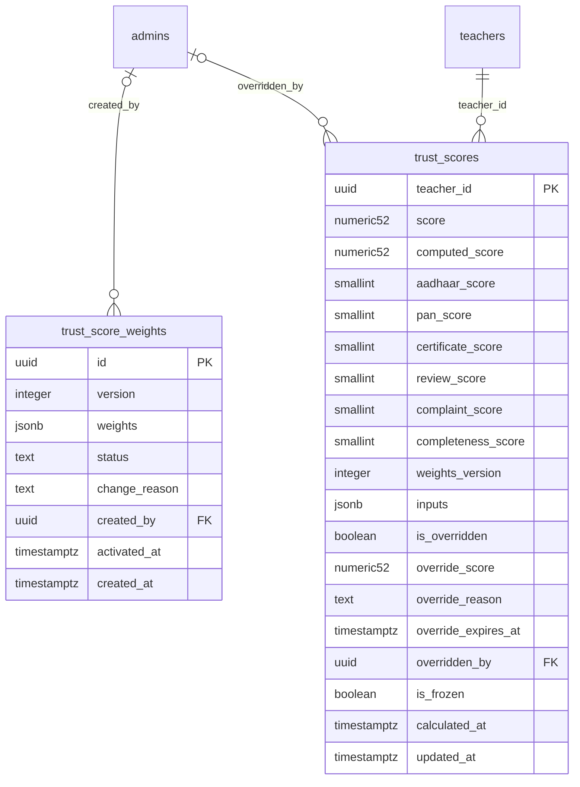

# Module 36 · Teacher Trust Score

> **Phase 10 · Trust Score Engine** · **Depends on:** M16, M17, M33, M35 (complaints factor needs M43; until then it defaults to 100) · **Owns tables:** `trust_score_weights`, `trust_scores` · **Reads:** `teachers`, `teacher_documents`, `teacher_reviews`, `complaints` · **Build estimate:** 4–5 days

## 1. Module Overview

Calculates each teacher's Trust Score (0–100) from six factors — Aadhaar verification, PAN verification, certificate verification, reviews, complaints and profile completeness — using versioned weights. Scores update automatically on relevant events and nightly. Admins can view the breakdown, change weights (new version, full recalculation), freeze a score during an investigation, or override it temporarily with a reason.

## 2. Business Purpose

The trust score is shown prominently on every teacher profile and search card. It must be explainable (every point traceable to a factor), stable (not gamed by a burst of reviews), and controllable (weights tunable without code).

## 3. User Stories

- As **Verification Admin**, I want to see how a teacher's 94 is made up so that I can explain it to them.
- As **Super Admin**, I want to change factor weights and see the effect on the score distribution before activating so that I don't shock the marketplace.
- As **Support Admin**, I want to freeze a teacher's score while a fraud complaint is investigated so that it can't be inflated.
- As **Super Admin**, I want to override a score for 30 days with a reason when data is temporarily wrong.

## 4. Functional Requirements & Business Logic

**FR-36.1 Factors (each 0–100).**

| Factor | Default weight | Calculation |
| --- | --- | --- |
| Aadhaar verification | 20 | current Aadhaar document: approved 100 · submitted 50 · re-upload requested 25 · rejected/missing 0 |
| PAN verification | 10 | same mapping for PAN |
| Certificate verification | 20 | education certificates: ≥ 1 approved = 70, + 15 if ≥ 2 approved, + 15 if a professional certificate is approved (cap 100); none approved but submitted = 30 |
| Reviews | 25 | Bayesian-smoothed rating of published reviews: `R = (C·m + Σr)/(C + n)` with `C = 10`, `m = 4.0`; factor = `round((R − 1) / 4 × 100)`; with 0 reviews factor = 60 |
| Complaints | 15 | `100 − 35 × upheld complaints in the last 12 months − 10 × open high/critical complaints` (min 0) |
| Profile completeness | 10 | `teachers.profile_completeness` (Module 17) |

**FR-36.2 Formula.** `score = Σ(weight_i × factor_i) / Σ(weight_i)`, rounded to 2 decimals; the badge-less cap: teachers without `is_verified_badge` cannot exceed 60. Stored in `trust_scores` with each factor, the weights version and raw `inputs`; cached on `teachers.trust_score`.

**FR-36.3 Triggers.** Recalculate (debounced 60 s per teacher via BullMQ job id `trust:<teacherId>`) on: document decision, review published/removed, complaint resolved/opened high/critical, profile change affecting completeness, badge change. Nightly full recalculation at 02:00 IST for all approved teachers (chunked 1,000 per job). Each change that moves the score by ≥ 0.01 writes a `trust_score_logs` row (Module 37).

**FR-36.4 Freeze.** `POST /trust-scores/:teacherId/freeze { reason }` sets `is_frozen`; recalculations compute but do not publish (logged as `freeze` skips); `unfreeze` publishes the latest computed value.

**FR-36.5 Override.** `POST /trust-scores/:teacherId/override { score, reason, expiresAt }` (≤ 90 days) sets `is_overridden`, `override_score`; `score` shown = override. A job clears expired overrides (`override_expired`). `DELETE /trust-scores/:teacherId/override` removes it early.

**FR-36.6 Weights.** `PUT /trust-weights/draft { weights, reason }` — six non-negative integers summing to 100. `POST /trust-weights/draft/simulate` returns the projected distribution (bands 90+, 80–89, 60–79, <60), mean, and the 20 biggest movers, computed from current factor values (no writes). `POST /trust-weights/draft/activate` activates the version and queues a full recalculation (`weights_changed`).

**FR-36.7 Views.** `GET /trust-scores/:teacherId` (breakdown with factor explanations and inputs), `GET /trust-scores` (list with filters, distribution), `GET /trust-scores/distribution`.

**FR-36.8 Anomalies.** Signals from Module 35 (`rating_burst`, `self_review`) and complaint spikes create anomaly entries shown on the trust page (`GET /trust-scores/anomalies`) with "Freeze" and "Investigate" actions (investigation = create a complaint case in Module 43 with type `fraud`).

## 5. Validation Rules

| Field | Rule |
| --- | --- |
| weights | object with exactly keys aadhaar, pan, certificates, reviews, complaints, profile_completeness; integers 0–60; sum = 100 |
| override.score | 0–100, 2 decimals |
| override.expiresAt | > now, ≤ now + 90 days |
| reason | 10–500 chars (freeze, override, weights) |

## 6. API Endpoints

| Method | Path | Permission | Description |
| --- | --- | --- | --- |
| GET | /trust-scores | trust_scores.read | Teachers with scores and filters |
| GET | /trust-scores/distribution | trust_scores.read | Counts per band, average |
| GET | /trust-scores/anomalies | trust_scores.read | Suspicious activity list |
| GET | /trust-scores/:teacherId | trust_scores.read | Breakdown |
| POST | /trust-scores/:teacherId/recalculate | trust_scores.override | Recalculate now |
| POST | /trust-scores/:teacherId/freeze | trust_scores.override | Freeze |
| POST | /trust-scores/:teacherId/unfreeze | trust_scores.override | Unfreeze |
| POST | /trust-scores/:teacherId/override | trust_scores.override | Temporary override |
| DELETE | /trust-scores/:teacherId/override | trust_scores.override | Remove override |
| GET | /trust-weights | trust_scores.read | Active + draft weights and history |
| PUT | /trust-weights/draft | trust_weights.manage | Save draft weights |
| POST | /trust-weights/draft/simulate | trust_weights.manage | Projected distribution |
| POST | /trust-weights/draft/activate | trust_weights.manage | Activate and recalculate all |

## 7. Request Payloads

```json
// PUT /trust-weights/draft
{ "weights": { "aadhaar": 18, "pan": 8, "certificates": 20, "reviews": 28, "complaints": 16, "profile_completeness": 10 }, "reason": "Give reviews more weight now that volume is higher" }

// POST /trust-scores/:teacherId/override
{ "score": 70, "reason": "Certificate re-verification pending with university; hold at 70", "expiresAt": "2026-10-26T00:00:00Z" }
```

## 8. Response Payloads

```json
// 200 GET /trust-scores/:teacherId
{ "data": { "teacherId": "…", "score": 94.10, "computedScore": 94.10, "band": "excellent", "weightsVersion": 1, "isFrozen": false, "override": null,
  "factors": [ { "key": "aadhaar", "label": "Aadhaar verification", "weight": 20, "value": 100, "points": 20.0, "explanation": "Aadhaar approved on 12 Aug 2026" },
               { "key": "reviews", "label": "Reviews", "weight": 25, "value": 96, "points": 24.0, "explanation": "4.86 smoothed from 312 published reviews" } ],
  "inputs": { "publishedReviews": 312, "avgRating": 4.9, "upheldComplaints12m": 0, "openSevereComplaints": 0, "profileCompleteness": 95 }, "calculatedAt": "…" } }

// 200 POST /trust-weights/draft/simulate
{ "data": { "current": { "mean": 76.4, "bands": { "90+": 1840, "80-89": 3120, "60-79": 4100, "<60": 752 } }, "projected": { "mean": 77.1, "bands": { "90+": 1990, "80-89": 3080, "60-79": 4010, "<60": 732 } },
  "topMovers": [ { "teacherId": "…", "name": "…", "from": 71.2, "to": 76.0 } ] } }
```

## 9. PostgreSQL Tables

### `trust_score_weights`

Versioned factor weights. Exactly one active version; weights must add up to 100.

```sql
CREATE TABLE trust_score_weights (
  id uuid PRIMARY KEY DEFAULT gen_random_uuid(), -- Primary key
  version integer NOT NULL, -- Version number
  weights jsonb NOT NULL, -- {"aadhaar":20,"pan":10,"certificates":20,"reviews":25,"complaints":15,"profile_completeness":10}
  status text NOT NULL DEFAULT 'draft' CHECK (status IN ('draft','active','superseded')), -- Lifecycle
  change_reason text, -- Why weights changed
  created_by uuid REFERENCES admins(id), -- Creator
  activated_at timestamptz, -- When activated
  created_at timestamptz NOT NULL DEFAULT now() -- Created
);
CREATE UNIQUE INDEX uq_trust_score_weights_version ON trust_score_weights (version);
CREATE UNIQUE INDEX uq_trust_score_weights_active ON trust_score_weights (status) WHERE status = 'active';
```

### `trust_scores`

Current trust score per teacher with its factor breakdown.

```sql
CREATE TABLE trust_scores (
  teacher_id uuid PRIMARY KEY REFERENCES teachers(id) ON DELETE CASCADE, -- One row per teacher
  score numeric(5,2) NOT NULL CHECK (score BETWEEN 0 AND 100), -- Final 0–100 score shown to users
  computed_score numeric(5,2) NOT NULL CHECK (computed_score BETWEEN 0 AND 100), -- Score from the formula before any override
  aadhaar_score smallint NOT NULL DEFAULT 0 CHECK (aadhaar_score BETWEEN 0 AND 100), -- Factor 0–100
  pan_score smallint NOT NULL DEFAULT 0 CHECK (pan_score BETWEEN 0 AND 100), -- Factor 0–100
  certificate_score smallint NOT NULL DEFAULT 0 CHECK (certificate_score BETWEEN 0 AND 100), -- Factor 0–100
  review_score smallint NOT NULL DEFAULT 0 CHECK (review_score BETWEEN 0 AND 100), -- Factor 0–100 (Bayesian-smoothed rating)
  complaint_score smallint NOT NULL DEFAULT 100 CHECK (complaint_score BETWEEN 0 AND 100), -- Factor 0–100 (100 = no upheld complaints)
  completeness_score smallint NOT NULL DEFAULT 0 CHECK (completeness_score BETWEEN 0 AND 100), -- Factor 0–100
  weights_version integer NOT NULL, -- trust_score_weights.version used
  inputs jsonb NOT NULL DEFAULT '{}'::jsonb, -- Raw inputs, e.g. {"published_reviews":42,"avg_rating":4.8,"upheld_complaints_12m":0}
  is_overridden boolean NOT NULL DEFAULT false, -- Admin override active
  override_score numeric(5,2) CHECK (override_score BETWEEN 0 AND 100), -- Manual score
  override_reason text, -- Required with an override
  override_expires_at timestamptz, -- Override ends automatically
  overridden_by uuid REFERENCES admins(id), -- Who overrode
  is_frozen boolean NOT NULL DEFAULT false, -- Frozen during an investigation; recalculation is skipped
  calculated_at timestamptz NOT NULL DEFAULT now(), -- Last calculation
  updated_at timestamptz NOT NULL DEFAULT now() -- Updated
);
CREATE INDEX idx_trust_scores_score ON trust_scores (score DESC);
CREATE TRIGGER trg_trust_scores_updated BEFORE UPDATE ON trust_scores FOR EACH ROW EXECUTE FUNCTION set_updated_at();
```

Migration file: `sql/migrations/036_m36_teacher_trust_score.sql`

## 10. Column Definitions

### `trust_score_weights`

| Column | Type | Null | Default | Constraints / References | Description |
| --- | --- | --- | --- | --- | --- |
| `id` | uuid | no | gen_random_uuid() | PK | Primary key |
| `version` | integer | no | — | — | Version number |
| `weights` | jsonb | no | — | — | {"aadhaar":20,"pan":10,"certificates":20,"reviews":25,"complaints":15,"profile_completeness":10} |
| `status` | text | no | 'draft' | CHECK status IN ('draft','active','superseded') | Lifecycle |
| `change_reason` | text | yes | — | — | Why weights changed |
| `created_by` | uuid | yes | — | FK → `admins.id` (on delete no action) | Creator |
| `activated_at` | timestamptz | yes | — | — | When activated |
| `created_at` | timestamptz | no | now() | — | Created |

### `trust_scores`

| Column | Type | Null | Default | Constraints / References | Description |
| --- | --- | --- | --- | --- | --- |
| `teacher_id` | uuid | no | — | PK; FK → `teachers.id` (on delete cascade) | One row per teacher |
| `score` | numeric(5,2) | no | — | CHECK score BETWEEN 0 AND 100 | Final 0–100 score shown to users |
| `computed_score` | numeric(5,2) | no | — | CHECK computed_score BETWEEN 0 AND 100 | Score from the formula before any override |
| `aadhaar_score` | smallint | no | 0 | CHECK aadhaar_score BETWEEN 0 AND 100 | Factor 0–100 |
| `pan_score` | smallint | no | 0 | CHECK pan_score BETWEEN 0 AND 100 | Factor 0–100 |
| `certificate_score` | smallint | no | 0 | CHECK certificate_score BETWEEN 0 AND 100 | Factor 0–100 |
| `review_score` | smallint | no | 0 | CHECK review_score BETWEEN 0 AND 100 | Factor 0–100 (Bayesian-smoothed rating) |
| `complaint_score` | smallint | no | 100 | CHECK complaint_score BETWEEN 0 AND 100 | Factor 0–100 (100 = no upheld complaints) |
| `completeness_score` | smallint | no | 0 | CHECK completeness_score BETWEEN 0 AND 100 | Factor 0–100 |
| `weights_version` | integer | no | — | — | trust_score_weights.version used |
| `inputs` | jsonb | no | '{}'::jsonb | — | Raw inputs, e.g. {"published_reviews":42,"avg_rating":4.8,"upheld_complaints_12m":0} |
| `is_overridden` | boolean | no | false | — | Admin override active |
| `override_score` | numeric(5,2) | yes | — | CHECK override_score BETWEEN 0 AND 100 | Manual score |
| `override_reason` | text | yes | — | — | Required with an override |
| `override_expires_at` | timestamptz | yes | — | — | Override ends automatically |
| `overridden_by` | uuid | yes | — | FK → `admins.id` (on delete no action) | Who overrode |
| `is_frozen` | boolean | no | false | — | Frozen during an investigation; recalculation is skipped |
| `calculated_at` | timestamptz | no | now() | — | Last calculation |
| `updated_at` | timestamptz | no | now() | — | Updated |

## 11. Relationships

**Outgoing foreign keys**

- `trust_score_weights.created_by` → `admins.id` — optional, many-to-one, on delete **no action**
- `trust_scores.teacher_id` → `teachers.id` — required, many-to-one, on delete **cascade**
- `trust_scores.overridden_by` → `admins.id` — optional, many-to-one, on delete **no action**

**Entity relationship diagram**



## 12. Indexing Strategy

| Index | Table | Kind | Definition |
| --- | --- | --- | --- |
| `uq_trust_score_weights_version` | `trust_score_weights` | unique | `(version)` |
| `uq_trust_score_weights_active` | `trust_score_weights` | unique | `(status) WHERE status = 'active'` |
| `idx_trust_scores_score` | `trust_scores` | btree | `(score DESC)` |

`trust_scores` PK on `teacher_id`; `idx_trust_scores_score` for distribution/leaderboards; `uq_trust_score_weights_active` guarantees one active weights version.

## 13. Permissions

| Permission key | Allows | Sensitive | Super | Ops | Verif. | Finance | Support |
| --- | --- | --- | --- | --- | --- | --- | --- |
| `trust_scores.read` | View trust scores and breakdowns | — | ✓ | ✓ | ✓ | — | ✓ |
| `trust_scores.override` | Override, freeze or recalculate a teacher's trust score | yes | ✓ | — | — | — | — |
| `trust_weights.manage` | Change trust score factor weights | yes | ✓ | — | — | — | — |

## 14. UI Screens & React Page Structure

| Route | Page | Content |
| --- | --- | --- |
| `/trust` | TrustScorePage | Teacher list (search) · breakdown panel · weights card with sliders (sum indicator) + simulate + activate · distribution chart · anomalies table |
| `/teachers/:id` → Trust score tab | TrustTab | Breakdown, freeze/override actions, history (M37) |

```
src/features/trust/
  pages/TrustScorePage.tsx
  components/TrustRing.tsx, FactorBreakdown.tsx, WeightsEditor.tsx, SimulationResult.tsx, DistributionChart.tsx, AnomaliesTable.tsx, OverrideDialog.tsx, FreezeDialog.tsx
```

## 15. UI Components

- `FactorBreakdown` — bar per factor (value 0–100) with weight and points; explanation line.
- `WeightsEditor` — six sliders, running total must equal 100 before simulate/activate.
- `SimulationResult` — current vs projected band bars side by side, mean, top movers.
- `TrustRing` — band colours with text label (not colour alone).

## 16. Filters

Band, score range, frozen, overridden, city, category, has anomaly.

## 17. Search Capabilities

Teacher name/code.

## 18. Pagination Requirements

Offset, default 20; sort score (desc default), calculatedAt.

## 19. Audit Logs

| Event | Details |
| --- | --- |
| `trust.recalculated_manually` | teacher |
| `trust.frozen` / `trust.unfrozen` | reason |
| `trust.override_set` / `trust.override_removed` | score, expiry, reason |
| `trust_weights.draft_saved` / `trust_weights.activated` | weights, reason, version |

## 20. Error Scenarios

| Scenario | HTTP | Code | Message |
| --- | --- | --- | --- |
| Weights don't sum to 100 | 422 | VALIDATION_FAILED | "Weights must add up to 100 (now {n})." |
| Activate without simulation in last 30 min | 409 | CONFLICT_STATE | "Run a simulation before activating." |
| Override on a non-approved teacher | 409 | CONFLICT_STATE | "Only approved teachers have a public score." |
| Override expiry > 90 days | 422 | VALIDATION_FAILED | "Overrides can last up to 90 days." |
| Full recalculation already running | 409 | CONFLICT_STATE | "Recalculation in progress ({pct}%)." |

## 21. Future Scalability Notes & Enhancements

Additional factors (response rate, activity, experience) as the brief's longer list — add keys to the weights JSON and columns via migration; per-category weights; ML-based anomaly detection.

## 22. Security Considerations

Weight changes and overrides are sensitive permissions with reasons; every score change is logged (M37) so disputes can be answered with evidence.
