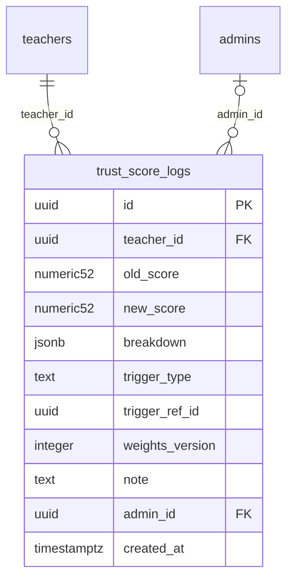

# Module 37 · Trust Score History

> **Phase 10 · Trust Score Engine** · **Depends on:** M36 · **Owns tables:** `trust_score_logs` · **Reads:** `trust_scores`, `teachers` · **Build estimate:** 1–2 days

## 1. Module Overview

An immutable history of every trust score change: old and new score, factor breakdown after the change, what triggered it (document decision, review, complaint, profile update, weights change, override, schedule, freeze) with a link to the cause, and the admin if manual. Shown as a chart and a timeline per teacher, plus a platform-wide change log.

## 2. Business Purpose

When a teacher asks "why did my score drop from 91 to 84?", support must answer with evidence. History also lets admins audit manual overrides and measure the impact of weight changes.

## 3. User Stories

- As **Support Admin**, I want a teacher's score chart with events on it so that I can explain a drop.
- As **Super Admin**, I want to list all manual overrides in the last month so that I can review them.
- As **Verification Admin**, I want to see the biggest score drops this week so that I can check for problems.

## 4. Functional Requirements & Business Logic

**FR-37.1 Writing.** Module 36's `publishScore()` inserts a log row whenever the published score changes by ≥ 0.01 or a manual action happens (freeze, override, etc.), in the same transaction as the `trust_scores` update.

**FR-37.2 Teacher history.** `GET /trust-scores/:teacherId/history?from&to` — series of (date, score) and events with trigger, cause link (review id, complaint case, document), note, admin.

**FR-37.3 Global log.** `GET /trust-score-logs?triggerType&adminId&minDelta&from&to` — cross-teacher list; `minDelta` (absolute change) helps find big movers.

**FR-37.4 Retention.** Logs are kept 36 months; older rows are aggregated to monthly snapshots (`trigger_type = 'scheduled'` kept only at month-end) by a yearly job.

## 5. Validation Rules

from/to dates (≤ 366 days span); triggerType from the CHECK list; minDelta 0–100; adminId UUID.

## 6. API Endpoints

| Method | Path | Permission | Description |
| --- | --- | --- | --- |
| GET | /trust-scores/:teacherId/history | trust_scores.history | Score series and events for a teacher |
| GET | /trust-score-logs | trust_scores.history | Global change log |
| GET | /trust-score-logs/:id | trust_scores.history | One log entry with breakdown |

## 7. Request Payloads

```json
// GET /trust-score-logs?triggerType=manual_override&from=2026-09-01&to=2026-09-30&limit=50
```

## 8. Response Payloads

```json
// 200 GET /trust-scores/:teacherId/history
{ "data": { "series": [ { "at": "2026-09-01T20:30:00Z", "score": 91.2 }, { "at": "2026-09-14T09:12:00Z", "score": 84.0 } ],
  "events": [ { "id": "…", "at": "2026-09-14T09:12:00Z", "from": 91.2, "to": 84.0, "trigger": "complaint_resolved", "cause": { "type": "complaint", "id": "…", "label": "CS-4412 upheld" }, "admin": null } ] } }
```

## 9. PostgreSQL Tables

### `trust_score_logs`

Every change to a teacher's trust score and what caused it.

```sql
CREATE TABLE trust_score_logs (
  id uuid PRIMARY KEY DEFAULT gen_random_uuid(), -- Primary key
  teacher_id uuid NOT NULL REFERENCES teachers(id) ON DELETE CASCADE, -- Teacher
  old_score numeric(5,2), -- Before (NULL for the first calculation)
  new_score numeric(5,2) NOT NULL, -- After
  breakdown jsonb NOT NULL, -- Factor scores after the change
  trigger_type text NOT NULL CHECK (trigger_type IN ('document_decision','review_published','review_removed','complaint_resolved','profile_updated','weights_changed','manual_override','override_expired','override_removed','scheduled','freeze','unfreeze')), -- What caused it
  trigger_ref_id uuid, -- Id of the review / complaint / document that caused it
  weights_version integer NOT NULL, -- Weights used
  note text, -- Reason for manual actions
  admin_id uuid REFERENCES admins(id), -- NULL for automatic recalculation
  created_at timestamptz NOT NULL DEFAULT now() -- When
);
CREATE INDEX idx_trust_score_logs_teacher ON trust_score_logs (teacher_id, created_at DESC);
CREATE INDEX idx_trust_score_logs_trigger ON trust_score_logs (trigger_type, created_at DESC);
```

Migration file: `sql/migrations/037_m37_trust_score_history.sql`

## 10. Column Definitions

### `trust_score_logs`

| Column | Type | Null | Default | Constraints / References | Description |
| --- | --- | --- | --- | --- | --- |
| `id` | uuid | no | gen_random_uuid() | PK | Primary key |
| `teacher_id` | uuid | no | — | FK → `teachers.id` (on delete cascade) | Teacher |
| `old_score` | numeric(5,2) | yes | — | — | Before (NULL for the first calculation) |
| `new_score` | numeric(5,2) | no | — | — | After |
| `breakdown` | jsonb | no | — | — | Factor scores after the change |
| `trigger_type` | text | no | — | CHECK trigger_type IN ('document_decision','review_published','review_removed','complaint_resolved','profile_updated','weights_changed','manual_override','override_expired','override_removed','scheduled','freeze','unfreeze') | What caused it |
| `trigger_ref_id` | uuid | yes | — | — | Id of the review / complaint / document that caused it |
| `weights_version` | integer | no | — | — | Weights used |
| `note` | text | yes | — | — | Reason for manual actions |
| `admin_id` | uuid | yes | — | FK → `admins.id` (on delete no action) | NULL for automatic recalculation |
| `created_at` | timestamptz | no | now() | — | When |

## 11. Relationships

**Outgoing foreign keys**

- `trust_score_logs.teacher_id` → `teachers.id` — required, many-to-one, on delete **cascade**
- `trust_score_logs.admin_id` → `admins.id` — optional, many-to-one, on delete **no action**

**Entity relationship diagram**



## 12. Indexing Strategy

| Index | Table | Kind | Definition |
| --- | --- | --- | --- |
| `idx_trust_score_logs_teacher` | `trust_score_logs` | btree | `(teacher_id, created_at DESC)` |
| `idx_trust_score_logs_trigger` | `trust_score_logs` | btree | `(trigger_type, created_at DESC)` |

`(teacher_id, created_at DESC)` for per-teacher history; `(trigger_type, created_at DESC)` for the global log. Delta filters compute `abs(new_score − old_score)` — add an expression index if used heavily.

## 13. Permissions

| Permission key | Allows | Sensitive | Super | Ops | Verif. | Finance | Support |
| --- | --- | --- | --- | --- | --- | --- | --- |
| `trust_scores.history` | View trust score history | — | ✓ | — | ✓ | — | — |

## 14. UI Screens & React Page Structure

Trust tab on the teacher page (chart + timeline) and `/trust/history` (global log table).
```
src/features/trust/components/ScoreHistoryChart.tsx (line with event markers), ScoreEventTimeline.tsx
src/features/trust/pages/TrustHistoryPage.tsx
```

## 15. UI Components

`ScoreHistoryChart` (single series, markers coloured by trigger with legend), `ScoreEventTimeline`, global log `DataTable`.

## 16. Filters

Trigger type, admin, min delta, date range, teacher.

## 17. Search Capabilities

Teacher name/code in the global log.

## 18. Pagination Requirements

Global log: cursor, 50. Teacher history bounded by date range.

## 19. Audit Logs

This module is itself a log; reading it is not audited.

## 20. Error Scenarios

| Scenario | HTTP | Code | Message |
| --- | --- | --- | --- |
| Range too long | 422 | VALIDATION_FAILED | "Pick up to one year." |
| Teacher not found | 404 | NOT_FOUND | "Teacher not found." |

## 21. Future Scalability Notes & Enhancements

Partition logs by year; expose history to teachers in their app ("Why did my score change?").

## 22. Security Considerations

Insert-only table for the application role (no update/delete grants).
