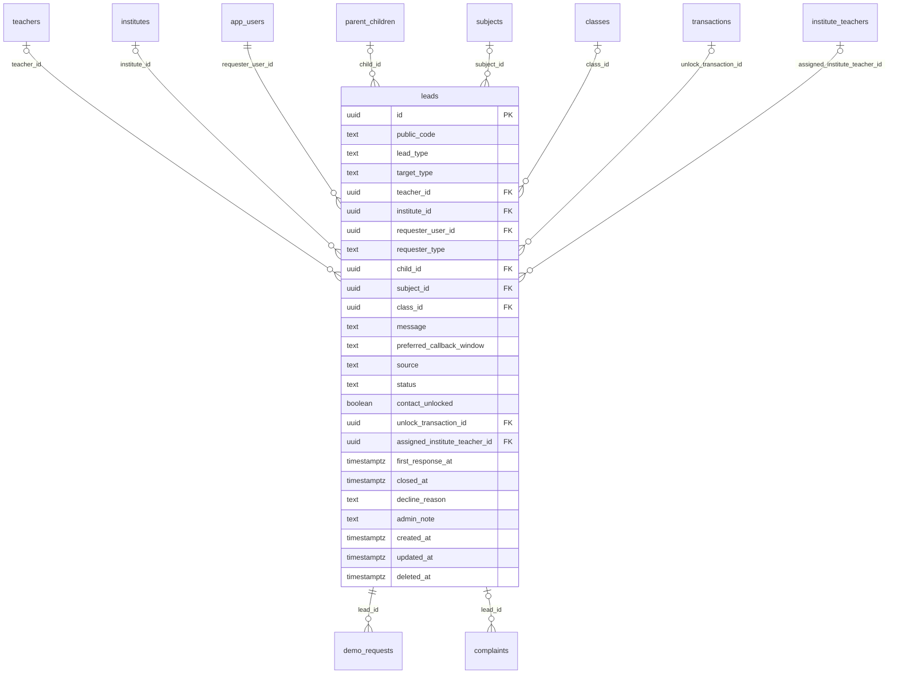

# Module 38 · Lead Management

> **Phase 11 · Leads** · **Depends on:** M16, M22, M26, M28, M29, M31 (M40 adds the unlock-transaction FK) · **Owns tables:** `leads` · **Reads:** `teachers`, `institutes`, `app_users`, `parent_children`, `subjects`, `classes`, `institute_teachers`, `transactions` · **Build estimate:** 3 days

## 1. Module Overview

A lead is an enquiry, call-back request or demo request sent by a parent or student to a teacher or an institute. The mobile API creates leads; this module gives admins a searchable list across the platform, the full detail of a lead with its timeline, the ability to correct status, mark spam and add internal notes, and the response-time metrics that feed teacher analytics (Module 21) and the dashboard (Module 47).

## 2. Business Purpose

Leads are the marketplace's core outcome — a family reaching a teacher. Support needs to trace a lead when a parent says "the teacher never called back", operations needs response-rate and conversion numbers, and trust & safety needs to spot spam and harassment patterns early.

## 3. User Stories

- As **Support Admin**, I want to find a lead by its code or the parent's phone so that I can answer "did my request reach the teacher?".
- As **Operations Admin**, I want to see teachers with many unanswered leads so that I can nudge or de-rank them.
- As **Support Admin**, I want to mark a lead as spam so that it stops counting against the teacher's response rate.
- As **Operations Admin**, I want conversion from lead to demo to enrolment by city so that I can see where the funnel leaks.

## 4. Functional Requirements & Business Logic

**FR-38.1 Lifecycle (set by the mobile API; admins can correct).**

| From | To | Actor | Notes |
| --- | --- | --- | --- |
| — | `new` | requester | `public_code` = `LD-` + 6-digit sequence (`seq_lead_code`); push + SMS to receiver |
| `new` | `viewed` | receiver opens it | first view does **not** set `first_response_at` |
| `new` / `viewed` | `contacted` | receiver taps Call/WhatsApp or replies | sets `first_response_at` |
| `contacted` | `converted` | receiver or requester marks enrolled; or a demo outcome `enrolled` | sets `closed_at` |
| any open | `declined` | receiver, with `decline_reason` | sets `closed_at`, `first_response_at` if null |
| any open | `closed` | system after 30 days without activity, or requester | sets `closed_at` |
| any | `spam` | admin (`leads.manage`) or 3 receiver reports | excluded from metrics; requester gets a strike (5 strikes in 30 days → Module 43 auto-complaint) |

Admins may move a lead to any status except `new`; `spam` → previous status is allowed within 7 days ("Not spam").

**FR-38.2 Limits (enforced by the mobile API, shown here for support).** Requester: max 10 new leads per day, max 1 open lead per (requester, target, subject). Contact unlock: when the `CONTACT_UNLOCK` fee is enabled and the requester has no live subscription, the phone number is shared only after payment (`unlock_transaction_id`).

**FR-38.3 Institute routing.** Institute leads go to the manager; the manager may assign an institute teacher (`assigned_institute_teacher_id`). Response time counts from creation to first manager/teacher action.

**FR-38.4 Metrics (computed, not stored).** Response rate = leads with `first_response_at` within 24 h ÷ non-spam leads in the window; median first response time; conversion rate = `converted` ÷ non-spam leads. Available per teacher/institute/city in `GET /leads/stats`.

**FR-38.5 Detail timeline.** Built from lead columns, the related `demo_requests` row, related complaints, and audit log entries for the lead (admin changes).

**FR-38.6 Admin notes.** `admin_note` is internal, never shown in the app; each change is audited with the previous text.

## 5. Validation Rules

| Field | Rule |
| --- | --- |
| status (PATCH) | one of viewed, contacted, converted, declined, closed, spam; not `new` |
| reason | required 10–300 chars when setting spam, declined or closed by admin |
| adminNote | ≤ 1,000 chars |
| query dates | `from` ≤ `to`, range ≤ 366 days |
| If-Match | required on PATCH |

## 6. API Endpoints

| Method | Path | Permission | Description |
| --- | --- | --- | --- |
| GET | /leads | leads.read | List with filters |
| GET | /leads/stats | leads.read | Funnel and response metrics for the current filters |
| GET | /leads/:id | leads.read | Detail with timeline |
| PATCH | /leads/:id/status | leads.manage | Correct status (If-Match) |
| POST | /leads/:id/spam | leads.manage | Mark as spam |
| POST | /leads/:id/not-spam | leads.manage | Undo spam within 7 days |
| PATCH | /leads/:id/note | leads.manage | Set internal note |
| GET | /teachers/:id/leads | leads.read | Leads for a teacher (tab) |
| GET | /institutes/:id/leads | leads.read | Leads for an institute (tab) |
| GET | /app-users/:userId/leads | leads.read | Leads sent by a user |

## 7. Request Payloads

```json
// GET /leads?status=new&targetType=teacher&cityId=…&from=2026-09-01&to=2026-09-26&unansweredHours=24&page=1&pageSize=20&sort=createdAt:desc

// PATCH /leads/:id/status   (If-Match: "2026-09-26T08:10:00.000Z")
{ "status": "closed", "reason": "Parent confirmed on call that they found a teacher elsewhere" }

// POST /leads/:id/spam
{ "reason": "Same message sent to 40 teachers in 10 minutes" }
```

## 8. Response Payloads

```json
// 200 GET /leads/:id
{ "data": { "id": "…", "publicCode": "LD-240981", "leadType": "demo", "status": "contacted", "source": "recommendation",
  "target": { "type": "teacher", "id": "…", "name": "Dr. Ananya Iyer" },
  "requester": { "userId": "…", "type": "parent", "displayName": "Lakshmi V.", "child": { "id": "…", "name": "Aarav", "class": "Class 12" } },
  "subject": "Physics", "class": "Class 12", "message": "Need help with JEE Mains physics…", "preferredCallbackWindow": "Today 6–8 PM",
  "contactUnlocked": true, "firstResponseAt": "…", "responseMinutes": 42, "demo": { "id": "…", "status": "confirmed", "confirmedStartAt": "…" },
  "timeline": [ { "at": "…", "event": "created" }, { "at": "…", "event": "viewed" }, { "at": "…", "event": "contacted" } ],
  "adminNote": null, "createdAt": "…", "updatedAt": "…" } }

// 200 GET /leads/stats
{ "data": { "total": 18420, "byStatus": { "new": 1210, "viewed": 2240, "contacted": 7310, "converted": 3120, "declined": 1980, "closed": 2360, "spam": 200 },
  "responseRate24hPct": 81.4, "medianFirstResponseMinutes": 96, "conversionRatePct": 17.1, "leadToDemoPct": 38.2 } }
```

## 9. PostgreSQL Tables

### `leads`

Enquiries and call-back requests from parents/students to a teacher or institute.

```sql
CREATE TABLE leads (
  id uuid PRIMARY KEY DEFAULT gen_random_uuid(), -- Primary key
  public_code text NOT NULL DEFAULT ('LD-' || nextval('seq_lead_code')), -- e.g. LD-240981
  lead_type text NOT NULL CHECK (lead_type IN ('inquiry','callback','demo')), -- demo leads also have a demo_requests row
  target_type text NOT NULL CHECK (target_type IN ('teacher','institute')), -- Who receives it
  teacher_id uuid REFERENCES teachers(id) ON DELETE RESTRICT, -- Target teacher
  institute_id uuid REFERENCES institutes(id) ON DELETE RESTRICT, -- Target institute
  requester_user_id uuid NOT NULL REFERENCES app_users(id) ON DELETE RESTRICT, -- Who asked
  requester_type text NOT NULL CHECK (requester_type IN ('parent','student')), -- Requester role
  child_id uuid REFERENCES parent_children(id) ON DELETE SET NULL, -- Child the request is for
  subject_id uuid REFERENCES subjects(id) ON DELETE RESTRICT, -- Subject asked about
  class_id uuid REFERENCES classes(id) ON DELETE RESTRICT, -- Class
  message text, -- Requester message, max 1,000 chars
  preferred_callback_window text, -- e.g. Today 6–8 PM
  source text NOT NULL DEFAULT 'profile' CHECK (source IN ('profile','search','recommendation','featured','compare','institute_page','other')), -- Where it started
  status text NOT NULL DEFAULT 'new' CHECK (status IN ('new','viewed','contacted','converted','declined','closed','spam')), -- Lifecycle
  contact_unlocked boolean NOT NULL DEFAULT false, -- Requester phone shared with the teacher
  unlock_transaction_id uuid, -- Paid contact unlock (FK added in migration 040)
  assigned_institute_teacher_id uuid REFERENCES institute_teachers(id) ON DELETE SET NULL, -- Institute leads: teacher the manager assigned
  first_response_at timestamptz, -- First reply or status change by the receiver (response-rate metric)
  closed_at timestamptz, -- When closed/converted/declined
  decline_reason text, -- Reason given by the teacher
  admin_note text, -- Internal note from support
  created_at timestamptz NOT NULL DEFAULT now(), -- Created
  updated_at timestamptz NOT NULL DEFAULT now(), -- Updated
  deleted_at timestamptz, -- Soft delete
  CONSTRAINT ck_leads_target CHECK ((target_type = 'teacher' AND teacher_id IS NOT NULL AND institute_id IS NULL) OR (target_type = 'institute' AND institute_id IS NOT NULL AND teacher_id IS NULL))
);
CREATE UNIQUE INDEX uq_leads_public_code ON leads (public_code);
CREATE INDEX idx_leads_teacher ON leads (teacher_id, status, created_at DESC) WHERE deleted_at IS NULL;
CREATE INDEX idx_leads_institute ON leads (institute_id, status, created_at DESC) WHERE deleted_at IS NULL;
CREATE INDEX idx_leads_requester ON leads (requester_user_id, created_at DESC);
CREATE INDEX idx_leads_status_created ON leads (status, created_at DESC) WHERE deleted_at IS NULL;
CREATE TRIGGER trg_leads_updated BEFORE UPDATE ON leads FOR EACH ROW EXECUTE FUNCTION set_updated_at();
ALTER TABLE leads ADD CONSTRAINT fk_leads_unlock_txn FOREIGN KEY (unlock_transaction_id) REFERENCES transactions(id) ON DELETE SET NULL;
```

Migration file: `sql/migrations/038_m38_lead_management.sql`

## 10. Column Definitions

### `leads`

| Column | Type | Null | Default | Constraints / References | Description |
| --- | --- | --- | --- | --- | --- |
| `id` | uuid | no | gen_random_uuid() | PK | Primary key |
| `public_code` | text | no | ('LD-' \|\| nextval('seq_lead_code')) | — | e.g. LD-240981 |
| `lead_type` | text | no | — | CHECK lead_type IN ('inquiry','callback','demo') | demo leads also have a demo_requests row |
| `target_type` | text | no | — | CHECK target_type IN ('teacher','institute') | Who receives it |
| `teacher_id` | uuid | yes | — | FK → `teachers.id` (on delete restrict) | Target teacher |
| `institute_id` | uuid | yes | — | FK → `institutes.id` (on delete restrict) | Target institute |
| `requester_user_id` | uuid | no | — | FK → `app_users.id` (on delete restrict) | Who asked |
| `requester_type` | text | no | — | CHECK requester_type IN ('parent','student') | Requester role |
| `child_id` | uuid | yes | — | FK → `parent_children.id` (on delete set null) | Child the request is for |
| `subject_id` | uuid | yes | — | FK → `subjects.id` (on delete restrict) | Subject asked about |
| `class_id` | uuid | yes | — | FK → `classes.id` (on delete restrict) | Class |
| `message` | text | yes | — | — | Requester message, max 1,000 chars |
| `preferred_callback_window` | text | yes | — | — | e.g. Today 6–8 PM |
| `source` | text | no | 'profile' | CHECK source IN ('profile','search','recommendation','featured','compare','institute_page','other') | Where it started |
| `status` | text | no | 'new' | CHECK status IN ('new','viewed','contacted','converted','declined','closed','spam') | Lifecycle |
| `contact_unlocked` | boolean | no | false | — | Requester phone shared with the teacher |
| `unlock_transaction_id` | uuid | yes | — | FK → `transactions.id` (on delete set null), added in migration 040 | Paid contact unlock (FK added in migration 040) |
| `assigned_institute_teacher_id` | uuid | yes | — | FK → `institute_teachers.id` (on delete set null) | Institute leads: teacher the manager assigned |
| `first_response_at` | timestamptz | yes | — | — | First reply or status change by the receiver (response-rate metric) |
| `closed_at` | timestamptz | yes | — | — | When closed/converted/declined |
| `decline_reason` | text | yes | — | — | Reason given by the teacher |
| `admin_note` | text | yes | — | — | Internal note from support |
| `created_at` | timestamptz | no | now() | — | Created |
| `updated_at` | timestamptz | no | now() | — | Updated |
| `deleted_at` | timestamptz | yes | — | — | Soft delete |

**Table constraints:** `CONSTRAINT ck_leads_target CHECK ((target_type = 'teacher' AND teacher_id IS NOT NULL AND institute_id IS NULL) OR (target_type = 'institute' AND institute_id IS NOT NULL AND teacher_id IS NULL))`

## 11. Relationships

**Outgoing foreign keys**

- `leads.teacher_id` → `teachers.id` — optional, many-to-one, on delete **restrict**
- `leads.institute_id` → `institutes.id` — optional, many-to-one, on delete **restrict**
- `leads.requester_user_id` → `app_users.id` — required, many-to-one, on delete **restrict**
- `leads.child_id` → `parent_children.id` — optional, many-to-one, on delete **set null**
- `leads.subject_id` → `subjects.id` — optional, many-to-one, on delete **restrict**
- `leads.class_id` → `classes.id` — optional, many-to-one, on delete **restrict**
- `leads.unlock_transaction_id` → `transactions.id` — optional, many-to-one, on delete **set null**
- `leads.assigned_institute_teacher_id` → `institute_teachers.id` — optional, many-to-one, on delete **set null**

**Referenced by**

- `demo_requests.lead_id` → `leads` (module 39) — on delete **cascade**
- `complaints.lead_id` → `leads` (module 43) — on delete **set null**

**Entity relationship diagram**



## 12. Indexing Strategy

| Index | Table | Kind | Definition |
| --- | --- | --- | --- |
| `uq_leads_public_code` | `leads` | unique | `(public_code)` |
| `idx_leads_teacher` | `leads` | btree | `(teacher_id, status, created_at DESC) WHERE deleted_at IS NULL` |
| `idx_leads_institute` | `leads` | btree | `(institute_id, status, created_at DESC) WHERE deleted_at IS NULL` |
| `idx_leads_requester` | `leads` | btree | `(requester_user_id, created_at DESC)` |
| `idx_leads_status_created` | `leads` | btree | `(status, created_at DESC) WHERE deleted_at IS NULL` |

`idx_leads_teacher` / `idx_leads_institute` serve profile tabs; `idx_leads_status_created` serves the global list; `idx_leads_requester` serves the user's history and rate-limit checks; `uq_leads_public_code` for code search. For the "unanswered > N hours" filter use `WHERE status IN ('new','viewed') AND created_at < now() - interval` on `idx_leads_status_created`.

## 13. Permissions

| Permission key | Allows | Sensitive | Super | Ops | Verif. | Finance | Support |
| --- | --- | --- | --- | --- | --- | --- | --- |
| `leads.read` | View leads | — | ✓ | ✓ | — | — | ✓ |
| `leads.manage` | Change lead status, mark spam, add notes | — | ✓ | ✓ | — | — | ✓ |

## 14. UI Screens & React Page Structure

| Route | Page | Content |
| --- | --- | --- |
| `/leads` | LeadsPage | KPI strip (total, response rate, conversion, median response) · filter bar · table |
| `/leads/:id` | LeadDetailPage | Header (code, status, actions) · requester & target cards · message · timeline · demo card · admin note |
| `/teachers/:id` → Leads tab | TeacherLeadsTab | Same table scoped to teacher + response metrics |

```
src/features/leads/
  pages/LeadsPage.tsx, LeadDetailPage.tsx
  components/LeadsTable.tsx, LeadStatusBadge.tsx, LeadTimeline.tsx, LeadKpis.tsx, SpamDialog.tsx, StatusCorrectionDialog.tsx
  api/leads.api.ts (useLeads, useLead, useLeadStats, useUpdateLeadStatus)
```

## 15. UI Components

- `LeadsTable` — code, created, requester (role tag), target, subject/class, source, status, response time, actions menu.
- `LeadTimeline` — vertical timeline merging lead events, demo events and admin changes.
- `LeadKpis` — four stat cards reacting to the current filters.
- `SpamDialog` — reason textarea; shows the requester's strike count.

## 16. Filters

Status (multi), lead type, target type, city, area, subject, class, source, requester type, contact unlocked, unanswered for more than N hours (6/24/48), date range.

## 17. Search Capabilities

`q` matches `public_code` exactly (prefix `LD-`), requester phone (exact E.164 via `app_users.phone`), requester name and target name (ILIKE prefix).

## 18. Pagination Requirements

Offset, default 20, max 100; sort createdAt (default desc), firstResponseAt, status.

## 19. Audit Logs

| Event | Details |
| --- | --- |
| `lead.status_corrected` | from, to, reason |
| `lead.marked_spam` / `lead.unmarked_spam` | reason, requester strike count |
| `lead.note_updated` | previous and new note |

## 20. Error Scenarios

| Scenario | HTTP | Code | Message |
| --- | --- | --- | --- |
| Lead not found | 404 | NOT_FOUND | "Lead not found." |
| Setting status to `new` | 422 | VALIDATION_FAILED | "A lead can't be moved back to New." |
| Not-spam after 7 days | 409 | CONFLICT_STATE | "Spam can only be undone within 7 days." |
| Stale If-Match | 409 | VERSION_CONFLICT | "This lead was changed by someone else. Reload to see the latest." |

## 21. Future Scalability Notes & Enhancements

Partition `leads` by month once > 20M rows; lead scoring (likelihood to convert); in-app chat between requester and teacher (would add a `lead_messages` table); auto re-routing of unanswered institute leads.

## 22. Security Considerations

Requester phone is shown only with `users.pii`; otherwise masked (`+91 98••• ••210`). Messages may contain personal data — never included in exports without `users.pii`.
