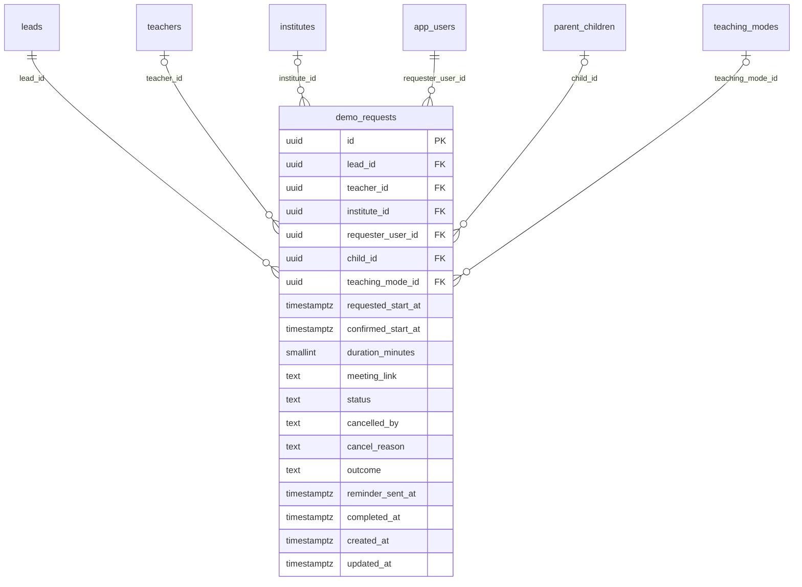

# Module 39 · Demo Class Requests

> **Phase 11 · Leads** · **Depends on:** M38 · **Owns tables:** `demo_requests` · **Reads:** `leads`, `teachers`, `institutes`, `app_users`, `parent_children`, `teaching_modes` · **Build estimate:** 2 days

## 1. Module Overview

Free demo classes booked by parents or students with a teacher (or campus visits with an institute). Every demo has a parent lead of type `demo`. Admins see all demos, their schedule and outcome, can cancel or reschedule on behalf of users when support is asked, and track no-shows that feed teacher analytics and requester strikes.

## 2. Business Purpose

Demos are the strongest conversion step. Support must be able to fix a demo when one side can't use the app, and operations needs no-show and completion rates to protect families' time and teachers' reputations.

## 3. User Stories

- As **Support Admin**, I want to reschedule a demo for a parent who called in so that the booking isn't lost.
- As **Operations Admin**, I want the no-show rate per teacher so that I can act on unreliable teachers.
- As **Operations Admin**, I want the demo → enrolment rate by subject so that marketing knows what converts.

## 4. Functional Requirements & Business Logic

**FR-39.1 Lifecycle.**

| From | To | Actor | Rule |
| --- | --- | --- | --- |
| — | `requested` | requester | slot ≥ 2 h and ≤ 21 days ahead; max 3 open demos per requester |
| `requested` | `confirmed` | teacher / institute | sets `confirmed_start_at`; meeting link required for online mode |
| `requested` / `confirmed` | `reschedule_proposed` | either side / admin | new slot stored as `confirmed_start_at` proposal; other side accepts → `confirmed` |
| `requested` | `expired` | system | not confirmed 1 h before `requested_start_at` |
| `confirmed` | `completed` | either side after start + duration, or admin | sets `completed_at`; prompts outcome and review |
| `confirmed` | `no_show` | either side within 24 h after start, or admin | no-show attributed via `cancelled_by` = the side that didn't attend |
| any open | `cancelled` | either side / admin | `cancelled_by`, `cancel_reason` required |

**FR-39.2 Lead sync.** Demo `completed` with outcome `enrolled` sets the lead to `converted`; `cancelled` / `expired` leave the lead open for follow-up.

**FR-39.3 Reminders.** Job sends a push 1 h before `confirmed_start_at` (sets `reminder_sent_at`) to both sides.

**FR-39.4 Admin actions.** Cancel (reason, notify both sides), reschedule (new slot, notify both; goes to `confirmed` directly when the admin confirms both sides agreed by phone — `confirmedByPhone: true` required), mark completed / no-show (who did not attend).

**FR-39.5 Clash check.** Confirming or rescheduling rejects a slot overlapping another confirmed demo of the same teacher (`idx_demo_requests_teacher_time`).

**FR-39.6 Metrics.** Completion rate, no-show rate (split teacher vs requester), average lead-to-demo time, demo → enrolment rate. Available via `GET /demos/stats`.

## 5. Validation Rules

| Field | Rule |
| --- | --- |
| startAt | ISO datetime, ≥ now + 1 h, ≤ now + 21 days |
| durationMinutes | 15–120 |
| meetingLink | https URL, required when teaching mode is online |
| reason | 10–300 chars for cancel, no-show, admin reschedule |
| noShowParty | `teacher` or `requester` |
| confirmedByPhone | must be true for admin reschedule straight to `confirmed` |

## 6. API Endpoints

| Method | Path | Permission | Description |
| --- | --- | --- | --- |
| GET | /demos | demos.read | List with filters |
| GET | /demos/stats | demos.read | Completion, no-show and conversion metrics |
| GET | /demos/calendar | demos.read | Demos in a date window for the calendar view |
| GET | /demos/:id | demos.read | Detail |
| POST | /demos/:id/cancel | demos.manage | Cancel on behalf of a user |
| POST | /demos/:id/reschedule | demos.manage | Propose or confirm a new slot |
| POST | /demos/:id/complete | demos.manage | Mark completed with outcome |
| POST | /demos/:id/no-show | demos.manage | Mark no-show |

## 7. Request Payloads

```json
// POST /demos/:id/reschedule
{ "startAt": "2026-09-29T12:30:00Z", "durationMinutes": 45, "confirmedByPhone": true, "reason": "Parent called support; teacher agreed on phone" }

// POST /demos/:id/no-show
{ "noShowParty": "teacher", "reason": "Parent waited 20 minutes; teacher unreachable" }
```

## 8. Response Payloads

```json
// 200 GET /demos/:id
{ "data": { "id": "…", "lead": { "id": "…", "publicCode": "LD-240981" }, "status": "confirmed", "teachingMode": "Online",
  "teacher": { "id": "…", "name": "Dr. Ananya Iyer" }, "requester": { "userId": "…", "displayName": "Lakshmi V.", "type": "parent" }, "child": { "name": "Aarav", "class": "Class 12" },
  "requestedStartAt": "…", "confirmedStartAt": "…", "durationMinutes": 45, "meetingLink": "https://meet.google.com/…", "reminderSentAt": null, "outcome": null } }

// 200 GET /demos/stats
{ "data": { "total": 7040, "completedPct": 71.2, "noShowTeacherPct": 3.1, "noShowRequesterPct": 6.4, "cancelledPct": 12.8, "enrolledPct": 41.5, "avgLeadToDemoHours": 30.4 } }
```

## 9. PostgreSQL Tables

### `demo_requests`

Free demo class bookings and their outcome.

```sql
CREATE TABLE demo_requests (
  id uuid PRIMARY KEY DEFAULT gen_random_uuid(), -- Primary key
  lead_id uuid NOT NULL REFERENCES leads(id) ON DELETE CASCADE, -- Parent lead (lead_type = demo)
  teacher_id uuid REFERENCES teachers(id) ON DELETE RESTRICT, -- Teacher giving the demo
  institute_id uuid REFERENCES institutes(id) ON DELETE RESTRICT, -- Institute giving the demo / campus visit
  requester_user_id uuid NOT NULL REFERENCES app_users(id) ON DELETE RESTRICT, -- Learner or parent
  child_id uuid REFERENCES parent_children(id) ON DELETE SET NULL, -- Child attending
  teaching_mode_id uuid REFERENCES teaching_modes(id) ON DELETE RESTRICT, -- Online / home / at teacher's place
  requested_start_at timestamptz NOT NULL, -- Slot the requester picked
  confirmed_start_at timestamptz, -- Slot the teacher confirmed
  duration_minutes smallint NOT NULL DEFAULT 45 CHECK (duration_minutes BETWEEN 15 AND 120), -- Length
  meeting_link text, -- Online class link (https)
  status text NOT NULL DEFAULT 'requested' CHECK (status IN ('requested','confirmed','reschedule_proposed','completed','cancelled','no_show','expired')), -- Lifecycle
  cancelled_by text CHECK (cancelled_by IN ('requester','teacher','institute','admin','system')), -- Who cancelled
  cancel_reason text, -- Why cancelled
  outcome text CHECK (outcome IN ('enrolled','not_enrolled','undecided')), -- Result reported after the demo
  reminder_sent_at timestamptz, -- 1-hour reminder push sent
  completed_at timestamptz, -- Marked completed
  created_at timestamptz NOT NULL DEFAULT now(), -- Created
  updated_at timestamptz NOT NULL DEFAULT now(), -- Updated
  CONSTRAINT ck_demo_requests_target CHECK (teacher_id IS NOT NULL OR institute_id IS NOT NULL)
);
CREATE UNIQUE INDEX uq_demo_requests_lead ON demo_requests (lead_id);
CREATE INDEX idx_demo_requests_teacher_time ON demo_requests (teacher_id, confirmed_start_at) WHERE status IN ('requested','confirmed','reschedule_proposed');
CREATE INDEX idx_demo_requests_status ON demo_requests (status, requested_start_at);
CREATE TRIGGER trg_demo_requests_updated BEFORE UPDATE ON demo_requests FOR EACH ROW EXECUTE FUNCTION set_updated_at();
```

Migration file: `sql/migrations/039_m39_demo_class_requests.sql`

## 10. Column Definitions

### `demo_requests`

| Column | Type | Null | Default | Constraints / References | Description |
| --- | --- | --- | --- | --- | --- |
| `id` | uuid | no | gen_random_uuid() | PK | Primary key |
| `lead_id` | uuid | no | — | FK → `leads.id` (on delete cascade) | Parent lead (lead_type = demo) |
| `teacher_id` | uuid | yes | — | FK → `teachers.id` (on delete restrict) | Teacher giving the demo |
| `institute_id` | uuid | yes | — | FK → `institutes.id` (on delete restrict) | Institute giving the demo / campus visit |
| `requester_user_id` | uuid | no | — | FK → `app_users.id` (on delete restrict) | Learner or parent |
| `child_id` | uuid | yes | — | FK → `parent_children.id` (on delete set null) | Child attending |
| `teaching_mode_id` | uuid | yes | — | FK → `teaching_modes.id` (on delete restrict) | Online / home / at teacher's place |
| `requested_start_at` | timestamptz | no | — | — | Slot the requester picked |
| `confirmed_start_at` | timestamptz | yes | — | — | Slot the teacher confirmed |
| `duration_minutes` | smallint | no | 45 | CHECK duration_minutes BETWEEN 15 AND 120 | Length |
| `meeting_link` | text | yes | — | — | Online class link (https) |
| `status` | text | no | 'requested' | CHECK status IN ('requested','confirmed','reschedule_proposed','completed','cancelled','no_show','expired') | Lifecycle |
| `cancelled_by` | text | yes | — | CHECK cancelled_by IN ('requester','teacher','institute','admin','system') | Who cancelled |
| `cancel_reason` | text | yes | — | — | Why cancelled |
| `outcome` | text | yes | — | CHECK outcome IN ('enrolled','not_enrolled','undecided') | Result reported after the demo |
| `reminder_sent_at` | timestamptz | yes | — | — | 1-hour reminder push sent |
| `completed_at` | timestamptz | yes | — | — | Marked completed |
| `created_at` | timestamptz | no | now() | — | Created |
| `updated_at` | timestamptz | no | now() | — | Updated |

**Table constraints:** `CONSTRAINT ck_demo_requests_target CHECK (teacher_id IS NOT NULL OR institute_id IS NOT NULL)`

## 11. Relationships

**Outgoing foreign keys**

- `demo_requests.lead_id` → `leads.id` — required, many-to-one, on delete **cascade**
- `demo_requests.teacher_id` → `teachers.id` — optional, many-to-one, on delete **restrict**
- `demo_requests.institute_id` → `institutes.id` — optional, many-to-one, on delete **restrict**
- `demo_requests.requester_user_id` → `app_users.id` — required, many-to-one, on delete **restrict**
- `demo_requests.child_id` → `parent_children.id` — optional, many-to-one, on delete **set null**
- `demo_requests.teaching_mode_id` → `teaching_modes.id` — optional, many-to-one, on delete **restrict**

**Entity relationship diagram**



## 12. Indexing Strategy

| Index | Table | Kind | Definition |
| --- | --- | --- | --- |
| `uq_demo_requests_lead` | `demo_requests` | unique | `(lead_id)` |
| `idx_demo_requests_teacher_time` | `demo_requests` | btree | `(teacher_id, confirmed_start_at) WHERE status IN ('requested','confirmed','reschedule_proposed')` |
| `idx_demo_requests_status` | `demo_requests` | btree | `(status, requested_start_at)` |

`uq_demo_requests_lead` (one demo per lead); `idx_demo_requests_teacher_time` partial on open statuses for clash checks and the calendar; `idx_demo_requests_status` for queues and the expiry/reminder jobs.

## 13. Permissions

| Permission key | Allows | Sensitive | Super | Ops | Verif. | Finance | Support |
| --- | --- | --- | --- | --- | --- | --- | --- |
| `demos.read` | View demo class requests | — | ✓ | ✓ | — | — | ✓ |
| `demos.manage` | Cancel or reschedule demos on behalf of users | — | ✓ | ✓ | — | — | ✓ |

## 14. UI Screens & React Page Structure

| Route | Page | Content |
| --- | --- | --- |
| `/demos` | DemosPage | Tabs: List · Calendar (week view) · KPIs strip |
| `/demos/:id` | DemoDetailDrawer | Drawer over the list: parties, slot, link, status actions, lead link |

```
src/features/demos/
  pages/DemosPage.tsx
  components/DemosTable.tsx, DemoCalendar.tsx, DemoDetailDrawer.tsx, RescheduleDialog.tsx, CancelDemoDialog.tsx, NoShowDialog.tsx, CompleteDemoDialog.tsx
```

## 15. UI Components

- `DemoCalendar` — week grid (IST) with coloured blocks by status; click opens the drawer.
- `RescheduleDialog` — date/time picker (IST), duration, "confirmed by phone" checkbox, clash warning inline.
- `NoShowDialog` — radio for who didn't attend + reason.

## 16. Filters

Status, teaching mode, teacher, institute, city, subject, class, outcome, no-show party, date range (requested or confirmed start).

## 17. Search Capabilities

Lead code, teacher name, requester name/phone (phone requires `users.pii`).

## 18. Pagination Requirements

Offset, default 20; sort startAt (default asc for upcoming, desc for past), createdAt. Calendar endpoint is window-based (`from`, `to` ≤ 31 days), not paginated, max 2,000 items.

## 19. Audit Logs

| Event | Details |
| --- | --- |
| `demo.cancelled_by_admin` | reason, notified parties |
| `demo.rescheduled_by_admin` | from, to, confirmedByPhone, reason |
| `demo.completed_by_admin` | outcome |
| `demo.no_show_marked` | party, reason |

## 20. Error Scenarios

| Scenario | HTTP | Code | Message |
| --- | --- | --- | --- |
| Slot clashes with another confirmed demo | 409 | CONFLICT_STATE | "The teacher already has a demo at that time." |
| Slot in the past or > 21 days | 422 | VALIDATION_FAILED | "Pick a time between 1 hour and 21 days from now." |
| Action not allowed in current status | 409 | CONFLICT_STATE | "This demo is {status} and can't be {action}." |
| Online demo without meeting link | 422 | VALIDATION_FAILED | "Add a meeting link for online demos." |

## 21. Future Scalability Notes & Enhancements

Teacher availability calendars with bookable slots; in-app video classes; paid trial classes (new fee code); Google/Outlook calendar sync.

## 22. Security Considerations

Meeting links are visible only to admins with `demos.read`; never logged in audit details. Admin actions notify both parties so users always know when support changed their booking.
