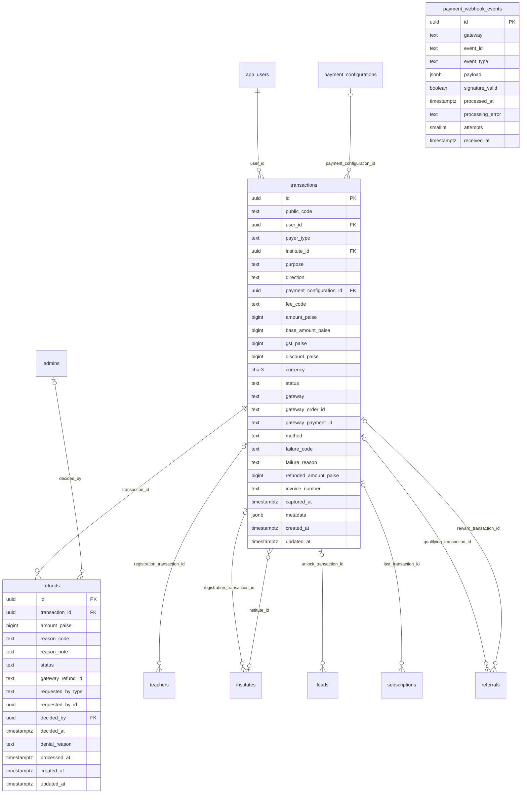

# Module 40 · Transactions

> **Phase 12 · Payments** · **Depends on:** M5, M16, M22 (M41 creates subscription payments) · **Owns tables:** `transactions`, `refunds`, `payment_webhook_events` · **Reads:** `app_users`, `institutes`, `payment_configurations`, `teachers`, `leads`, `subscriptions` · **Build estimate:** 5 days

## 1. Module Overview

The payments ledger. Every Razorpay payment attempt (registrations, subscriptions, premium/featured listings, contact unlocks), every refund and every referral payout is a row in `transactions`. Webhooks are stored raw in `payment_webhook_events` and processed exactly once. Admins can search and inspect transactions, reconcile with Razorpay, download GST invoices, and request/approve/deny refunds.

## 2. Business Purpose

Money must be correct to the paisa and explainable. Finance needs reconciliation and invoices; support needs to answer "I paid but nothing happened"; the business needs refunds to be controlled (maker-checker) and traceable.

## 3. User Stories

- As **Finance Admin**, I want to find a payment by Razorpay payment id so that I can reconcile a bank statement line.
- As **Support Admin**, I want to request a refund for a teacher whose registration was rejected so that finance can approve it.
- As **Finance Admin**, I want to approve refunds created by support, but not my own, so that no one person can move money alone.
- As **Support Admin**, I want to re-sync a payment stuck in `created` so that a user who paid gets access.

## 4. Functional Requirements & Business Logic

**FR-40.1 Payment flow (mobile API, documented for admins).**
1. App calls `POST /app/v1/payments/orders { feeCode, context }`. Server reads the **active** payment configuration for the fee code (Module 5), rejects if disabled, computes `base_amount_paise`, GST 18 % (`gst_paise = round(base × 0.18)`), discounts (referral), creates the Razorpay order with `receipt = public_code`, inserts `transactions` (`created`, `payment_configuration_id`, `fee_code` snapshot).
2. App completes Checkout; server verifies the signature `HMAC_SHA256(order_id|payment_id, key_secret)` and marks `authorized`/`captured`.
3. Webhook `payment.captured` is the source of truth: store in `payment_webhook_events` (`ON CONFLICT (gateway, event_id) DO NOTHING`), verify `X-Razorpay-Signature`, process in a BullMQ job: set `captured`, `captured_at`, `method`, invoice number (`GC/<FY>/<6-digit sequence per FY>`, from sequence `seq_invoice_<fy>` e.g. `seq_invoice_2026_27`, created on first use with `CREATE SEQUENCE IF NOT EXISTS`; gaps are allowed by GST rules only if cancelled numbers are recorded, so numbers are assigned **only on capture**), then fulfil by purpose (activate subscription, mark registration paid, start premium/featured window, unlock lead). Fulfilment is idempotent (checks current state first).
4. `payment.failed` sets `failed` with `failure_code`/`failure_reason`. Orders not captured within 30 min → `cancelled` by job.

**FR-40.2 Refunds (maker-checker).**
- Created by admin (`POST /transactions/:id/refunds`), by the system (e.g. teacher rejected within 7 days of paying → auto request `teacher_rejected`), or by the user via support.
- Amount ≤ `amount_paise − refunded_amount_paise − pending refund amounts`.
- Approval by an admin with `refunds.approve` who is **not** the requester; approval calls Razorpay `POST /payments/:id/refund` with `Idempotency-Key = refund.id`; status `processing`; webhook `refund.processed` → `processed`, updates `refunded_amount_paise` and transaction status (`refunded` if fully, else `partially_refunded`). `refund.failed` → `failed` (can be retried).
- Side effects on full refund: subscription → `cancelled` (reason `refunded`), premium/featured window ended, registration remains but `registration_paid` cleared.
- Deny requires `denialReason` shown to the user.

**FR-40.3 Reconciliation.** `POST /transactions/:id/sync` fetches the payment from Razorpay and applies any missed state (idempotent). Nightly job compares the day's Razorpay settlements report with captured transactions and lists mismatches (`GET /transactions/reconciliation?date=`).

**FR-40.4 Webhook console.** `GET /payment-webhooks` lists events with processing state; `POST /payment-webhooks/:id/retry` re-queues a failed event. Events with `signature_valid = false` are never processed.

**FR-40.5 Invoices.** `GET /transactions/:id/invoice` returns a presigned URL to a PDF generated on capture (GSTIN, HSN/SAC 999293, place of supply from user state). Credit notes are generated for processed refunds.

**FR-40.6 Manual transactions.** Offline payments (bank transfer from institutes) can be recorded with `gateway = manual`, `method = manual`, a reference and a proof file; requires `refunds.approve` (finance) and a second admin's confirmation before fulfilment.

## 5. Validation Rules

| Field | Rule |
| --- | --- |
| refund.amountPaise | integer > 0, ≤ refundable amount |
| refund.reasonCode | one of the table's reason codes |
| refund.reasonNote | 10–500 chars; required for `goodwill` and `other` |
| deny.denialReason | 10–300 chars |
| manual.referenceNumber | 6–40 chars, unique per manual transaction |
| query amountMin/amountMax | integers in paise, min ≤ max |
| Idempotency-Key | required on refund create and manual transaction create |

## 6. API Endpoints

| Method | Path | Permission | Description |
| --- | --- | --- | --- |
| GET | /transactions | transactions.read | List with filters and totals |
| GET | /transactions/:id | transactions.read | Detail with refunds, webhooks and fulfilment |
| GET | /transactions/:id/invoice | transactions.read | Presigned invoice URL |
| POST | /transactions/:id/sync | transactions.read | Re-fetch from Razorpay and apply state |
| GET | /transactions/reconciliation | transactions.read | Settlement mismatches for a date |
| POST | /transactions/manual | refunds.approve | Record an offline payment (needs second-admin confirmation) |
| POST | /transactions/:id/confirm-manual | refunds.approve | Second admin confirms a manual payment |
| GET | /refunds | transactions.read | Refund queue |
| POST | /transactions/:id/refunds | transactions.read | Request a refund (maker) |
| POST | /refunds/:id/approve | refunds.approve | Approve and send to Razorpay (checker) |
| POST | /refunds/:id/deny | refunds.approve | Deny with reason |
| POST | /refunds/:id/retry | refunds.approve | Retry a failed refund |
| GET | /payment-webhooks | transactions.read | Webhook events |
| POST | /payment-webhooks/:id/retry | refunds.approve | Re-process a failed event |
| POST | /webhooks/razorpay | public (signature) | Razorpay webhook receiver (outside /admin; `express.raw()` body) |

## 7. Request Payloads

```json
// GET /transactions?purpose=subscription&status=captured&from=2026-09-01&to=2026-09-26&method=upi&q=pay_OZ…&page=1&pageSize=50

// POST /transactions/:id/refunds   (Idempotency-Key: 7f1c…)
{ "amountPaise": 49900, "reasonCode": "teacher_rejected", "reasonNote": "Registration rejected on 24 Sep — documents could not be verified" }

// POST /refunds/:id/deny
{ "denialReason": "Subscription used for 4 months; outside the 7-day refund window" }
```

## 8. Response Payloads

```json
// 200 GET /transactions/:id
{ "data": { "id": "…", "publicCode": "TXN-7702137", "user": { "id": "…", "name": "Meera Nair", "type": "teacher" }, "purpose": "teacher_registration",
  "feeCode": "TEACHER_REGISTRATION", "priceVersion": 1, "amountPaise": 58882, "baseAmountPaise": 49900, "gstPaise": 8982, "discountPaise": 0,
  "status": "captured", "method": "upi", "gateway": { "orderId": "order_OZ…", "paymentId": "pay_OZ…" }, "invoiceNumber": "GC/2026-27/000412",
  "refundedAmountPaise": 0, "refundableAmountPaise": 58882, "capturedAt": "…",
  "fulfilment": { "type": "teacher_registration", "state": "done", "teacherId": "…" },
  "refunds": [], "webhooks": [ { "eventType": "payment.captured", "receivedAt": "…", "processedAt": "…" } ] } }

// 200 GET /transactions (meta carries totals for the filter)
{ "data": [ … ], "meta": { "page": 1, "pageSize": 50, "total": 1284, "totals": { "grossPaise": 61234500, "refundedPaise": 1203400, "netPaise": 60031100 } } }

// 201 POST /transactions/:id/refunds
{ "data": { "id": "…", "status": "requested", "amountPaise": 49900, "requestedBy": { "type": "admin", "id": "…" } } }
```

## 9. PostgreSQL Tables

### `transactions`

Every payment attempt through Razorpay, plus refunds and reward payouts. Amounts in paise.

```sql
CREATE TABLE transactions (
  id uuid PRIMARY KEY DEFAULT gen_random_uuid(), -- Primary key
  public_code text NOT NULL DEFAULT ('TXN-' || nextval('seq_transaction_code')), -- e.g. TXN-7702137 (shown to users and support)
  user_id uuid NOT NULL REFERENCES app_users(id) ON DELETE RESTRICT, -- Payer or payee
  payer_type text NOT NULL CHECK (payer_type IN ('parent','student','teacher','institute')), -- Payer role
  institute_id uuid REFERENCES institutes(id) ON DELETE RESTRICT, -- Set for institute payments
  purpose text NOT NULL CHECK (purpose IN ('teacher_registration','institute_registration','subscription','premium_listing','featured_listing','contact_unlock','referral_payout')), -- What was bought / paid out
  direction text NOT NULL DEFAULT 'credit' CHECK (direction IN ('credit','debit')), -- credit = money in to GuruConnect; debit = payout
  payment_configuration_id uuid REFERENCES payment_configurations(id) ON DELETE RESTRICT, -- Price version charged (NULL for payouts)
  fee_code text, -- Snapshot of fee_code
  amount_paise bigint NOT NULL CHECK (amount_paise >= 0), -- Total charged incl. GST
  base_amount_paise bigint NOT NULL CHECK (base_amount_paise >= 0), -- Amount before GST
  gst_paise bigint NOT NULL DEFAULT 0 CHECK (gst_paise >= 0), -- GST component
  discount_paise bigint NOT NULL DEFAULT 0 CHECK (discount_paise >= 0), -- Referral / promo discount applied
  currency char(3) NOT NULL DEFAULT 'INR', -- Currency
  status text NOT NULL DEFAULT 'created' CHECK (status IN ('created','authorized','captured','failed','refund_pending','refunded','partially_refunded','cancelled')), -- Lifecycle
  gateway text NOT NULL DEFAULT 'razorpay' CHECK (gateway IN ('razorpay','manual','wallet')), -- Processor
  gateway_order_id text, -- Razorpay order_xxx
  gateway_payment_id text, -- Razorpay pay_xxx
  method text CHECK (method IN ('upi','card','netbanking','wallet','emi','manual')), -- Payment method
  failure_code text, -- Gateway error code
  failure_reason text, -- Gateway error description
  refunded_amount_paise bigint NOT NULL DEFAULT 0 CHECK (refunded_amount_paise >= 0), -- Total refunded
  invoice_number text, -- GST invoice number, e.g. GC/2026-27/000412
  captured_at timestamptz, -- When money was captured
  metadata jsonb NOT NULL DEFAULT '{}'::jsonb, -- Extra context, e.g. {"subscription_id":"…","lead_id":"…"}
  created_at timestamptz NOT NULL DEFAULT now(), -- Created
  updated_at timestamptz NOT NULL DEFAULT now(), -- Updated
  CONSTRAINT ck_transactions_refund CHECK (refunded_amount_paise <= amount_paise)
);
CREATE UNIQUE INDEX uq_transactions_public_code ON transactions (public_code);
CREATE UNIQUE INDEX uq_transactions_gateway_order ON transactions (gateway_order_id) WHERE gateway_order_id IS NOT NULL;
CREATE UNIQUE INDEX uq_transactions_gateway_payment ON transactions (gateway_payment_id) WHERE gateway_payment_id IS NOT NULL;
CREATE UNIQUE INDEX uq_transactions_invoice ON transactions (invoice_number) WHERE invoice_number IS NOT NULL;
CREATE INDEX idx_transactions_user ON transactions (user_id, created_at DESC);
CREATE INDEX idx_transactions_status_created ON transactions (status, created_at DESC);
CREATE INDEX idx_transactions_purpose_captured ON transactions (purpose, captured_at) WHERE status IN ('captured','partially_refunded','refunded');
CREATE TRIGGER trg_transactions_updated BEFORE UPDATE ON transactions FOR EACH ROW EXECUTE FUNCTION set_updated_at();
```

### `refunds`

Refund requests and their gateway processing.

```sql
CREATE TABLE refunds (
  id uuid PRIMARY KEY DEFAULT gen_random_uuid(), -- Primary key
  transaction_id uuid NOT NULL REFERENCES transactions(id) ON DELETE RESTRICT, -- Original payment
  amount_paise bigint NOT NULL CHECK (amount_paise > 0), -- Amount to refund
  reason_code text NOT NULL CHECK (reason_code IN ('teacher_rejected','institute_rejected','duplicate_charge','service_not_started','user_request','goodwill','other')), -- Why
  reason_note text, -- Details
  status text NOT NULL DEFAULT 'requested' CHECK (status IN ('requested','approved','processing','processed','denied','failed')), -- Lifecycle
  gateway_refund_id text, -- Razorpay rfnd_xxx
  requested_by_type text NOT NULL CHECK (requested_by_type IN ('app_user','admin','system')), -- Who asked
  requested_by_id uuid, -- Requester id
  decided_by uuid REFERENCES admins(id), -- Approver / denier
  decided_at timestamptz, -- Decision time
  denial_reason text, -- Shown to the user
  processed_at timestamptz, -- Gateway confirmed
  created_at timestamptz NOT NULL DEFAULT now(), -- Created
  updated_at timestamptz NOT NULL DEFAULT now() -- Updated
);
CREATE UNIQUE INDEX uq_refunds_gateway ON refunds (gateway_refund_id) WHERE gateway_refund_id IS NOT NULL;
CREATE INDEX idx_refunds_status ON refunds (status, created_at);
CREATE INDEX idx_refunds_transaction ON refunds (transaction_id);
CREATE TRIGGER trg_refunds_updated BEFORE UPDATE ON refunds FOR EACH ROW EXECUTE FUNCTION set_updated_at();
```

### `payment_webhook_events`

Raw Razorpay webhooks, stored before processing so every event is processed exactly once.

```sql
CREATE TABLE payment_webhook_events (
  id uuid PRIMARY KEY DEFAULT gen_random_uuid(), -- Primary key
  gateway text NOT NULL DEFAULT 'razorpay', -- Source
  event_id text NOT NULL, -- Gateway event id (x-razorpay-event-id)
  event_type text NOT NULL, -- e.g. payment.captured, refund.processed
  payload jsonb NOT NULL, -- Full body
  signature_valid boolean NOT NULL, -- HMAC check result
  processed_at timestamptz, -- NULL until processed
  processing_error text, -- Last error
  attempts smallint NOT NULL DEFAULT 0, -- Processing attempts
  received_at timestamptz NOT NULL DEFAULT now() -- Received
);
CREATE UNIQUE INDEX uq_payment_webhook_events ON payment_webhook_events (gateway, event_id);
CREATE INDEX idx_payment_webhook_unprocessed ON payment_webhook_events (received_at) WHERE processed_at IS NULL;
```

Migration file: `sql/migrations/040_m40_transactions.sql`

## 10. Column Definitions

### `transactions`

| Column | Type | Null | Default | Constraints / References | Description |
| --- | --- | --- | --- | --- | --- |
| `id` | uuid | no | gen_random_uuid() | PK | Primary key |
| `public_code` | text | no | ('TXN-' \|\| nextval('seq_transaction_code')) | — | e.g. TXN-7702137 (shown to users and support) |
| `user_id` | uuid | no | — | FK → `app_users.id` (on delete restrict) | Payer or payee |
| `payer_type` | text | no | — | CHECK payer_type IN ('parent','student','teacher','institute') | Payer role |
| `institute_id` | uuid | yes | — | FK → `institutes.id` (on delete restrict) | Set for institute payments |
| `purpose` | text | no | — | CHECK purpose IN ('teacher_registration','institute_registration','subscription','premium_listing','featured_listing','contact_unlock','referral_payout') | What was bought / paid out |
| `direction` | text | no | 'credit' | CHECK direction IN ('credit','debit') | credit = money in to GuruConnect; debit = payout |
| `payment_configuration_id` | uuid | yes | — | FK → `payment_configurations.id` (on delete restrict) | Price version charged (NULL for payouts) |
| `fee_code` | text | yes | — | — | Snapshot of fee_code |
| `amount_paise` | bigint | no | — | CHECK amount_paise >= 0 | Total charged incl. GST |
| `base_amount_paise` | bigint | no | — | CHECK base_amount_paise >= 0 | Amount before GST |
| `gst_paise` | bigint | no | 0 | CHECK gst_paise >= 0 | GST component |
| `discount_paise` | bigint | no | 0 | CHECK discount_paise >= 0 | Referral / promo discount applied |
| `currency` | char(3) | no | 'INR' | — | Currency |
| `status` | text | no | 'created' | CHECK status IN ('created','authorized','captured','failed','refund_pending','refunded','partially_refunded','cancelled') | Lifecycle |
| `gateway` | text | no | 'razorpay' | CHECK gateway IN ('razorpay','manual','wallet') | Processor |
| `gateway_order_id` | text | yes | — | — | Razorpay order_xxx |
| `gateway_payment_id` | text | yes | — | — | Razorpay pay_xxx |
| `method` | text | yes | — | CHECK method IN ('upi','card','netbanking','wallet','emi','manual') | Payment method |
| `failure_code` | text | yes | — | — | Gateway error code |
| `failure_reason` | text | yes | — | — | Gateway error description |
| `refunded_amount_paise` | bigint | no | 0 | CHECK refunded_amount_paise >= 0 | Total refunded |
| `invoice_number` | text | yes | — | — | GST invoice number, e.g. GC/2026-27/000412 |
| `captured_at` | timestamptz | yes | — | — | When money was captured |
| `metadata` | jsonb | no | '{}'::jsonb | — | Extra context, e.g. {"subscription_id":"…","lead_id":"…"} |
| `created_at` | timestamptz | no | now() | — | Created |
| `updated_at` | timestamptz | no | now() | — | Updated |

**Table constraints:** `CONSTRAINT ck_transactions_refund CHECK (refunded_amount_paise <= amount_paise)`

### `refunds`

| Column | Type | Null | Default | Constraints / References | Description |
| --- | --- | --- | --- | --- | --- |
| `id` | uuid | no | gen_random_uuid() | PK | Primary key |
| `transaction_id` | uuid | no | — | FK → `transactions.id` (on delete restrict) | Original payment |
| `amount_paise` | bigint | no | — | CHECK amount_paise > 0 | Amount to refund |
| `reason_code` | text | no | — | CHECK reason_code IN ('teacher_rejected','institute_rejected','duplicate_charge','service_not_started','user_request','goodwill','other') | Why |
| `reason_note` | text | yes | — | — | Details |
| `status` | text | no | 'requested' | CHECK status IN ('requested','approved','processing','processed','denied','failed') | Lifecycle |
| `gateway_refund_id` | text | yes | — | — | Razorpay rfnd_xxx |
| `requested_by_type` | text | no | — | CHECK requested_by_type IN ('app_user','admin','system') | Who asked |
| `requested_by_id` | uuid | yes | — | — | Requester id |
| `decided_by` | uuid | yes | — | FK → `admins.id` (on delete no action) | Approver / denier |
| `decided_at` | timestamptz | yes | — | — | Decision time |
| `denial_reason` | text | yes | — | — | Shown to the user |
| `processed_at` | timestamptz | yes | — | — | Gateway confirmed |
| `created_at` | timestamptz | no | now() | — | Created |
| `updated_at` | timestamptz | no | now() | — | Updated |

### `payment_webhook_events`

| Column | Type | Null | Default | Constraints / References | Description |
| --- | --- | --- | --- | --- | --- |
| `id` | uuid | no | gen_random_uuid() | PK | Primary key |
| `gateway` | text | no | 'razorpay' | — | Source |
| `event_id` | text | no | — | — | Gateway event id (x-razorpay-event-id) |
| `event_type` | text | no | — | — | e.g. payment.captured, refund.processed |
| `payload` | jsonb | no | — | — | Full body |
| `signature_valid` | boolean | no | — | — | HMAC check result |
| `processed_at` | timestamptz | yes | — | — | NULL until processed |
| `processing_error` | text | yes | — | — | Last error |
| `attempts` | smallint | no | 0 | — | Processing attempts |
| `received_at` | timestamptz | no | now() | — | Received |

## 11. Relationships

**Outgoing foreign keys**

- `transactions.user_id` → `app_users.id` — required, many-to-one, on delete **restrict**
- `transactions.institute_id` → `institutes.id` — optional, many-to-one, on delete **restrict**
- `transactions.payment_configuration_id` → `payment_configurations.id` — optional, many-to-one, on delete **restrict**
- `refunds.transaction_id` → `transactions.id` — required, many-to-one, on delete **restrict**
- `refunds.decided_by` → `admins.id` — optional, many-to-one, on delete **no action**

**Referenced by**

- `teachers.registration_transaction_id` → `transactions` (module 16) — on delete **set null**
- `institutes.registration_transaction_id` → `transactions` (module 22) — on delete **set null**
- `leads.unlock_transaction_id` → `transactions` (module 38) — on delete **set null**
- `subscriptions.last_transaction_id` → `transactions` (module 41) — on delete **set null**
- `referrals.qualifying_transaction_id` → `transactions` (module 42) — on delete **set null**
- `referrals.reward_transaction_id` → `transactions` (module 42) — on delete **set null**

**Entity relationship diagram**



## 12. Indexing Strategy

| Index | Table | Kind | Definition |
| --- | --- | --- | --- |
| `uq_transactions_public_code` | `transactions` | unique | `(public_code)` |
| `uq_transactions_gateway_order` | `transactions` | unique | `(gateway_order_id) WHERE gateway_order_id IS NOT NULL` |
| `uq_transactions_gateway_payment` | `transactions` | unique | `(gateway_payment_id) WHERE gateway_payment_id IS NOT NULL` |
| `uq_transactions_invoice` | `transactions` | unique | `(invoice_number) WHERE invoice_number IS NOT NULL` |
| `idx_transactions_user` | `transactions` | btree | `(user_id, created_at DESC)` |
| `idx_transactions_status_created` | `transactions` | btree | `(status, created_at DESC)` |
| `idx_transactions_purpose_captured` | `transactions` | btree | `(purpose, captured_at) WHERE status IN ('captured','partially_refunded','refunded')` |
| `uq_refunds_gateway` | `refunds` | unique | `(gateway_refund_id) WHERE gateway_refund_id IS NOT NULL` |
| `idx_refunds_status` | `refunds` | btree | `(status, created_at)` |
| `idx_refunds_transaction` | `refunds` | btree | `(transaction_id)` |
| `uq_payment_webhook_events` | `payment_webhook_events` | unique | `(gateway, event_id)` |
| `idx_payment_webhook_unprocessed` | `payment_webhook_events` | btree | `(received_at) WHERE processed_at IS NULL` |

Unique partial indexes on `gateway_order_id`, `gateway_payment_id`, `invoice_number` make webhook processing idempotent and lookups O(log n). `idx_transactions_purpose_captured` serves revenue reports; `idx_transactions_status_created` the list; `idx_payment_webhook_unprocessed` the retry job; `uq_payment_webhook_events (gateway, event_id)` deduplicates deliveries.

## 13. Permissions

| Permission key | Allows | Sensitive | Super | Ops | Verif. | Finance | Support |
| --- | --- | --- | --- | --- | --- | --- | --- |
| `transactions.read` | View transactions and refunds | — | ✓ | — | — | ✓ | ✓ |
| `refunds.approve` | Approve or deny refunds | yes | ✓ | — | — | ✓ | — |

## 14. UI Screens & React Page Structure

| Route | Page | Content |
| --- | --- | --- |
| `/payments/transactions` | TransactionsPage | Totals strip (gross, refunded, net) · filters · table · export |
| `/payments/transactions/:id` | TransactionDetailPage | Amount breakdown · gateway ids (copy) · fulfilment state · refunds · webhooks · actions (Sync, Invoice, Request refund) |
| `/payments/refunds` | RefundsPage | Tabs Requested / Processing / Processed / Denied / Failed · approve/deny |
| `/payments/reconciliation` | ReconciliationPage | Date picker · mismatch table |
| `/payments/webhooks` | WebhooksPage | Event list with state and retry |

```
src/features/payments/
  pages/TransactionsPage.tsx, TransactionDetailPage.tsx, RefundsPage.tsx, ReconciliationPage.tsx, WebhooksPage.tsx
  components/AmountBreakdown.tsx, MoneyCell.tsx, TxnStatusBadge.tsx, RefundRequestDialog.tsx, RefundDecisionDialog.tsx, GatewayIds.tsx, ManualPaymentDialog.tsx
  lib/money.ts (formatINR(paise) → "₹499.00", never floats)
```

## 15. UI Components

- `MoneyCell` — right-aligned tabular numerals, formats paise as ₹ with Indian grouping (₹1,23,456.00).
- `AmountBreakdown` — base, GST, discount, total, refunded, refundable.
- `RefundDecisionDialog` — shows requester and reason; approve button disabled with tooltip when the viewer is the requester.
- `GatewayIds` — order/payment/refund ids with copy buttons and link to the Razorpay dashboard.

## 16. Filters

Status, purpose, fee code, payer type, method, gateway, city, amount range, captured date range, has refund, invoice present.

## 17. Search Capabilities

`q` matches public code (`TXN-`), Razorpay order/payment id (`order_`, `pay_`), invoice number, payer phone/email (exact).

## 18. Pagination Requirements

Offset, default 20, max 100 (50 on the ledger view); sort createdAt (default desc), capturedAt, amount. Webhook list uses cursor pagination on `received_at`.

## 19. Audit Logs

| Event | Details |
| --- | --- |
| `transaction.synced` | before/after status |
| `transaction.manual_recorded` / `transaction.manual_confirmed` | amount, reference, proof file |
| `refund.requested` | amount, reason |
| `refund.approved` / `refund.denied` | amount, reason; approver ≠ requester |
| `refund.retried` | attempt |
| `payment_webhook.retried` | event id |

## 20. Error Scenarios

| Scenario | HTTP | Code | Message |
| --- | --- | --- | --- |
| Refund amount above refundable | 422 | VALIDATION_FAILED | "You can refund up to ₹{amount}." |
| Refund on a non-captured transaction | 409 | CONFLICT_STATE | "Only captured payments can be refunded." |
| Approver is the requester | 403 | FORBIDDEN | "Another admin must approve this refund." |
| Razorpay error on refund | 502 | GATEWAY_ERROR | "Razorpay declined the refund: {reason}." (status stays `approved`, retry available) |
| Duplicate Idempotency-Key with different body | 422 | IDEMPOTENCY_MISMATCH | "This request key was already used with different data." |
| Webhook with invalid signature | 400 | INVALID_SIGNATURE | (receiver only; stored and alerted) |

## 21. Future Scalability Notes & Enhancements

Wallet balances for referral credits (`wallets`, `wallet_entries` double-entry ledger); multiple gateways (PhonePe/Cashfree) behind a `PaymentGateway` interface; partitioning `transactions` by financial year; automated settlement ingestion via Razorpay Settlements API; GST e-invoicing (IRN) when turnover requires it.

## 22. Security Considerations

Razorpay key secret and webhook secret in the secrets manager, never in the DB. Webhook route uses the raw body for HMAC and constant-time comparison. Card data never touches our servers (Checkout). `refunds.approve` is sensitive and requires a fresh re-auth (≤ 5 min) on approve. Payer PII masked without `users.pii`.
