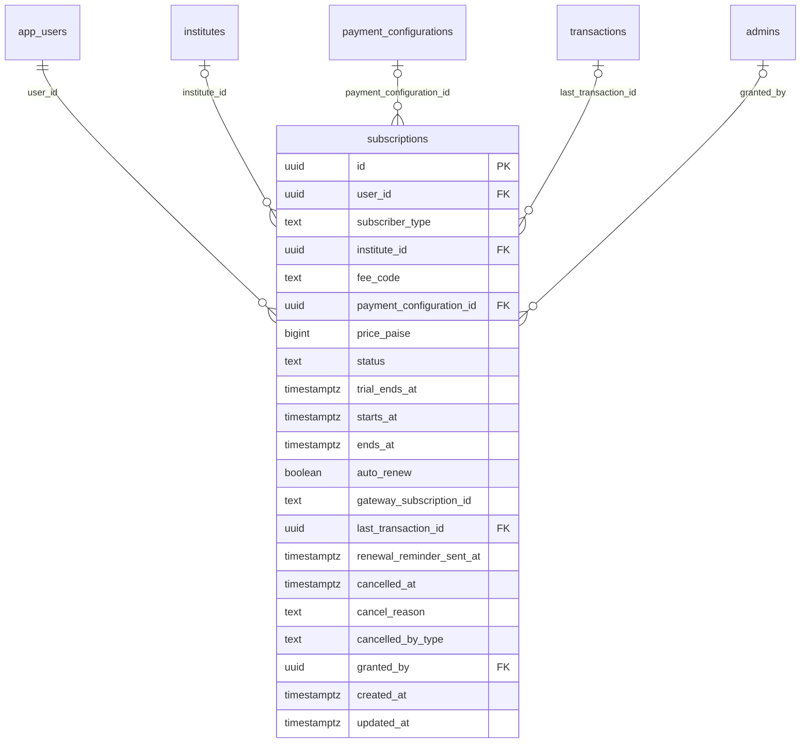

# Module 41 · Subscription Payments

> **Phase 12 · Payments** · **Depends on:** M5, M40 (used by M30, M32 and teacher/institute registration) · **Owns tables:** `subscriptions` · **Reads:** `app_users`, `institutes`, `payment_configurations`, `transactions`, `admins` · **Build estimate:** 3 days

## 1. Module Overview

Paid access periods: parent and student memberships (monthly/yearly with trials), teacher and institute annual registrations, and admin-granted complimentary or free-access periods when a fee is switched off. This module owns the subscription state machine, renewal and expiry jobs, and the admin tools to grant, extend and cancel. Modules 30 and 32 are the parent- and student-facing admin views over the same table.

## 2. Business Purpose

Subscription state decides what every user can do in the app, so it must be unambiguous (one live subscription per user and type), priced from the price version in force at purchase, and adjustable by admins with a reason when support needs to make things right.

## 3. User Stories

- As **Finance Admin**, I want to see all live subscriptions by plan so that I can forecast renewals.
- As **Support Admin**, I want to extend a parent's membership by 7 days after an outage so that they aren't charged for downtime.
- As **Super Admin**, I want users to keep access when I switch a fee off, and to move them to a trial when I switch it back on.
- As **Finance Admin**, I want failed renewals to enter a grace period so that users have time to fix payment.

## 4. Functional Requirements & Business Logic

**FR-41.1 States.**

| Status | Meaning | Access |
| --- | --- | --- |
| `trial` | Free trial (`trial_days` of the fee config) | Full |
| `active` | Paid period | Full |
| `grace` | Renewal failed; 3 days to pay | Full, banner in app |
| `expired` | Period over | None |
| `cancelled` | Cancelled by user/admin/system (refund) | Until `ends_at` for user cancels; immediate for admin/refund |
| `free_access` | Fee disabled by admin | Full, no end date |

Only one row per (user, subscriber_type) may be in trial/active/grace/free_access (`uq_subscriptions_one_live`). Renewing creates a **new row** after the previous ends, preserving history.

**FR-41.2 Purchase.** On capture (Module 40) for a subscription fee code: if a live trial exists, end it and start `active` now; if a live active exists, the new period starts at its `ends_at` (queued row stored with status `active` only when it begins — the job activates it; until then the payment's metadata holds the pending period). `price_paise` = amount paid (base), `payment_configuration_id` = version charged. Period length = `validity_days` of that version.

**FR-41.3 Auto-renew.** If `auto_renew` (Razorpay subscription / UPI Autopay mandate), the charge on `ends_at` creates the next period; failure → `grace` for 3 days, then `expired`. Price changes (Module 5) apply at next renewal; users are notified 7 days before (`renewal_reminder_sent_at`) with the new price.

**FR-41.4 Jobs (hourly).** trial → expired (or → active if a payment exists), active → expired at `ends_at` when not auto-renewing, grace → expired after 3 days, 7-day renewal reminders.

**FR-41.5 Fee switched off / on (Module 5 hook).** Disabling a fee code: all users of that type without a live row get `free_access` rows; existing active rows continue. Enabling: `free_access` rows are ended (`cancelled`, `cancelled_by_type = system`); if setting `subscriptions.free_access_to_trial_on_enable` is true they receive a trial of the fee's `trial_days`, otherwise access ends with a 3-day notice.

**FR-41.6 Admin actions.**
- Grant complimentary: creates `active` with `price_paise = 0`, `granted_by`, `ends_at` ≤ 365 days; fails if a live row exists (use extend).
- Extend: moves `ends_at` of the live row by 1–90 days.
- Cancel: immediate (access ends now) or at period end; optional refund request (creates a Module 40 refund, maker-checker still applies).
- Change auto-renew: turn off only (turning on requires the user's mandate).
All actions require a reason and send the user a notification.

**FR-41.7 Metrics.** Active by plan, trials, trial → paid conversion, churn (expired without renewal ÷ due), MRR (monthly-equivalent of active paid rows: yearly price ÷ 12), renewals due next 7/30 days.

## 5. Validation Rules

| Field | Rule |
| --- | --- |
| grant.subscriberType | parent, student, teacher, institute; must match the user's role |
| grant.feeCode | a fee code valid for that subscriber type |
| grant.endsAt | > now, ≤ now + 365 days |
| extend.days | integer 1–90 |
| cancel.mode | `immediate` or `period_end` |
| cancel.refundAmountPaise | optional, ≤ refundable amount of `last_transaction_id` |
| reason | 10–300 chars on every action |
| If-Match | required on extend / cancel |

## 6. API Endpoints

| Method | Path | Permission | Description |
| --- | --- | --- | --- |
| GET | /subscriptions | subscriptions.read | All subscriptions with filters |
| GET | /subscriptions/metrics | subscriptions.read | Active, trials, conversion, churn, MRR, renewals due |
| GET | /subscriptions/:id | subscriptions.read | Detail with payments and history |
| GET | /app-users/:userId/subscriptions | subscriptions.read | A user's subscription history |
| POST | /subscriptions/grant | subscriptions.manage | Grant complimentary access |
| POST | /subscriptions/:id/extend | subscriptions.manage | Extend the live period |
| POST | /subscriptions/:id/cancel | subscriptions.manage | Cancel (optionally request refund) |
| POST | /subscriptions/:id/disable-auto-renew | subscriptions.manage | Stop auto-renewal |

## 7. Request Payloads

```json
// POST /subscriptions/grant
{ "userId": "…", "subscriberType": "parent", "feeCode": "PARENT_SUBSCRIPTION_MONTHLY", "endsAt": "2026-10-26T18:29:59Z", "reason": "Compensation for missed demo due to teacher no-show" }

// POST /subscriptions/:id/extend   (If-Match: "…")
{ "days": 7, "reason": "App outage 18–20 Sep" }

// POST /subscriptions/:id/cancel   (If-Match: "…")
{ "mode": "immediate", "refundAmountPaise": 29900, "reason": "Charged twice; keeping one period" }
```

## 8. Response Payloads

```json
// 200 GET /subscriptions/:id
{ "data": { "id": "…", "user": { "id": "…", "name": "Lakshmi V.", "type": "parent" }, "feeCode": "PARENT_SUBSCRIPTION_YEARLY", "planName": "Parent membership · Yearly",
  "status": "active", "pricePaise": 199900, "priceVersion": 1, "startsAt": "…", "endsAt": "…", "trialEndsAt": null, "autoRenew": true, "daysLeft": 214,
  "payments": [ { "transactionId": "…", "publicCode": "TXN-…", "amountPaise": 235882, "capturedAt": "…" } ],
  "history": [ { "at": "…", "event": "trial_started" }, { "at": "…", "event": "activated" } ], "grantedBy": null } }

// 200 GET /subscriptions/metrics
{ "data": { "live": { "parent": 21840, "student": 9120, "teacher": 11200, "institute": 412 }, "trials": 3120, "trialConversionPct": 38.6,
  "churnPct30d": 6.2, "mrrPaise": 812340000, "renewalsDue": { "7d": 1840, "30d": 6120 } } }
```

## 9. PostgreSQL Tables

### `subscriptions`

Paid access periods for parents, students, teachers and institutes, including trials.

```sql
CREATE TABLE subscriptions (
  id uuid PRIMARY KEY DEFAULT gen_random_uuid(), -- Primary key
  user_id uuid NOT NULL REFERENCES app_users(id) ON DELETE RESTRICT, -- Subscriber account
  subscriber_type text NOT NULL CHECK (subscriber_type IN ('parent','student','teacher','institute')), -- Role
  institute_id uuid REFERENCES institutes(id) ON DELETE RESTRICT, -- For institute registrations
  fee_code text NOT NULL, -- Plan, e.g. PARENT_SUBSCRIPTION_YEARLY, TEACHER_REGISTRATION
  payment_configuration_id uuid REFERENCES payment_configurations(id) ON DELETE RESTRICT, -- Price version at purchase (NULL for trials)
  price_paise bigint NOT NULL DEFAULT 0 CHECK (price_paise >= 0), -- Price locked for this period
  status text NOT NULL CHECK (status IN ('trial','active','grace','expired','cancelled','free_access')), -- free_access = fee switched off by admin
  trial_ends_at timestamptz, -- End of free trial
  starts_at timestamptz NOT NULL, -- Period start
  ends_at timestamptz, -- Period end (NULL for free_access)
  auto_renew boolean NOT NULL DEFAULT false, -- UPI Autopay / card mandate active
  gateway_subscription_id text, -- Razorpay sub_xxx when auto-renew
  last_transaction_id uuid REFERENCES transactions(id) ON DELETE SET NULL, -- Most recent payment
  renewal_reminder_sent_at timestamptz, -- 7-day reminder sent
  cancelled_at timestamptz, -- Cancellation time
  cancel_reason text, -- Why
  cancelled_by_type text CHECK (cancelled_by_type IN ('user','admin','system')), -- Who cancelled
  granted_by uuid REFERENCES admins(id), -- Admin who granted/extended manually (complimentary access)
  created_at timestamptz NOT NULL DEFAULT now(), -- Created
  updated_at timestamptz NOT NULL DEFAULT now(), -- Updated
  CONSTRAINT ck_subscriptions_period CHECK (ends_at IS NULL OR ends_at > starts_at)
);
CREATE INDEX idx_subscriptions_user ON subscriptions (user_id, created_at DESC);
CREATE UNIQUE INDEX uq_subscriptions_one_live ON subscriptions (user_id, subscriber_type) WHERE status IN ('trial','active','grace','free_access');
CREATE INDEX idx_subscriptions_expiry ON subscriptions (ends_at) WHERE status IN ('trial','active','grace');
CREATE INDEX idx_subscriptions_type_status ON subscriptions (subscriber_type, status);
CREATE TRIGGER trg_subscriptions_updated BEFORE UPDATE ON subscriptions FOR EACH ROW EXECUTE FUNCTION set_updated_at();
```

Migration file: `sql/migrations/041_m41_subscription_payments.sql`

## 10. Column Definitions

### `subscriptions`

| Column | Type | Null | Default | Constraints / References | Description |
| --- | --- | --- | --- | --- | --- |
| `id` | uuid | no | gen_random_uuid() | PK | Primary key |
| `user_id` | uuid | no | — | FK → `app_users.id` (on delete restrict) | Subscriber account |
| `subscriber_type` | text | no | — | CHECK subscriber_type IN ('parent','student','teacher','institute') | Role |
| `institute_id` | uuid | yes | — | FK → `institutes.id` (on delete restrict) | For institute registrations |
| `fee_code` | text | no | — | — | Plan, e.g. PARENT_SUBSCRIPTION_YEARLY, TEACHER_REGISTRATION |
| `payment_configuration_id` | uuid | yes | — | FK → `payment_configurations.id` (on delete restrict) | Price version at purchase (NULL for trials) |
| `price_paise` | bigint | no | 0 | CHECK price_paise >= 0 | Price locked for this period |
| `status` | text | no | — | CHECK status IN ('trial','active','grace','expired','cancelled','free_access') | free_access = fee switched off by admin |
| `trial_ends_at` | timestamptz | yes | — | — | End of free trial |
| `starts_at` | timestamptz | no | — | — | Period start |
| `ends_at` | timestamptz | yes | — | — | Period end (NULL for free_access) |
| `auto_renew` | boolean | no | false | — | UPI Autopay / card mandate active |
| `gateway_subscription_id` | text | yes | — | — | Razorpay sub_xxx when auto-renew |
| `last_transaction_id` | uuid | yes | — | FK → `transactions.id` (on delete set null) | Most recent payment |
| `renewal_reminder_sent_at` | timestamptz | yes | — | — | 7-day reminder sent |
| `cancelled_at` | timestamptz | yes | — | — | Cancellation time |
| `cancel_reason` | text | yes | — | — | Why |
| `cancelled_by_type` | text | yes | — | CHECK cancelled_by_type IN ('user','admin','system') | Who cancelled |
| `granted_by` | uuid | yes | — | FK → `admins.id` (on delete no action) | Admin who granted/extended manually (complimentary access) |
| `created_at` | timestamptz | no | now() | — | Created |
| `updated_at` | timestamptz | no | now() | — | Updated |

**Table constraints:** `CONSTRAINT ck_subscriptions_period CHECK (ends_at IS NULL OR ends_at > starts_at)`

## 11. Relationships

**Outgoing foreign keys**

- `subscriptions.user_id` → `app_users.id` — required, many-to-one, on delete **restrict**
- `subscriptions.institute_id` → `institutes.id` — optional, many-to-one, on delete **restrict**
- `subscriptions.payment_configuration_id` → `payment_configurations.id` — optional, many-to-one, on delete **restrict**
- `subscriptions.last_transaction_id` → `transactions.id` — optional, many-to-one, on delete **set null**
- `subscriptions.granted_by` → `admins.id` — optional, many-to-one, on delete **no action**

**Entity relationship diagram**



## 12. Indexing Strategy

| Index | Table | Kind | Definition |
| --- | --- | --- | --- |
| `idx_subscriptions_user` | `subscriptions` | btree | `(user_id, created_at DESC)` |
| `uq_subscriptions_one_live` | `subscriptions` | unique | `(user_id, subscriber_type) WHERE status IN ('trial','active','grace','free_access')` |
| `idx_subscriptions_expiry` | `subscriptions` | btree | `(ends_at) WHERE status IN ('trial','active','grace')` |
| `idx_subscriptions_type_status` | `subscriptions` | btree | `(subscriber_type, status)` |

`uq_subscriptions_one_live` (partial unique) enforces one live row per user and type; `idx_subscriptions_expiry` (partial on live statuses) drives the hourly jobs; `idx_subscriptions_user` the history; `idx_subscriptions_type_status` the metrics and lists.

## 13. Permissions

| Permission key | Allows | Sensitive | Super | Ops | Verif. | Finance | Support |
| --- | --- | --- | --- | --- | --- | --- | --- |
| `subscriptions.read` | View all subscriptions | — | ✓ | ✓ | — | ✓ | ✓ |
| `subscriptions.manage` | Grant, extend or cancel any subscription | yes | ✓ | — | — | ✓ | — |

## 14. UI Screens & React Page Structure

| Route | Page | Content |
| --- | --- | --- |
| `/payments/subscriptions` | SubscriptionsPage | Metrics cards · plan tabs (Parents, Students, Teachers, Institutes) · table |
| `/payments/subscriptions/:id` | SubscriptionDrawer | Plan, dates, progress bar, payments, history, actions |
| Parent / student / teacher / institute detail → Subscription tab | SubscriptionTab | Same component scoped to a user (reused by M30, M32) |

```
src/features/subscriptions/
  pages/SubscriptionsPage.tsx
  components/SubscriptionDrawer.tsx, SubscriptionTab.tsx, PeriodProgress.tsx, GrantDialog.tsx, ExtendDialog.tsx, CancelSubscriptionDialog.tsx, SubscriptionMetrics.tsx
```

## 15. UI Components

- `PeriodProgress` — bar from `startsAt` to `endsAt` with days left and status colour + label.
- `GrantDialog` — user picker (search), plan select filtered by user role, end date, reason.
- `CancelSubscriptionDialog` — mode radio, optional refund amount (defaults to pro-rata suggestion), reason; explains that the refund needs another admin's approval.

## 16. Filters

Subscriber type, plan (fee code), status (multi), auto-renew, granted (complimentary), city, ends between, started between.

## 17. Search Capabilities

User name, phone (exact), email, Razorpay subscription id.

## 18. Pagination Requirements

Offset, default 20; sort endsAt (default asc for live), createdAt, pricePaise.

## 19. Audit Logs

| Event | Details |
| --- | --- |
| `subscription.granted` | user, plan, endsAt, reason |
| `subscription.extended` | days, old/new endsAt, reason |
| `subscription.cancelled` | mode, refund requested, reason |
| `subscription.auto_renew_disabled` | reason |
| `subscription.bulk_free_access` / `subscription.bulk_trial_started` | fee code, affected count (system actor, triggered by a Module 5 change) |

## 20. Error Scenarios

| Scenario | HTTP | Code | Message |
| --- | --- | --- | --- |
| Grant when a live subscription exists | 409 | CONFLICT_STATE | "This user already has a live {plan}. Extend it instead." |
| Plan doesn't match user role | 422 | VALIDATION_FAILED | "That plan isn't available for a {role}." |
| Extend an expired/cancelled row | 409 | CONFLICT_STATE | "Only live subscriptions can be extended." |
| Stale If-Match | 409 | VERSION_CONFLICT | Standard message |

## 21. Future Scalability Notes & Enhancements

Family plans (one parent membership covering several children is already implied; multi-guardian sharing later); coupons and promo codes; plan upgrades with pro-rated credit; move history to a `subscription_events` table if analytics needs more than the audit log.

## 22. Security Considerations

`subscriptions.manage` is sensitive: grants and extensions give value away, so each requires a reason and appears in the weekly finance digest of complimentary grants.
