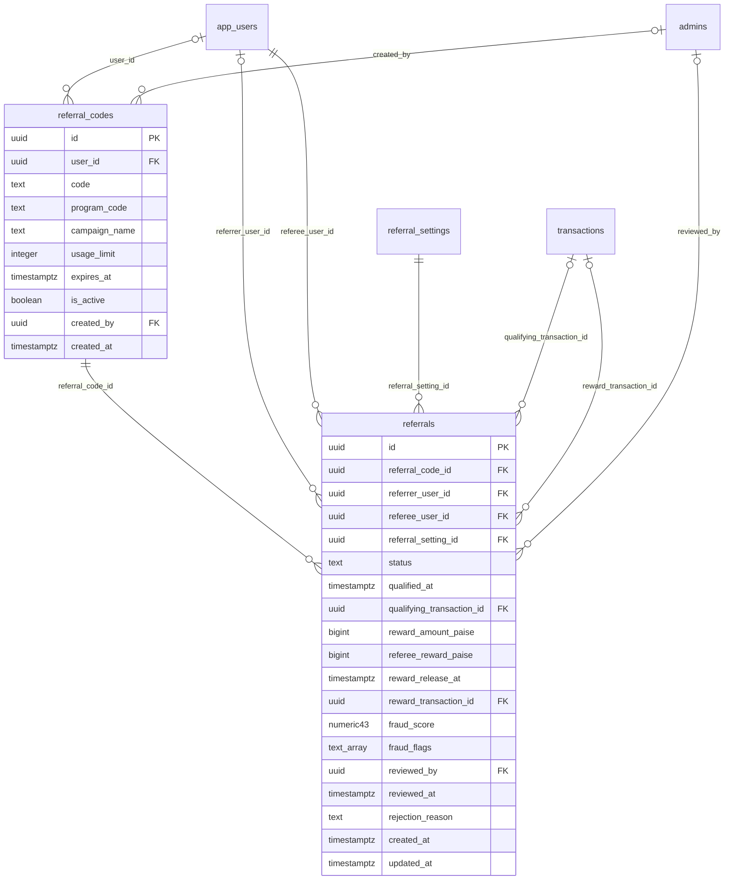

# Module 42 · Referral Management

> **Phase 13 · Referrals** · **Depends on:** M6, M40 · **Owns tables:** `referral_codes`, `referrals` · **Reads:** `app_users`, `referral_settings`, `transactions`, `admins` · **Build estimate:** 3 days

## 1. Module Overview

Tracks every referral from code to reward: personal referral codes (one per user per program), admin campaign codes, referrals created at sign-up, qualification on the program's qualifying event, fraud scoring, the reward hold period and payout as wallet credit. Admins review held (suspicious) referrals, reverse fraudulent rewards and manage campaign codes. Program rules are configured in Module 6.

## 2. Business Purpose

Referrals are the cheapest acquisition channel in India's word-of-mouth tutoring market, and also the easiest to abuse. The module has to pay genuine referrers quickly and stop self-referral and fake-number farms.

## 3. User Stories

- As **Operations Admin**, I want to see the top referrers this month so that we can thank them.
- As **Finance Admin**, I want held referrals with fraud flags so that I can release or reject each with a reason.
- As **Marketing (Operations Admin)**, I want a campaign code "SCHOOLFAIR26" limited to 500 sign-ups so that I can measure an event.

## 4. Functional Requirements & Business Logic

**FR-42.1 Codes.** Every app user gets a personal code on first need (`<FIRSTNAME><2–3 digits>`, upper-case, unique case-insensitively). Campaign codes are created by admins with optional usage limit and expiry; `user_id` NULL.

**FR-42.2 Attribution.** At sign-up the app sends the code; the server creates a `referrals` row (`pending`) with the **active** `referral_settings` version of the program at that moment. A user can be referred only once (`uq_referrals_referee`); self-referral (same phone/device) is rejected.

**FR-42.3 Qualification.** On the program's qualifying event (`first_payment` → first captured transaction; `teacher_approved`; `institute_approved`), the referral becomes `qualified` with `qualified_at`, `reward_release_at = qualified_at + reward_hold_days`, amounts copied from the settings version. If the referrer has reached `max_rewards_per_month`, status stays `qualified` with reason `monthly_cap` and rewards 0.

**FR-42.4 Fraud scoring (at sign-up and qualification).** Score 0–1 from flags: `same_device` (0.6), `same_ip_24h ≥ 3` (0.3), `burst_signups` (≥ 5 referees in 1 h, 0.3), `disposable_number` (0.4), `referee_inactive` (no session after qualification, 0.2); capped at 1. Score ≥ 0.5 → `on_hold` for admin review.

**FR-42.5 Payout.** Job at `reward_release_at`: for `qualified` rows not refunded/reversed, create `transactions` with `purpose = referral_payout`, `direction = debit`, `gateway = wallet`, then `rewarded`. If the qualifying payment is fully refunded before release → `expired`. Referee reward (discount) is applied at checkout (Module 40 `discount_paise`), not paid out.

**FR-42.6 Admin review.** Release (held → qualified, payout on schedule or immediately with `releaseNow`), reject (with reason, no reward), reverse (after reward: reverses wallet credit via a counter transaction; if wallet balance is insufficient, the balance goes negative and future credits settle it).

**FR-42.7 Stats.** Sign-ups via referral, qualified %, rewards paid, cost per acquisition (rewards ÷ qualified), top referrers, fraud rate; per program and campaign code.

## 5. Validation Rules

| Field | Rule |
| --- | --- |
| code (campaign) | 4–20 chars, `^[A-Z0-9]+$`, unique case-insensitive |
| campaignName | 3–80 chars |
| usageLimit | integer 1–1,000,000 or null |
| expiresAt | > now |
| programCode | LEARNER_REFERRAL, TEACHER_REFERRAL, INSTITUTE_REFERRAL |
| reason | 10–300 chars on release/reject/reverse/disable |

## 6. API Endpoints

| Method | Path | Permission | Description |
| --- | --- | --- | --- |
| GET | /referrals | referrals.read | Referrals with filters |
| GET | /referrals/stats | referrals.read | Program and campaign metrics |
| GET | /referrals/top-referrers | referrals.read | Leaderboard for a period |
| GET | /referrals/:id | referrals.read | Detail with fraud flags and transactions |
| POST | /referrals/:id/release | referrals.review | Release a held referral |
| POST | /referrals/:id/reject | referrals.review | Reject |
| POST | /referrals/:id/reverse | referrals.review | Reverse a paid reward |
| GET | /referral-codes | referrals.read | Personal and campaign codes |
| POST | /referral-codes | referral_codes.manage | Create a campaign code |
| PATCH | /referral-codes/:id | referral_codes.manage | Edit limit / expiry / name |
| POST | /referral-codes/:id/disable | referral_codes.manage | Disable a code |
| GET | /app-users/:userId/referrals | referrals.read | A user's code, invites and rewards |

## 7. Request Payloads

```json
// POST /referral-codes
{ "code": "SCHOOLFAIR26", "programCode": "LEARNER_REFERRAL", "campaignName": "Bengaluru school fair Oct 2026", "usageLimit": 500, "expiresAt": "2026-10-31T18:29:59Z" }

// POST /referrals/:id/reject
{ "reason": "Referee and referrer share the same device and address" }
```

## 8. Response Payloads

```json
// 200 GET /referrals/:id
{ "data": { "id": "…", "program": "LEARNER_REFERRAL", "rulesVersion": 1, "code": "LAKSHMI50", "referrer": { "id": "…", "name": "Lakshmi V." }, "referee": { "id": "…", "name": "Priya S.", "joinedAt": "…" },
  "status": "on_hold", "fraudScore": 0.6, "fraudFlags": ["same_device"], "qualifiedAt": "…", "qualifyingTransaction": { "publicCode": "TXN-…", "amountPaise": 35282 },
  "rewardAmountPaise": 10000, "refereeRewardPaise": 10000, "rewardReleaseAt": "…", "rewardTransaction": null } }

// 200 GET /referrals/stats?from=2026-09-01&to=2026-09-26
{ "data": { "signups": 2140, "qualified": 812, "qualifiedPct": 37.9, "onHold": 41, "rewardedPaise": 7420000, "costPerQualifiedPaise": 9138, "fraudRejectedPct": 2.3,
  "byProgram": { "LEARNER_REFERRAL": { "signups": 1810, "qualified": 690 }, "TEACHER_REFERRAL": { "signups": 330, "qualified": 122 } } } }
```

## 9. PostgreSQL Tables

### `referral_codes`

One personal referral code per app user.

```sql
CREATE TABLE referral_codes (
  id uuid PRIMARY KEY DEFAULT gen_random_uuid(), -- Primary key
  user_id uuid REFERENCES app_users(id) ON DELETE CASCADE, -- Owner; NULL for admin campaign codes
  code text NOT NULL, -- Upper-case code, e.g. LAKSHMI50
  program_code text NOT NULL CHECK (program_code IN ('LEARNER_REFERRAL','TEACHER_REFERRAL','INSTITUTE_REFERRAL')), -- Program
  campaign_name text, -- For admin-created campaign codes
  usage_limit integer CHECK (usage_limit IS NULL OR usage_limit > 0), -- Max sign-ups (campaign codes)
  expires_at timestamptz, -- Campaign expiry
  is_active boolean NOT NULL DEFAULT true, -- Disabled codes stop working
  created_by uuid REFERENCES admins(id), -- Admin creator (campaign codes)
  created_at timestamptz NOT NULL DEFAULT now() -- Created
);
CREATE UNIQUE INDEX uq_referral_codes_code ON referral_codes (upper(code));
CREATE UNIQUE INDEX uq_referral_codes_user_program ON referral_codes (user_id, program_code) WHERE user_id IS NOT NULL;
```

### `referrals`

One row per referred user, tracking qualification, fraud checks and reward payout.

```sql
CREATE TABLE referrals (
  id uuid PRIMARY KEY DEFAULT gen_random_uuid(), -- Primary key
  referral_code_id uuid NOT NULL REFERENCES referral_codes(id) ON DELETE RESTRICT, -- Code used
  referrer_user_id uuid REFERENCES app_users(id) ON DELETE SET NULL, -- Who invited (NULL for campaign codes)
  referee_user_id uuid NOT NULL REFERENCES app_users(id) ON DELETE RESTRICT, -- Who joined
  referral_setting_id uuid NOT NULL REFERENCES referral_settings(id) ON DELETE RESTRICT, -- Rules version applied
  status text NOT NULL DEFAULT 'pending' CHECK (status IN ('pending','qualified','on_hold','rewarded','rejected','expired','reversed')), -- Lifecycle
  qualified_at timestamptz, -- Qualifying event time
  qualifying_transaction_id uuid REFERENCES transactions(id) ON DELETE SET NULL, -- Payment that qualified it
  reward_amount_paise bigint NOT NULL DEFAULT 0 CHECK (reward_amount_paise >= 0), -- Referrer reward
  referee_reward_paise bigint NOT NULL DEFAULT 0 CHECK (referee_reward_paise >= 0), -- Referee reward/discount
  reward_release_at timestamptz, -- End of hold period
  reward_transaction_id uuid REFERENCES transactions(id) ON DELETE SET NULL, -- Payout record
  fraud_score numeric(4,3) CHECK (fraud_score BETWEEN 0 AND 1), -- Automated risk score
  fraud_flags text[] NOT NULL DEFAULT '{}', -- e.g. {same_device, burst_signups, disposable_number}
  reviewed_by uuid REFERENCES admins(id), -- Admin who reviewed a held referral
  reviewed_at timestamptz, -- Review time
  rejection_reason text, -- Why rejected / reversed
  created_at timestamptz NOT NULL DEFAULT now(), -- Created (referee signed up)
  updated_at timestamptz NOT NULL DEFAULT now() -- Updated
);
CREATE UNIQUE INDEX uq_referrals_referee ON referrals (referee_user_id);
CREATE INDEX idx_referrals_referrer ON referrals (referrer_user_id, created_at DESC);
CREATE INDEX idx_referrals_status ON referrals (status, created_at DESC);
CREATE INDEX idx_referrals_release ON referrals (reward_release_at) WHERE status = 'qualified';
CREATE TRIGGER trg_referrals_updated BEFORE UPDATE ON referrals FOR EACH ROW EXECUTE FUNCTION set_updated_at();
```

Migration file: `sql/migrations/042_m42_referral_management.sql`

## 10. Column Definitions

### `referral_codes`

| Column | Type | Null | Default | Constraints / References | Description |
| --- | --- | --- | --- | --- | --- |
| `id` | uuid | no | gen_random_uuid() | PK | Primary key |
| `user_id` | uuid | yes | — | FK → `app_users.id` (on delete cascade) | Owner; NULL for admin campaign codes |
| `code` | text | no | — | — | Upper-case code, e.g. LAKSHMI50 |
| `program_code` | text | no | — | CHECK program_code IN ('LEARNER_REFERRAL','TEACHER_REFERRAL','INSTITUTE_REFERRAL') | Program |
| `campaign_name` | text | yes | — | — | For admin-created campaign codes |
| `usage_limit` | integer | yes | — | CHECK usage_limit IS NULL OR usage_limit > 0 | Max sign-ups (campaign codes) |
| `expires_at` | timestamptz | yes | — | — | Campaign expiry |
| `is_active` | boolean | no | true | — | Disabled codes stop working |
| `created_by` | uuid | yes | — | FK → `admins.id` (on delete no action) | Admin creator (campaign codes) |
| `created_at` | timestamptz | no | now() | — | Created |

### `referrals`

| Column | Type | Null | Default | Constraints / References | Description |
| --- | --- | --- | --- | --- | --- |
| `id` | uuid | no | gen_random_uuid() | PK | Primary key |
| `referral_code_id` | uuid | no | — | FK → `referral_codes.id` (on delete restrict) | Code used |
| `referrer_user_id` | uuid | yes | — | FK → `app_users.id` (on delete set null) | Who invited (NULL for campaign codes) |
| `referee_user_id` | uuid | no | — | FK → `app_users.id` (on delete restrict) | Who joined |
| `referral_setting_id` | uuid | no | — | FK → `referral_settings.id` (on delete restrict) | Rules version applied |
| `status` | text | no | 'pending' | CHECK status IN ('pending','qualified','on_hold','rewarded','rejected','expired','reversed') | Lifecycle |
| `qualified_at` | timestamptz | yes | — | — | Qualifying event time |
| `qualifying_transaction_id` | uuid | yes | — | FK → `transactions.id` (on delete set null) | Payment that qualified it |
| `reward_amount_paise` | bigint | no | 0 | CHECK reward_amount_paise >= 0 | Referrer reward |
| `referee_reward_paise` | bigint | no | 0 | CHECK referee_reward_paise >= 0 | Referee reward/discount |
| `reward_release_at` | timestamptz | yes | — | — | End of hold period |
| `reward_transaction_id` | uuid | yes | — | FK → `transactions.id` (on delete set null) | Payout record |
| `fraud_score` | numeric(4,3) | yes | — | CHECK fraud_score BETWEEN 0 AND 1 | Automated risk score |
| `fraud_flags` | text[] | no | '{}' | — | e.g. {same_device, burst_signups, disposable_number} |
| `reviewed_by` | uuid | yes | — | FK → `admins.id` (on delete no action) | Admin who reviewed a held referral |
| `reviewed_at` | timestamptz | yes | — | — | Review time |
| `rejection_reason` | text | yes | — | — | Why rejected / reversed |
| `created_at` | timestamptz | no | now() | — | Created (referee signed up) |
| `updated_at` | timestamptz | no | now() | — | Updated |

## 11. Relationships

**Outgoing foreign keys**

- `referral_codes.user_id` → `app_users.id` — optional, many-to-one, on delete **cascade**
- `referral_codes.created_by` → `admins.id` — optional, many-to-one, on delete **no action**
- `referrals.referral_code_id` → `referral_codes.id` — required, many-to-one, on delete **restrict**
- `referrals.referrer_user_id` → `app_users.id` — optional, many-to-one, on delete **set null**
- `referrals.referee_user_id` → `app_users.id` — required, many-to-one, on delete **restrict**
- `referrals.referral_setting_id` → `referral_settings.id` — required, many-to-one, on delete **restrict**
- `referrals.qualifying_transaction_id` → `transactions.id` — optional, many-to-one, on delete **set null**
- `referrals.reward_transaction_id` → `transactions.id` — optional, many-to-one, on delete **set null**
- `referrals.reviewed_by` → `admins.id` — optional, many-to-one, on delete **no action**

**Entity relationship diagram**



## 12. Indexing Strategy

| Index | Table | Kind | Definition |
| --- | --- | --- | --- |
| `uq_referral_codes_code` | `referral_codes` | unique | `(upper(code))` |
| `uq_referral_codes_user_program` | `referral_codes` | unique | `(user_id, program_code) WHERE user_id IS NOT NULL` |
| `uq_referrals_referee` | `referrals` | unique | `(referee_user_id)` |
| `idx_referrals_referrer` | `referrals` | btree | `(referrer_user_id, created_at DESC)` |
| `idx_referrals_status` | `referrals` | btree | `(status, created_at DESC)` |
| `idx_referrals_release` | `referrals` | btree | `(reward_release_at) WHERE status = 'qualified'` |

`uq_referral_codes_code` on `upper(code)` for case-insensitive lookup at sign-up; `uq_referrals_referee` enforces one referral per user; `idx_referrals_release` (partial `qualified`) drives the payout job; `idx_referrals_referrer` the leaderboard and monthly cap check.

## 13. Permissions

| Permission key | Allows | Sensitive | Super | Ops | Verif. | Finance | Support |
| --- | --- | --- | --- | --- | --- | --- | --- |
| `referrals.read` | View referrals and codes | — | ✓ | — | — | ✓ | — |
| `referrals.review` | Release, reject or reverse held referral rewards | yes | ✓ | — | — | ✓ | — |
| `referral_codes.manage` | Create and disable campaign codes | — | ✓ | — | — | ✓ | — |

## 14. UI Screens & React Page Structure

| Route | Page | Content |
| --- | --- | --- |
| `/referrals` | ReferralsPage | Stats cards · tabs All / On hold / Rewarded / Rejected · table |
| `/referrals/:id` | ReferralDrawer | Parties, flags with explanations, timeline, actions |
| `/referrals/codes` | ReferralCodesPage | Campaign codes (create/edit/disable) · personal code lookup |
| `/referrals/leaderboard` | TopReferrersPage | Period picker · top 50 table |

```
src/features/referrals/
  pages/ReferralsPage.tsx, ReferralCodesPage.tsx, TopReferrersPage.tsx
  components/ReferralDrawer.tsx, FraudFlags.tsx, CampaignCodeForm.tsx, ReferralDecisionDialog.tsx
```

## 15. UI Components

- `FraudFlags` — chips with plain-language explanations ("Same phone model and device id as the referrer").
- `CampaignCodeForm` — code (auto upper-case), program, name, limit, expiry; live uniqueness check.

## 16. Filters

Program, status, fraud score ≥, flag, campaign code, referrer, date range (sign-up or qualified).

## 17. Search Capabilities

Code (exact, case-insensitive), referrer or referee name/phone.

## 18. Pagination Requirements

Offset, default 20; sort createdAt (default desc), fraudScore, rewardReleaseAt.

## 19. Audit Logs

| Event | Details |
| --- | --- |
| `referral.released` / `referral.rejected` / `referral.reversed` | reason, amounts |
| `referral_code.created` / `referral_code.updated` / `referral_code.disabled` | code, limits, reason |

## 20. Error Scenarios

| Scenario | HTTP | Code | Message |
| --- | --- | --- | --- |
| Code already exists | 409 | CONFLICT_DUPLICATE | "That code is already in use." |
| Release a non-held referral | 409 | CONFLICT_STATE | "Only referrals on hold can be released." |
| Reverse before reward | 409 | CONFLICT_STATE | "Nothing to reverse yet — reject instead." |
| Usage limit below current uses | 422 | VALIDATION_FAILED | "This code has already been used {n} times." |

## 21. Future Scalability Notes & Enhancements

Tiered rewards (more after 5 referrals); cash payouts to bank via RazorpayX (KYC needed); device fingerprint service; share-link attribution with deep links.

## 22. Security Considerations

Fraud signals (device ids, IPs) are visible only to `referrals.review`; reversal of paid rewards is sensitive and fully audited.
