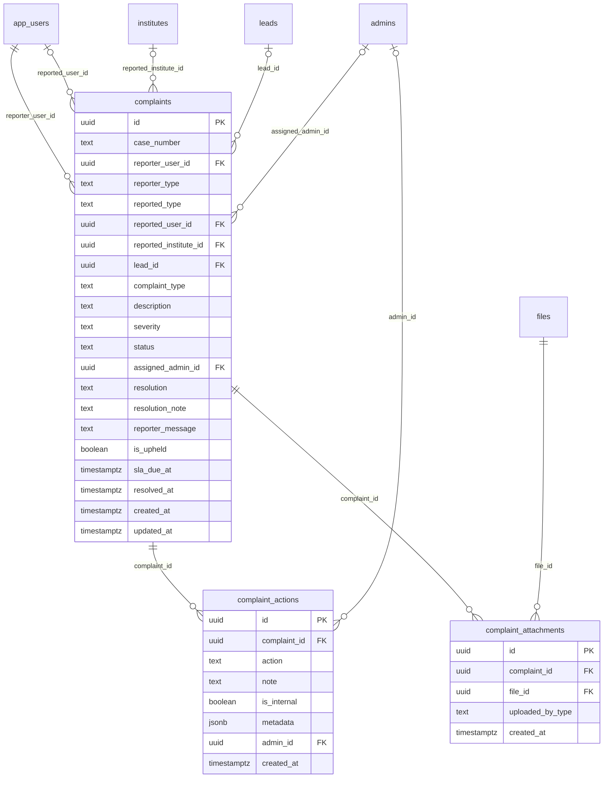

# Module 43 · Complaint Management

> **Phase 14 · Complaints** · **Depends on:** M0, M16, M22, M28, M31, M38 (feeds M36 complaints factor) · **Owns tables:** `complaints`, `complaint_actions`, `complaint_attachments` · **Reads:** `app_users`, `institutes`, `leads`, `admins`, `files`, `teachers`, `trust_scores` · **Build estimate:** 5 days

## 1. Module Overview

Two-way safety reporting. Parents and students can report teachers and institutes; teachers can report parents and students. Each report becomes a case with a number, severity, SLA, owner and timeline. Admins triage, request information, add evidence, issue warnings, suspend accounts, escalate, and resolve or dismiss with a message to the reporter. Upheld complaints lower the teacher's trust score (Module 36).

## 2. Business Purpose

Families invite teachers into their homes and children meet them alone; teachers enter strangers' homes. Fast, fair handling of reports is the platform's most important safety obligation and a legal one (IT Rules 2021 grievance timelines: acknowledge within 24 h, resolve within 15 days).

## 3. User Stories

- As **Support Admin**, I want critical cases (harassment, safety) at the top with an SLA countdown so that nothing urgent waits.
- As **Support Admin**, I want to suspend a teacher from inside the case so that the action and the reason stay linked.
- As **Super Admin**, I want to see every past complaint about the same person so that I can recognise patterns.
- As **Support Admin**, I want to ask the reporter for more information and pause the SLA until they reply.

## 4. Functional Requirements & Business Logic

**FR-43.1 Intake (mobile API).** Reporter picks the person/institute (from a lead, profile or chat), type, description (20–3,000 chars) and up to 5 attachments (images/PDF ≤ 10 MB, private). `case_number` = `CS-` + sequence. An auto-acknowledgement push/email is sent immediately.

**FR-43.2 Triage rules (on create).**

| Condition | Severity |
| --- | --- |
| type `harassment`, or description matches safety keywords (list in settings `complaints.safety_keywords`), or reported party has ≥ 2 complaints in 30 days | `critical` |
| type `fraud` | `high` |
| `misconduct` | `medium` |
| `fake_information`, `other` | `low` |
`sla_due_at` = created + 4 h (critical), 24 h (high), 72 h (medium/low). Critical cases page on-call support (email + push to admins with `complaints.manage` subscribed to alerts) and, for reported teachers, **auto-freeze** the trust score (Module 36) until resolved.

**FR-43.3 Lifecycle.**

| From | To | Action |
| --- | --- | --- |
| `open` | `in_review` | assign (self or other) |
| `in_review` | `awaiting_info` | request info from reporter or reported (message sent; SLA paused, stored in metadata) |
| `awaiting_info` | `in_review` | reply received or 7 days pass |
| `open` / `in_review` | `escalated` | escalate to Super Admin (required for bans and police referral) |
| any open | `resolved` | with `resolution`, `is_upheld`, `resolution_note`, `reporter_message` |
| any open | `dismissed` | not upheld; reason + reporter message |
| `resolved` / `dismissed` | `in_review` | reopen within 30 days with reason |

**FR-43.4 Enforcement (`complaints.enforce`).**
- Warning: notification to the reported user with template text; logged as `warning_issued`; 3 warnings in 12 months suggests suspension.
- Suspend: calls the same suspend service as Modules 17 / 24 / 28 / 31 (`account_status = 'suspended'` on the role row and `app_users`; teachers: hidden from search, leads blocked; institutes: hidden; parents/students: cannot create leads) for 7/30/90 days or until lifted; stored in `complaint_actions.metadata {"days":30,"until":"…"}`; job lifts it.
- Ban (`account_banned` resolution): only from `escalated` by Super Admin; permanent; sets `app_users.account_status = 'banned'` (sign-in blocked, sessions revoked) and the role row to `suspended` with no end date.
- Refund issued: links a Module 40 refund.
Each enforcement is a separate audited action and notification.

**FR-43.5 Trust effect.** On resolve/dismiss/reopen of a complaint against a teacher, enqueue trust recalculation (`complaint_resolved`); `is_upheld = true` counts in the complaints factor for 12 months.

**FR-43.6 History.** `GET /complaints/:id` includes other complaints involving the same reported party and the same reporter (to spot serial reporters).

**FR-43.7 SLA.** `sla_breached = now > sla_due_at AND status IN (open, in_review, escalated)`; breaches listed on the dashboard; hourly job notifies assignees 1 h before breach.

## 5. Validation Rules

| Field | Rule |
| --- | --- |
| assign.adminId | active admin with `complaints.manage` |
| severity | low, medium, high, critical; change needs reason |
| note | 2–3,000 chars; `isInternal` boolean (default true) |
| requestInfo.to | `reporter` or `reported`; message 20–1,000 chars |
| resolve.resolution | one of the table values; `account_banned` only from `escalated` by Super Admin |
| resolve.isUpheld | required boolean |
| resolve.reporterMessage | 20–1,000 chars |
| suspend.days | 7, 30, 90 or null (until lifted) |
| attachments | ≤ 5 per upload call, image/jpeg, image/png, application/pdf, ≤ 10 MB |
| If-Match | required on state changes |

## 6. API Endpoints

| Method | Path | Permission | Description |
| --- | --- | --- | --- |
| GET | /complaints | complaints.read | Queue with filters and SLA state |
| GET | /complaints/stats | complaints.read | Open by severity, breaches, average resolution time |
| GET | /complaints/:id | complaints.read | Case with timeline, attachments, related cases |
| POST | /complaints/:id/assign | complaints.manage | Assign owner |
| POST | /complaints/:id/severity | complaints.manage | Change severity (recomputes SLA) |
| POST | /complaints/:id/notes | complaints.manage | Add note |
| POST | /complaints/:id/request-info | complaints.manage | Message a party and pause SLA |
| POST | /complaints/:id/attachments | complaints.manage | Attach evidence (file ids from Module 0 upload) |
| GET | /complaints/:id/attachments/:attachmentId | complaints.read | Presigned URL (60 s) |
| POST | /complaints/:id/escalate | complaints.manage | Escalate to Super Admin |
| POST | /complaints/:id/warn | complaints.enforce | Warn the reported party |
| POST | /complaints/:id/suspend | complaints.enforce | Suspend the reported account |
| POST | /complaints/:id/lift-suspension | complaints.enforce | Lift early |
| POST | /complaints/:id/resolve | complaints.manage | Resolve |
| POST | /complaints/:id/dismiss | complaints.manage | Dismiss |
| POST | /complaints/:id/reopen | complaints.manage | Reopen within 30 days |

## 7. Request Payloads

```json
// POST /complaints/:id/suspend   (If-Match: "…")
{ "days": 30, "reason": "Two parents report the teacher asked for payment outside the app and did not show up", "notifyMessage": "Your profile is suspended for 30 days while we review reports." }

// POST /complaints/:id/resolve   (If-Match: "…")
{ "resolution": "account_suspended", "isUpheld": true, "resolutionNote": "Evidence (UPI screenshots) confirms off-platform payment requests.",
  "reporterMessage": "Thank you for reporting. We have taken action against this account." }
```

## 8. Response Payloads

```json
// 200 GET /complaints/:id
{ "data": { "id": "…", "caseNumber": "CS-4471", "status": "in_review", "severity": "high", "type": "fraud", "slaDueAt": "…", "slaBreached": false, "slaPaused": false,
  "reporter": { "userId": "…", "type": "parent", "displayName": "Lakshmi V." }, "reported": { "type": "teacher", "userId": "…", "teacherId": "…", "name": "R. Kumar", "status": "approved" },
  "lead": { "id": "…", "publicCode": "LD-238812" }, "description": "Asked me to pay ₹5,000 advance on GPay…",
  "assignee": { "id": "…", "name": "Sneha (Support)" }, "attachments": [ { "id": "…", "fileName": "gpay.png", "mimeType": "image/png" } ],
  "timeline": [ { "action": "created", "at": "…" }, { "action": "assigned", "at": "…", "admin": "Sneha" } ],
  "related": { "againstReported": [ { "caseNumber": "CS-4390", "status": "resolved", "isUpheld": true } ], "byReporter": [] } } }
```

## 9. PostgreSQL Tables

### `complaints`

Two-way safety reports: learners about teachers/institutes, teachers about parents/students.

```sql
CREATE TABLE complaints (
  id uuid PRIMARY KEY DEFAULT gen_random_uuid(), -- Primary key
  case_number text NOT NULL DEFAULT ('CS-' || nextval('seq_case_number')), -- e.g. CS-4471
  reporter_user_id uuid NOT NULL REFERENCES app_users(id) ON DELETE RESTRICT, -- Who reported
  reporter_type text NOT NULL CHECK (reporter_type IN ('parent','student','teacher','institute_staff')), -- Reporter role
  reported_type text NOT NULL CHECK (reported_type IN ('teacher','institute','parent','student')), -- Who is reported
  reported_user_id uuid REFERENCES app_users(id) ON DELETE RESTRICT, -- Reported account (teacher/parent/student)
  reported_institute_id uuid REFERENCES institutes(id) ON DELETE RESTRICT, -- Reported institute
  lead_id uuid REFERENCES leads(id) ON DELETE SET NULL, -- Related lead, if any
  complaint_type text NOT NULL CHECK (complaint_type IN ('fraud','misconduct','fake_information','harassment','other')), -- Type
  description text NOT NULL, -- What happened, 20–3,000 chars
  severity text NOT NULL DEFAULT 'medium' CHECK (severity IN ('low','medium','high','critical')), -- Set by triage rules, editable by admin
  status text NOT NULL DEFAULT 'open' CHECK (status IN ('open','in_review','awaiting_info','escalated','resolved','dismissed')), -- Lifecycle
  assigned_admin_id uuid REFERENCES admins(id), -- Case owner
  resolution text CHECK (resolution IN ('no_action','warning_issued','content_removed','account_suspended','account_banned','refund_issued','referred_to_police')), -- Outcome
  resolution_note text, -- Explanation (internal)
  reporter_message text, -- Message sent to the reporter on closure
  is_upheld boolean, -- true when the complaint was valid; feeds the trust score
  sla_due_at timestamptz NOT NULL, -- Response due (critical 4h, high 24h, else 72h)
  resolved_at timestamptz, -- Closed
  created_at timestamptz NOT NULL DEFAULT now(), -- Created
  updated_at timestamptz NOT NULL DEFAULT now(), -- Updated
  CONSTRAINT ck_complaints_target CHECK ((reported_type = 'institute') = (reported_institute_id IS NOT NULL) AND (reported_type = 'institute' OR reported_user_id IS NOT NULL))
);
CREATE UNIQUE INDEX uq_complaints_case ON complaints (case_number);
CREATE INDEX idx_complaints_queue ON complaints (status, severity, sla_due_at);
CREATE INDEX idx_complaints_reported_user ON complaints (reported_user_id, created_at DESC);
CREATE INDEX idx_complaints_reported_inst ON complaints (reported_institute_id, created_at DESC);
CREATE INDEX idx_complaints_assignee ON complaints (assigned_admin_id, status);
CREATE TRIGGER trg_complaints_updated BEFORE UPDATE ON complaints FOR EACH ROW EXECUTE FUNCTION set_updated_at();
```

### `complaint_actions`

Case timeline: assignments, notes, warnings, suspensions, escalations.

```sql
CREATE TABLE complaint_actions (
  id uuid PRIMARY KEY DEFAULT gen_random_uuid(), -- Primary key
  complaint_id uuid NOT NULL REFERENCES complaints(id) ON DELETE CASCADE, -- Case
  action text NOT NULL CHECK (action IN ('created','assigned','note','info_requested','warning_issued','suspended','escalated','severity_changed','resolved','dismissed','reopened')), -- Event
  note text, -- Details
  is_internal boolean NOT NULL DEFAULT true, -- false = shown to reporter/reported
  metadata jsonb, -- e.g. {"from":"medium","to":"high"}
  admin_id uuid REFERENCES admins(id), -- Actor
  created_at timestamptz NOT NULL DEFAULT now() -- When
);
CREATE INDEX idx_complaint_actions_case ON complaint_actions (complaint_id, created_at);
```

### `complaint_attachments`

Evidence files attached to a complaint.

```sql
CREATE TABLE complaint_attachments (
  id uuid PRIMARY KEY DEFAULT gen_random_uuid(), -- Primary key
  complaint_id uuid NOT NULL REFERENCES complaints(id) ON DELETE CASCADE, -- Case
  file_id uuid NOT NULL REFERENCES files(id) ON DELETE RESTRICT, -- Private file
  uploaded_by_type text NOT NULL CHECK (uploaded_by_type IN ('app_user','admin')), -- Uploader kind
  created_at timestamptz NOT NULL DEFAULT now() -- Uploaded
);
CREATE INDEX idx_complaint_attachments_case ON complaint_attachments (complaint_id);
```

Migration file: `sql/migrations/043_m43_complaint_management.sql`

## 10. Column Definitions

### `complaints`

| Column | Type | Null | Default | Constraints / References | Description |
| --- | --- | --- | --- | --- | --- |
| `id` | uuid | no | gen_random_uuid() | PK | Primary key |
| `case_number` | text | no | ('CS-' \|\| nextval('seq_case_number')) | — | e.g. CS-4471 |
| `reporter_user_id` | uuid | no | — | FK → `app_users.id` (on delete restrict) | Who reported |
| `reporter_type` | text | no | — | CHECK reporter_type IN ('parent','student','teacher','institute_staff') | Reporter role |
| `reported_type` | text | no | — | CHECK reported_type IN ('teacher','institute','parent','student') | Who is reported |
| `reported_user_id` | uuid | yes | — | FK → `app_users.id` (on delete restrict) | Reported account (teacher/parent/student) |
| `reported_institute_id` | uuid | yes | — | FK → `institutes.id` (on delete restrict) | Reported institute |
| `lead_id` | uuid | yes | — | FK → `leads.id` (on delete set null) | Related lead, if any |
| `complaint_type` | text | no | — | CHECK complaint_type IN ('fraud','misconduct','fake_information','harassment','other') | Type |
| `description` | text | no | — | — | What happened, 20–3,000 chars |
| `severity` | text | no | 'medium' | CHECK severity IN ('low','medium','high','critical') | Set by triage rules, editable by admin |
| `status` | text | no | 'open' | CHECK status IN ('open','in_review','awaiting_info','escalated','resolved','dismissed') | Lifecycle |
| `assigned_admin_id` | uuid | yes | — | FK → `admins.id` (on delete no action) | Case owner |
| `resolution` | text | yes | — | CHECK resolution IN ('no_action','warning_issued','content_removed','account_suspended','account_banned','refund_issued','referred_to_police') | Outcome |
| `resolution_note` | text | yes | — | — | Explanation (internal) |
| `reporter_message` | text | yes | — | — | Message sent to the reporter on closure |
| `is_upheld` | boolean | yes | — | — | true when the complaint was valid; feeds the trust score |
| `sla_due_at` | timestamptz | no | — | — | Response due (critical 4h, high 24h, else 72h) |
| `resolved_at` | timestamptz | yes | — | — | Closed |
| `created_at` | timestamptz | no | now() | — | Created |
| `updated_at` | timestamptz | no | now() | — | Updated |

**Table constraints:** `CONSTRAINT ck_complaints_target CHECK ((reported_type = 'institute') = (reported_institute_id IS NOT NULL) AND (reported_type = 'institute' OR reported_user_id IS NOT NULL))`

### `complaint_actions`

| Column | Type | Null | Default | Constraints / References | Description |
| --- | --- | --- | --- | --- | --- |
| `id` | uuid | no | gen_random_uuid() | PK | Primary key |
| `complaint_id` | uuid | no | — | FK → `complaints.id` (on delete cascade) | Case |
| `action` | text | no | — | CHECK action IN ('created','assigned','note','info_requested','warning_issued','suspended','escalated','severity_changed','resolved','dismissed','reopened') | Event |
| `note` | text | yes | — | — | Details |
| `is_internal` | boolean | no | true | — | false = shown to reporter/reported |
| `metadata` | jsonb | yes | — | — | e.g. {"from":"medium","to":"high"} |
| `admin_id` | uuid | yes | — | FK → `admins.id` (on delete no action) | Actor |
| `created_at` | timestamptz | no | now() | — | When |

### `complaint_attachments`

| Column | Type | Null | Default | Constraints / References | Description |
| --- | --- | --- | --- | --- | --- |
| `id` | uuid | no | gen_random_uuid() | PK | Primary key |
| `complaint_id` | uuid | no | — | FK → `complaints.id` (on delete cascade) | Case |
| `file_id` | uuid | no | — | FK → `files.id` (on delete restrict) | Private file |
| `uploaded_by_type` | text | no | — | CHECK uploaded_by_type IN ('app_user','admin') | Uploader kind |
| `created_at` | timestamptz | no | now() | — | Uploaded |

## 11. Relationships

**Outgoing foreign keys**

- `complaints.reporter_user_id` → `app_users.id` — required, many-to-one, on delete **restrict**
- `complaints.reported_user_id` → `app_users.id` — optional, many-to-one, on delete **restrict**
- `complaints.reported_institute_id` → `institutes.id` — optional, many-to-one, on delete **restrict**
- `complaints.lead_id` → `leads.id` — optional, many-to-one, on delete **set null**
- `complaints.assigned_admin_id` → `admins.id` — optional, many-to-one, on delete **no action**
- `complaint_actions.complaint_id` → `complaints.id` — required, many-to-one, on delete **cascade**
- `complaint_actions.admin_id` → `admins.id` — optional, many-to-one, on delete **no action**
- `complaint_attachments.complaint_id` → `complaints.id` — required, many-to-one, on delete **cascade**
- `complaint_attachments.file_id` → `files.id` — required, many-to-one, on delete **restrict**

**Entity relationship diagram**



## 12. Indexing Strategy

| Index | Table | Kind | Definition |
| --- | --- | --- | --- |
| `uq_complaints_case` | `complaints` | unique | `(case_number)` |
| `idx_complaints_queue` | `complaints` | btree | `(status, severity, sla_due_at)` |
| `idx_complaints_reported_user` | `complaints` | btree | `(reported_user_id, created_at DESC)` |
| `idx_complaints_reported_inst` | `complaints` | btree | `(reported_institute_id, created_at DESC)` |
| `idx_complaints_assignee` | `complaints` | btree | `(assigned_admin_id, status)` |
| `idx_complaint_actions_case` | `complaint_actions` | btree | `(complaint_id, created_at)` |
| `idx_complaint_attachments_case` | `complaint_attachments` | btree | `(complaint_id)` |

`idx_complaints_queue (status, severity, sla_due_at)` serves the triage queue ordered by urgency; `idx_complaints_reported_user` / `_inst` serve related-case lookups and the trust factor; `idx_complaints_assignee` the "My cases" view; `idx_complaint_actions_case` the timeline.

## 13. Permissions

| Permission key | Allows | Sensitive | Super | Ops | Verif. | Finance | Support |
| --- | --- | --- | --- | --- | --- | --- | --- |
| `complaints.read` | View complaints | — | ✓ | — | ✓ | — | ✓ |
| `complaints.manage` | Assign, triage, add notes, resolve and dismiss complaints | — | ✓ | — | — | — | ✓ |
| `complaints.enforce` | Issue warnings and suspend accounts from a complaint | yes | ✓ | — | — | — | ✓ |

## 14. UI Screens & React Page Structure

| Route | Page | Content |
| --- | --- | --- |
| `/complaints` | ComplaintsPage | Stats (open by severity, breached) · tabs My cases / Open / Awaiting info / Escalated / Closed · queue table with SLA countdown |
| `/complaints/:id` | ComplaintCasePage | Header (case, severity, SLA) · parties · description · evidence gallery · timeline with note composer · action bar (Assign, Request info, Warn, Suspend, Escalate, Resolve, Dismiss) · related cases |

```
src/features/complaints/
  pages/ComplaintsPage.tsx, ComplaintCasePage.tsx
  components/ComplaintsTable.tsx, SlaCountdown.tsx, SeverityBadge.tsx, CaseTimeline.tsx, NoteComposer.tsx, EvidenceGallery.tsx,
             SuspendDialog.tsx, WarnDialog.tsx, ResolveDialog.tsx, RequestInfoDialog.tsx, RelatedCases.tsx
```

## 15. UI Components

- `SlaCountdown` — "3 h 12 m left" / "Breached 2 h ago" with colour + icon; shows "Paused" in `awaiting_info`.
- `EvidenceGallery` — thumbnails fetched via presigned URLs on demand; PDF opens in a new tab; no download of originals without `complaints.manage`.
- `ResolveDialog` — resolution select, upheld toggle, internal note, reporter message with template picker.

## 16. Filters

Status, severity, type, reported type, reporter type, assignee (me / unassigned / any), SLA (breached, due in 1 h), city, date range.

## 17. Search Capabilities

Case number (exact, `CS-`), reported or reporter name/phone, lead code.

## 18. Pagination Requirements

Offset, default 20; default sort `severity` (critical first) then `sla_due_at` asc; also createdAt, resolvedAt.

## 19. Audit Logs

| Event | Details |
| --- | --- |
| `complaint.assigned` | from, to |
| `complaint.severity_changed` | from, to, reason |
| `complaint.note_added` | internal flag (note text stored in `complaint_actions`, not duplicated) |
| `complaint.info_requested` | party |
| `complaint.escalated` | reason |
| `complaint.warning_issued` / `complaint.suspended` / `complaint.suspension_lifted` | party, days, reason |
| `complaint.resolved` / `complaint.dismissed` / `complaint.reopened` | resolution, upheld, reason |
| `complaint.attachment_viewed` | attachment id (evidence access is logged) |

## 20. Error Scenarios

| Scenario | HTTP | Code | Message |
| --- | --- | --- | --- |
| Ban without escalation | 409 | CONFLICT_STATE | "Escalate the case to a Super Admin before banning." |
| Reopen after 30 days | 409 | CONFLICT_STATE | "Cases can be reopened within 30 days of closing." |
| Assignee lacks permission | 422 | VALIDATION_FAILED | "This admin can't handle complaints." |
| Suspend an already suspended account | 409 | CONFLICT_STATE | "Account is already suspended until {date}." |
| Stale If-Match | 409 | VERSION_CONFLICT | Standard message |

## 21. Future Scalability Notes & Enhancements

Two-way messaging thread with parties inside the case; auto-detection of off-platform payment requests in chat; integration with police cyber-cell reporting; case templates per type; weekly transparency report (required under IT Rules for significant intermediaries).

## 22. Security Considerations

Complaint descriptions and evidence are sensitive personal data: private bucket, 60-second presigned URLs, every evidence view audited. Reporter identity is never shown to the reported party. Only Super Admin can ban. Data retained 3 years after closure, then anonymised.
