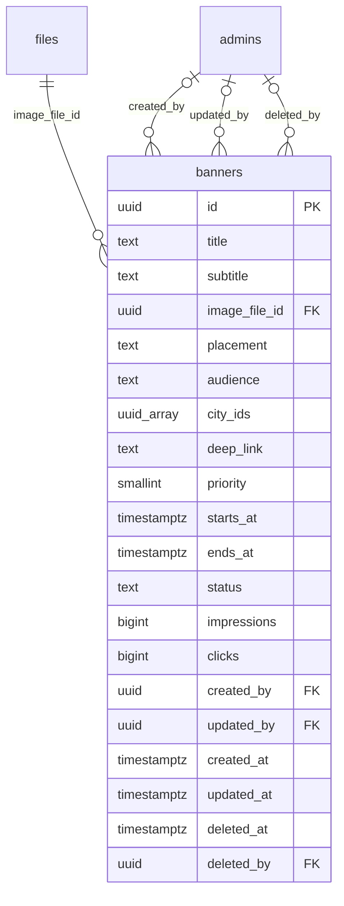

# Module 44 · Banner Management

> **Phase 15 · CMS** · **Depends on:** M0, M9 · **Owns tables:** `banners` · **Reads:** `files`, `cities`, `admins` · **Build estimate:** 2 days

## 1. Module Overview

Promotional banners shown in the mobile app at fixed placements (home top carousel, home middle, inline in search, teacher and institute dashboards, onboarding). Admins create banners with an image, title, deep link, audience, cities and a schedule; banners go live and expire automatically, can be paused, and report impressions and clicks.

## 2. Business Purpose

Lets marketing and operations run campaigns (exam season, referral pushes, teacher recruitment) without an app release, targeted to the right audience and city.

## 3. User Stories

- As **Operations Admin**, I want to schedule a "Board exam crash courses" banner for Class 10/12 parents in Bengaluru from 1–31 Jan so that it runs without me.
- As **Operations Admin**, I want to see click-through rate per banner so that I can keep what works.
- As **Operations Admin**, I want to reorder banners in a placement so that the most important shows first.

## 4. Functional Requirements & Business Logic

**FR-44.1 Lifecycle.** `draft` → (publish) → `scheduled` if `starts_at` > now else `active`; `active` ⇄ `paused`; job every 5 minutes: scheduled → active at `starts_at`, active → expired at `ends_at`. Deleting is soft and only for non-active banners.

**FR-44.2 Serving (mobile API).** `GET /app/v1/banners?placement=` returns active banners matching the user's audience and city (empty `city_ids` = all), ordered by `priority` desc then `starts_at` desc, max 5 per placement; cached in Redis 5 min per (placement, audience, city) and invalidated on any banner change.

**FR-44.3 Metrics.** The app batches impression and click events (`POST /app/v1/events`); a job aggregates them every 15 minutes into `impressions`/`clicks`. CTR = clicks ÷ impressions.

**FR-44.4 Image.** Uploaded through Module 0 (public bucket), 1080×480 (2.25:1), JPEG/PNG/WebP, ≤ 500 KB; server validates dimensions.

**FR-44.5 Deep links.** Allowed: app routes from a registry (`gc://search?subjectId=…`, `gc://plans`, `gc://referral`, `gc://blog/<slug>`, `gc://teacher/<id>`) or `https://` URLs on an allow-listed domain (settings `banners.allowed_domains`).

**FR-44.6 Reorder.** `POST /banners/reorder { placement, ids[] }` sets priority descending in the given order.

## 5. Validation Rules

| Field | Rule |
| --- | --- |
| title | 3–60 chars |
| subtitle | ≤ 90 chars |
| imageFileId | uploaded, public, image, 1080×480 ± 2 px |
| placement | one of the six placements |
| audience | all, parents, students, teachers, institutes |
| cityIds | array of active city ids, ≤ 50 |
| deepLink | registry route or allow-listed https URL |
| startsAt / endsAt | endsAt > startsAt; endsAt ≤ startsAt + 180 days |
| priority | 0–100 |

## 6. API Endpoints

| Method | Path | Permission | Description |
| --- | --- | --- | --- |
| GET | /banners | banners.read | List with filters and CTR |
| GET | /banners/:id | banners.read | Detail |
| POST | /banners | banners.manage | Create (draft) |
| PATCH | /banners/:id | banners.manage | Edit (If-Match) |
| POST | /banners/:id/publish | banners.manage | Publish (scheduled or active) |
| POST | /banners/:id/pause | banners.manage | Pause |
| POST | /banners/:id/resume | banners.manage | Resume |
| POST | /banners/reorder | banners.manage | Set order within a placement |
| DELETE | /banners/:id | banners.manage | Soft delete (not active) |
| GET | /banners/preview | banners.read | What a given audience/city sees per placement |

## 7. Request Payloads

```json
// POST /banners
{ "title": "Board exams in 90 days", "subtitle": "Book a free demo with a verified teacher", "imageFileId": "…", "placement": "home_top", "audience": "parents",
  "cityIds": ["<bengaluru>"], "deepLink": "gc://search?classId=<class-10>", "priority": 50, "startsAt": "2027-01-01T00:00:00+05:30", "endsAt": "2027-01-31T23:59:59+05:30" }
```

## 8. Response Payloads

```json
// 201 POST /banners
{ "data": { "id": "…", "status": "draft", "title": "Board exams in 90 days", "image": { "url": "https://cdn.guruconnect.in/banners/…webp" }, "placement": "home_top", "audience": "parents",
  "cities": [ { "id": "…", "name": "Bengaluru" } ], "impressions": 0, "clicks": 0, "ctrPct": null, "createdAt": "…", "updatedAt": "…" } }
```

## 9. PostgreSQL Tables

### `banners`

Promotional banners in the mobile app.

```sql
CREATE TABLE banners (
  id uuid PRIMARY KEY DEFAULT gen_random_uuid(), -- Primary key
  title text NOT NULL, -- Headline, max 60 chars
  subtitle text, -- Supporting line, max 90 chars
  image_file_id uuid NOT NULL REFERENCES files(id) ON DELETE RESTRICT, -- 1080×480 image (public)
  placement text NOT NULL CHECK (placement IN ('home_top','home_middle','search_inline','teacher_dashboard','institute_dashboard','onboarding')), -- Where it shows
  audience text NOT NULL DEFAULT 'all' CHECK (audience IN ('all','parents','students','teachers','institutes')), -- Who sees it
  city_ids uuid[] NOT NULL DEFAULT '{}', -- Empty = all cities
  deep_link text, -- App route or https URL opened on tap
  priority smallint NOT NULL DEFAULT 0, -- Higher shows first
  starts_at timestamptz NOT NULL, -- Visible from
  ends_at timestamptz, -- Visible until (NULL = until paused)
  status text NOT NULL DEFAULT 'draft' CHECK (status IN ('draft','scheduled','active','paused','expired')), -- Lifecycle
  impressions bigint NOT NULL DEFAULT 0, -- Aggregated impressions
  clicks bigint NOT NULL DEFAULT 0, -- Aggregated clicks
  created_by uuid REFERENCES admins(id), -- Creator
  updated_by uuid REFERENCES admins(id), -- Last editor
  created_at timestamptz NOT NULL DEFAULT now(), -- Created
  updated_at timestamptz NOT NULL DEFAULT now(), -- Updated
  deleted_at timestamptz, -- Soft delete
  deleted_by uuid REFERENCES admins(id), -- Who deleted
  CONSTRAINT ck_banners_window CHECK (ends_at IS NULL OR ends_at > starts_at)
);
CREATE INDEX idx_banners_serving ON banners (placement, audience, priority DESC) WHERE status = 'active' AND deleted_at IS NULL;
CREATE INDEX idx_banners_status ON banners (status, starts_at) WHERE deleted_at IS NULL;
CREATE TRIGGER trg_banners_updated BEFORE UPDATE ON banners FOR EACH ROW EXECUTE FUNCTION set_updated_at();
```

Migration file: `sql/migrations/044_m44_banner_management.sql`

## 10. Column Definitions

### `banners`

| Column | Type | Null | Default | Constraints / References | Description |
| --- | --- | --- | --- | --- | --- |
| `id` | uuid | no | gen_random_uuid() | PK | Primary key |
| `title` | text | no | — | — | Headline, max 60 chars |
| `subtitle` | text | yes | — | — | Supporting line, max 90 chars |
| `image_file_id` | uuid | no | — | FK → `files.id` (on delete restrict) | 1080×480 image (public) |
| `placement` | text | no | — | CHECK placement IN ('home_top','home_middle','search_inline','teacher_dashboard','institute_dashboard','onboarding') | Where it shows |
| `audience` | text | no | 'all' | CHECK audience IN ('all','parents','students','teachers','institutes') | Who sees it |
| `city_ids` | uuid[] | no | '{}' | — | Empty = all cities |
| `deep_link` | text | yes | — | — | App route or https URL opened on tap |
| `priority` | smallint | no | 0 | — | Higher shows first |
| `starts_at` | timestamptz | no | — | — | Visible from |
| `ends_at` | timestamptz | yes | — | — | Visible until (NULL = until paused) |
| `status` | text | no | 'draft' | CHECK status IN ('draft','scheduled','active','paused','expired') | Lifecycle |
| `impressions` | bigint | no | 0 | — | Aggregated impressions |
| `clicks` | bigint | no | 0 | — | Aggregated clicks |
| `created_by` | uuid | yes | — | FK → `admins.id` (on delete no action) | Creator |
| `updated_by` | uuid | yes | — | FK → `admins.id` (on delete no action) | Last editor |
| `created_at` | timestamptz | no | now() | — | Created |
| `updated_at` | timestamptz | no | now() | — | Updated |
| `deleted_at` | timestamptz | yes | — | — | Soft delete |
| `deleted_by` | uuid | yes | — | FK → `admins.id` (on delete no action) | Who deleted |

**Table constraints:** `CONSTRAINT ck_banners_window CHECK (ends_at IS NULL OR ends_at > starts_at)`

## 11. Relationships

**Outgoing foreign keys**

- `banners.image_file_id` → `files.id` — required, many-to-one, on delete **restrict**
- `banners.created_by` → `admins.id` — optional, many-to-one, on delete **no action**
- `banners.updated_by` → `admins.id` — optional, many-to-one, on delete **no action**
- `banners.deleted_by` → `admins.id` — optional, many-to-one, on delete **no action**

**Entity relationship diagram**



## 12. Indexing Strategy

| Index | Table | Kind | Definition |
| --- | --- | --- | --- |
| `idx_banners_serving` | `banners` | btree | `(placement, audience, priority DESC) WHERE status = 'active' AND deleted_at IS NULL` |
| `idx_banners_status` | `banners` | btree | `(status, starts_at) WHERE deleted_at IS NULL` |

`idx_banners_serving` (partial on active, not deleted) matches the serving query; `idx_banners_status (status, starts_at)` drives the scheduler and the admin list. `city_ids` filtering happens on ≤ 50 active rows so no GIN index is needed.

## 13. Permissions

| Permission key | Allows | Sensitive | Super | Ops | Verif. | Finance | Support |
| --- | --- | --- | --- | --- | --- | --- | --- |
| `banners.read` | View banners | — | ✓ | ✓ | — | — | — |
| `banners.manage` | Create, edit, schedule, pause and delete banners | — | ✓ | ✓ | — | — | — |

## 14. UI Screens & React Page Structure

| Route | Page | Content |
| --- | --- | --- |
| `/cms/banners` | BannersPage | Placement tabs · cards with image, status, dates, CTR · drag to reorder · preview panel (phone frame) |
| `/cms/banners/new`, `/cms/banners/:id` | BannerEditorPage | Form left, live phone preview right |

```
src/features/cms/banners/
  pages/BannersPage.tsx, BannerEditorPage.tsx
  components/BannerCard.tsx, BannerForm.tsx, PhonePreview.tsx, DeepLinkPicker.tsx, SortableBannerList.tsx (dnd-kit)
```

## 15. UI Components

- `DeepLinkPicker` — select route type then entity (search teacher / blog / class) or paste URL; validates live.
- `PhonePreview` — renders the banner at the placement's real size.
- `SortableBannerList` — keyboard-accessible drag handles; saves on drop.

## 16. Filters

Placement, status, audience, city, active on date.

## 17. Search Capabilities

Title (ILIKE contains).

## 18. Pagination Requirements

Offset, default 20; sort priority (default within placement), startsAt, ctr.

## 19. Audit Logs

| Event | Details |
| --- | --- |
| `banner.created` / `banner.updated` | changed fields |
| `banner.published` / `banner.paused` / `banner.resumed` | — |
| `banner.reordered` | placement, order |
| `banner.deleted` | — |

## 20. Error Scenarios

| Scenario | HTTP | Code | Message |
| --- | --- | --- | --- |
| Wrong image size | 422 | VALIDATION_FAILED | "Banner images must be 1080 × 480 px." |
| Deep link not allowed | 422 | VALIDATION_FAILED | "Use an app link or an approved website." |
| Delete an active banner | 409 | CONFLICT_STATE | "Pause the banner before deleting it." |
| Publish with endsAt in the past | 409 | CONFLICT_STATE | "This banner's end date has passed." |

## 21. Future Scalability Notes & Enhancements

A/B variants per banner; per-child-class targeting using `parent_children`; frequency capping; banner impressions table for per-day charts.

## 22. Security Considerations

Only allow-listed deep link domains prevent phishing via banners; images are served from the CDN with no user content.
