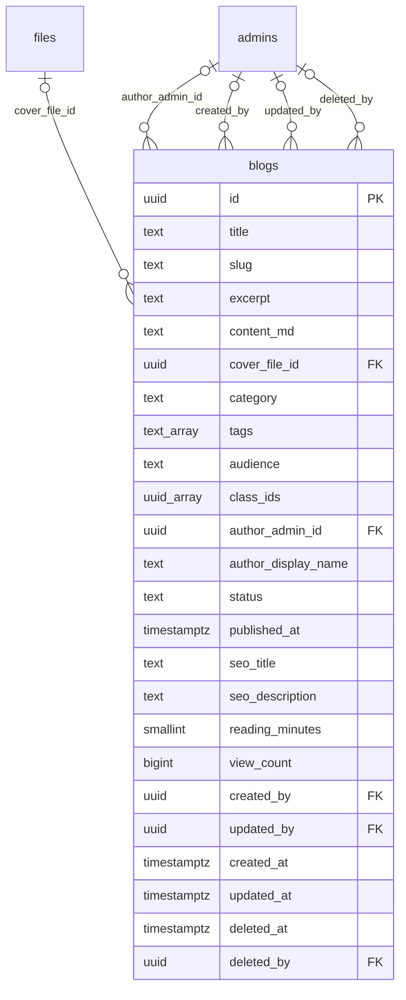

# Module 45 · Blog Management

> **Phase 15 · CMS** · **Depends on:** M0, M11 · **Owns tables:** `blogs` · **Reads:** `files`, `admins`, `classes` · **Build estimate:** 3 days

## 1. Module Overview

Articles and guides for parents, students and teachers ("How to choose a Physics tutor for JEE", "CBSE vs ICSE"), shown in the app's Learn tab and on the website. Admins write in Markdown with a preview, attach a cover, tag classes (so parents see content relevant to each child), send drafts for review, schedule, publish and archive.

## 2. Business Purpose

Content builds trust and brings organic traffic; class-tagged guides make the parent experience feel personal. An editorial workflow keeps quality high.

## 3. User Stories

- As a **content writer (Operations Admin with blogs.write)**, I want to save drafts and submit for review so that an editor checks before publishing.
- As an **editor (blogs.publish)**, I want to schedule a post for 7 AM so that it goes out at the best time.
- As **Operations Admin**, I want to tag an article with Class 10 and Class 12 so that parents of those children see it.

## 4. Functional Requirements & Business Logic

**FR-45.1 Workflow.** `draft` → `in_review` (writer submits) → `draft` (editor returns with comment) or `scheduled` / `published` (editor). `published` → `archived` (hidden, URL returns 410 on the website) → `draft` (restore). Writers can edit only their own drafts; editors can edit anything. Editing a published post creates no new version; changes are live on save (audited with a diff).

**FR-45.2 Slug.** Generated from the title (lower-case, hyphenated, ≤ 80 chars); unique among non-deleted posts; changing the slug of a published post stores a redirect in `settings seo.redirects` (website handles 301).

**FR-45.3 Rendering.** Markdown rendered with `markdown-it` and sanitised with DOMPurify (server-side for the website, client-side for preview); allowed: headings, lists, links (rel=nofollow for external), images from our CDN only, tables, blockquotes. `reading_minutes = ceil(words / 200)`.

**FR-45.4 Scheduling.** Job every minute publishes `scheduled` posts whose `published_at` ≤ now.

**FR-45.5 Personalisation (mobile API).** Learn tab: posts whose `audience` matches and whose `class_ids` intersect the parent's children's classes (GIN `&&`), else general posts.

**FR-45.6 Views.** App/website increment views via events aggregated every 15 minutes into `view_count`.

## 5. Validation Rules

| Field | Rule |
| --- | --- |
| title | 10–120 chars |
| slug | `^[a-z0-9]+(?:-[a-z0-9]+)*$`, ≤ 80, unique |
| excerpt | ≤ 300 chars; required to publish |
| contentMd | 200–60,000 chars |
| coverFileId | public image, ≥ 1200×630; required to publish |
| category | one of five categories |
| tags | ≤ 10, each 2–30 chars |
| classIds | active class ids |
| seoTitle / seoDescription | ≤ 60 / ≤ 160 chars |
| publishedAt (schedule) | > now, ≤ now + 90 days |

## 6. API Endpoints

| Method | Path | Permission | Description |
| --- | --- | --- | --- |
| GET | /blogs | blogs.read | List |
| GET | /blogs/:id | blogs.read | Detail |
| POST | /blogs | blogs.write | Create draft |
| PATCH | /blogs/:id | blogs.write | Edit (own drafts; editors any) (If-Match) |
| POST | /blogs/:id/submit | blogs.write | Submit for review |
| POST | /blogs/:id/return | blogs.publish | Return to draft with comment |
| POST | /blogs/:id/publish | blogs.publish | Publish now |
| POST | /blogs/:id/schedule | blogs.publish | Schedule |
| POST | /blogs/:id/archive | blogs.publish | Archive |
| POST | /blogs/:id/restore | blogs.publish | Restore archived to draft |
| DELETE | /blogs/:id | blogs.write | Soft delete (drafts only) |
| GET | /blogs/slug-available | blogs.write | Check slug |

## 7. Request Payloads

```json
// POST /blogs
{ "title": "How to choose a Physics tutor for JEE", "contentMd": "## Start with the syllabus…", "excerpt": "Five questions to ask before you book a demo.",
  "category": "parent_guides", "tags": ["jee","physics"], "audience": "parents", "classIds": ["<class-11>","<class-12>"], "coverFileId": "…" }

// POST /blogs/:id/schedule
{ "publishedAt": "2026-10-01T07:00:00+05:30" }
```

## 8. Response Payloads

```json
// 200 GET /blogs/:id
{ "data": { "id": "…", "title": "How to choose a Physics tutor for JEE", "slug": "how-to-choose-a-physics-tutor-for-jee", "status": "scheduled", "publishedAt": "…",
  "category": "parent_guides", "tags": ["jee","physics"], "audience": "parents", "classes": [ { "id": "…", "name": "Class 11" } ], "readingMinutes": 6, "viewCount": 0,
  "author": { "id": "…", "name": "Priya (Content)" }, "cover": { "url": "…" }, "seo": { "title": null, "description": null }, "updatedAt": "…" } }
```

## 9. PostgreSQL Tables

### `blogs`

Articles and guides shown in the app and on the website.

```sql
CREATE TABLE blogs (
  id uuid PRIMARY KEY DEFAULT gen_random_uuid(), -- Primary key
  title text NOT NULL, -- Title, max 120 chars
  slug text NOT NULL, -- URL slug, unique
  excerpt text, -- Summary, max 300 chars
  content_md text NOT NULL, -- Body in Markdown (sanitised on render)
  cover_file_id uuid REFERENCES files(id) ON DELETE SET NULL, -- Cover image
  category text NOT NULL CHECK (category IN ('parent_guides','exam_prep','teacher_tips','platform_news','success_stories')), -- Category
  tags text[] NOT NULL DEFAULT '{}', -- Tags
  audience text NOT NULL DEFAULT 'all' CHECK (audience IN ('all','parents','students','teachers','institutes')), -- Target audience
  class_ids uuid[] NOT NULL DEFAULT '{}', -- Classes it is relevant to (used for per-child content)
  author_admin_id uuid REFERENCES admins(id), -- Author
  author_display_name text, -- Byline override, e.g. Guest · A. Iyer
  status text NOT NULL DEFAULT 'draft' CHECK (status IN ('draft','in_review','scheduled','published','archived')), -- Lifecycle
  published_at timestamptz, -- Publish time (future = scheduled)
  seo_title text, -- Max 60 chars
  seo_description text, -- Max 160 chars
  reading_minutes smallint, -- Computed from word count
  view_count bigint NOT NULL DEFAULT 0, -- Aggregated views
  created_by uuid REFERENCES admins(id), -- Creator
  updated_by uuid REFERENCES admins(id), -- Last editor
  created_at timestamptz NOT NULL DEFAULT now(), -- Created
  updated_at timestamptz NOT NULL DEFAULT now(), -- Updated
  deleted_at timestamptz, -- Soft delete
  deleted_by uuid REFERENCES admins(id) -- Who deleted
);
CREATE UNIQUE INDEX uq_blogs_slug ON blogs (slug) WHERE deleted_at IS NULL;
CREATE INDEX idx_blogs_published ON blogs (status, published_at DESC) WHERE deleted_at IS NULL;
CREATE INDEX idx_blogs_classes ON blogs USING gin (class_ids);
CREATE INDEX idx_blogs_search ON blogs USING gin (to_tsvector('english', title || ' ' || coalesce(excerpt,'')));
CREATE TRIGGER trg_blogs_updated BEFORE UPDATE ON blogs FOR EACH ROW EXECUTE FUNCTION set_updated_at();
```

Migration file: `sql/migrations/045_m45_blog_management.sql`

## 10. Column Definitions

### `blogs`

| Column | Type | Null | Default | Constraints / References | Description |
| --- | --- | --- | --- | --- | --- |
| `id` | uuid | no | gen_random_uuid() | PK | Primary key |
| `title` | text | no | — | — | Title, max 120 chars |
| `slug` | text | no | — | — | URL slug, unique |
| `excerpt` | text | yes | — | — | Summary, max 300 chars |
| `content_md` | text | no | — | — | Body in Markdown (sanitised on render) |
| `cover_file_id` | uuid | yes | — | FK → `files.id` (on delete set null) | Cover image |
| `category` | text | no | — | CHECK category IN ('parent_guides','exam_prep','teacher_tips','platform_news','success_stories') | Category |
| `tags` | text[] | no | '{}' | — | Tags |
| `audience` | text | no | 'all' | CHECK audience IN ('all','parents','students','teachers','institutes') | Target audience |
| `class_ids` | uuid[] | no | '{}' | — | Classes it is relevant to (used for per-child content) |
| `author_admin_id` | uuid | yes | — | FK → `admins.id` (on delete no action) | Author |
| `author_display_name` | text | yes | — | — | Byline override, e.g. Guest · A. Iyer |
| `status` | text | no | 'draft' | CHECK status IN ('draft','in_review','scheduled','published','archived') | Lifecycle |
| `published_at` | timestamptz | yes | — | — | Publish time (future = scheduled) |
| `seo_title` | text | yes | — | — | Max 60 chars |
| `seo_description` | text | yes | — | — | Max 160 chars |
| `reading_minutes` | smallint | yes | — | — | Computed from word count |
| `view_count` | bigint | no | 0 | — | Aggregated views |
| `created_by` | uuid | yes | — | FK → `admins.id` (on delete no action) | Creator |
| `updated_by` | uuid | yes | — | FK → `admins.id` (on delete no action) | Last editor |
| `created_at` | timestamptz | no | now() | — | Created |
| `updated_at` | timestamptz | no | now() | — | Updated |
| `deleted_at` | timestamptz | yes | — | — | Soft delete |
| `deleted_by` | uuid | yes | — | FK → `admins.id` (on delete no action) | Who deleted |

## 11. Relationships

**Outgoing foreign keys**

- `blogs.cover_file_id` → `files.id` — optional, many-to-one, on delete **set null**
- `blogs.author_admin_id` → `admins.id` — optional, many-to-one, on delete **no action**
- `blogs.created_by` → `admins.id` — optional, many-to-one, on delete **no action**
- `blogs.updated_by` → `admins.id` — optional, many-to-one, on delete **no action**
- `blogs.deleted_by` → `admins.id` — optional, many-to-one, on delete **no action**

**Entity relationship diagram**



## 12. Indexing Strategy

| Index | Table | Kind | Definition |
| --- | --- | --- | --- |
| `uq_blogs_slug` | `blogs` | unique | `(slug) WHERE deleted_at IS NULL` |
| `idx_blogs_published` | `blogs` | btree | `(status, published_at DESC) WHERE deleted_at IS NULL` |
| `idx_blogs_classes` | `blogs` | gin | `USING gin (class_ids)` |
| `idx_blogs_search` | `blogs` | gin | `USING gin (to_tsvector('english', title \|\| ' ' \|\| coalesce(excerpt,'')))` |

`uq_blogs_slug` (partial, not deleted); `idx_blogs_published (status, published_at DESC)` for feeds and the scheduler; `idx_blogs_classes` GIN for class intersection; `idx_blogs_search` GIN full-text on title + excerpt.

## 13. Permissions

| Permission key | Allows | Sensitive | Super | Ops | Verif. | Finance | Support |
| --- | --- | --- | --- | --- | --- | --- | --- |
| `blogs.read` | View blog posts | — | ✓ | ✓ | — | — | — |
| `blogs.write` | Create and edit drafts | — | ✓ | ✓ | — | — | — |
| `blogs.publish` | Publish, schedule and archive posts | — | ✓ | ✓ | — | — | — |

## 14. UI Screens & React Page Structure

| Route | Page | Content |
| --- | --- | --- |
| `/cms/blogs` | BlogsPage | Tabs by status · table (title, category, author, status, date, views) |
| `/cms/blogs/new`, `/cms/blogs/:id` | BlogEditorPage | Split Markdown editor / preview · sidebar (status, slug, category, tags, classes, cover, SEO, schedule) · review comments |

```
src/features/cms/blogs/
  pages/BlogsPage.tsx, BlogEditorPage.tsx
  components/MarkdownEditor.tsx (CodeMirror 6), MarkdownPreview.tsx, BlogSidebar.tsx, SlugField.tsx, ScheduleDialog.tsx, ReturnDialog.tsx
```

## 15. UI Components

- `MarkdownEditor` — toolbar (bold, heading, list, link, image upload to Module 0), autosave draft every 20 s (PATCH with If-Match; conflict shows a merge prompt).
- `SlugField` — auto from title until edited; availability check debounced 300 ms.

## 16. Filters

Status, category, audience, class, author, published date range.

## 17. Search Capabilities

Full-text on title and excerpt (`websearch_to_tsquery`), slug prefix.

## 18. Pagination Requirements

Offset, default 20; sort updatedAt (default desc), publishedAt, viewCount.

## 19. Audit Logs

| Event | Details |
| --- | --- |
| `blog.created` / `blog.updated` | changed fields (content as length + hash, not full text) |
| `blog.submitted` / `blog.returned` | comment |
| `blog.published` / `blog.scheduled` / `blog.archived` / `blog.restored` | publishedAt |
| `blog.deleted` | — |

## 20. Error Scenarios

| Scenario | HTTP | Code | Message |
| --- | --- | --- | --- |
| Slug taken | 409 | CONFLICT_DUPLICATE | "Another post uses this URL." |
| Publish without cover/excerpt | 422 | VALIDATION_FAILED | "Add a cover image and excerpt before publishing." |
| Writer edits someone else's post | 403 | FORBIDDEN | "You can edit only your own drafts." |
| Delete a published post | 409 | CONFLICT_STATE | "Archive published posts instead of deleting." |

## 21. Future Scalability Notes & Enhancements

Revisions table for full history; multilingual posts (Hindi, Kannada, Tamil) with `locale`; authors directory; related posts; comments.

## 22. Security Considerations

All Markdown is sanitised on render; images limited to our CDN; external links get `rel="nofollow noopener"`.
