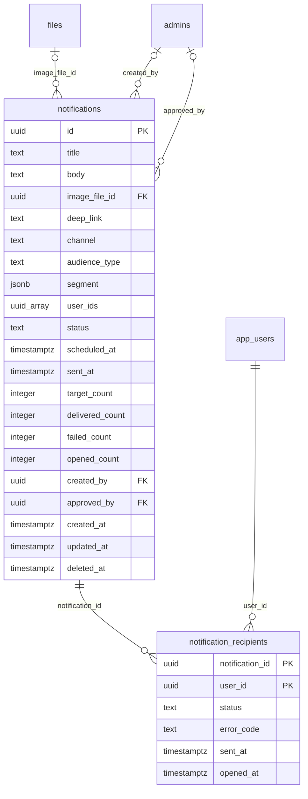

# Module 46 · Notification Management

> **Phase 15 · CMS** · **Depends on:** M0, M28, M31 · **Owns tables:** `notifications`, `notification_recipients` · **Reads:** `app_users`, `files`, `admins`, `cities`, `classes`, `subscriptions` · **Build estimate:** 4 days

## 1. Module Overview

Admin-created push and in-app inbox campaigns: to everyone, a role, a segment (city, class, subscription status, last active) or an uploaded user list. Admins compose with a live preview, see the audience size before sending, send now or schedule, and track delivered, failed and opened counts. Large audiences need a second admin's approval. Transactional notifications (lead received, demo reminder) are sent by services and are not managed here.

## 2. Business Purpose

Direct reach to users for announcements, exam-season campaigns, re-engagement and service messages — with guardrails, because a wrong push to 200,000 families cannot be recalled.

## 3. User Stories

- As **Operations Admin**, I want to notify parents of Class 10 children in Chennai about board-exam teachers so that the message is relevant.
- As **Operations Admin**, I want to see how many users will receive the push before sending so that I don't over-send.
- As **Super Admin**, I want campaigns to more than 50,000 users to need my approval so that mistakes are caught.
- As **Operations Admin**, I want open rates per campaign so that I can improve copy.

## 4. Functional Requirements & Business Logic

**FR-46.1 Lifecycle.** `draft` → (send) → `scheduled` (if `scheduled_at` > now) or `sending`; audiences > 50,000 go to an approval step first (draft stays `draft` with `approval_requested` in audit; approver with `notifications.approve_large` ≠ creator sets `approved_by`, then it proceeds). `sending` → `sent` (or `failed` if > 50 % failures). `scheduled` → `cancelled` any time before send.

**FR-46.2 Audience resolution (at send time).** SQL built from the segment JSON over `app_users` (+ joins to parents/students/teachers/institutes, parent_children for class, subscriptions for status); excludes users with notifications opted out, deleted/banned users; `target_count` stored. `user_list` accepts ≤ 10,000 ids or a CSV of phones (resolved to ids; unknown phones reported).

**FR-46.3 Sending.** BullMQ fan-out: insert `notification_recipients` in chunks of 1,000 (`queued`), send via FCM `sendEach` in batches of 500 with each user's device tokens; mark `sent` / `failed` (`error_code`) / `no_token`; remove `UNREGISTERED` tokens. Inbox channel writes the message into the user's inbox (served from `notification_recipients` joined to `notifications`). Rate: ≤ 2,000 messages/second. Quiet hours: pushes are not delivered 21:30–08:00 IST unless `urgent` (Super Admin only) — scheduled sends falling in quiet hours are moved to 08:00 with a warning.

**FR-46.4 Frequency cap.** A user receives at most 2 campaign pushes per 24 h (settings `notifications.daily_cap`); capped users get inbox only (`status = sent`, `error_code = CAPPED`).

**FR-46.5 Tracking.** App reports opens → `opened_at`, `opened_count`. Counters are updated by the worker with `UPDATE … SET delivered_count = delivered_count + $n`.

**FR-46.6 Test send.** `POST /notifications/:id/test { adminDeviceUserIds[] }` sends to up to 5 test accounts without changing state.

## 5. Validation Rules

| Field | Rule |
| --- | --- |
| title | 3–60 chars |
| body | 5–180 chars |
| imageFileId | public image 2:1, ≤ 300 KB |
| deepLink | registry route (same list as Module 44) |
| channel | push, inbox, push_and_inbox |
| audienceType | all, parents, students, teachers, institutes, segment, user_list |
| segment | allowed keys: cityIds, classIds, roles, subscriptionStatus, lastActiveWithinDays (1–365), inactiveForDays (1–365), hasChildren |
| userIds | ≤ 10,000 uuids |
| scheduledAt | > now + 5 min, ≤ now + 30 days |

## 6. API Endpoints

| Method | Path | Permission | Description |
| --- | --- | --- | --- |
| GET | /notifications | notifications.read | Campaigns |
| GET | /notifications/:id | notifications.read | Detail with stats |
| GET | /notifications/:id/recipients | notifications.read | Recipients (cursor) with status |
| POST | /notifications | notifications.send | Create draft |
| PATCH | /notifications/:id | notifications.send | Edit draft (If-Match) |
| POST | /notifications/audience-estimate | notifications.send | Count for a segment |
| POST | /notifications/:id/test | notifications.send | Test send |
| POST | /notifications/:id/send | notifications.send | Send now / schedule (Idempotency-Key) |
| POST | /notifications/:id/approve | notifications.approve_large | Approve a large campaign |
| POST | /notifications/:id/cancel | notifications.send | Cancel scheduled |
| DELETE | /notifications/:id | notifications.send | Delete draft |

## 7. Request Payloads

```json
// POST /notifications
{ "title": "Board exams in 90 days", "body": "Book a free demo with a verified Maths or Science teacher near you.", "channel": "push_and_inbox", "deepLink": "gc://search?classId=<class-10>",
  "audienceType": "segment", "segment": { "roles": ["parent"], "cityIds": ["<chennai>"], "classIds": ["<class-10>"], "lastActiveWithinDays": 60 } }

// POST /notifications/:id/send   (Idempotency-Key: …)
{ "scheduledAt": "2026-10-02T18:30:00+05:30" }
```

## 8. Response Payloads

```json
// 200 POST /notifications/audience-estimate
{ "data": { "count": 18240, "withPushToken": 16110, "cappedToday": 420, "requiresApproval": false } }

// 200 GET /notifications/:id
{ "data": { "id": "…", "title": "Board exams in 90 days", "status": "sent", "audienceType": "segment", "segmentSummary": "Parents · Chennai · Class 10 · active in 60 days",
  "targetCount": 18240, "deliveredCount": 15870, "failedCount": 240, "openedCount": 2310, "openRatePct": 14.6, "sentAt": "…", "createdBy": { "name": "…" }, "approvedBy": null } }
```

## 9. PostgreSQL Tables

### `notifications`

Push / in-app notification campaigns created by admins (transactional pushes are sent by services and not stored here).

```sql
CREATE TABLE notifications (
  id uuid PRIMARY KEY DEFAULT gen_random_uuid(), -- Primary key
  title text NOT NULL, -- Max 60 chars
  body text NOT NULL, -- Max 180 chars
  image_file_id uuid REFERENCES files(id) ON DELETE SET NULL, -- Optional rich image
  deep_link text, -- App route opened on tap
  channel text NOT NULL DEFAULT 'push_and_inbox' CHECK (channel IN ('push','inbox','push_and_inbox')), -- Delivery channel
  audience_type text NOT NULL CHECK (audience_type IN ('all','parents','students','teachers','institutes','segment','user_list')), -- Who receives it
  segment jsonb, -- Filters for audience_type = segment, e.g. {"city_ids":[…],"class_ids":[…],"subscription_status":["trial"]}
  user_ids uuid[], -- Explicit recipients for audience_type = user_list (max 10,000)
  status text NOT NULL DEFAULT 'draft' CHECK (status IN ('draft','scheduled','sending','sent','failed','cancelled')), -- Lifecycle
  scheduled_at timestamptz, -- Send time (NULL = send now)
  sent_at timestamptz, -- Finished sending
  target_count integer, -- Recipients resolved at send time
  delivered_count integer NOT NULL DEFAULT 0, -- FCM success count
  failed_count integer NOT NULL DEFAULT 0, -- FCM failures
  opened_count integer NOT NULL DEFAULT 0, -- Opens reported by the app
  created_by uuid REFERENCES admins(id), -- Creator
  approved_by uuid REFERENCES admins(id), -- Second admin approval for audiences over 50,000
  created_at timestamptz NOT NULL DEFAULT now(), -- Created
  updated_at timestamptz NOT NULL DEFAULT now(), -- Updated
  deleted_at timestamptz -- Soft delete (drafts only)
);
CREATE INDEX idx_notifications_status ON notifications (status, scheduled_at) WHERE deleted_at IS NULL;
CREATE TRIGGER trg_notifications_updated BEFORE UPDATE ON notifications FOR EACH ROW EXECUTE FUNCTION set_updated_at();
```

### `notification_recipients`

Per-user delivery record for a campaign. Partition by month at scale.

```sql
CREATE TABLE notification_recipients (
  notification_id uuid NOT NULL REFERENCES notifications(id) ON DELETE CASCADE, -- Campaign
  user_id uuid NOT NULL REFERENCES app_users(id) ON DELETE CASCADE, -- Recipient
  status text NOT NULL DEFAULT 'queued' CHECK (status IN ('queued','sent','failed','opened','no_token')), -- Delivery state
  error_code text, -- FCM error, e.g. UNREGISTERED
  sent_at timestamptz, -- Sent
  opened_at timestamptz, -- Opened
  PRIMARY KEY (notification_id, user_id)
);
CREATE INDEX idx_notification_recipients_user ON notification_recipients (user_id, sent_at DESC);
```

Migration file: `sql/migrations/046_m46_notification_management.sql`

## 10. Column Definitions

### `notifications`

| Column | Type | Null | Default | Constraints / References | Description |
| --- | --- | --- | --- | --- | --- |
| `id` | uuid | no | gen_random_uuid() | PK | Primary key |
| `title` | text | no | — | — | Max 60 chars |
| `body` | text | no | — | — | Max 180 chars |
| `image_file_id` | uuid | yes | — | FK → `files.id` (on delete set null) | Optional rich image |
| `deep_link` | text | yes | — | — | App route opened on tap |
| `channel` | text | no | 'push_and_inbox' | CHECK channel IN ('push','inbox','push_and_inbox') | Delivery channel |
| `audience_type` | text | no | — | CHECK audience_type IN ('all','parents','students','teachers','institutes','segment','user_list') | Who receives it |
| `segment` | jsonb | yes | — | — | Filters for audience_type = segment, e.g. {"city_ids":[…],"class_ids":[…],"subscription_status":["trial"]} |
| `user_ids` | uuid[] | yes | — | — | Explicit recipients for audience_type = user_list (max 10,000) |
| `status` | text | no | 'draft' | CHECK status IN ('draft','scheduled','sending','sent','failed','cancelled') | Lifecycle |
| `scheduled_at` | timestamptz | yes | — | — | Send time (NULL = send now) |
| `sent_at` | timestamptz | yes | — | — | Finished sending |
| `target_count` | integer | yes | — | — | Recipients resolved at send time |
| `delivered_count` | integer | no | 0 | — | FCM success count |
| `failed_count` | integer | no | 0 | — | FCM failures |
| `opened_count` | integer | no | 0 | — | Opens reported by the app |
| `created_by` | uuid | yes | — | FK → `admins.id` (on delete no action) | Creator |
| `approved_by` | uuid | yes | — | FK → `admins.id` (on delete no action) | Second admin approval for audiences over 50,000 |
| `created_at` | timestamptz | no | now() | — | Created |
| `updated_at` | timestamptz | no | now() | — | Updated |
| `deleted_at` | timestamptz | yes | — | — | Soft delete (drafts only) |

### `notification_recipients`

| Column | Type | Null | Default | Constraints / References | Description |
| --- | --- | --- | --- | --- | --- |
| `notification_id` | uuid | no | — | PK; FK → `notifications.id` (on delete cascade) | Campaign |
| `user_id` | uuid | no | — | PK; FK → `app_users.id` (on delete cascade) | Recipient |
| `status` | text | no | 'queued' | CHECK status IN ('queued','sent','failed','opened','no_token') | Delivery state |
| `error_code` | text | yes | — | — | FCM error, e.g. UNREGISTERED |
| `sent_at` | timestamptz | yes | — | — | Sent |
| `opened_at` | timestamptz | yes | — | — | Opened |

**Table constraints:** `PRIMARY KEY (notification_id, user_id)`

## 11. Relationships

**Outgoing foreign keys**

- `notifications.image_file_id` → `files.id` — optional, many-to-one, on delete **set null**
- `notifications.created_by` → `admins.id` — optional, many-to-one, on delete **no action**
- `notifications.approved_by` → `admins.id` — optional, many-to-one, on delete **no action**
- `notification_recipients.notification_id` → `notifications.id` — required, many-to-one, on delete **cascade**
- `notification_recipients.user_id` → `app_users.id` — required, many-to-one, on delete **cascade**

**Entity relationship diagram**



## 12. Indexing Strategy

| Index | Table | Kind | Definition |
| --- | --- | --- | --- |
| `idx_notifications_status` | `notifications` | btree | `(status, scheduled_at) WHERE deleted_at IS NULL` |
| `idx_notification_recipients_user` | `notification_recipients` | btree | `(user_id, sent_at DESC)` |

`idx_notifications_status (status, scheduled_at)` drives the scheduler; `notification_recipients` PK `(notification_id, user_id)` guarantees one delivery per user and serves the recipients list; `idx_notification_recipients_user (user_id, sent_at DESC)` serves the app inbox and the frequency cap. Partition `notification_recipients` by month (range on `sent_at`) once it passes ~50M rows; drop partitions older than 12 months.

## 13. Permissions

| Permission key | Allows | Sensitive | Super | Ops | Verif. | Finance | Support |
| --- | --- | --- | --- | --- | --- | --- | --- |
| `notifications.read` | View notification campaigns | — | ✓ | ✓ | — | — | ✓ |
| `notifications.send` | Create and send / schedule notifications | yes | ✓ | ✓ | — | — | — |
| `notifications.approve_large` | Approve campaigns to more than 50,000 users | yes | ✓ | — | — | — | — |

## 14. UI Screens & React Page Structure

| Route | Page | Content |
| --- | --- | --- |
| `/cms/notifications` | NotificationsPage | Table (title, audience, status, target, delivered, open rate, date) · "New notification" |
| `/cms/notifications/new`, `/:id` | NotificationComposerPage | Steps: Message → Audience (segment builder with live estimate) → Schedule → Review; phone preview (Android/iOS lock-screen style) |
| `/cms/notifications/:id/report` | NotificationReportPage | Funnel (targeted → delivered → opened), failures by error code, recipients list |

```
src/features/cms/notifications/
  pages/NotificationsPage.tsx, NotificationComposerPage.tsx, NotificationReportPage.tsx
  components/SegmentBuilder.tsx, AudienceEstimate.tsx, PushPreview.tsx, SchedulePicker.tsx, ApprovalBanner.tsx, DeliveryFunnel.tsx
```

## 15. UI Components

- `SegmentBuilder` — chips for roles, city and class multi-selects, subscription status, activity sliders; debounced estimate call.
- `AudienceEstimate` — count, with-token count, "needs approval" warning above 50,000.
- `PushPreview` — truncates like real devices (title 1 line, body 2 lines).

## 16. Filters

Status, audience type, created by, date range.

## 17. Search Capabilities

Title and body (ILIKE contains).

## 18. Pagination Requirements

Campaigns: offset, default 20, sort createdAt desc. Recipients: cursor pagination (`limit` 50–200) filtered by status.

## 19. Audit Logs

| Event | Details |
| --- | --- |
| `notification.created` / `notification.updated` | fields |
| `notification.test_sent` | test user ids |
| `notification.sent` / `notification.scheduled` | target count, scheduledAt |
| `notification.approval_requested` / `notification.approved` | target count |
| `notification.cancelled` / `notification.deleted` | — |

## 20. Error Scenarios

| Scenario | HTTP | Code | Message |
| --- | --- | --- | --- |
| Large audience without approval | 409 | CONFLICT_STATE | "Campaigns over 50,000 users need approval from another admin." |
| Creator approves own campaign | 403 | FORBIDDEN | "Another admin must approve this campaign." |
| Edit after sending | 409 | CONFLICT_STATE | "Sent campaigns can't be edited." |
| Empty audience | 422 | VALIDATION_FAILED | "No users match this audience." |
| FCM unavailable | 502 | GATEWAY_ERROR | "Push service unavailable; the campaign will retry automatically." |

## 21. Future Scalability Notes & Enhancements

SMS and WhatsApp (Business API) channels with template approval; per-user send-time optimisation; campaign A/B tests; event-triggered journeys (e.g. trial ending).

## 22. Security Considerations

Phone-list uploads are processed in memory and not stored; `notifications.send` is sensitive; large sends require a second admin; quiet hours respect users.
