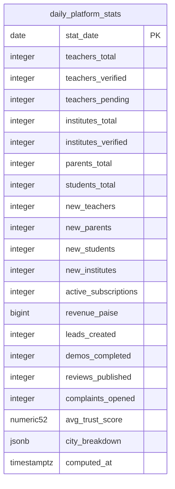

# Module 47 · Dashboard Analytics

> **Phase 16 · Reporting** · **Depends on:** M16–M46 (reads their tables) · **Owns tables:** `daily_platform_stats` · **Reads:** `teachers`, `institutes`, `parents`, `students`, `subscriptions`, `transactions`, `leads`, `demo_requests`, `teacher_reviews`, `complaints`, `trust_scores` · **Build estimate:** 4 days

## 1. Module Overview

The admin home: KPI cards (teachers, verified teachers, pending approvals, institutes, parents, students, active subscriptions, revenue, average trust score), trend charts, a city breakdown, and action queues (pending approvals, flagged reviews, SLA-breaching complaints, held refunds). Historical numbers come from `daily_platform_stats`, written by a nightly job and refreshed hourly for today, so the dashboard loads fast regardless of data size.

## 2. Business Purpose

Gives leadership and each admin role an at-a-glance picture of platform health and — more usefully — tells each admin what needs their attention now.

## 3. User Stories

- As **Super Admin**, I want revenue, sign-ups and active subscriptions for the last 30 days compared to the previous 30 so that I can see momentum.
- As **Verification Admin**, I want my pending queue counts on the home page so that I start where I'm needed.
- As **Operations Admin**, I want a city breakdown of parents, students and teachers so that I can find supply gaps.

## 4. Functional Requirements & Business Logic

**FR-47.1 Stats job.** Nightly at 00:30 IST computes the previous day's row (`ON CONFLICT (stat_date) DO UPDATE`); hourly recomputes today. Totals are end-of-day snapshots; `new_*` are counts created that day (IST); `revenue_paise` = captured − refunded processed that day; `city_breakdown` per city id. Backfill command `npm run stats:backfill -- --from=2026-01-01`.

**FR-47.2 KPIs.** `GET /dashboard/summary?range=7d|30d|90d|custom` returns each KPI's current value, value at range start, delta %, and a sparkline series from `daily_platform_stats`. Pending counts (teachers, institutes, documents, reviews, complaints, refunds) are live queries (cheap, indexed partial queues).

**FR-47.3 Role-aware widgets.** The API returns only widgets the admin's permissions allow (e.g. revenue requires `reports.revenue`; queues require the related read permission). The UI renders what it receives.

**FR-47.4 Charts.** Sign-ups by role (stacked area), revenue (bar, by purpose from `transactions` for ≤ 90 days), leads → demos → conversions funnel, trust score distribution (from Module 36), city table.

**FR-47.5 Caching.** Responses cached in Redis 5 min per (range, permission set hash); a "Refresh" button bypasses cache (rate-limited 1/min per admin).

**FR-47.6 Timezone.** All day boundaries in Asia/Kolkata.

## 5. Validation Rules

| Field | Rule |
| --- | --- |
| range | 7d, 30d, 90d, 12m or custom |
| from / to | required for custom; ≤ 366 days; to ≤ today |
| cityId | active city (optional filter for city-scoped widgets) |

## 6. API Endpoints

| Method | Path | Permission | Description |
| --- | --- | --- | --- |
| GET | /dashboard/summary | dashboard.read | KPI cards with deltas and sparklines |
| GET | /dashboard/queues | dashboard.read | Pending work counts per queue (permission-filtered) |
| GET | /dashboard/charts/signups | dashboard.read | Sign-ups by role per day |
| GET | /dashboard/charts/revenue | reports.revenue | Revenue per day by purpose |
| GET | /dashboard/charts/funnel | dashboard.read | Leads → demos → conversions |
| GET | /dashboard/cities | dashboard.read | City breakdown table |
| POST | /dashboard/refresh | dashboard.read | Bypass cache (rate-limited) |

## 7. Request Payloads

```json
// GET /dashboard/summary?range=30d
// GET /dashboard/cities?range=30d&sort=parents:desc
```

## 8. Response Payloads

```json
// 200 GET /dashboard/summary?range=30d
{ "data": { "range": { "from": "2026-08-28", "to": "2026-09-26" }, "kpis": [
  { "key": "teachers_total", "label": "Total teachers", "value": 12480, "previous": 11210, "deltaPct": 11.3, "series": [11210, 11260, …] },
  { "key": "teachers_verified", "label": "Verified teachers", "value": 9812, "previous": 8950, "deltaPct": 9.6, "series": […] },
  { "key": "revenue_paise", "label": "Revenue (30 days)", "value": 184230000, "previous": 162110000, "deltaPct": 13.6, "series": […] },
  { "key": "avg_trust_score", "label": "Average trust score", "value": 78.4, "previous": 77.9, "deltaPct": 0.6, "series": […] } ],
  "computedAt": "2026-09-26T09:00:12+05:30" } }

// 200 GET /dashboard/queues
{ "data": { "teachersPending": 146, "institutesPending": 12, "documentsPending": 88, "reviewsPending": 57, "reviewFlagsOpen": 9, "complaintsOpen": 31, "complaintsBreached": 3, "refundsRequested": 4 } }
```

## 9. PostgreSQL Tables

### `daily_platform_stats`

One row per day with platform totals, written by the nightly analytics job and refreshed hourly for today.

```sql
CREATE TABLE daily_platform_stats (
  stat_date date PRIMARY KEY, -- Day (Asia/Kolkata)
  teachers_total integer NOT NULL DEFAULT 0, -- Teachers (not deleted) at end of day
  teachers_verified integer NOT NULL DEFAULT 0, -- Approved teachers
  teachers_pending integer NOT NULL DEFAULT 0, -- In the approval queue
  institutes_total integer NOT NULL DEFAULT 0, -- Institutes
  institutes_verified integer NOT NULL DEFAULT 0, -- Approved institutes
  parents_total integer NOT NULL DEFAULT 0, -- Parents
  students_total integer NOT NULL DEFAULT 0, -- Students
  new_teachers integer NOT NULL DEFAULT 0, -- Sign-ups that day
  new_parents integer NOT NULL DEFAULT 0, -- Sign-ups that day
  new_students integer NOT NULL DEFAULT 0, -- Sign-ups that day
  new_institutes integer NOT NULL DEFAULT 0, -- Sign-ups that day
  active_subscriptions integer NOT NULL DEFAULT 0, -- Trial + active + grace at end of day
  revenue_paise bigint NOT NULL DEFAULT 0, -- Captured minus refunded that day
  leads_created integer NOT NULL DEFAULT 0, -- Leads that day
  demos_completed integer NOT NULL DEFAULT 0, -- Demos completed
  reviews_published integer NOT NULL DEFAULT 0, -- Reviews published
  complaints_opened integer NOT NULL DEFAULT 0, -- Complaints opened
  avg_trust_score numeric(5,2), -- Average over approved teachers
  city_breakdown jsonb NOT NULL DEFAULT '{}'::jsonb, -- {"<city_id>":{"parents":…,"students":…,"teachers":…}}
  computed_at timestamptz NOT NULL DEFAULT now() -- Last computed
);

```

Migration file: `sql/migrations/047_m47_dashboard_analytics.sql`

## 10. Column Definitions

### `daily_platform_stats`

| Column | Type | Null | Default | Constraints / References | Description |
| --- | --- | --- | --- | --- | --- |
| `stat_date` | date | no | — | PK | Day (Asia/Kolkata) |
| `teachers_total` | integer | no | 0 | — | Teachers (not deleted) at end of day |
| `teachers_verified` | integer | no | 0 | — | Approved teachers |
| `teachers_pending` | integer | no | 0 | — | In the approval queue |
| `institutes_total` | integer | no | 0 | — | Institutes |
| `institutes_verified` | integer | no | 0 | — | Approved institutes |
| `parents_total` | integer | no | 0 | — | Parents |
| `students_total` | integer | no | 0 | — | Students |
| `new_teachers` | integer | no | 0 | — | Sign-ups that day |
| `new_parents` | integer | no | 0 | — | Sign-ups that day |
| `new_students` | integer | no | 0 | — | Sign-ups that day |
| `new_institutes` | integer | no | 0 | — | Sign-ups that day |
| `active_subscriptions` | integer | no | 0 | — | Trial + active + grace at end of day |
| `revenue_paise` | bigint | no | 0 | — | Captured minus refunded that day |
| `leads_created` | integer | no | 0 | — | Leads that day |
| `demos_completed` | integer | no | 0 | — | Demos completed |
| `reviews_published` | integer | no | 0 | — | Reviews published |
| `complaints_opened` | integer | no | 0 | — | Complaints opened |
| `avg_trust_score` | numeric(5,2) | yes | — | — | Average over approved teachers |
| `city_breakdown` | jsonb | no | '{}'::jsonb | — | {"<city_id>":{"parents":…,"students":…,"teachers":…}} |
| `computed_at` | timestamptz | no | now() | — | Last computed |

## 11. Relationships


**Entity relationship diagram**


No relationships of its own.

## 12. Indexing Strategy


`daily_platform_stats` PK on `stat_date` makes range reads a single index scan. Live queue counts rely on the partial queue indexes defined by each module (e.g. `idx_teachers_queue`, `idx_complaints_queue`, `idx_refunds_status`).

## 13. Permissions

| Permission key | Allows | Sensitive | Super | Ops | Verif. | Finance | Support |
| --- | --- | --- | --- | --- | --- | --- | --- |
| `dashboard.read` | View the analytics dashboard | — | ✓ | ✓ | ✓ | ✓ | ✓ |

## 14. UI Screens & React Page Structure

| Route | Page | Content |
| --- | --- | --- |
| `/` | DashboardPage | Range picker · KPI grid · "Needs attention" queue cards (link to each queue) · charts row · city table |

```
src/features/dashboard/
  pages/DashboardPage.tsx
  components/KpiCard.tsx, Sparkline.tsx, QueueCard.tsx, SignupsChart.tsx, RevenueChart.tsx, FunnelChart.tsx, CityTable.tsx, RangePicker.tsx
```

## 15. UI Components

- `KpiCard` — label, big number (Indian grouping; money as ₹ lakh/crore short form with full value in tooltip), delta chip (up/down arrow + %, colour + sign), sparkline.
- `QueueCard` — count, label, "Open queue" link; red accent when SLA breaches exist.
- Charts use Recharts with accessible tables as a toggle ("View as table").

## 16. Filters

Range (7d/30d/90d/12m/custom), city (for city-scoped widgets).

## 17. Search Capabilities

Not applicable.

## 18. Pagination Requirements

City table: client-side sorting, top 50 cities with "Show all". Other endpoints are aggregates.

## 19. Audit Logs

Read-only; no audit events. `dashboard/refresh` is rate-limited and logged at info level (not audit).

## 20. Error Scenarios

| Scenario | HTTP | Code | Message |
| --- | --- | --- | --- |
| Custom range > 366 days | 422 | VALIDATION_FAILED | "Pick a range of up to one year." |
| Refresh too often | 429 | RATE_LIMITED | "Dashboard was refreshed a moment ago." |
| Stats not computed for a day | 200 | — | Missing days returned as `null` in series; banner "Stats for {date} are being computed." |

## 21. Future Scalability Notes & Enhancements

Move analytics to a read replica, then to a columnar store (ClickHouse/BigQuery) fed by CDC; cohort retention charts; configurable dashboards per role; alerting on KPI drops.

## 22. Security Considerations

Widget-level permission filtering on the server; revenue never returned without `reports.revenue`.
