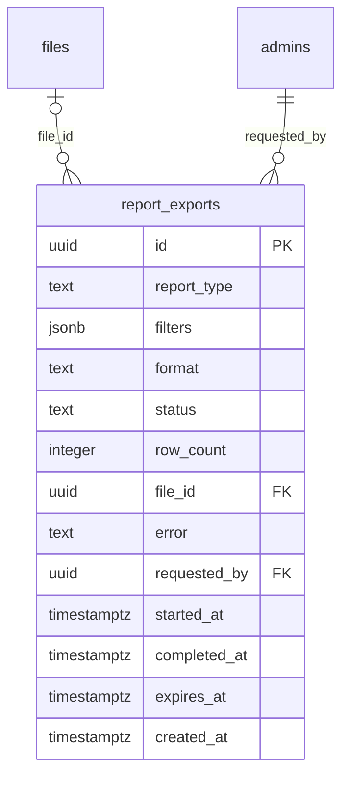

# Module 48 · Revenue Reports

> **Phase 16 · Reporting** · **Depends on:** M40, M41 (report_exports is shared by M49 and M50) · **Owns tables:** `report_exports` · **Reads:** `transactions`, `refunds`, `subscriptions`, `payment_configurations`, `files`, `admins` · **Build estimate:** 3 days

## 1. Module Overview

Finance-grade revenue reporting: gross, refunds and net revenue by day/week/month, by purpose and fee code, by payer type and city; GST summary for filing; subscription MRR and renewals; and a transaction-level ledger export. Also owns the shared asynchronous export system (`report_exports`) used by every report module.

## 2. Business Purpose

Finance needs numbers that tie out to Razorpay settlements and GST returns, exportable for the accountant, without running SQL against production.

## 3. User Stories

- As **Finance Admin**, I want monthly net revenue by fee code so that I can see which products earn.
- As **Finance Admin**, I want a GST summary (taxable value, GST collected, credit notes) by month and state so that I can file GSTR-1/3B.
- As **Finance Admin**, I want to export a month's ledger to Excel so that the accountant can reconcile.

## 4. Functional Requirements & Business Logic

**FR-48.1 Definitions.** Gross = sum of `amount_paise` of transactions captured in the period (direction credit). Refunds = sum of processed refunds in the period (by `processed_at`). Net = Gross − Refunds. Taxable value = base amounts; GST = `gst_paise`; referral payouts (debit) are reported separately as marketing cost, never subtracted from revenue. All grouping by IST date.

**FR-48.2 Reports.**

| Report | Endpoint | Grouping |
| --- | --- | --- |
| Revenue overview | `/reports/revenue/overview` | granularity day/week/month; series gross, refunds, net; totals and period-over-period |
| By product | `/reports/revenue/by-product` | fee code and purpose; count, gross, refunds, net, average price |
| By segment | `/reports/revenue/by-segment` | payer type, city, state |
| GST summary | `/reports/revenue/gst` | month × place-of-supply state: taxable value, CGST/SGST (intra-state, Karnataka) or IGST, credit notes |
| Subscriptions | `/reports/revenue/subscriptions` | MRR trend, new/renewed/churned subscriptions, ARPU |
| Ledger | `/reports/revenue/ledger` | transaction-level rows (paginated) |

**FR-48.3 Exports (shared by M48–M50).** `POST /report-exports { reportType, filters, format }` → `queued`; BullMQ worker streams rows from a read-only connection with a server-side cursor (`pg-query-stream`) to CSV or XLSX (`exceljs` streaming writer), uploads to the private bucket, sets `completed`, `row_count`, `file_id`, `expires_at = now + 7 days`, notifies the requester in-app. Max 1,000,000 rows; max 3 concurrent exports per admin. Download via `GET /report-exports/:id/download` (presigned 60 s). Cleanup job deletes expired files and sets `expired`.

**FR-48.4 Consistency.** Reports read from the primary until a read replica exists; each response includes `asOf` time. Money totals are computed in SQL (`sum(bigint)`), never in JS floats.

## 5. Validation Rules

| Field | Rule |
| --- | --- |
| from / to | required; `to` ≥ `from`; ≤ 366 days (ledger ≤ 92 days on screen, any range ≤ 366 days for export) |
| granularity | day (≤ 92 days), week, month |
| feeCode / purpose / payerType / cityId / stateId | valid values |
| export.reportType | allowed for the requester's permissions (revenue types need `reports.revenue`) |
| export.format | csv or xlsx |

## 6. API Endpoints

| Method | Path | Permission | Description |
| --- | --- | --- | --- |
| GET | /reports/revenue/overview | reports.revenue | Series and totals |
| GET | /reports/revenue/by-product | reports.revenue | By fee code / purpose |
| GET | /reports/revenue/by-segment | reports.revenue | By payer type, city, state |
| GET | /reports/revenue/gst | reports.revenue | GST summary |
| GET | /reports/revenue/subscriptions | reports.revenue | MRR, new, renewed, churned |
| GET | /reports/revenue/ledger | reports.revenue | Transaction-level rows |
| POST | /report-exports | reports.revenue, reports.teachers or reports.institutes (per type) | Request an export |
| GET | /report-exports | any reports.* | My exports (all exports for Super Admin) |
| GET | /report-exports/:id | any reports.* | Export status |
| GET | /report-exports/:id/download | any reports.* | Presigned download URL |

## 7. Request Payloads

```json
// GET /reports/revenue/overview?from=2026-04-01&to=2026-09-30&granularity=month

// POST /report-exports
{ "reportType": "revenue", "format": "xlsx", "filters": { "from": "2026-09-01", "to": "2026-09-30", "granularity": "day" } }
```

## 8. Response Payloads

```json
// 200 GET /reports/revenue/overview
{ "data": { "series": [ { "period": "2026-04", "grossPaise": 121430000, "refundsPaise": 2140000, "netPaise": 119290000, "transactions": 3120 } ],
  "totals": { "grossPaise": 842310000, "refundsPaise": 13420000, "netPaise": 828890000, "referralPayoutsPaise": 7420000 }, "previousPeriod": { "netPaise": 611200000, "deltaPct": 35.6 },
  "asOf": "2026-09-26T10:02:00+05:30" } }

// 202 POST /report-exports
{ "data": { "id": "…", "status": "queued", "reportType": "revenue", "format": "xlsx" } }
```

## 9. PostgreSQL Tables

### `report_exports`

Asynchronous CSV/XLSX exports for all report modules. Files expire after 7 days.

```sql
CREATE TABLE report_exports (
  id uuid PRIMARY KEY DEFAULT gen_random_uuid(), -- Primary key
  report_type text NOT NULL CHECK (report_type IN ('revenue','transactions','subscriptions','teachers','teacher_performance','institutes','institute_ratings','leads','reviews','complaints','referrals','audit_logs')), -- Which report
  filters jsonb NOT NULL DEFAULT '{}'::jsonb, -- Filters used, e.g. {"from":"2026-09-01","to":"2026-09-30","city_id":"…"}
  format text NOT NULL DEFAULT 'csv' CHECK (format IN ('csv','xlsx')), -- Output format
  status text NOT NULL DEFAULT 'queued' CHECK (status IN ('queued','running','completed','failed','expired')), -- Job state
  row_count integer, -- Rows written
  file_id uuid REFERENCES files(id) ON DELETE SET NULL, -- Output file (private)
  error text, -- Failure reason
  requested_by uuid NOT NULL REFERENCES admins(id), -- Requester
  started_at timestamptz, -- Job start
  completed_at timestamptz, -- Job end
  expires_at timestamptz, -- Download link expiry
  created_at timestamptz NOT NULL DEFAULT now() -- Requested
);
CREATE INDEX idx_report_exports_requester ON report_exports (requested_by, created_at DESC);
CREATE INDEX idx_report_exports_status ON report_exports (status, created_at);
```

Migration file: `sql/migrations/048_m48_revenue_reports.sql`

## 10. Column Definitions

### `report_exports`

| Column | Type | Null | Default | Constraints / References | Description |
| --- | --- | --- | --- | --- | --- |
| `id` | uuid | no | gen_random_uuid() | PK | Primary key |
| `report_type` | text | no | — | CHECK report_type IN ('revenue','transactions','subscriptions','teachers','teacher_performance','institutes','institute_ratings','leads','reviews','complaints','referrals','audit_logs') | Which report |
| `filters` | jsonb | no | '{}'::jsonb | — | Filters used, e.g. {"from":"2026-09-01","to":"2026-09-30","city_id":"…"} |
| `format` | text | no | 'csv' | CHECK format IN ('csv','xlsx') | Output format |
| `status` | text | no | 'queued' | CHECK status IN ('queued','running','completed','failed','expired') | Job state |
| `row_count` | integer | yes | — | — | Rows written |
| `file_id` | uuid | yes | — | FK → `files.id` (on delete set null) | Output file (private) |
| `error` | text | yes | — | — | Failure reason |
| `requested_by` | uuid | no | — | FK → `admins.id` (on delete no action) | Requester |
| `started_at` | timestamptz | yes | — | — | Job start |
| `completed_at` | timestamptz | yes | — | — | Job end |
| `expires_at` | timestamptz | yes | — | — | Download link expiry |
| `created_at` | timestamptz | no | now() | — | Requested |

## 11. Relationships

**Outgoing foreign keys**

- `report_exports.file_id` → `files.id` — optional, many-to-one, on delete **set null**
- `report_exports.requested_by` → `admins.id` — required, many-to-one, on delete **no action**

**Entity relationship diagram**



## 12. Indexing Strategy

| Index | Table | Kind | Definition |
| --- | --- | --- | --- |
| `idx_report_exports_requester` | `report_exports` | btree | `(requested_by, created_at DESC)` |
| `idx_report_exports_status` | `report_exports` | btree | `(status, created_at)` |

`idx_transactions_purpose_captured (purpose, captured_at)` partial on captured statuses powers all revenue aggregations; `idx_refunds_status` + `processed_at` range for refunds; `idx_report_exports_requester` for "My exports"; `idx_report_exports_status` for the worker and cleanup. Add a materialised view `mv_revenue_daily (day, fee_code, payer_type, city_id, gross, refunds, count)` refreshed hourly when transactions exceed ~5M rows.

## 13. Permissions

| Permission key | Allows | Sensitive | Super | Ops | Verif. | Finance | Support |
| --- | --- | --- | --- | --- | --- | --- | --- |
| `reports.revenue` | View and export revenue reports | yes | ✓ | — | — | ✓ | — |

## 14. UI Screens & React Page Structure

| Route | Page | Content |
| --- | --- | --- |
| `/reports/revenue` | RevenueReportsPage | Tabs Overview · Products · Segments · GST · Subscriptions · Ledger; shared date range + granularity; export button per tab |
| `/reports/exports` | ExportsPage | My exports with status, size, expiry, download (shared by M49/M50) |

```
src/features/reports/
  pages/RevenueReportsPage.tsx, ExportsPage.tsx
  components/ReportFilters.tsx, RevenueChart.tsx, ProductTable.tsx, GstTable.tsx, LedgerTable.tsx, ExportButton.tsx, ExportStatusToast.tsx
```

## 15. UI Components

- `ExportButton` — opens a small dialog (format, confirm filters), posts the export, shows progress toast; the toast links to Exports when done.
- `GstTable` — month rows, state columns collapsible; CGST/SGST vs IGST split.

## 16. Filters

Date range, granularity, fee code, purpose, payer type, city, state, payment method.

## 17. Search Capabilities

Ledger tab only: transaction code, invoice number, gateway payment id.

## 18. Pagination Requirements

Aggregates return all groups (bounded by the range). Ledger: offset, default 50, max 100, sort capturedAt desc. Exports list: offset, default 20.

## 19. Audit Logs

| Event | Details |
| --- | --- |
| `report_export.requested` | report type, filters, format |
| `report_export.downloaded` | export id (every download is logged — exports contain financial and personal data) |

## 20. Error Scenarios

| Scenario | HTTP | Code | Message |
| --- | --- | --- | --- |
| Range too long | 422 | VALIDATION_FAILED | "Pick a range of up to one year." |
| Too many running exports | 429 | RATE_LIMITED | "You have 3 exports running. Try again when one finishes." |
| Export exceeds 1,000,000 rows | 422 | VALIDATION_FAILED | "This export is too large. Narrow the date range." |
| Download after expiry | 410 | AUTH_LINK_EXPIRED | "This export has expired. Request it again." |

## 21. Future Scalability Notes & Enhancements

Scheduled email reports (monthly finance pack); Tally/Zoho Books export format; read replica and materialised views; revenue forecasting from renewals due.

## 22. Security Considerations

`reports.revenue` is sensitive. Exports are private files with 60-second presigned links; personal data columns (phone, email) included only if the requester also has `users.pii`, otherwise masked.
